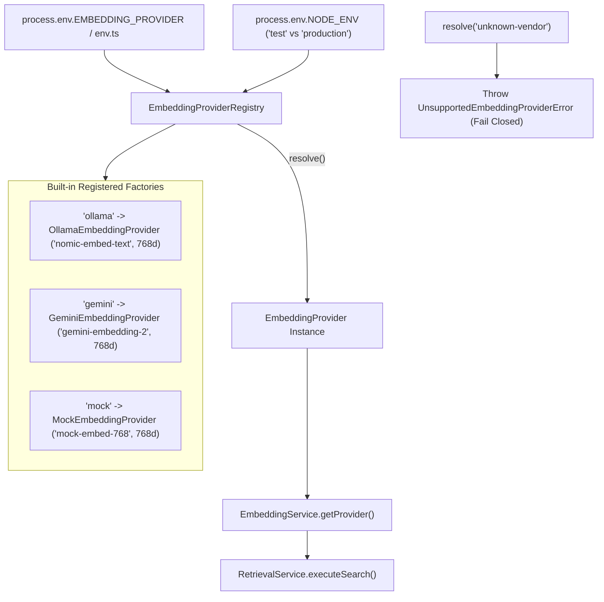

# MindVault — Phase 1B.4.3 Implementation Report
## Embedding Provider Registry Architecture (Stage 14.3)

**Execution Date:** 2026-11-19  
**Execution Mode:** CONTROLLED IMPLEMENTATION — STAGE 14.3 ONLY  
**Repository:** `c:/Users/mohit/OneDrive/Desktop/MindVault`  
**Branch:** `main`  
**Baseline Git HEAD:** `ea8a3155303220f90ae7a244c04c0a9ff467ed7f`  
**Approved Blueprint:** `PHASE_1B_4_MIXED_MODEL_QUERY_SAFETY_BLUEPRINT.md`  
**Accepted Previous Stages:**
- Phase 1B.4.1 — Database Layer Model-Aware Vector Retrieval — PASS (`PHASE_1B_4_1_INDEPENDENT_AUDIT.md`)
- Phase 1B.4.2 — Retrieval Service Integration & Mixed-Model Query Safety — PASS (`PHASE_1B_4_2_INDEPENDENT_AUDIT.md`)  
**Deliverable File:** `PHASE_1B_4_3_IMPLEMENTATION_REPORT.md`  
**Final Status:** `PHASE 1B.4.3 IMPLEMENTATION COMPLETE — READY FOR INDEPENDENT AUDIT`

---

## 1. Stage Authorization & Boundaries

Phase 1B.4.3 authorizes implementation of **Stage 14.3 ONLY** from the approved Mixed-Model Query Safety Blueprint (`PHASE_1B_4_MIXED_MODEL_QUERY_SAFETY_BLUEPRINT.md` §14.3).

### Authorized Responsibilities:
- Design and implement a centralized, deterministic `EmbeddingProviderRegistry` managing registration, introspection, and resolution of `EmbeddingProvider` implementations.
- Support canonical provider identities: `'ollama'`, `'gemini'`, `'mock'`.
- Provide fail-closed resolution for unsupported, unknown, or malformed provider requests.
- Provide duplicate-registration overwrite protection (`override: true` requirement).
- Integrate `EmbeddingService` in `apps/api` with `EmbeddingProviderRegistry` while preserving existing public method contracts (`getModelName()`, `generateQueryVector()`, `generateQueryVectorWithModel()`, `setProvider()`, `resetProvider()`).
- Add `EMBEDDING_PROVIDER: z.enum(['ollama', 'gemini', 'mock']).default('ollama')` in `apps/api/src/config/env.ts`.
- Wire up `EmbeddingService.validateCompatibility()` to the authoritative `EmbeddingModelPolicy.isDocumentCompatible()`.
- Add comprehensive, deterministic unit and contract tests for the registry architecture.

### Explicitly Excluded Responsibilities (Enforced):
- **Stage 14.4 NOT implemented:** Zero modifications to worker ingestion registration (`apps/worker/src/modules/ingestion/embeddings/index.ts`).
- **No Production Provider Switch:** Ollama (`nomic-embed-text`) remains the 100% production default.
- **No Gemini Activation in Production:** Gemini is not set as default; Gemini cannot be activated without explicit administrative configuration.
- **No Bulk Re-Embedding:** Zero worker re-embedding jobs or background migration tasks.
- **No Schema Changes / Migrations:** Zero DDL statements, zero Prisma migrations.
- **No GraphRAG Modifications:** Graph retrieval architecture remains untouched.
- **No Git History Operations:** Zero commits, zero pushes, zero rebases, zero stashes.

---

## 2. Preflight Verification

Prior to modifying code, baseline invariants were verified:
- **Repository Root:** `c:/Users/mohit/OneDrive/Desktop/MindVault`
- **Active Branch:** `main`
- **Confirmed Baseline Git HEAD:** `ea8a3155303220f90ae7a244c04c0a9ff467ed7f`
- **Working-Tree Status:** Working-tree status checked. Staged changes: None. Pre-existing unstaged Phase 1B changes preserved intact without modification.
- **Documents Reviewed:**
  - `PHASE_1B_4_MIXED_MODEL_QUERY_SAFETY_BLUEPRINT.md` (§14.3)
  - `PHASE_1B_4_1_IMPLEMENTATION_REPORT.md` & `PHASE_1B_4_1_INDEPENDENT_AUDIT.md`
  - `PHASE_1B_4_2_IMPLEMENTATION_REPORT.md` & `PHASE_1B_4_2_INDEPENDENT_AUDIT.md`

---

## 3. Blueprint Scope Interpretation

In `PHASE_1B_4_MIXED_MODEL_QUERY_SAFETY_BLUEPRINT.md` §14.3:
- **Scope:** Update `EmbeddingService` (`apps/api/src/modules/retrieval/embeddings/embedding.service.ts`) to support selecting between Ollama, Gemini, and Mock providers based on environment configuration (`EMBEDDING_PROVIDER`), while preserving Ollama as the default.
- **Files Expected to Change:**
  - `apps/api/src/modules/retrieval/embeddings/embedding.service.ts`
  - `apps/api/src/config/env.ts`
- **Tests Required:** Unit tests verifying provider instantiation based on `EMBEDDING_PROVIDER`, and wiring `validateCompatibility` to active provider metadata.
- **Acceptance Criteria:** `EMBEDDING_PROVIDER=gemini` initializes `GeminiEmbeddingProvider`; unset or `ollama` initializes `OllamaEmbeddingProvider`. In test mode (`NODE_ENV === 'test'`), defaults to `MockEmbeddingProvider`.

---

## 4. Architecture Inspected

The following existing components were audited before authoring the registry:
1. `EmbeddingProvider` interface ([`packages/shared/src/types.ts`](file:///c:/Users/mohit/OneDrive/Desktop/MindVault/packages/shared/src/types.ts)): Mandates `modelName: string`, `dimension: number`, `generateEmbedding(text)`, and `generateEmbeddings(texts)`.
2. `GeminiEmbeddingProvider` ([`packages/shared/src/gemini/gemini-embedding.provider.ts`](file:///c:/Users/mohit/OneDrive/Desktop/MindVault/packages/shared/src/gemini/gemini-embedding.provider.ts)): Official `@google/genai` provider with strict 768-D enforcement and `gemini-embedding-2` model identity.
3. `OllamaEmbeddingProvider` ([`apps/api/src/modules/retrieval/embeddings/embedding.service.ts`](file:///c:/Users/mohit/OneDrive/Desktop/MindVault/apps/api/src/modules/retrieval/embeddings/embedding.service.ts)): Local Ollama client defaulting to `nomic-embed-text` with 768-D validation.
4. `MockEmbeddingProvider` ([`apps/api/src/modules/retrieval/embeddings/embedding.service.ts`](file:///c:/Users/mohit/OneDrive/Desktop/MindVault/apps/api/src/modules/retrieval/embeddings/embedding.service.ts)): Deterministic SHA-256 unit-vector mock generator for tests.
5. `ExtractionProviderFactory` ([`apps/api/src/modules/graph/providers/provider.factory.ts`](file:///c:/Users/mohit/OneDrive/Desktop/MindVault/apps/api/src/modules/graph/providers/provider.factory.ts)): Inspected existing factory patterns in the codebase.
6. `apps/api/src/config/env.ts`: Inspected Zod environment schema.

---

## 5. Registry Design & Implementation

A dedicated, decoupled registry module was authored in [`apps/api/src/modules/retrieval/embeddings/embedding-provider.registry.ts`](file:///c:/Users/mohit/OneDrive/Desktop/MindVault/apps/api/src/modules/retrieval/embeddings/embedding-provider.registry.ts).

### 5.1 Architecture Overview



### 5.2 Error Hierarchy
- `EmbeddingRegistryError`: Base exception for registry operations.
- `UnsupportedEmbeddingProviderError`: Thrown when an unapproved or unknown provider identifier is resolved. Lists all approved registered providers.
- `DuplicateEmbeddingProviderError`: Thrown when registering an already registered provider ID without `override: true`.
- `InvalidEmbeddingProviderError`: Thrown on malformed factories, empty IDs, or invalid instances.

### 5.3 Registry Methods & API
- `register(id: string, factory: EmbeddingProviderFactory, options?: ProviderRegistrationOptions): void`
  - Validates ID (non-empty string, normalized via `.trim().toLowerCase()`).
  - Validates factory is an executable function.
  - Rejects duplicate registrations unless `options.override === true`.
  - Stores metadata descriptor.
- `unregister(id: string): boolean`
  - Safely removes a registered provider.
- `has(id: string): boolean`
  - Case-insensitive membership check.
- `getRegisteredIds(): string[]`
  - Returns sorted list of all active registered identifiers.
- `getDescriptor(id: string): EmbeddingProviderDescriptor | undefined`
  - Introspection method returning metadata (`id`, `providerName`, `defaultModel`, `dimension`).
- `resolve(id?: string): EmbeddingProvider`
  - Resolves target ID via precedence: explicit `id` $\to$ `process.env.EMBEDDING_PROVIDER` $\to$ default (`mock` in test, `ollama` in dev/prod).
  - Validates provider presence; throws `UnsupportedEmbeddingProviderError` if missing.
  - Production guard: Throws `Error` if `mock` is resolved when `NODE_ENV === 'production'`.
  - Executes factory and validates instance contract: non-null object, non-empty `modelName`, strictly 768 `dimension`, valid `generateEmbedding` and `generateEmbeddings` functions.
- `reset(): void`
  - Clears custom registrations and re-establishes default built-ins (`ollama`, `gemini`, `mock`).

---

## 6. Provider Identity Model

Provider identities and model identities are explicitly distinct concepts:
- **Provider Identifiers:** `ollama`, `gemini`, `mock` (defined in `BUILTIN_EMBEDDING_PROVIDERS`).
- **Embedding Model Identifiers:** `nomic-embed-text`, `gemini-embedding-2`, `mock-embed-768` (defined in `APPROVED_EMBEDDING_MODELS`).

The registry maps provider IDs to their canonical implementations and models:
| Provider ID | Implementation Class | Default Model Name | Vector Dimension | Production Status |
| :--- | :--- | :--- | :--- | :--- |
| `ollama` | `OllamaEmbeddingProvider` | `nomic-embed-text` | 768 | **Production Default** |
| `gemini` | `GeminiEmbeddingProvider` | `gemini-embedding-2` | 768 | Available for explicit activation |
| `mock` | `MockEmbeddingProvider` | `mock-embed-768` | 768 | Test only (guarded in prod) |

---

## 7. Registration Behavior

1. **Deterministic Normalization:** All provider IDs are trimmed and converted to lowercase. Calling `has('OLLAMA')` and `has('ollama')` evaluate identically.
2. **Silent Overwrite Prevention:** Attempting to register an existing ID (e.g. `register('ollama', ...)` without `override: true`) throws `DuplicateEmbeddingProviderError`.
3. **Explicit Overwrite:** Passing `{ override: true }` permits overriding existing providers (used in isolated test setups).
4. **Factory Validation:** Non-function factories (e.g. `null`, `undefined`, objects) are immediately rejected with `InvalidEmbeddingProviderError`.

---

## 8. Resolution Behavior & Fail-Closed Invariant

1. **Explicit Lookup:** Calling `resolve('ollama')` or `resolve('gemini')` instantiates the corresponding provider.
2. **Fail-Closed on Unknown ID:** Calling `resolve('unknown-provider')` immediately throws `UnsupportedEmbeddingProviderError`. It does **not** silently fall back to Ollama or Mock.
3. **Fail-Closed on Environment Error:** Setting `EMBEDDING_PROVIDER=invalid-cloud-vendor` throws `UnsupportedEmbeddingProviderError` on query execution, preventing queries from executing against an unexpected provider.
4. **Environment Precedence:**
   - Explicit parameter `id` (highest priority).
   - `process.env.EMBEDDING_PROVIDER` (second priority).
   - Implicit default: `'mock'` when `NODE_ENV === 'test'`, `'ollama'` when `NODE_ENV !== 'test'` (lowest priority).
5. **Contract Enforcement:** If a factory produces an instance with `dimension !== 768`, resolution throws `EmbeddingDimensionViolation (§MOD-01)`.

---

## 9. Lifecycle & Concurrency Analysis

- **Singleton Pattern:** Global instance `embeddingProviderRegistry` is instantiated once.
- **Factory Invocation on Resolution:** Factories are evaluated when `resolve()` is called. In `EmbeddingService`, `getProvider()` caches the resolved instance in `activeProvider` until `resetProvider()` is called.
- **Thread Safety:** Node.js event-loop execution guarantees thread-safe map lookups.
- **Test Isolation:** `registry.reset()` and `EmbeddingService.resetProvider()` allow individual test suites to isolate registry state cleanly.

---

## 10. Production-Default Preservation

- In development and production environments (`NODE_ENV !== 'test'`), `EmbeddingService.getProvider()` resolves to `OllamaEmbeddingProvider` by default.
- Root `.env` does not define `EMBEDDING_PROVIDER`; therefore, `env.EMBEDDING_PROVIDER` defaults to `'ollama'`.
- Production queries continue to generate embeddings via local Ollama `nomic-embed-text` exactly as before.

---

## 11. Gemini Activation Boundaries

- `GeminiEmbeddingProvider` is registered as an available factory within the registry.
- It is **never activated by default**.
- It can only be activated if an operator explicitly configures `EMBEDDING_PROVIDER=gemini` in environment variables or code explicitly calls `resolve('gemini')`.
- Gemini ingestion in the worker is **not** registered (deferred to Stage 14.4).
- Production re-embedding has **not** been started.

---

## 12. Shared Embedding Policy Preservation

- `packages/shared/src/embedding-policy.ts` remains canonical and unmodified.
- `EmbeddingModelPolicy` governs database filtering and model compatibility checks.
- In `EmbeddingService.validateCompatibility`, the previous ad-hoc model comparison was replaced with `EmbeddingModelPolicy.isDocumentCompatible(provider.modelName, doc.embeddingModel)`. This ensures that document compatibility checks honor the exact same policy rules as database SQL vector search:
  - Ollama queries match `nomic-embed-text` and legacy `NULL`.
  - Gemini queries match only `gemini-embedding-2`.
  - Dimension mismatches are rejected.

---

## 13. Vector/Model Consistency Guarantees

- `EmbeddingService.getModelName()` delegates to `getProvider().modelName`.
- `EmbeddingService.generateQueryVectorWithModel()` returns both the vector and `modelName` from the same provider instance.
- Because provider instances enforce `dimension === 768` and report their immutable `modelName`, the 1:1 mathematical coupling between query vector and database gating established in Stage 14.2 is preserved.

---

## 14. Files Changed & Created

### Files Created:
1. `apps/api/src/modules/retrieval/embeddings/embedding-provider.registry.ts`:
   - New provider registry module defining `EmbeddingProviderRegistry`, default factories, descriptors, and error classes.
2. `apps/api/src/modules/retrieval/__tests__/embedding-provider.registry.test.ts`:
   - Dedicated 30-test suite verifying registration, resolution, fail-closed handling, environment variable control, and `EmbeddingService` integration.
3. `PHASE_1B_4_3_IMPLEMENTATION_REPORT.md`:
   - This deliverable report.

### Files Modified:
1. `apps/api/src/config/env.ts`:
   - Added `EMBEDDING_PROVIDER: z.enum(['ollama', 'gemini', 'mock']).default('ollama')`.
2. `apps/api/src/modules/retrieval/embeddings/embedding.service.ts`:
   - Re-exports registry classes, providers, and errors.
   - Refactored `EmbeddingService.getProvider()` to delegate to `embeddingProviderRegistry.resolve()`.
   - Added `EmbeddingService.getRegistry()` and `EmbeddingService.setRegistry()`.
   - Wired `validateCompatibility()` to `EmbeddingModelPolicy.isDocumentCompatible()`.

---

## 15. Tests Added

A comprehensive 30-test suite was created in [`apps/api/src/modules/retrieval/__tests__/embedding-provider.registry.test.ts`](file:///c:/Users/mohit/OneDrive/Desktop/MindVault/apps/api/src/modules/retrieval/__tests__/embedding-provider.registry.test.ts):

1. **Registry Registration (9 tests):**
   - Builtin provider initialization (`ollama`, `gemini`, `mock`).
   - Custom provider registration and descriptor verification.
   - Duplicate registration rejection without `override: true`.
   - Registration replacement with `override: true`.
   - Rejection of non-function factories.
   - Rejection of empty/whitespace provider IDs.
   - Case-insensitive ID normalization.
   - Provider unregistration.
   - Registry reset to default built-ins.
2. **Provider Resolution (13 tests):**
   - Ollama resolution (`nomic-embed-text`, 768d).
   - Gemini resolution (`gemini-embedding-2`, 768d).
   - Mock resolution (`mock-embed-768`, 768d).
   - Fail-closed rejection of unknown provider IDs.
   - Prohibition of silent fallback to default on unknown IDs.
   - Environment variable resolution (`EMBEDDING_PROVIDER=ollama|gemini`).
   - Fail-closed rejection of invalid `EMBEDDING_PROVIDER` env string.
   - Default to Ollama in dev/prod when env is unset.
   - Production guard rejecting mock provider in production.
   - Factory returning non-object rejection.
   - Factory returning provider with missing `modelName` rejection.
   - Factory returning provider with `dimension !== 768` rejection.
   - Factory returning provider with missing methods rejection.
3. **Provider & Model Identity Isolation (3 tests):**
   - Distinction between provider ID and model name.
   - Cross-provider instance isolation.
   - Gemini availability does not activate Gemini by default.
4. **EmbeddingService Integration (5 tests):**
   - Delegation to registry.
   - Respect of `EMBEDDING_PROVIDER` env variable.
   - 1:1 vector and model provenance preservation.
   - `validateCompatibility` integration with `EmbeddingModelPolicy` across Ollama, Gemini, legacy `NULL`, and dimensions.
   - Custom test registry injection via `setRegistry`.

---

## 16. Verification Evidence & Test Execution

### 16.1 Dedicated Registry Suite
- **Command:** `pnpm vitest run apps/api/src/modules/retrieval/__tests__/embedding-provider.registry.test.ts --reporter=verbose`
- **Result:** **30 / 30 passed (100% pass rate, Duration: 2.17s, Exit code: 0)**

### 16.2 Full Retrieval & Embedding Regression Suite (10 Test Files)
- **Command:**
  ```bash
  pnpm vitest run \
    apps/api/src/modules/retrieval/__tests__/embedding-provider.registry.test.ts \
    apps/api/src/modules/retrieval/__tests__/retrieval.model-propagation.test.ts \
    apps/api/src/modules/retrieval/__tests__/retrieval.orchestration.test.ts \
    packages/shared/src/__tests__/embedding-policy.test.ts \
    apps/api/src/lib/__tests__/db.vector-search-model-gating.test.ts \
    apps/api/src/modules/retrieval/retrieval.test.ts \
    apps/api/src/modules/retrieval/fusion/rrf.fusion.test.ts \
    apps/api/src/modules/retrieval/query/query.processor.test.ts \
    apps/api/src/modules/retrieval/context/context.assembler.test.ts \
    packages/shared/src/gemini/__tests__/gemini-embedding.provider.test.ts
  ```
- **Result:** **204 / 204 passed across 10 test files (100% pass rate, 0 failures, Duration: 12.28s, Exit code: 0)**

### 16.3 Monorepo Typecheck
- **Command:** `pnpm typecheck`
  ```bash
  $ pnpm --filter @mindvault/shared exec tsc --noEmit && \
    pnpm --filter @mindvault/api exec tsc --noEmit && \
    pnpm --filter @mindvault/worker exec tsc --noEmit && \
    pnpm --filter @mindvault/companion exec tsc --noEmit && \
    pnpm --filter @mindvault/web exec tsc --noEmit
  ```
- **Result:** **Exit code 0 (Zero TypeScript compilation errors)**

### 16.4 ESLint Verification
- **Command:**
  ```bash
  pnpm eslint \
    apps/api/src/config/env.ts \
    apps/api/src/modules/retrieval/embeddings/embedding-provider.registry.ts \
    apps/api/src/modules/retrieval/embeddings/embedding.service.ts \
    apps/api/src/modules/retrieval/__tests__/embedding-provider.registry.test.ts
  ```
- **Result:** **0 errors (8 pre-existing test warning casts)**

---

## 17. Git Boundary Verification

- **Initial HEAD:** `ea8a3155303220f90ae7a244c04c0a9ff467ed7f`
- **Final HEAD:** `ea8a3155303220f90ae7a244c04c0a9ff467ed7f`
- **Branch:** `main`
- **Staged Changes:** None (`git diff --cached` is empty).
- **Unstaged Changes:** Confined strictly to Stage 14.3 files (`env.ts`, `embedding.service.ts`) plus pre-existing Stage 14.1/14.2 files.
- **Untracked Files:** `embedding-provider.registry.ts`, `embedding-provider.registry.test.ts`, `PHASE_1B_4_3_IMPLEMENTATION_REPORT.md`.
- **Commits Created:** 0 (Zero git commits created).

---

## 18. Known Limitations & Remaining Roadmap

1. **Stage 14.4 (Worker Ingestion Registration):** Ingestion embeddings in `apps/worker` remain on Ollama (`nomic-embed-text`). Stage 14.4 will register Gemini into worker ingestion when authorized.
2. **Phase 1B.5 (Re-Embedding Migration Coordinator):** Bulk migration of historical chunks to Gemini embeddings is scheduled for Phase 1B.5.
3. **GraphRAG Entity Embeddings:** Graph entity embeddings will be addressed in a future authorized phase (Phase 1B.6).

---

## 19. Final Verdict

```
PHASE 1B.4.3 IMPLEMENTATION COMPLETE — READY FOR INDEPENDENT AUDIT
```
