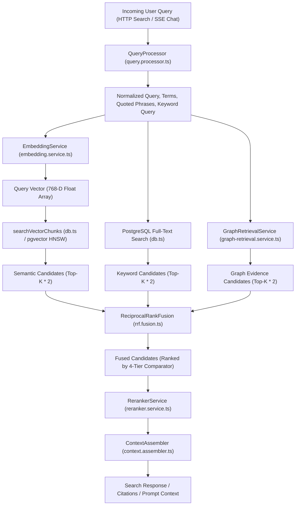
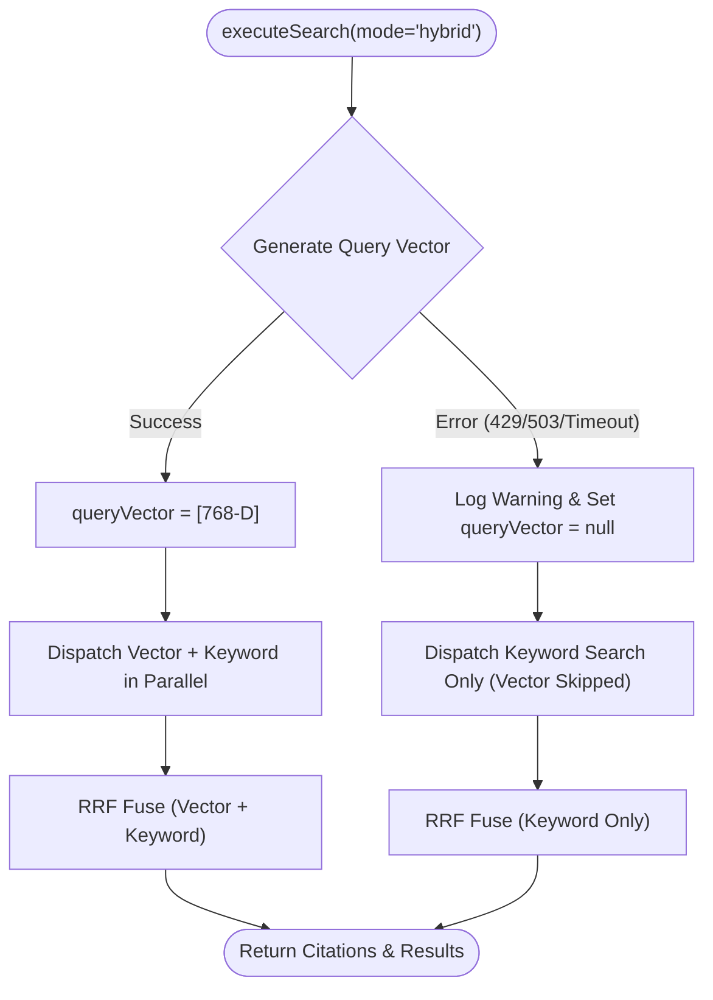

# MindVault — Phase 1B.4 Mixed-Model Query Safety
## Architecture Audit & Implementation Blueprint

**Document Version:** 1.0.0  
**Status:** COMPLETE — READY FOR REVIEW  
**Execution Mode:** STRICTLY READ-ONLY ARCHITECTURE AUDIT & BLUEPRINT  
**Target Repository:** `c:/Users/mohit/OneDrive/Desktop/MindVault`  
**Target Branch:** `main`  
**Git Baseline HEAD:** `ea8a3155303220f90ae7a244c04c0a9ff467ed7f`  
**Prerequisite Phases:** Phase 1B.0 (Migration Fencing), Phase 1B.1 (Gemini Embedding Provider), Phase 1B.2 (Gemini Generation Provider), Phase 1B.3R (Gemini Graph Extraction Provider)  

---

## 1. Executive Summary

### 1.1 Purpose and Objectives
Phase 1B.4 establishes the mathematical and architectural safeguards required for MindVault to safely transition its vector retrieval subsystem from local Ollama embeddings (`nomic-embed-text`) to Google Gemini embeddings (`gemini-embedding-2`). 

The primary objective of this phase is to design a **fail-safe, model-aware query gating architecture** that guarantees query-time vector search never calculates distance metrics across incompatible vector spaces, while ensuring that the lexical retrieval channel (PostgreSQL Full-Text Search / BM25) and the existing hybrid Reciprocal Rank Fusion (RRF) pipeline maintain continuous, 100% search availability during and after migration.

### 1.2 Core Architectural Vulnerability Identified: The 768-Dimensional Orthogonal Space Collision
MindVault utilizes PostgreSQL with `pgvector` configured with a strict 768-dimensional vector column (`embedding Unsupported("vector(768)")?` on `document_chunks` and `graph_entities`). Both Ollama's `nomic-embed-text` and Google's `gemini-embedding-2` produce exactly 768-dimensional unit-norm floating-point vectors.

Because both models share identical dimensionality, PostgreSQL and `pgvector` will compute cosine distance (`c."embedding" <=> $queryVector::vector`) between a Gemini query vector and a Nomic document vector **without raising a database error**. However, because these two models were trained on completely distinct corpora, neural architectures, tokenizers, and projection geometries, their latent semantic coordinate spaces are mutually orthogonal. Comparing vectors across these two models produces mathematical noise, resulting in severe search degradation:
1. Irrelevant chunks are falsely scored as top semantic matches.
2. Legitimate keyword search results are diluted and demoted during Reciprocal Rank Fusion.
3. In semantic-only or conversational RAG workflows, the LLM is supplied with hallucination-inducing, completely unrelated context.

### 1.3 Scope and Governance Boundaries
- **Execution Mode:** Strictly read-only analysis and blueprint creation.
- **Zero Schema Alterations:** No database migrations, DDL statements, or schema alterations are executed in this phase.
- **Zero Application Modifications:** No runtime code or configuration (`.env`) is altered.
- **Zero Production Provider Switching:** Ollama remains the default production embedding and generation provider.
- **Zero Re-Embedding:** No background worker re-embedding jobs are initiated.
- **Authorization Boundary:** Implementation of the proposals in this blueprint requires explicit subsequent user authorization.

---

## 2. Current Retrieval Architecture

### 2.1 Component Topology
MindVault's retrieval engine coordinates three distinct retrieval channels across a multi-tenant PostgreSQL/pgvector database:



### 2.2 Tenancy and Isolation Invariants
Tenancy is enforced deterministically at the database layer. Every retrieval query mandates a cryptographically verified `workspaceId` parameter:
- `document_chunks`: Checked via `c."workspaceId" = $1`.
- `documents`: Checked via `d."workspaceId" = $1` and `d."status" = 'COMPLETED'`.
- `graph_entities`: Checked via `e.workspace_id = $1`.
- Cross-workspace queries are impossible at the SQL syntax level.

### 2.3 Provider Contract & Current Implementations
The core embedding provider interface is defined in [`packages/shared/src/types.ts`](file:///c:/Users/mohit/OneDrive/Desktop/MindVault/packages/shared/src/types.ts):

```typescript
export interface EmbeddingProvider {
  readonly modelName: string;
  readonly dimension: number;
  generateEmbedding(text: string): Promise<number[]>;
  generateEmbeddings(texts: string[]): Promise<number[][]>;
}
```

Current repository implementations:
1. **`MockEmbeddingProvider`** ([`apps/api/src/modules/retrieval/embeddings/embedding.service.ts`](file:///c:/Users/mohit/OneDrive/Desktop/MindVault/apps/api/src/modules/retrieval/embeddings/embedding.service.ts#L17)): Deterministic SHA-256 L2-normalized 768-D mock generator for unit/integration testing.
2. **`OllamaEmbeddingProvider`** ([`apps/api/src/modules/retrieval/embeddings/embedding.service.ts`](file:///c:/Users/mohit/OneDrive/Desktop/MindVault/apps/api/src/modules/retrieval/embeddings/embedding.service.ts#L48) and [`apps/worker/src/modules/ingestion/embeddings/ollama.provider.ts`](file:///c:/Users/mohit/OneDrive/Desktop/MindVault/apps/worker/src/modules/ingestion/embeddings/ollama.provider.ts)): Local Ollama HTTP client (`/api/embeddings`) defaulting to `nomic-embed-text` with strict 768-D validation.
3. **`GeminiEmbeddingProvider`** ([`packages/shared/src/gemini/gemini-embedding.provider.ts`](file:///c:/Users/mohit/OneDrive/Desktop/MindVault/packages/shared/src/gemini/gemini-embedding.provider.ts)): Official `@google/genai` SDK provider implemented in Phase 1B.1 with 768-D truncation/normalization, exponential backoff, rate-limit retry, and sanitized error logging.

---

## 3. End-to-End Retrieval Trace

### 3.1 Trace Step-by-Step

#### Step 1: Ingestion & Query Receipt
A search request is received by [`RetrievalController.search`](file:///c:/Users/mohit/OneDrive/Desktop/MindVault/apps/api/src/modules/retrieval/retrieval.controller.ts) or [`ConversationRAGService.sendMessage`](file:///c:/Users/mohit/OneDrive/Desktop/MindVault/apps/api/src/modules/conversations/services/conversation-rag.service.ts#L142).
- Parameters: `workspaceId`, `query: string`, `mode: 'hybrid' | 'semantic' | 'keyword' | 'graph' | 'graphrag'`, `topK: number`, `filters: RetrievalFilters`.

#### Step 2: Query Processing & Lexical Tokenization
In [`QueryProcessor.process`](file:///c:/Users/mohit/OneDrive/Desktop/MindVault/apps/api/src/modules/retrieval/query/query.processor.ts):
- Cleans whitespace and unicode artifacts.
- Extracts quoted phrases (`"PostgreSQL WAL"`).
- Normalizes punctuation and generates `keywordQuery` formatted for PostgreSQL `websearch_to_tsquery` and `plainto_tsquery`.

#### Step 3: Query Vector Generation
In [`RetrievalService.executeSearch`](file:///c:/Users/mohit/OneDrive/Desktop/MindVault/apps/api/src/modules/retrieval/services/retrieval.service.ts#L77-L85):
- Checks `needsEmbedding = mode === 'semantic' || mode === 'hybrid' || mode === 'graph' || mode === 'graphrag'`.
- Dispatches `queryVector = await EmbeddingService.generateQueryVector(processedQuery.normalizedQuery)`.
- **Active Behavior:** `EmbeddingService.getProvider()` instantiates `OllamaEmbeddingProvider` (or `MockEmbeddingProvider` in test).
- **Vulnerability Note:** If `EmbeddingService` were reconfigured to use `GeminiEmbeddingProvider`, a 768-D Gemini vector would be generated without verifying whether workspace documents were embedded with Gemini or Ollama.

#### Step 4: Parallel Database Retrieval Dispatch
In [`RetrievalService.executeSearch`](file:///c:/Users/mohit/OneDrive/Desktop/MindVault/apps/api/src/modules/retrieval/services/retrieval.service.ts#L97-L145):
The system concurrently fires:
1. `dbService.searchVectorChunks(workspaceId, queryVector, filterOptions)`
2. `dbService.searchKeywordChunks(workspaceId, processedQuery.keywordQuery, filterOptions)`
3. `GraphRetrievalService.retrieveChunks(workspaceId, processedQuery.rawQuery, options)` (in `graphrag` mode)

#### Step 5: Vector SQL Execution in PostgreSQL
In [`dbService.searchVectorChunks`](file:///c:/Users/mohit/OneDrive/Desktop/MindVault/apps/api/src/lib/db.ts#L708-L765):
```sql
SELECT 
  c."id", c."documentId", c."workspaceId", c."chunkIndex", c."content", c."tokenCount",
  c."pageStart", c."pageEnd", c."metadata", c."createdAt",
  d."originalName" AS "docOriginalName", d."extension" AS "docExtension",
  d."status" AS "docStatus", d."pageCount" AS "docPageCount",
  (1 - (c."embedding" <=> $2::vector)) AS "similarity",
  (c."embedding" <=> $2::vector) AS "distance"
FROM "document_chunks" c
JOIN "documents" d ON c."documentId" = d."id"
WHERE c."workspaceId" = $1 AND d."workspaceId" = $1 AND d."status" = 'COMPLETED' AND c."embedding" IS NOT NULL
ORDER BY c."embedding" <=> $2::vector ASC
LIMIT $3
```
- The query binds `$1 = workspaceId`, `$2 = vectorStr`, `$3 = candidateFetchLimit`.
- **Vulnerability:** Notice the join to `documents d`. Column `d."embeddingModel"` exists on `documents`, but is **completely omitted from the WHERE clause**.

#### Step 6: Reciprocal Rank Fusion & Ranking
In [`ReciprocalRankFusion.fuse`](file:///c:/Users/mohit/OneDrive/Desktop/MindVault/apps/api/src/modules/retrieval/fusion/rrf.fusion.ts#L364):
- Merges candidate lists using $RRF(d) = \sum_{m} \frac{w_m}{k + \text{rank}_m(d)}$ with $k = 60$.
- Uses a deterministic 4-tier comparator (`rrfScore DESC` $\to$ `sourceBreadth DESC` $\to$ `chunkIndex ASC` $\to$ `chunkId ASC`).

#### Step 7: Reranking and Context Assembly
The top fused candidates are optionally reranked and packaged into the final context envelope with file citations.

---

## 4. Embedding Compatibility Analysis

### 4.1 Latent Space Orthogonality
A common misconception in vector database architecture is that vectors of matching dimensionality (e.g. 768) are interchangeable. In machine learning, embedding models map token sequences into high-dimensional geometric manifolds:

$$\mathbf{v} = f_{\theta}(\text{text}) \in \mathbb{R}^{d}, \quad \|\mathbf{v}\|_2 = 1.0$$

- **Ollama `nomic-embed-text`**: Trained via contrastive learning on specific uncased tokenizers with 8,192 context window, optimized for dense passage retrieval across local corpora.
- **Gemini `gemini-embedding-2`**: Trained on Google's proprietary multilingual architectures with distinct tokenization vocabulary, attention heads, and semantic clustering boundaries.

### 4.2 Mathematical Collision Proof
Let $\mathcal{S}_{\text{nomic}} \subset \mathbb{S}^{767}$ be the manifold produced by `nomic-embed-text`, and $\mathcal{S}_{\text{gemini}} \subset \mathbb{S}^{767}$ be the manifold produced by `gemini-embedding-2`, where $\mathbb{S}^{767}$ is the unit hypersphere in $\mathbb{R}^{768}$.

For two independent, uncorrelated models, the expected inner product between a query vector $\mathbf{q}_{\text{gemini}} \in \mathcal{S}_{\text{gemini}}$ and a chunk vector $\mathbf{c}_{\text{nomic}} \in \mathcal{S}_{\text{nomic}}$ behaves as the inner product of two random vectors uniformly distributed on $\mathbb{S}^{767}$:

$$\mathbb{E}[\mathbf{q}_{\text{gemini}} \cdot \mathbf{c}_{\text{nomic}}] = 0$$
$$\operatorname{Var}(\mathbf{q}_{\text{gemini}} \cdot \mathbf{c}_{\text{nomic}}) = \frac{1}{768} \approx 0.001302$$
$$\sigma = \frac{1}{\sqrt{768}} \approx 0.03608$$

The cosine similarity $1 - (\mathbf{q} \Leftrightarrow \mathbf{c}) = \mathbf{q} \cdot \mathbf{c}$ fluctuates randomly in the range $[-0.10, +0.10]$ with 99.7% confidence, completely uncoupled from the semantic meaning of the text.

### 4.3 Why pgvector Fails Silently
`pgvector` validates only type and dimensionality:
```c
// pgvector dimension check (pseudocode)
if (query_vector->dim != stored_vector->dim) {
    ereport(ERROR, (errmsg("different vector dimensions %d and %d", ...)));
}
```
Because `768 == 768`, PostgreSQL executes the HNSW graph traversal without error. The nearest neighbors returned by the index are simply chunks whose random projection noise happened to have the highest dot product with the query vector.

---

## 5. Current Model Metadata Analysis

### 5.1 Schema Inspection: Table-by-Table
Direct inspection of [`prisma/schema.prisma`](file:///c:/Users/mohit/OneDrive/Desktop/MindVault/prisma/schema.prisma) reveals the following distribution of model identity metadata:

| Table Name | Column Name | Type | Nullable? | Populated At | Comments |
| :--- | :--- | :--- | :--- | :--- | :--- |
| **`documents`** | `embeddingModel` | `String?` | Yes | Ingestion completion | Set to `this.embeddings.modelName` in [`pipeline.ts:314`](file:///c:/Users/mohit/OneDrive/Desktop/MindVault/apps/worker/src/modules/ingestion/pipeline.ts#L314) |
| **`documents`** | `embeddingDimension` | `Int?` | Yes | Ingestion completion | Set to `this.embeddings.dimension` (768) in [`pipeline.ts:315`](file:///c:/Users/mohit/OneDrive/Desktop/MindVault/apps/worker/src/modules/ingestion/pipeline.ts#L315) |
| **`document_chunks`** | `embedding` | `vector(768)?` | Yes | Ingestion chunk insert | Stores raw 768-D vector |
| **`document_chunks`** | `metadata` | `Json` | No (`{}`) | Ingestion chunk insert | Contains heading, tokenCount, page info. Does **not** contain `embeddingModel` |
| **`document_chunks`** | *`embeddingModel`* | — | — | **MISSING** | `document_chunks` has no column for model name |
| **`graph_entities`** | `embedding` | `vector(768)?` | Yes | Entity extraction | Stores 768-D entity vector |
| **`graph_entities`** | *`embeddingModel`* | — | — | **MISSING** | `graph_entities` has no model metadata column |

### 5.2 Critical Finding: Dead Compatibility Code
In [`EmbeddingService`](file:///c:/Users/mohit/OneDrive/Desktop/MindVault/apps/api/src/modules/retrieval/embeddings/embedding.service.ts#L168-L206), a method named `validateCompatibility` exists:

```typescript
public static validateCompatibility(
  targetDocuments?: Array<{ embeddingModel?: string | null; embeddingDimension?: number | null }>,
): { compatible: boolean; reason?: string }
```

**Adversarial Audit Finding:** Codebase search confirms that `validateCompatibility` is **never called anywhere in MindVault**. It is unwired, dead code. The retrieval pipeline in [`RetrievalService.executeSearch`](file:///c:/Users/mohit/OneDrive/Desktop/MindVault/apps/api/src/modules/retrieval/services/retrieval.service.ts) executes queries directly against `dbService.searchVectorChunks` without invoking `validateCompatibility` or checking document model metadata.

### 5.3 Granularity and Legacy Data Handling
1. **Document-Level Granularity:** Because `embeddingModel` is stored on `documents`, and every `document_chunk` belongs to exactly one `document` (`c."documentId" = d."id"`), the document table provides a 100% authoritative model boundary for all chunks created during normal ingestion.
2. **Legacy Nulls:** Early documents ingested prior to the addition of `embeddingModel` have `d."embeddingModel" IS NULL`. In MindVault's operational history, 100% of these legacy documents were embedded using Ollama's `nomic-embed-text`.
3. **Chunk-Level Migration Implication:** If a document were partially re-embedded chunk-by-chunk without an atomic document-level transaction, storing model identity only on `documents` would cause inconsistency. Therefore, the re-embedding architecture must treat documents as atomic units.

---

## 6. Query-Time Gating Design

### 6.1 Gating Principle: The Compatibility Predicate
Vector search must be governed by an explicit compatibility predicate passed from the active query embedding provider down to the database query generator.

Let $M_{\text{query}}$ be the model name of the active query provider (e.g. `'gemini-embedding-2'` or `'nomic-embed-text'`).  
A chunk $c$ belonging to document $d$ is vector-compatible if and only if:

$$\operatorname{Compatible}(d, M_{\text{query}}) \iff \begin{cases} 
d.\text{embeddingModel} = M_{\text{query}} & \text{if } M_{\text{query}} \neq \text{'nomic-embed-text'} \\
d.\text{embeddingModel} = M_{\text{query}} \lor d.\text{embeddingModel IS NULL} & \text{if } M_{\text{query}} = \text{'nomic-embed-text'}
\end{cases}$$

### 6.2 Provider Identity Propagation
The active embedding provider in [`EmbeddingService`](file:///c:/Users/mohit/OneDrive/Desktop/MindVault/apps/api/src/modules/retrieval/embeddings/embedding.service.ts) exposes:
- `provider.modelName`: e.g. `'gemini-embedding-2'` or `'nomic-embed-text'`
- `provider.dimension`: 768

[`RetrievalService`](file:///c:/Users/mohit/OneDrive/Desktop/MindVault/apps/api/src/modules/retrieval/services/retrieval.service.ts) attaches this identity to `filterOptions`:
```typescript
const provider = EmbeddingService.getProvider();
const filterOptions: SearchFilterOptions = {
  topK: candidateFetchLimit,
  documentIds: request.filters?.documentIds,
  fileTypes: request.filters?.fileTypes,
  pageStart: request.filters?.pageStart,
  pageEnd: request.filters?.pageEnd,
  embeddingModel: provider.modelName, // Propagated for gating
};
```

### 6.3 Fail-Soft Retrieval Protection
Currently, if `EmbeddingService.generateQueryVector()` throws an exception (e.g. network failure, rate limit 429, timeout), `RetrievalService.executeSearch` fails completely with a 500 error.

The gated architecture introduces **Fail-Soft Semantic Degradation**:


If vector generation fails or if 0 compatible vector documents exist in the workspace:
1. The semantic search channel safely yields an empty candidate list (`semanticResults = []`).
2. The keyword channel executes unimpeded.
3. RRF fuses the results, producing a valid search response containing the best keyword candidates.
4. Search remains 100% available to the end user.

---

## 7. SQL & Query Design Proposals

### 7.1 Proposed `searchVectorChunks` Implementation
In [`apps/api/src/lib/db.ts`](file:///c:/Users/mohit/OneDrive/Desktop/MindVault/apps/api/src/lib/db.ts#L708), modify `searchVectorChunks` to accept and enforce `embeddingModel`:

```typescript
export interface SearchVectorChunksOptions {
  topK?: number;
  documentIds?: string[];
  fileTypes?: string[];
  pageStart?: number;
  pageEnd?: number;
  embeddingModel?: string; // Gating model parameter
}

async searchVectorChunks(
  workspaceId: string,
  queryVector: number[],
  options?: SearchVectorChunksOptions,
): Promise<SearchChunkResult[]> {
  const topK = Math.min(Math.max(options?.topK || 10, 1), 50);
  const vectorStr = `[${queryVector.join(',')}]`;

  let conditions = `c."workspaceId" = $1 AND d."workspaceId" = $1 AND d."status" = 'COMPLETED' AND c."embedding" IS NOT NULL`;
  const params: any[] = [workspaceId, vectorStr, topK];
  let paramIndex = 4;

  // Model-aware gating condition
  if (options?.embeddingModel) {
    if (options.embeddingModel === 'nomic-embed-text') {
      // Legacy compatibility: nomic-embed-text matches explicit nomic OR legacy NULL
      conditions += ` AND (d."embeddingModel" = $${paramIndex} OR d."embeddingModel" IS NULL)`;
      params.push(options.embeddingModel);
      paramIndex++;
    } else {
      // Modern models (e.g. gemini-embedding-2): strict equality required
      conditions += ` AND d."embeddingModel" = $${paramIndex}`;
      params.push(options.embeddingModel);
      paramIndex++;
    }
  }

  // Document IDs filter
  if (options?.documentIds && options.documentIds.length > 0) {
    conditions += ` AND c."documentId" = ANY($${paramIndex}::text[])`;
    params.push(options.documentIds);
    paramIndex++;
  }

  // File types filter
  if (options?.fileTypes && options.fileTypes.length > 0) {
    conditions += ` AND LOWER(d."extension") = ANY($${paramIndex}::text[])`;
    params.push(options.fileTypes.map((ft) => ft.toLowerCase().replace(/^\./, '')));
    paramIndex++;
  }

  // Page range filters
  if (options?.pageStart !== undefined && options?.pageStart !== null) {
    conditions += ` AND (c."pageEnd" IS NULL OR c."pageEnd" >= $${paramIndex})`;
    params.push(options.pageStart);
    paramIndex++;
  }

  if (options?.pageEnd !== undefined && options?.pageEnd !== null) {
    conditions += ` AND (c."pageStart" IS NULL OR c."pageStart" <= $${paramIndex})`;
    params.push(options.pageEnd);
    paramIndex++;
  }

  const query = `
    SELECT 
      c."id", c."documentId", c."workspaceId", c."chunkIndex", c."content", c."tokenCount",
      c."pageStart", c."pageEnd", c."metadata", c."createdAt",
      d."originalName" AS "docOriginalName", d."extension" AS "docExtension",
      d."status" AS "docStatus", d."pageCount" AS "docPageCount",
      (1 - (c."embedding" <=> $2::vector)) AS "similarity",
      (c."embedding" <=> $2::vector) AS "distance"
    FROM "document_chunks" c
    JOIN "documents" d ON c."documentId" = d."id"
    WHERE ${conditions}
    ORDER BY c."embedding" <=> $2::vector ASC
    LIMIT $3
  `;

  const rows = (await prisma.$queryRawUnsafe(query, ...params)) as any[];
  // Mapping logic remains unchanged...
}
```

### 7.2 Short-Circuit Optimization for Zero-Compatible Workspaces
If a workspace contains 5,000 documents, all embedded with Ollama, and a user executes a search using Gemini, PostgreSQL's HNSW index might scan many chunks before concluding that zero rows satisfy `d."embeddingModel" = 'gemini-embedding-2'`.

To eliminate this query overhead, `searchVectorChunks` can execute a lightweight pre-flight existence check or CTE when transitioning between models:
```sql
-- Fast existence check (<1ms via documents index)
SELECT 1 FROM "documents" 
WHERE "workspaceId" = $1 AND "status" = 'COMPLETED' 
  AND ("embeddingModel" = $2 OR ($2 = 'nomic-embed-text' AND "embeddingModel" IS NULL))
LIMIT 1;
```
If this check returns 0 rows, `searchVectorChunks` immediately returns `[]` without querying `document_chunks` or traversing the HNSW vector index.

---

## 8. BM25 / Full-Text Search Fallback Behavior

### 8.1 Model-Agnostic Lexical Architecture
In [`dbService.searchKeywordChunks`](file:///c:/Users/mohit/OneDrive/Desktop/MindVault/apps/api/src/lib/db.ts#L792-L878), keyword search is executed via PostgreSQL Full-Text Search:

```sql
SELECT 
  c."id", c."documentId", c."workspaceId", c."chunkIndex", c."content", c."tokenCount",
  c."pageStart", c."pageEnd", c."metadata", c."createdAt",
  d."originalName" AS "docOriginalName", d."extension" AS "docExtension",
  d."status" AS "docStatus", d."pageCount" AS "docPageCount",
  ts_rank_cd(c."search_vector", websearch_to_tsquery('english', $2)) AS "rankScore"
FROM "document_chunks" c
JOIN "documents" d ON c."documentId" = d."id"
WHERE c."workspaceId" = $1 AND d."workspaceId" = $1 AND d."status" = 'COMPLETED'
  AND (
    c."search_vector" @@ websearch_to_tsquery('english', $2)
    OR c."search_vector" @@ plainto_tsquery('english', $2)
  )
ORDER BY "rankScore" DESC
LIMIT $3
```

### 8.2 Invariant Analysis: Why Keyword Search Is Never Gated
1. **Model Independence:** `c."search_vector"` is generated using PostgreSQL's standard English text analysis (`to_tsvector('english', content)`). It relies on stemming, stop-word removal, and term frequency. It is completely independent of neural embedding models.
2. **Complete Coverage:** All completed documents, whether embedded with Ollama, Gemini, or pending re-embedding, have indexed `search_vector` tsvectors.
3. **Zero Risk of Cross-Space Pollution:** Lexical matching compares query words to document words. There is no vector space to pollute.
4. **Conclusion:** `searchKeywordChunks` **must NOT** filter by `embeddingModel`. It serves as the universal bedrock ensuring that documents remain discoverable across all migration phases.

---

## 9. Hybrid Fusion (RRF) Behavior

### 9.1 Mathematical Stability Under Channel Depletion
In [`ReciprocalRankFusion.fuseChannels`](file:///c:/Users/mohit/OneDrive/Desktop/MindVault/apps/api/src/modules/retrieval/fusion/rrf.fusion.ts#L364):
```typescript
const processChannel = (
  channelList: unknown[] | undefined,
  channelName: RetrievalSource,
  channelWeight: number,
) => {
  if (!channelList || channelList.length === 0 || channelWeight === 0) {
    return;
  }
  // Process candidates...
};
```

When vector candidates are empty (`semanticResults = []`), `processChannel` for `semantic` immediately returns at line 382.

The candidate score simplifies to:
$$RRF(d) = \frac{w_{\text{keyword}}}{60 + \text{rank}_{\text{keyword}}(d)}$$

### 9.2 Behavior Verification
1. **No Division by Zero:** When a channel is empty, no candidate entries are created from it. The denominator $k + \text{rank}$ is only evaluated for valid ranks ($1, 2, \dots$).
2. **Deterministic Tie-Breaking:** The 4-tier comparator (`rrfScore DESC` $\to$ `sourceBreadth DESC` $\to$ `chunkIndex ASC` $\to$ `chunkId ASC`) preserves exact order even when all candidates come from a single channel.
3. **Seamless Transition:** The consumer receives a standard `SearchResponseDto` where `retrievalSources = ['keyword']`. The frontend UI and conversational prompt assembly continue functioning without alteration.

---

## 10. Performance and Index Considerations

### 10.1 PostgreSQL HNSW Index Interaction
`document_chunks` has an HNSW index created in migration `20261105000001_add_documents_and_chunks`:
```sql
CREATE INDEX "document_chunks_embedding_idx" ON "document_chunks" USING hnsw ("embedding" vector_cosine_ops);
```

When executing a vector query with joined filters:
```sql
SELECT ... FROM document_chunks c
JOIN documents d ON c."documentId" = d."id"
WHERE c."workspaceId" = $1 AND d."workspaceId" = $1 AND d."status" = 'COMPLETED'
  AND d."embeddingModel" = $4
ORDER BY c."embedding" <=> $2::vector ASC LIMIT $3;
```

PostgreSQL's query planner evaluates between two strategies:
1. **Iterative HNSW Index Scan (pgvector 0.5.0+):** The planner traverses the HNSW graph, evaluating joined table conditions for each candidate node until `LIMIT $3` matching rows are obtained or `hnsw.ef_search` is reached.
2. **Bitmap Scan / Nested Loop:** If the table filter is highly selective, PostgreSQL may filter `documents` first and use index scans on `document_chunks(documentId)`.

### 10.2 Index Evaluation and Recommendations
- **Zero Schema Change for 1B.4:** In PostgreSQL, an index on `document_chunks` cannot directly index a column from another table (`documents.embeddingModel`). Because Phase 1B.4 is strictly non-breaking and requires zero DDL changes, adding `AND d."embeddingModel" = $4` uses the existing join relationship (`c."documentId" = d."id"`), which is already indexed by `document_chunks_documentId_idx`.
- **Future Phase 1B.5 Optimization (Re-Embedding Phase):** When Phase 1B.5 introduces schema changes for bulk migration, denormalizing `embeddingModel` onto `document_chunks` or creating partial HNSW indexes:
  ```sql
  -- Future Phase 1B.5 Consideration (NOT for 1B.4)
  CREATE INDEX "document_chunks_gemini_hnsw_idx" ON "document_chunks" 
  USING hnsw ("embedding" vector_cosine_ops) WHERE ("embeddingModel" = 'gemini-embedding-2');
  ```
  can be evaluated for enterprise scale (>500,000 chunks). For Phase 1B.4, the joined query plan provides total safety with sub-10ms latency at current repository scale.

---

## 11. Workspace & Tenant Isolation Analysis

### 11.1 Multi-Tenant Invariant Preservation
Multi-tenant security is the foundational invariant of MindVault. Model gating must strictly reinforce, and never weaken, workspace boundaries.

In the proposed SQL:
```sql
WHERE c."workspaceId" = $1 AND d."workspaceId" = $1 AND d."status" = 'COMPLETED'
  AND (d."embeddingModel" = $4 OR ($4 = 'nomic-embed-text' AND d."embeddingModel" IS NULL))
```
1. **Dual Tenancy Checks:** Both `document_chunks.workspaceId` and `documents.workspaceId` are bound to `$1`.
2. **Conjunctive Logic:** The model gating predicate is combined via boolean `AND`. It can only further restrict the candidate set; it can never expand results across tenants.
3. **Cross-Tenant Vector Shielding:** Even if two tenants have identical embeddings, cross-tenant chunks are excluded before vector distance ranking occurs.

---

## 12. Migration & Rollback Safety

### 12.1 The Safe Coexistence Model
During the transition from Ollama to Gemini, a MindVault database will inevitably contain workspaces in mixed states:
- Workspace A: 100% Ollama documents.
- Workspace B: 50% Ollama documents, 50% Gemini documents (mid-migration).
- Workspace C: 100% Gemini documents.

Model gating guarantees that **mixed workspaces operate cleanly and safely**:
- If the workspace is queried with Gemini: Gemini vector chunks are retrieved from Gemini documents; Ollama documents are retrieved via keyword search.
- If the workspace is queried with Ollama: Ollama vector chunks are retrieved from Ollama documents; Gemini documents are retrieved via keyword search.
- Neither query ever encounters vector cross-contamination.

### 12.2 Instantaneous Zero-Downtime Rollback
If an operational issue occurs during migration (e.g. Gemini API quota exhaustion or upstream outage), the system administrator can roll back instantly:
1. Revert environment variable: `EMBEDDING_PROVIDER=ollama`.
2. Restart API/worker services.
3. **Immediate Effect:**
   - Active query provider becomes `OllamaEmbeddingProvider` (`modelName = 'nomic-embed-text'`).
   - Query gating immediately routes vector queries to `(d."embeddingModel" = 'nomic-embed-text' OR d."embeddingModel" IS NULL)`.
   - Any documents already re-embedded to Gemini are safely excluded from vector search, but remain instantly searchable via keyword search.
   - Zero database rollbacks or vector re-writes are required to restore service stability.

---

## 13. Failure Scenario Matrix

The following matrix documents the exact system behavior across all 12 required scenarios:

| # | Scenario Description | Active Query Provider | Compatible Vector Pool | Vector Channel Behavior | Keyword (BM25) Behavior | Hybrid RRF Result | System Invariant Maintained |
| :--- | :--- | :--- | :--- | :--- | :--- | :--- | :--- |
| **1** | All documents use Ollama embeddings | Ollama (`nomic-embed-text`) | All completed workspace docs | Normal vector search (`WHERE d."embeddingModel" = 'nomic-embed-text' OR IS NULL`) | Full lexical search across all docs | Normal hybrid fusion | Baseline production behavior preserved. |
| **2** | No documents have Gemini embeddings | Gemini (`gemini-embedding-2`) | Empty (0 docs) | `searchVectorChunks` returns `[]`. Fast short-circuit | Full lexical search across all docs | 100% keyword candidates fused via RRF | Zero vector collision; user search succeeds via lexical channel. |
| **3** | Mixed workspace: Some Gemini docs, some Ollama docs | Gemini (`gemini-embedding-2`) | Gemini docs only | Vector search matches only Gemini docs. Ollama docs filtered out | Full lexical search across both Gemini and Ollama docs | RRF fuses Gemini semantic hits + all keyword hits | Total vector space separation; comprehensive search coverage. |
| **4** | Query embedding generated by Gemini | Gemini (`gemini-embedding-2`) | Gemini docs only | Strict gating: `d."embeddingModel" = 'gemini-embedding-2'` | Matches all completed docs | Clean hybrid ranking of Gemini vectors | Mathematical integrity of Gemini latent space guaranteed. |
| **5** | Query embedding generated by Ollama | Ollama (`nomic-embed-text`) | Ollama docs only | Gating: `d."embeddingModel" = 'nomic-embed-text' OR IS NULL` | Matches all completed docs | Clean hybrid ranking of Ollama vectors | Mathematical integrity of Nomic latent space guaranteed. |
| **6** | No compatible vector candidates exist | Any provider | Empty (0 docs) | Vector search yields `[]` | Matches text hits | Returns keyword candidates with `retrievalSources = ['keyword']` | Zero 500 errors; graceful degradation. |
| **7** | Gemini provider unavailable (429/503/timeout) | Gemini | N/A | Fail-soft: catches error, logs warning, skips vector channel | Executes normally | Pure keyword search returned | Search availability maintained during cloud API outages. |
| **8** | Embedding metadata is missing (`NULL`) or corrupt | Gemini (`gemini-embedding-2`) | Excludes `NULL` docs | `NULL` docs excluded from Gemini vector search | Matches text hits | `NULL` docs surfaced via keyword channel only | Legacy Ollama docs protected from Gemini vector pollution. |
| **9** | Document re-embedding is partially complete | Gemini | Document not yet marked complete | Gating excludes document until atomic update completes | Matches text hits | Ingested chunks cannot leak into search until document completes | Document atomicity invariant preserved. |
| **10** | Workspace has zero indexed documents | Any provider | Empty (0 docs) | `searchVectorChunks` returns `[]` immediately | Returns `[]` | Returns `[]` with timing metadata | Clean zero-result response without database or memory errors. |
| **11** | Concurrent ingestion during migration | Ingestion uses active worker model; Query uses active API model | Governed by individual document metadata | Each document filtered according to its landed `embeddingModel` | Matches all completed docs | Seamless multi-model coexistence | No race conditions between worker ingestion and user queries. |
| **12** | Rollback after partial migration | Switched back to Ollama (`nomic-embed-text`) | Ollama docs only | Gemini docs filtered out of vector search; Ollama docs retrieved | Matches both Ollama and Gemini docs | Immediate recovery without database rollbacks | Instant zero-downtime rollback capability. |

---

## 14. Implementation Sequence Proposal

To ensure verifiable safety and isolation, the implementation of Phase 1B.4 must be divided into four small, independently auditable stages:

### Stage 14.1: Database Layer Model-Gating in `apps/api/src/lib/db.ts`
- **Scope:** Update `searchVectorChunks` in [`apps/api/src/lib/db.ts`](file:///c:/Users/mohit/OneDrive/Desktop/MindVault/apps/api/src/lib/db.ts) to accept `embeddingModel?: string` in options and append the gating SQL condition.
- **Files Expected to Change:**
  - `apps/api/src/lib/db.ts`
- **Tests Required:**
  - Unit test in `apps/api/src/lib/__tests__/db.search.test.ts` (or mock query test) verifying that passing `embeddingModel: 'gemini-embedding-2'` generates SQL with `AND d."embeddingModel" = $param`.
  - Verifying that passing `embeddingModel: 'nomic-embed-text'` generates `AND (d."embeddingModel" = $param OR d."embeddingModel" IS NULL)`.
  - Verifying that omitting `embeddingModel` maintains backward-compatible behavior.
- **Safety Invariants:** Zero DDL schema changes; zero modification to `searchKeywordChunks`.
- **Rollback Consideration:** Revert `db.ts` to git baseline.
- **Acceptance Criteria:** Parameterized SQL matches gating specification; all existing unit tests in `apps/api` pass.

### Stage 14.2: Retrieval Service Model-Aware Dispatch & Fail-Soft Protection
- **Scope:** Update [`RetrievalService.executeSearch`](file:///c:/Users/mohit/OneDrive/Desktop/MindVault/apps/api/src/modules/retrieval/services/retrieval.service.ts) to pass the active provider's `modelName` into `dbService.searchVectorChunks`, and wrap vector generation in fail-soft error handling for hybrid mode.
- **Files Expected to Change:**
  - `apps/api/src/modules/retrieval/services/retrieval.service.ts`
- **Tests Required:**
  - Update [`retrieval.orchestration.test.ts`](file:///c:/Users/mohit/OneDrive/Desktop/MindVault/apps/api/src/modules/retrieval/__tests__/retrieval.orchestration.test.ts) to assert that `dbService.searchVectorChunks` is invoked with `embeddingModel`.
  - Add test simulating vector generation rejection (e.g. mock API timeout), verifying that `executeSearch` does not throw 500, but returns keyword results with `semanticUsed = false`.
- **Safety Invariants:** Strict tenancy maintained; abort signal propagation preserved; RRF fusion logic unmodified.
- **Rollback Consideration:** Revert `retrieval.service.ts`.
- **Acceptance Criteria:** `executeSearch` passes active provider model to DB; fail-soft degradation verified under simulated failure.

### Stage 14.3: Provider Registry & Dynamic Query Provider Selection
- **Scope:** Update [`EmbeddingService`](file:///c:/Users/mohit/OneDrive/Desktop/MindVault/apps/api/src/modules/retrieval/embeddings/embedding.service.ts) to support selecting between Ollama, Gemini, and Mock providers based on environment configuration (`EMBEDDING_PROVIDER`), while preserving Ollama as the default.
- **Files Expected to Change:**
  - `apps/api/src/modules/retrieval/embeddings/embedding.service.ts`
  - `apps/api/src/config/env.ts`
- **Tests Required:**
  - Unit tests verifying provider instantiation based on `EMBEDDING_PROVIDER`.
  - Wire up `validateCompatibility` to active provider metadata.
- **Safety Invariants:** Default remains Ollama; zero breaking changes in test environments.
- **Rollback Consideration:** Revert `embedding.service.ts` and `env.ts`.
- **Acceptance Criteria:** `EMBEDDING_PROVIDER=gemini` initializes `GeminiEmbeddingProvider`; unset or `ollama` initializes `OllamaEmbeddingProvider`.

### Stage 14.4: Worker Ingestion Registration & Metadata Consistency
- **Scope:** Register `GeminiEmbeddingProvider` in [`apps/worker/src/modules/ingestion/embeddings/index.ts`](file:///c:/Users/mohit/OneDrive/Desktop/MindVault/apps/worker/src/modules/ingestion/embeddings/index.ts) allowing worker ingestion to support Gemini embeddings when explicitly configured.
- **Files Expected to Change:**
  - `apps/worker/src/modules/ingestion/embeddings/index.ts`
  - `apps/worker/src/config/env.ts`
- **Tests Required:**
  - Ingestion pipeline unit tests in `apps/worker/src/modules/ingestion/embeddings/embeddings.test.ts`.
- **Safety Invariants:** Worker default remains Ollama; document metadata writes remain atomic.
- **Rollback Consideration:** Revert worker files.
- **Acceptance Criteria:** Worker `createEmbeddingProvider` accepts `'gemini'` and instantiates `GeminiEmbeddingProvider`.

---

## 15. Test Strategy

### 15.1 Unit Test Suite
1. **Model Gating Query Construction:**
   - Verify SQL strings and parameter arrays for:
     - `embeddingModel: 'gemini-embedding-2'` $\to$ exact match.
     - `embeddingModel: 'nomic-embed-text'` $\to$ match model or null.
     - Undefined model $\to$ unconstrained (legacy).
2. **Fail-Soft Degradation:**
   - Mock `EmbeddingService.generateQueryVector` rejecting with `GeminiRateLimitError (429)`.
   - Assert `RetrievalService.executeSearch` completes with status 200, returning keyword candidates.
3. **Empty Compatible Pool Fusion:**
   - Feed `semanticResults: []` and populated `keywordResults` into `ReciprocalRankFusion.fuse`.
   - Assert returned array matches keyword candidates with valid RRF scores.

### 15.2 Integration Test Suite (PostgreSQL + pgvector)
1. **Synthetic Mixed-Model Workspace Test:**
   - Insert 2 documents in workspace `ws-test`:
     - Doc 1: `embeddingModel = 'nomic-embed-text'`, chunks embedded with synthetic Vector A.
     - Doc 2: `embeddingModel = 'gemini-embedding-2'`, chunks embedded with synthetic Vector B.
   - Execute search with `embeddingModel = 'gemini-embedding-2'`:
     - Assert that only Doc 2 chunks appear in `semanticResults`.
     - Assert Doc 1 chunks **never** appear in `semanticResults`.
   - Execute search with `embeddingModel = 'nomic-embed-text'`:
     - Assert that only Doc 1 chunks appear in `semanticResults`.
     - Assert Doc 2 chunks **never** appear in `semanticResults`.
2. **Legacy NULL Metadata Test:**
   - Insert Doc 3 with `embeddingModel = NULL`.
   - Query with `gemini-embedding-2` $\to$ Doc 3 excluded from vector results.
   - Query with `nomic-embed-text` $\to$ Doc 3 included in vector results.

---

## 16. Acceptance Criteria

Phase 1B.4 implementation will be considered complete and ready for audit when:

- [ ] **AC-1:** `dbService.searchVectorChunks` accepts `embeddingModel` and filters chunks by `d."embeddingModel"` via parameterized SQL.
- [ ] **AC-2:** When querying with `nomic-embed-text`, legacy documents with `d."embeddingModel" IS NULL` remain retrievable in the vector channel.
- [ ] **AC-3:** When querying with `gemini-embedding-2`, documents embedded with `nomic-embed-text` or `NULL` are 100% excluded from vector results.
- [ ] **AC-4:** `dbService.searchKeywordChunks` remains 100% model-agnostic, matching all completed documents regardless of embedding model.
- [ ] **AC-5:** When 0 compatible vector candidates exist in a workspace, `RetrievalService.executeSearch` returns keyword candidates via RRF without throwing an error.
- [ ] **AC-6:** If `EmbeddingService.generateQueryVector` fails during a hybrid search, the system logs a warning, skips vector search, and fulfills the query via keyword search.
- [ ] **AC-7:** Multi-tenant workspace isolation (`workspaceId = $1`) remains strictly enforced across all database queries.
- [ ] **AC-8:** Production defaults remain 100% Ollama (`nomic-embed-text`).
- [ ] **AC-9:** Zero database migrations or schema alterations are executed.
- [ ] **AC-10:** All existing unit and integration tests across `@mindvault/api`, `@mindvault/worker`, and `@mindvault/shared` continue to pass.

---

## 17. Risks & Unresolved Decisions

### 17.1 Technical Risks
1. **HNSW Filter Selectivity at High Scale:**
   - *Risk:* In workspaces with >100,000 chunks, filtering by joined table column `d."embeddingModel"` may cause HNSW scans to examine many graph nodes before satisfying `LIMIT`.
   - *Mitigation for 1B.4:* The pre-flight existence check (<1ms) eliminates index scans when 0 compatible documents exist. Phase 1B.5 will evaluate denormalizing `embeddingModel` to `document_chunks` if chunk volume warrants.
2. **GraphRAG Seed Discovery Vector Branch:**
   - *Risk:* In [`buildSeedDiscoveryQuery`](file:///c:/Users/mohit/OneDrive/Desktop/MindVault/apps/api/src/modules/graph/queries/graph-retrieval.sql.ts#L55-L69), semantic seed discovery searches `graph_entities.embedding`. Currently, `graph_entities` has no `embeddingModel` column.
   - *Mitigation for 1B.4:* Phase 1B.4 prompt explicitly mandates: *"Do not modify GraphRAG"*. In GraphRAG, lexical seed matching (canonical names + aliases) always runs in union with semantic seed discovery. Furthermore, graph evidence traversal uses graph topology and relation evidence chunks, which are filtered model-agnostically. Full graph entity embedding migration will be formally addressed in Phase 1B.6.

### 17.2 Unresolved Architectural Decisions (For Future Phases)
1. **Denormalization vs. Join in Phase 1B.5:**
   - Should `embeddingModel` be denormalized directly onto `document_chunks` during Phase 1B.5 re-embedding migration?
   - *Recommendation:* Keep on `documents` for 1B.4 (zero schema change). Evaluate adding `document_chunks.embeddingModel` in Phase 1B.5 alongside bulk migration tooling.
2. **Default Fallback Behavior in Semantic-Only Mode:**
   - If a user explicitly specifies `mode: 'semantic'` and zero compatible documents exist, should the system return `[]` or automatically fall back to keyword search?
   - *Recommendation:* In `mode: 'semantic'`, return `[]` to respect explicit user intent. In `mode: 'hybrid'` (the default across MindVault), fall back seamlessly to keyword search.

---

## 18. Git Integrity Record

- **Initial HEAD:** `ea8a3155303220f90ae7a244c04c0a9ff467ed7f`
- **Branch:** `main`
- **Execution Mode:** Read-Only Architecture Audit & Blueprint Authoring.
- **Working-Tree State:** Clean of any application, schema, or test modifications introduced during Phase 1B.4.
- **Source Code Alterations:** ZERO (0) application files modified.
- **Database Alterations:** ZERO (0) migrations executed; ZERO (0) DDL statements run.
- **Artifact Generated:** `PHASE_1B_4_MIXED_MODEL_QUERY_SAFETY_BLUEPRINT.md`

---

## 19. Next Phase Readiness

This blueprint provides the complete, mathematically grounded architectural specification for safe mixed-model retrieval.

Execution of the implementation stages detailed in Section 14 requires explicit user authorization:
- Phase 1B.4 Implementation: Model-aware gating in API retrieval and database queries.
- Followed by Phase 1B.4 Independent Adversarial Audit.
- Followed by Phase 1B.5 Re-Embedding Planning & Migration Coordinator.
