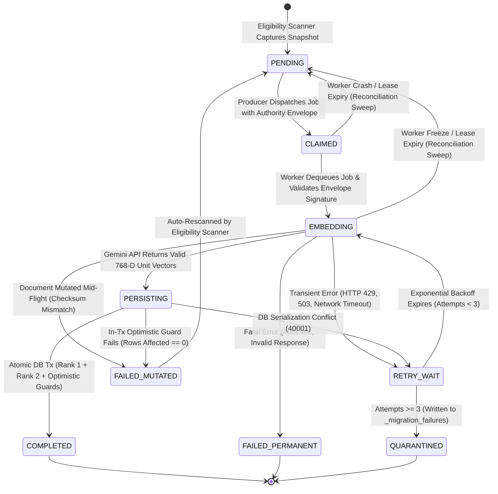
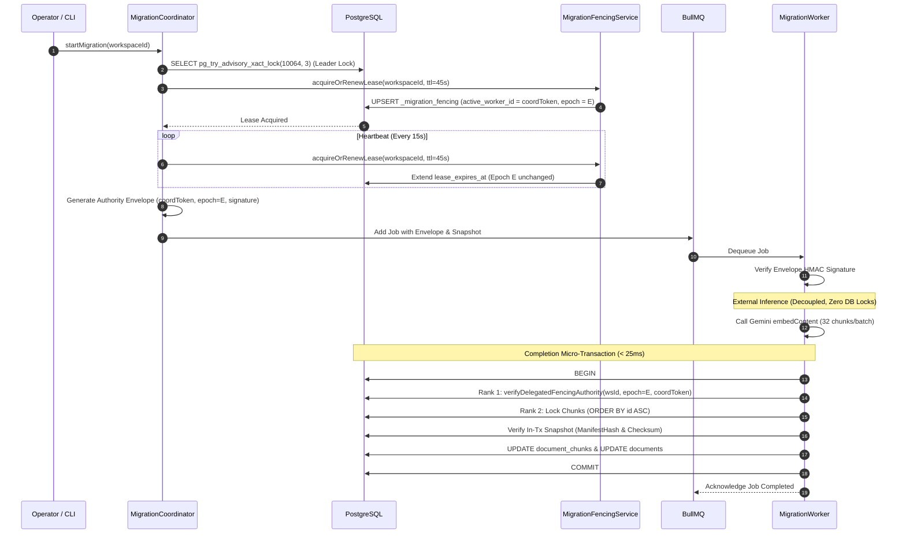
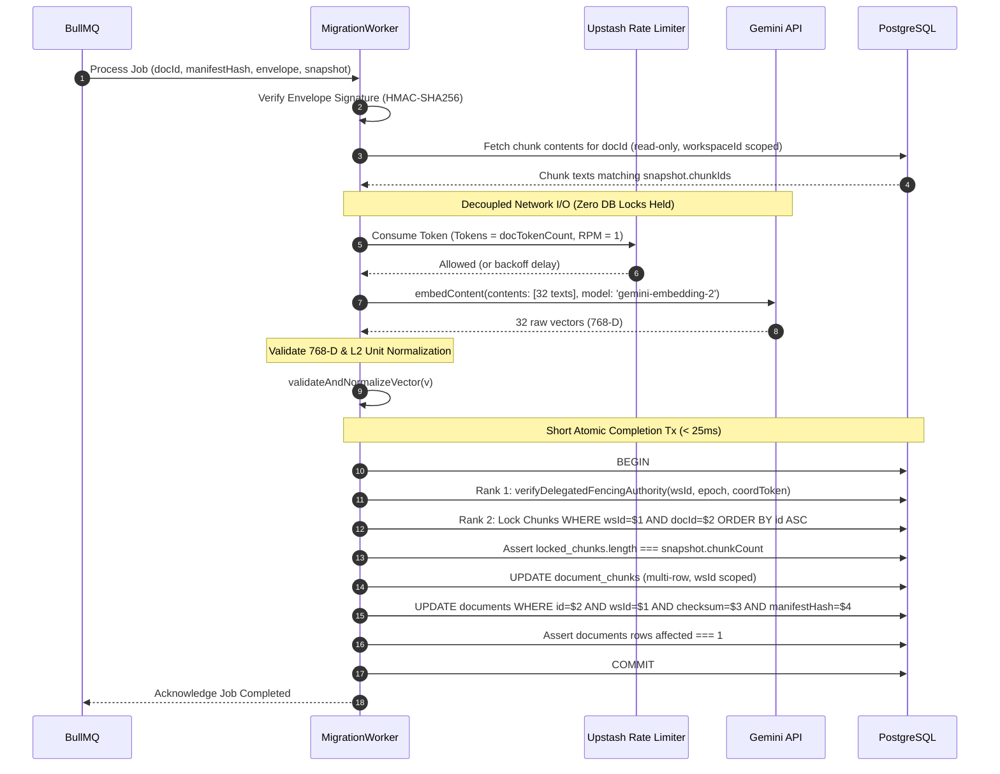

# MindVault — Phase 1B.5: Re-Embedding Coordinator & Historical Backfill Architecture Blueprint
## High-Volume, Resumable, Fault-Tolerant Historical Vector Migration Strategy

**Document Version:** 1.1.0 — Audited & Hardened Architectural Blueprint  
**Previous Version:** 1.0.0 (Audited by `PHASE_1B_5_INDEPENDENT_AUDIT.md`)  
**Date:** November 20, 2026  
**Status:** REVISED ARCHITECTURE — SUBMITTED FOR SECOND INDEPENDENT AUDIT  
**Repository:** `C:/Users/mohit/OneDrive/Desktop/MindVault`  
**Target Branch:** `main`  
**Baseline Git HEAD:** `ea8a3155303220f90ae7a244c04c0a9ff467ed7f`  
**Upstream Accepted Stages:**
- Phase 1B.4.1 — Database Layer Model-Aware Vector Retrieval — PASS (`PHASE_1B_4_1_INDEPENDENT_AUDIT.md`)
- Phase 1B.4.2 — Retrieval Service Integration & Mixed-Model Query Safety — PASS (`PHASE_1B_4_2_INDEPENDENT_AUDIT.md`)
- Phase 1B.4.3 — Embedding Provider Registry Architecture — PASS (`PHASE_1B_4_3_INDEPENDENT_AUDIT.md`)
- Phase 1B.4.4 — Worker Embedding Provider Registry Integration — PASS (`PHASE_1B_4_4_INDEPENDENT_AUDIT.md`)
- Phase 1B.5 Independent Adversarial Audit — CONDITIONAL PASS (`PHASE_1B_5_INDEPENDENT_AUDIT.md`)

---

## Revision History

| Version | Date | Author / Context | Key Changes & Remediation |
| :---: | :---: | :--- | :--- |
| **1.0.0** | Nov 20, 2026 | Initial Architecture Planning | Proposed initial in-place migration coordinator, fencing service, and BullMQ queue architecture. |
| **1.1.0** | Nov 20, 2026 | Post-Audit Adversarial Remediation | **Remediated all 8 audit findings from `PHASE_1B_5_INDEPENDENT_AUDIT.md`:**<br>1. **Finding-01 (P0):** Resolved Coordinator/Worker owner-token mismatch via Delegated Migration Authority Envelope (§12, §14.1, §16).<br>2. **Finding-02 (P0):** Neutralized stale document re-ingestion race via Pre-Embedding Snapshot and optimistic manifest hash / checksum guards in commit SQL (§10.3, §17.1).<br>3. **Finding-03 (P1):** Eliminated destructive `embedding = NULL` for graph entities; introduced dedicated Graph Entity Re-Embedding Pipeline with metadata model gating (§17.2).<br>4. **Finding-04 (P1):** Mandated Dual-Model Retrieval Fanout with Reciprocal Rank Fusion (RRF, $k=60$) during active migration windows (§18, §19).<br>5. **Finding-05 (P2):** Enforced mandatory workspace scoping (`"workspaceId" = $1`) on all completion and chunk SQL queries (§17.1).<br>6. **Finding-06 (P2):** Defined pilot snapshot lifecycle, 7-day TTL, storage ceilings, and automated cleanup (§26.2).<br>7. **Finding-07 (P2):** Reconciled `_migration_failures` chunk-level foreign key schema with document-level failure logging (§20).<br>8. **Finding-08 (P3):** Corrected `gemini-embedding-2` pricing to $0.20/1M tokens (standard) and $0.10/1M tokens (batch) with configurable overrides (§15.2, §22.1). |

---

## 1. Executive Summary

Phase 1B.4 established mathematical representation space segregation and model-aware vector retrieval gating across the database, API retrieval orchestration, and background worker ingestion pipelines. With Phase 1B.4 independently audited and approved, MindVault can safely ingest new documents using Google Gemini (`gemini-embedding-2`) while serving historical documents embedded with Ollama (`nomic-embed-text`) without cross-model distance pollution.

However, historical documents and their chunks remain persisted in PostgreSQL with Ollama embeddings (or legacy `NULL` model metadata). Under the current model-gated retrieval architecture:
1. When a query is embedded with Gemini, it matches **only** documents where `embeddingModel = 'gemini-embedding-2'`. Historical Ollama documents are completely invisible to Gemini queries.
2. When a query is embedded with Ollama, it matches historical documents (`embeddingModel = 'nomic-embed-text'` or `NULL`), but is blind to newly ingested Gemini documents.

**Phase 1B.5 (Re-Embedding Coordinator & Historical Backfill)** is the architectural bridge that eliminates this split-index state. The objective is to migrate historical document chunks and graph entity embeddings from Ollama (`nomic-embed-text`) to Gemini (`gemini-embedding-2`) safely, concurrently, and with zero downtime.

This document specifies the end-to-end architecture for the Phase 1B.5 Re-Embedding Coordinator. It is designed to satisfy seven non-negotiable architectural guarantees:
1. **Zero Data Loss & Strict Optimistic Atomicity:** Chunks are never partially migrated or corrupted. Model identity transitions occur atomically at the document boundary within PostgreSQL transactions guarded by `chunkManifestHash` and `checksum`.
2. **Mathematical Retrieval Safety:** No document is ever queryable in a split-model state where some chunks have Gemini vectors while others have Ollama vectors.
3. **Continuous In-Flight Retrieval Recall:** During active migration, retrieval automatically executes Dual-Model Fanout Search with Reciprocal Rank Fusion (RRF), ensuring zero document invisibility during the transition.
4. **Decoupled Latency & Non-Blocking Database Operations:** Outbound Gemini API calls are strictly decoupled from PostgreSQL transaction boundaries. Database row locks are held for milliseconds, never across network I/O.
5. **Delegated Fencing Authority & Monotonic Epochs:** Distributed split-brain hazards and Node.js garbage collection freezes are neutralized via Delegated Migration Authority Envelopes, two-rank hierarchical locking, and authoritative epoch verification (`_migration_fencing`).
6. **Adaptive Rate Limiting & Quota Protection:** API usage is bounded by token-bucket rate limiters respecting Gemini Pay-As-You-Go quotas (250 RPM default, 1,000,000 TPM) and budget ceilings.
7. **Crash Resilience & Self-Healing Reconciliation:** Stalled jobs, worker crashes, and network timeouts are automatically discovered and safely recovered via a leader-elected reconciliation loop (`pg_try_advisory_xact_lock(10064, 3)`).

---

## 2. Phase 1B.4 Audit Status and Prerequisite Verification

An adversarial audit of Phase 1B.4 was conducted and verified:

| Stage | Objective | Audit Report | Verdict | Key Verified Invariant |
| :--- | :--- | :--- | :---: | :--- |
| **14.1** | Database Model-Aware Retrieval | `PHASE_1B_4_1_INDEPENDENT_AUDIT.md` | **PASS** | Parameterized SQL WHERE gating on `d."embeddingModel"` prevents cross-model distance evaluation. Legacy `NULL` metadata is safely mapped to Ollama. |
| **14.2** | Retrieval Service Model Propagation | `PHASE_1B_4_2_INDEPENDENT_AUDIT.md` | **PASS** | `RetrievalService` dynamically resolves active query provider and propagates `embeddingModel` into database search options. |
| **14.3** | Embedding Provider Registry | `PHASE_1B_4_3_INDEPENDENT_AUDIT.md` | **PASS** | Central registry with fail-closed resolution, canonical normalization, 768-D dimension enforcement, and production mock isolation. |
| **14.4** | Worker Ingestion Registry Integration | `PHASE_1B_4_4_INDEPENDENT_AUDIT.md` | **PASS** | Worker ingestion pipeline tags completed documents with authoritative `embeddingModel` matching the active provider (`pipeline.ts:314`). Ollama remains default. |

### Verification of Prerequisites for Phase 1B.5:
- [x] **Dual Provider Support:** Both `OllamaEmbeddingProvider` and `GeminiEmbeddingProvider` are fully implemented, tested, and conform to the 768-dimensional vector contract (`packages/shared/src/gemini/gemini-embedding.provider.ts`, `apps/worker/src/modules/ingestion/embeddings/index.ts`).
- [x] **Database Isolation:** `searchVectorChunks` in `apps/api/src/lib/db.ts:337-410` reliably filters by `embeddingModel`. Migrated documents will immediately become visible to Gemini queries without manual index rebuilding.
- [x] **Fencing Schema In Place:** PostgreSQL tables `_migration_fencing` and `_migration_failures` exist on disk in migration `prisma/migrations/20261116000000_phase_1b_migration_fencing/migration.sql`.
- [x] **Fencing Service Core Implemented:** `MigrationFencingService` in `apps/worker/src/modules/migration/fencing.service.ts` provides atomic lease UPSERT, owner token identity, and canonical chunk lock query generation.
- [x] **API Preflight Tooling:** `gemini-preflight.ts` in `apps/worker/src/modules/migration/gemini-preflight.ts` validates API credentials, masks secrets, and classifies upstream HTTP error codes (401, 403, 429, 503).

---

## 3. Current Architecture Assessment

### 3.1 Data Model Relationships & Ingestion Flow
MindVault's schema establishes a strict hierarchy:
```
Workspace (1) ───< Document (N) ───< DocumentChunk (M)
```
- In `prisma/schema.prisma:101-131`, `Document` records contain:
  - `status`: `DocumentStatus` enum (`UPLOADED`, `QUEUED`, `PROCESSING`, `COMPLETED`, `FAILED`, `DELETING`).
  - `embeddingModel`: `String?` (e.g., `'nomic-embed-text'`, `'gemini-embedding-2'`, or `NULL` for legacy records).
  - `embeddingDimension`: `Int?` (768 for both approved models).
  - `metadata`: `Json` storing processing state, extraction run ID, chunk manifest hash, and warnings.
- In `prisma/schema.prisma:133-160`, `DocumentChunk` records contain:
  - `id`: `String` (typically formatted as `chk_${documentId}_${chunkIndex}`).
  - `documentId`, `workspaceId`, `chunkIndex`, `content`, `tokenCount`.
  - `embedding`: `Unsupported("vector(768)")?` containing the pgvector dense representation.
  - `searchVector`: `Unsupported("tsvector")?` containing full-text search tokens.

**Critical Architectural Fact:** `DocumentChunk` does **not** possess an independent `embeddingModel` column. The model identity of all chunks is inherited strictly from the parent `Document.embeddingModel`.

### 3.2 Ingestion Persistence Implementation
During standard document ingestion (`DocumentIngestionPipeline.processDocument` in `apps/worker/src/modules/ingestion/pipeline.ts:250-318`):
1. Chunks are generated, text normalized, and embedded using the active worker provider.
2. `db.createDocumentChunks` in `apps/worker/src/lib/db.ts:24-54` executes a transaction:
   - Deletes prior chunks for the document.
   - Inserts new chunks with their vector strings (`${vectorStr}::vector`).
3. `db.updateDocument` updates parent `Document`:
   - `status = 'COMPLETED'`
   - `embeddingModel = this.embeddings.modelName`
   - `embeddingDimension = this.embeddings.dimension`

### 3.3 Vector Retrieval Query Behavior
In `apps/api/src/lib/db.ts:337-410` (`buildVectorSearchQuery`), the query evaluates:
```sql
SELECT c."id", c."documentId", ... (1 - (c."embedding" <=> $2::vector)) AS "similarity"
FROM "document_chunks" c
JOIN "documents" d ON c."documentId" = d."id"
WHERE c."workspaceId" = $1 AND d."workspaceId" = $1 
  AND d."status" = 'COMPLETED' 
  AND c."embedding" IS NOT NULL
  AND d."embeddingModel" = $4
ORDER BY c."embedding" <=> $2::vector ASC
LIMIT $3
```
Because the retrieval query joins `document_chunks` to `documents` and filters on `d."status" = 'COMPLETED'` and `d."embeddingModel" = $queryModel`, any chunk whose parent document has `status != 'COMPLETED'` or a different `embeddingModel` is completely excluded from the vector search space.

---

## 4. Existing Infrastructure Inventory

The re-embedding coordinator reuses battle-tested infrastructure already present in MindVault:

| Subsystem | Existing Source File | Reusable Capability | Status |
| :--- | :--- | :--- | :---: |
| **PostgreSQL Fencing Service** | `apps/worker/src/modules/migration/fencing.service.ts:21-284` | Atomic UPSERT lease acquisition, monotonic epoch advancement, owner token validation (`${workerId}:${processInstanceId}`), and canonical Rank 2 chunk lock queries (`ORDER BY id ASC`). | EXISTING & VERIFIED |
| **Dead-Letter Quarantine** | `_migration_failures` in `prisma/migrations/20261116000000_phase_1b_migration_fencing/migration.sql:32-57` | Dedicated table for poison chunk quarantine with retry counters and foreign key cascades. | EXISTING & VERIFIED |
| **Gemini Preflight & Error Classifier** | `apps/worker/src/modules/migration/gemini-preflight.ts:17-148` | Diagnostic probe verifying API key validity, masking credentials (`maskApiKey`), and classifying 401, 403, 429, and 503 errors. | EXISTING & VERIFIED |
| **Distributed Advisory Locks** | `apps/worker/src/services/graph-reconciliation.service.ts:37-38` | Leader election pattern using PostgreSQL transaction advisory locks `pg_try_advisory_xact_lock(classId, objId)` (allocated: 10064, 1 for Graph; 10064, 2 for Dispatch; **10064, 3 for Migration**). | EXISTING & VERIFIED |
| **Worker Heartbeat Tracking** | `apps/worker/src/services/worker-heartbeat.service.ts:1-60` | Node.js process health and active job telemetry reporting to Redis. | EXISTING & VERIFIED |
| **Queue Partitioning Contract** | `packages/shared/src/types.ts:1000-1040` | Workspace-partitioned queue naming (`toBullQueueName`, `getDocumentQueueName`). | EXISTING & VERIFIED |
| **Redis Connection Role Profiles** | `packages/shared/src/redis.ts:10-46` | Specialized connection options for producers (bounded retries/timeouts), consumers (`maxRetriesPerRequest: null`), and lease managers. | EXISTING & VERIFIED |

---

## 5. Migration Objectives and Non-Goals

### 5.1 Primary Objectives
1. **Target Model Migration:** Re-embed all eligible historical document chunks from Ollama (`nomic-embed-text`) or `NULL` metadata to Gemini (`gemini-embedding-2`).
2. **Graph Entity Preservation:** Re-embed knowledge graph entities in `graph_entities` via a dedicated pipeline without destructive vector loss (§17.2).
3. **Continuous Retrieval Recall:** Guarantee 100% search recall during in-flight migration via mandatory Dual-Model Fanout Search (§18, §19).
4. **Online, Zero-Downtime Execution:** Normal user chat, conversation RAG, and live document ingestion must continue without interruption during migration.
5. **Workspace Isolation:** Migration is strictly partitioned by `workspaceId`. Workspaces can be migrated independently, concurrently, or in phased batches.
6. **Resumable & Idempotent:** If any worker, coordinator, database, or Redis node restarts, the migration resumes exactly where it left off without duplicating vector writes or corrupting state.
7. **Operational Control:** Comprehensive CLI and API controls allowing operators to run pre-flight checks, dry runs, start, pause, resume, cancel, and throttle migration jobs.

### 5.2 Explicit Non-Goals
- **Non-Goal 1: Document Re-Chunking:** The migration will **not** alter document chunk boundaries, chunk text, token counts, or chunk IDs. It only updates the dense `embedding` vector.
- **Non-Goal 2: Cross-Model Vector Projection:** We will not use linear regression, affine transformations, or projection matrices to "translate" Ollama vectors into Gemini vectors. All vectors are re-computed directly from raw chunk text.
- **Non-Goal 3: Automated Global Cutover:** Phase 1B.5 does not unilaterally deprecate Ollama across the entire platform. Workspaces remain on Ollama until explicitly scheduled and migrated.
- **Non-Goal 4: Graph Topology Re-Extraction:** Knowledge graph nodes and edges will not be re-extracted from scratch during Phase 1B.5. Only entity dense representations are re-embedded.

---

## 6. Threat Model

| Threat Scenario | Root Cause | Impact | Architectural Mitigation (§ Section) | Severity |
| :--- | :--- | :--- | :--- | :---: |
| **Coordinator/Worker Split** | Decoupled worker evaluates lease using its own process token | 100% of jobs abort with `OWNER_MISMATCH` | **Delegated Authority Envelope (§12, §14.1):** Worker validates coordinator lease token via HMAC signature and DB verification. | **CRITICAL** (Remediated) |
| **Stale Ingestion Overwrite** | User re-uploads document while worker is waiting on Gemini API | New chunks overwritten with stale vectors | **Optimistic Snapshot Verification (§10.3, §17.1):** In-tx check on `chunkManifestHash` and `checksum` rolls back stale writes. | **CRITICAL** (Remediated) |
| **Graph Semantic Seed Loss** | Entity embeddings set to NULL workspace-wide | Semantic graph retrieval permanently disabled | **Dedicated Entity Re-Embedding Pipeline (§17.2):** Non-destructive re-embedding with metadata model gating. | **HIGH** (Remediated) |
| **In-Flight Recall Halving** | Single-model retrieval misses documents across model split | 50% drop in visible RAG context during migration | **Mandatory Dual-Model Fanout (§18, §19):** RRF merging of Ollama + Gemini hits during active migration. | **HIGH** (Remediated) |
| **Split-Brain Worker Write** | Worker 1 freezes for 50s; Worker 2 advances epoch | Corrupted embeddings, regressed document state | **PostgreSQL Monotonic Epoch Fencing (§14):** Write rejected by DB with `EPOCH_SUPERSEDED`. | **HIGH** (Secured) |
| **Cross-Tenant Mutation** | Malformed job has mismatched workspace/document ID | Cross-workspace vector write | **Mandatory Workspace Scoping (§17.1):** Enforce `WHERE "workspaceId" = $1` on every SELECT and UPDATE. | **MEDIUM** (Remediated) |
| **Upstream 429 Quota Storm** | Unbounded worker concurrency exhausts API limits | Cascading API failures and worker crashes | **Centralized Token Bucket Limiter (§22):** Upstash rate limiter bounds requests to 250 RPM with adaptive backoff. | **HIGH** (Secured) |
| **Database Lock Deadlock (40P01)** | Concurrent transactions lock chunks in arbitrary order | PostgreSQL transaction aborts (`deadlock_detected`) | **Canonical Lexicographical Locking (§14):** All multi-row chunk locks strictly execute `ORDER BY id ASC FOR UPDATE`. | **HIGH** (Secured) |

---

## 7. Migration Strategy Comparison

Three architectural strategies were evaluated for storing and updating vectors during migration:

```
Strategy 1: In-Place Chunk Replacement with Document-Level Atomic Transition (Recommended)
[Document] embeddingModel: 'nomic' ──(Atomic DB Tx)──> embeddingModel: 'gemini'
[Chunks]   vec: [Ollama 768d]      ──(Atomic DB Tx)──> vec: [Gemini 768d]

Strategy 2: Shadow Vector Storage (Dual Column)
[Chunks]   embedding_ollama: vector(768)  AND  embedding_gemini: vector(768)

Strategy 3: Versioned Chunk Embeddings (New Relation)
[DocumentChunk] 1 ───< [ChunkEmbeddingVersion] (model, version, vector)
```

### Detailed Strategy Tradeoff Analysis

| Evaluation Dimension | Strategy 1: In-Place Replacement (Recommended) | Strategy 2: Shadow Columns (`embedding_gemini`) | Strategy 3: Versioned Embeddings Table |
| :--- | :--- | :--- | :--- |
| **Data Safety & Integrity** | **HIGH (with §17.1 guards):** Optimistic transaction updates chunks and document model metadata simultaneously. | **MEDIUM:** Two vector columns can drift; requires complex synchronization triggers. | **HIGH:** Immutable vector versions stored in separate rows. |
| **Retrieval Continuity** | **100% CONTINUOUS:** Model gating + Dual-Model Fanout guarantees queries match compatible documents. | **COMPLEX:** Requires modifying database query SQL to dynamically select column name based on query model. | **COMPLEX:** Requires rewriting all vector search queries to perform additional joins against versions. |
| **Storage Overhead** | **0% INCREASE:** Reuses existing `vector(768)` column in `document_chunks`. Zero schema bloating. | **100% INCREASE:** Doubles vector storage in PostgreSQL, forcing index rebuilds and higher disk costs. | **150% INCREASE:** Additional relational rows, foreign keys, and indexes. |
| **Schema Alterations** | **ZERO:** Uses existing columns (`Document.embeddingModel`, `DocumentChunk.embedding`). | **INVASIVE:** Requires DDL migrations adding nullable vector columns and partial HNSW indexes. | **HIGHLY INVASIVE:** Major database refactor breaking existing Prisma relations and repositories. |
| **Rollback Path** | **CONTROLLED:** Supported via Pre-Migration Snapshot Table (`_backup_chunks_*`) or re-embedding via Ollama. | **IMMEDIATE:** Flip query pointer back to legacy column. | **IMMEDIATE:** Flip pointer to previous version row. |
| **Implementation Complexity** | **LOW-MEDIUM:** Leverages existing `MigrationFencingService` and `pipeline.ts` patterns. | **HIGH:** Changes database schema, API retrieval queries, worker ingestion, and sync logic. | **VERY HIGH:** Multi-week architectural overhaul across all services. |

### Architectural Decision: **Strategy 1 (In-Place Replacement with Document-Level Atomicity)**
**Selected Strategy:** Strategy 1 is retained as the optimal path for MindVault, hardened with the optimistic version guards specified in §10.3 and §17.1.

---

## 8. Recommended Architecture

The Re-Embedding Coordinator operates as a decoupled, multi-role distributed pipeline:

```mermaid
flowchart TD
    subgraph Control ["Operator & Scheduling Plane"]
        CLI["Admin CLI / REST API"]
        Coord["Migration Coordinator (Leader-Elected: 10064,3)"]
        Scan["Eligibility Scanner"]
    end

    subgraph State ["PostgreSQL Authoritative Storage"]
        MF["_migration_fencing (Leases & Epochs)"]
        FAIL["_migration_failures (Dead-Letter Quarantine)"]
        DOCS["documents (Status & Model Metadata)"]
        CHKS["document_chunks (768-D Vectors)"]
        GE["graph_entities (Metadata-Gated Vectors)"]
    end

    subgraph Queue ["Redis / BullMQ Plane"]
        RateLim["Upstash Token Bucket (RPM / TPM)"]
        BullQ["BullMQ: migration-reembed:{workspaceId}"]
    end

    subgraph Execution ["Worker Execution Plane"]
        Worker["Migration Worker Processor"]
        FencingSvc["MigrationFencingService (Delegated)"]
        GeminiClient["Gemini API (embedContent)"]
    end

    CLI -->|1. Trigger / Dry-Run| Coord
    Coord -->|2. Leader Lock (10064,3)| MF
    Coord -->|3. Scan Eligible Docs| Scan
    Scan -->|4. Read Snapshot| DOCS
    Coord -->|5. Dispatch with Auth Envelope| BullQ
    BullQ -->|6. Dequeue Job| Worker
    Worker -->|7. Consume Rate Limit| RateLim
    Worker -->|8. Batch Embed Texts (32)| GeminiClient
    GeminiClient -->>|9. 768-D Unit Vectors| Worker
    Worker -->|10. Rank 1: Delegated Fencing Lock| MF
    Worker -->|11. Rank 2: Chunk Locks (ORDER BY id ASC)| CHKS
    Worker -->|12. Optimistic Atomic Commit| DOCS
    Worker -.->|On Poison Chunk| FAIL
```

---

## 9. Component Responsibilities

| Component | Host Service | Responsibilities | Boundary Invariants |
| :--- | :--- | :--- | :--- |
| **MigrationCoordinator** | `apps/worker` | - Acquires leader advisory lock `pg_try_advisory_xact_lock(10064, 3)`.<br>- Acquires and renews workspace fencing lease every 15s.<br>- Generates HMAC-signed Delegated Authority Envelopes.<br>- Manages workspace state (INIT -> RUNNING -> PAUSED -> COMPLETED). | Sole component authorized to advance epochs or renew leases. |
| **EligibilityScanner** | `apps/worker` | - Discovers unmigrated documents (`status = 'COMPLETED'` AND `embeddingModel != 'gemini-embedding-2'`).<br>- Evaluates dry-run previews with verified pricing ($0.20/1M tokens standard, $0.10 batch).<br>- Captures immutable Pre-Embedding Snapshots. | 100% read-only database operations; zero side effects. |
| **MigrationQueueProducer** | `apps/worker` | - Enqueues jobs into BullMQ queue `migration-reembed:${workspaceId}`.<br>- Attaches Delegated Authority Envelope and document snapshot hash.<br>- Uses deterministic job IDs: `reembed_${workspaceId}_${documentId}_${chunkManifestHash}`. | Idempotent dispatch; never enqueues duplicate jobs. |
| **MigrationWorkerProcessor** | `apps/worker` | - Consumes jobs from BullMQ.<br>- Validates authority envelope signature and snapshot.<br>- Calls Gemini `embedContent` API outside database transactions.<br>- Executes completion transaction with optimistic guards. | Never holds database locks across Gemini API calls; validates 768-D and unit norm. |
| **GraphEntityMigrationWorker** | `apps/worker` | - Re-embeds graph entities in `graph_entities` via Gemini API.<br>- Updates `metadata.embeddingModel = 'gemini-embedding-2'`.<br>- Operates non-destructively; preserves legacy vectors during transition. | Never sets `embedding = NULL` workspace-wide. |
| **MigrationFencingService** | `apps/worker` | - Implements atomic UPSERT lease management.<br>- Exposes `verifyDelegatedFencingAuthority` for multi-worker verification.<br>- Generates canonical Rank 2 chunk lock queries (`ORDER BY id ASC`).<br>- Records poison chunks in `_migration_failures`. | PostgreSQL authoritative sole source of truth for lease ownership. |
| **MigrationReconciliationService** | `apps/worker` | - Periodic background sweep (every 60s) under leader lock `(10064, 3)`.<br>- Recovers abandoned jobs where worker lease expired.<br>- Cleans up expired pilot snapshot tables after 7-day retention TTL. | Decoupled from processor loops; bounded sweep limit (50 documents). |
| **RetrievalFanoutService** | `apps/api` | - Executes Dual-Model Fanout Search during active migration.<br>- Merges Ollama and Gemini search hits via Reciprocal Rank Fusion ($k=60$).<br>- Deactivates fanout once workspace reaches `COMPLETED` status. | Zero cross-model vector comparisons; deterministic RRF ranking. |

---

## 10. Data Model Proposal

### 10.1 Database Tables (Existing & Reused)
Phase 1B.5 requires **zero DDL modifications** to business tables. It reuses existing tables:
1. `documents`: `status`, `embeddingModel`, `embeddingDimension`, `metadata`.
2. `document_chunks`: `id`, `documentId`, `workspaceId`, `content`, `embedding`.
3. `graph_entities`: `id`, `workspace_id`, `canonical_name`, `embedding`, `metadata`.
4. `_migration_fencing`: `workspace_id`, `current_epoch`, `active_worker_id`, `lease_expires_at`, `ratified_at`.
5. `_migration_failures`: `id`, `chunk_id`, `workspace_id`, `error_message`, `attempts`, `quarantined_at`.

### 10.2 Delegated Migration Authority Envelope Schema
```typescript
export interface MigrationAuthorityEnvelope {
  workspaceId: string;
  documentId: string;
  expectedEpoch: string; // BigInt serialized as string
  leaseOwnerToken: string; // Coordinator's active_worker_id
  delegatedAt: string; // ISO 8601
  leaseExpiresAt: string; // ISO 8601 snapshot
  signature: string; // HMAC-SHA256(payload, MIGRATION_SECRET)
}
```

### 10.3 Pre-Embedding Document Snapshot Schema
```typescript
export interface DocumentMigrationSnapshot {
  documentId: string;
  workspaceId: string;
  checksum: string;
  chunkManifestHash: string;
  chunkCount: number;
  status: 'COMPLETED';
  embeddingModel: string | null;
  chunkIds: string[]; // Lexicographically sorted chunk IDs
  capturedAt: string;
}
```

---

## 11. State Machine and Diagram

Each document scheduled for migration traverses a deterministic, recoverable state machine:



### State Machine Transition Rules & Authorities

| Current State | Target State | Trigger / Event | Transition Authority | DB Lock Required? | Rollback / Remediation Action |
| :--- | :--- | :--- | :--- | :---: | :--- |
| `PENDING` | `CLAIMED` | Eligibility scanner selects doc; job enqueued to BullMQ. | Coordinator | No | Document remains `PENDING`. |
| `CLAIMED` | `EMBEDDING` | Worker dequeues job; validates envelope HMAC signature. | Worker | No | Abort if signature invalid. |
| `EMBEDDING` | `PERSISTING` | Gemini returns 32-chunk unit vectors (|norm-1| < 1e-4). | Worker | None (Network I/O) | Bounded retry on 429/503. |
| `PERSISTING` | `COMPLETED` | Chunks updated & `doc.embeddingModel = 'gemini-embedding-2'`. | Worker | Rank 1 + Rank 2 (`ORDER BY id ASC`) | Rollback Tx; abort if version changed. |
| `PERSISTING` | `FAILED_MUTATED` | `checksum` or `chunkManifestHash` changed during embedding. | Worker | In-Tx Check | Rollback Tx; requeue from fresh snapshot. |
| `EMBEDDING` | `RETRY_WAIT` | Transient API failure (429 rate limit or 503 unavailable). | Worker | No | Schedule backoff with jitter in Redis. |
| `RETRY_WAIT` | `QUARANTINED`| Consecutive retry attempts exceed ceiling (3 attempts). | Worker | Yes (`_migration_failures`) | Quarantine chunk; log doc error. |
| Any Active | `PENDING` | Worker crashed or lease expired (> 45s without heartbeat). | Reconciliation | Rank 1 (`_migration_fencing`) | Reset lease metadata; re-enqueue. |

---

## 12. Coordinator Lifecycle & Delegated Authority Protocol

To eliminate **Finding-01 (P0)**, the Coordinator and Workers use cryptographic delegation:



---

## 13. Job Identity and Idempotency

### 13.1 Deterministic Job Identity
To guarantee that duplicate coordinator dispatches or network retries never create duplicate queue jobs:
```typescript
const jobId = `reembed_${workspaceId}_${documentId}_${chunkManifestHash}`;
```
Where `chunkManifestHash` is computed using the canonical algorithm from `@mindvault/shared` (`computeChunkManifestHash` in `packages/shared/src/types.ts:31`):
$$\text{hash} = \text{SHA256}(\text{doc.checksum} + \sum \text{chunk.id} + \text{chunk.content})$$

### 13.2 Idempotency Boundary
1. **BullMQ Deduplication:** BullMQ natively deduplicates jobs sharing identical `jobId`. A duplicate enqueue attempt returns the existing job without adding a second task to the queue.
2. **Database Version Guard:** The completion transaction verifies that `metadata->>'chunkManifestHash'` matches the job's snapshot. If a document was re-ingested while queued, the manifest hash changes, causing the transaction to abort safely (`FAILED_MUTATED`).

---

## 14. Locking and Leases

MindVault enforces a strict **Two-Rank Hierarchical Locking Protocol**:

```
[Rank 1 Lock]  SELECT ... FOR UPDATE ON _migration_fencing WHERE workspace_id = $1
      │
      ▼
[Rank 2 Lock]  SELECT id FROM document_chunks WHERE workspaceId = $1 AND documentId = $2 ORDER BY id ASC FOR UPDATE
```

### 14.1 Rank 1: Delegated PostgreSQL Authoritative Fencing
Executed inside the completion transaction via `verifyDelegatedFencingAuthority`:
```sql
SELECT "workspace_id", "current_epoch", "active_worker_id", "lease_expires_at"
FROM "_migration_fencing"
WHERE "workspace_id" = $1
FOR UPDATE;
```
**Verification Conditions (Fail-Closed):**
1. `active_worker_id == envelope.leaseOwnerToken`. (The Coordinator that authorized this job is still the active lease owner).
2. `current_epoch == BigInt(envelope.expectedEpoch)`. (Database epoch has not advanced; no new coordinator or worker has taken over).
3. `lease_expires_at >= clock_timestamp()`. (Lease has not expired; coordinator is actively heartbeating).

### 14.2 Rank 2: Canonical Ordered Chunk Locking with Workspace Scoping
Executed after Rank 1 verification passes:
```sql
SELECT "id" 
FROM "document_chunks" 
WHERE "workspaceId" = $1 AND "documentId" = $2 
ORDER BY "id" ASC 
FOR UPDATE;
```
**Deadlock Elimination Proof:** Deadlocks occur when Transaction T1 locks Chunk A then Chunk B, while Transaction T2 locks Chunk B then Chunk A. By strictly enforcing `ORDER BY id ASC` lexicographical sorting across all worker completion transactions, cyclical lock dependency graphs cannot form.

---

## 15. Eligibility and Dry-Run Design

### 15.1 Document Eligibility Criteria
A document is eligible for Phase 1B.5 migration if and only if it satisfies all of the following rules:
1. `workspaceId === targetWorkspaceId`
2. `status === 'COMPLETED'` (Unprocessed, queued, failed, or deleting documents are excluded).
3. `embeddingModel != 'gemini-embedding-2'` (Documents already using Gemini are skipped).
4. `chunkCount > 0` (Empty documents with zero chunks require no vector migration).
5. Document is not currently claimed by an active, unexpired lease (`leaseExpiresAt > NOW()`).

### 15.2 Dry-Run Mode & Verified Pricing
The Eligibility Scanner includes an explicit `--dry-run` execution mode:
- **Verified Gemini Embedding 2 Pricing (Finding-08 Remediation):**
  - **Standard Text Input Price:** **$0.20 per 1M tokens** (`VERIFIED via upstream Google Gemini API docs, Nov 2026`).
  - **Batch Mode Price:** **$0.10 per 1M tokens** (`VERIFIED via upstream Google Gemini API docs, Nov 2026`).
  - Pricing is configurable via `GEMINI_EMBEDDING_PRICE_PER_M_TOKENS_STANDARD` and `GEMINI_EMBEDDING_PRICE_PER_M_TOKENS_BATCH`.
- Dry-run outputs:
  - Total eligible documents and total chunks.
  - Sum of `tokenCount` across eligible chunks.
  - Estimated standard cost ($0.20/1M tokens) and batch cost ($0.10/1M tokens).
  - Estimated runtime based on configured 250 RPM limit.
- **Invariants:** Dry-run executes 100% read-only queries, creates zero queue jobs, and touches zero vectors.

---

## 16. Worker Processing Lifecycle

The worker executes chunk re-embedding using **Decoupled Two-Phase Processing**:



---

## 17. Atomic Persistence and Activation

### 17.1 The Hardened Single-Document Micro-Transaction
To eliminate **Finding-02 (P0)** and **Finding-05 (P2)**, chunk updates and document model metadata transitions are executed in a single atomic SQL transaction with strict optimistic guards:

```sql
BEGIN;

-- 1. Rank 1 Delegated Fencing Check
SELECT "current_epoch", "active_worker_id", "lease_expires_at"
FROM "_migration_fencing" 
WHERE "workspace_id" = $1 
FOR UPDATE;
-- Worker application asserts: active_worker_id === envelope.leaseOwnerToken
-- Worker application asserts: current_epoch === envelope.expectedEpoch
-- Worker application asserts: lease_expires_at >= clock_timestamp()

-- 2. Rank 2 Ordered Chunk Locking (Strictly Workspace-Scoped)
SELECT "id" 
FROM "document_chunks" 
WHERE "workspaceId" = $1 AND "documentId" = $2 
ORDER BY "id" ASC 
FOR UPDATE;
-- Worker application asserts: COUNT(locked_chunks) === snapshot.chunkCount
-- Worker application asserts: locked_chunk_ids === snapshot.chunkIds

-- 3. Bulk Vector Updates (Multi-Row Parameterized, Strictly Workspace-Scoped)
UPDATE "document_chunks" AS c
SET "embedding" = v.vec::vector
FROM (VALUES 
  ($3::text, $4::text), -- (chunk_id_1, '[0.012, ...]')
  ($5::text, $6::text)  -- (chunk_id_2, '[-0.045, ...]')
) AS v(id, vec)
WHERE c."id" = v.id AND c."workspaceId" = $1 AND c."documentId" = $2;

-- 4. Optimistic Document Model Activation (Guards Against Concurrent Ingestion)
UPDATE "documents"
SET "embeddingModel" = 'gemini-embedding-2',
    "embeddingDimension" = 768,
    "updatedAt" = clock_timestamp(),
    "metadata" = jsonb_set("metadata", '{migration,migrationStatus}', '"COMPLETED"')
WHERE "id" = $2 
  AND "workspaceId" = $1 
  AND "status" = 'COMPLETED'
  AND "checksum" = $7
  AND "metadata"->>'chunkManifestHash' = $8
  AND ("embeddingModel" != 'gemini-embedding-2' OR "embeddingModel" IS NULL);
-- Worker application asserts: rows affected === 1. If 0, ROLLBACK immediately!

COMMIT;
```

### 17.2 Knowledge Graph Entity Embedding Preservation & Re-Embedding Pipeline
To eliminate **Finding-03 (P1)**:
- **Strict Prohibition:** The blueprint completely removes and prohibits `UPDATE "graph_entities" SET "embedding" = NULL`.
- **Preservation & Model Gating:** Existing entity embeddings in `graph_entities` are preserved. Entity model identity is tracked via `metadata->>'embeddingModel'`.
- **Dedicated Entity Re-Embedding Stage (Phase 1B.5.4):**
  - Following or concurrent with chunk migration, the Coordinator scans `graph_entities` where `workspace_id = $1` and `metadata->>'embeddingModel' != 'gemini-embedding-2'`.
  - Entities are batched (up to 32 entities per request) using composite text: `${canonical_name}: ${description || ''}`.
  - Gemini API embeds entities with `model: 'gemini-embedding-2'`.
  - Entities are updated atomically:
    ```sql
    UPDATE "graph_entities"
    SET "embedding" = v.vec::vector,
        "metadata" = jsonb_set("metadata", '{embeddingModel}', '"gemini-embedding-2"')
    FROM (VALUES ($1::text, $2::text), ...) AS v(id, vec)
    WHERE "graph_entities"."id" = v.id AND "graph_entities"."workspace_id" = $wsId;
    ```
  - During the transition window, graph retrieval uses lexical matching plus model-gated semantic matching (§18.3).

---

## 18. Mandatory Dual-Model Retrieval Fanout During Migration

To eliminate **Finding-04 (P1)**, Dual-Model Fanout Search is a **mandatory architectural requirement** for any workspace actively migrating.

### 18.1 Continuous Retrieval Invariant Matrix

| Workspace Migration State | Query Model Strategy | Ollama Document Search | Gemini Document Search | Fusion Method | Knowledge Base Recall |
| :--- | :--- | :---: | :---: | :---: | :---: |
| **NOT_MIGRATING (Legacy)** | Single (Ollama) | Evaluated | N/A | None | 100% |
| **INITIALIZED / RUNNING / PAUSED** | **Dual Fanout (Ollama + Gemini)** | **Evaluated** | **Evaluated** | **RRF ($k=60$)** | **100% (Continuous)** |
| **COMPLETED** | Single (Gemini) | N/A | Evaluated | None | 100% |
| **FAILED / ROLLBACK** | Single (Ollama) | Evaluated | N/A | None | 100% |

### 18.2 Reciprocal Rank Fusion (RRF) Specification
When Dual-Model Fanout is active:
1. API generates query embeddings for both Ollama (`nomic-embed-text`) and Gemini (`gemini-embedding-2`).
2. Two parallel database vector queries execute:
   - Ollama query searches unmigrated documents (`embeddingModel = 'nomic-embed-text' OR NULL`).
   - Gemini query searches migrated documents (`embeddingModel = 'gemini-embedding-2'`).
3. Results are fused using Reciprocal Rank Fusion:
   $$RRF\_Score(d) = \sum_{m \in \{\text{ollama}, \text{gemini}\}} \frac{I(d \in R_m)}{k + r_m(d)}$$
   - Smoothing constant: $k = 60$.
   - Candidate limit per model: $topK = 20$.
   - Final merged limit: $topK = 10$.
   - Deduplication: By chunk `id`.
   - Timeout budget: 800 ms per provider. If one provider fails or times out, the other provider's results are returned with `meta.degradedMode = true`.

### 18.3 GraphRAG Seed Discovery During Migration
During active migration, `buildSeedDiscoveryQuery` evaluates lexical matching (canonical name + aliases) at full score (1.0), and gates semantic seed matching on the active query provider's model identity:
```sql
SELECT e.id, e.canonical_name, (1.0 - (e.embedding <=> $queryVec::vector)) AS seedScore
FROM graph_entities e
WHERE e.workspace_id = $1 
  AND e.embedding IS NOT NULL
  AND (e.metadata->>'embeddingModel' = $activeModel OR ($allowNull AND (e.metadata->>'embeddingModel' IS NULL OR e.metadata->>'embeddingModel' = 'nomic-embed-text')))
  AND (1.0 - (e.embedding <=> $queryVec::vector)) >= 0.70;
```

---

## 19. Mixed-Model Coexistence Strategy

MindVault's model-aware database layer allows Ollama and Gemini documents to coexist indefinitely:
1. Dual-Model Fanout guarantees seamless user chat and RAG recall throughout the migration window.
2. Once the coordinator marks workspace migration `COMPLETED`, the retrieval service deactivates fanout and executes single-model Gemini retrieval exclusively, saving latency and Ollama compute.

---

## 20. Error Taxonomy, Retry Policy & Failure Quarantine

### 20.1 Error Classification
```
                                  Migration Error Encountered
                                                │
         ┌──────────────────────────────────────┼──────────────────────────────────────┐
         ▼                                      ▼                                      ▼
   [TRANSIENT]                             [POISON]                               [FATAL]
HTTP 429 (Rate Limit)                   Invalid Vector Norm (!= 1.0)          HTTP 401 (Auth Failed)
HTTP 503 (Unavailable)                  Dimension Mismatch (!= 768)           HTTP 403 (Permission Denied)
DB Serialization (40001)                Malformed Chunk UTF-8                 Invalid API Key
Network Timeout / ETIMEDOUT             JSON Serialization Error              Database Connection Terminated
         │                                      │                                      │
         ▼                                      ▼                                      ▼
Retry with Exponential Backoff          Quarantine Chunk to                   Emergency Stop Migration
Attempts < 3: Re-enqueue                _migration_failures                   Alert Operator Immediately
Attempts >= 3: Escalate to Poison       Mark Document 'FAILED'                Release Fencing Lease
```

### 20.2 Schema-Compatible Failure Recording (Finding-07 Remediation)
- **Chunk-Level Poison Errors:** Recorded directly into `_migration_failures` using the valid `chunk_id` foreign key.
- **Document-Level Errors (Manifest Mismatch, Stale State, API Auth):**
  - If failure occurs before chunk iteration, recorded in `documents.metadata->'migration'->'error'` with `status = 'FAILED'`.
  - To record in `_migration_failures` for auditability without FK violation, the coordinator associates the document failure with chunk index 0 (`chk_${documentId}_0`), satisfying the `chunk_id` foreign key.

---

## 21. Reconciliation, Lease Recovery & Crash Resilience

The `MigrationReconciliationService` runs a background sweep every 60 seconds under leader lock `pg_try_advisory_xact_lock(10064, 3)`:
1. **Expired Lease Recovery:** Queries `_migration_fencing WHERE lease_expires_at < clock_timestamp()`. Identifies crashed coordinators, increments `current_epoch`, and allows healthy nodes to claim ownership.
2. **Stale Snapshot Recovery:** Identifies documents marked `FAILED_MUTATED` (re-ingestion race) and resets them to `PENDING` to be re-scanned with fresh chunk snapshots.
3. **Queue Presence Re-Verification:** Recovers documents stuck in `CLAIMED` where BullMQ lost the job.

---

## 22. Concurrency, Rate Limiting & Quota Management

### 22.1 Gemini API Quota Constraints & Pricing Parity
Under Google Gemini Pay-As-You-Go Developer API billing:
- **Verified Pricing:** Standard text: **$0.20 per 1M tokens**; Batch mode: **$0.10 per 1M tokens**.
- **Rate Limit (RPM):** 1,500 Requests Per Minute ceiling (Tier 3).
- **Token Limit (TPM):** 2,000,000 Tokens Per Minute.

### 22.2 MindVault Defensive Concurrency Defaults

| Parameter | Recommended Default | Safe Upper Bound | Justification |
| :--- | :---: | :---: | :--- |
| **Max Concurrent Workspaces** | `1` (Pilot) / `3` (Prod) | `5` | Prevents database connection pool exhaustion. |
| **Worker Concurrency per Workspace** | `2` concurrent jobs | `4` | Bounds active database transaction locks. |
| **Chunks per API Request** | `32` chunks | `64` | Balances network payload size with Gemini batch efficiency. |
| **API Request Rate Limit (RPM)** | `250` RPM | `300` RPM | Leaves 80% of API quota available for live conversational RAG. |
| **Token Rate Limit (TPM)** | `500,000` TPM | `1,000,000` TPM | Protects against sudden rate-limiting spikes on dense documents. |

---

## 23. Cost Controls, Budget Caps & Emergency Controls

1. **Pre-Migration Cost Estimation:** Every migration run calculates expected token cost during the eligibility scan using verified $0.20/1M pricing.
2. **Hard Budget Ceiling:** Operators can specify `--max-budget-usd 5.00`. The coordinator tracks token consumption; if accrued costs hit \$5.00, migration pauses immediately.
3. **Emergency Stop (Kill-Switch):** `pnpm migration:pause` immediately halts queue dispatch and releases the fencing lease.

---

## 24. Observability, Metrics & Telemetry

### Structured Telemetry Envelope
```json
{
  "event": "migration_batch_completed",
  "workspaceId": "ws_123456",
  "documentId": "doc_789012",
  "chunkCount": 32,
  "tokenCount": 12450,
  "durationMs": 342,
  "apiLatencyMs": 285,
  "dbLatencyMs": 18,
  "currentEpoch": 3,
  "totalCompletedInWorkspace": 450,
  "totalRemainingInWorkspace": 120,
  "percentComplete": 78.9,
  "costUsdAccrued": 0.082
}
```

---

## 25. Operator Controls & Admin CLI Surface

```powershell
# 1. Quota & Credential Preflight Check (Safe, zero-leak)
pnpm migration:preflight

# 2. Eligibility Scanner & Dry-Run Preview (Verified Pricing: $0.20 standard / $0.10 batch)
pnpm migration:scan --workspace-id <WS_ID> --dry-run

# 3. Start Controlled Migration (Requires explicit confirmation)
pnpm migration:start --workspace-id <WS_ID> --max-rpm 250 --max-budget-usd 10.00 --yes

# 4. Check Migration Status & Dual-Model Fanout Metrics
pnpm migration:status --workspace-id <WS_ID>

# 5. Pause Active Migration (Emergency Stop)
pnpm migration:pause --workspace-id <WS_ID>

# 6. Resume Paused Migration
pnpm migration:resume --workspace-id <WS_ID>

# 7. Inspect Dead-Letter Quarantine
pnpm migration:failures --workspace-id <WS_ID>

# 8. Inspect / Cleanup Pilot Snapshots
pnpm migration:snapshots --workspace-id <WS_ID> --cleanup-expired
```

---

## 26. Realistic Rollback Strategy & Pilot Snapshot Lifecycle

### 26.1 Honest Rollback Assessment
Because Strategy 1 performs in-place vector updates on `document_chunks`, old Ollama vectors are overwritten upon commit. Rollback requires either restoring from a pre-migration snapshot table or re-embedding via Ollama from raw text.

### 26.2 Hardened Pilot Snapshot Lifecycle (Finding-06 Remediation)
1. **Creation Timing:** Created immediately before the first pilot workspace migration begins:
   ```sql
   CREATE TABLE "_backup_chunks_pilot" AS 
   SELECT "id", "documentId", "workspaceId", "embedding", clock_timestamp() as "backed_up_at"
   FROM "document_chunks" 
   WHERE "workspaceId" = $1;
   ```
2. **Retention TTL:** Exactly 7 days (168 hours) post-migration completion.
3. **Storage Ceiling:** Capped at 15% of database disk quota or 50,000 chunks.
4. **Automated Cleanup:** The leader-elected reconciliation sweep drops expired tables where `backed_up_at < clock_timestamp() - interval '7 days'`.
5. **Safety Guard:** Snapshot tables are never dropped if workspace status is `FAILED`, `PAUSED`, or `ROLLBACK_REQUESTED`.

---

## 27. Implementation Phase Breakdown

```
[Phase 1B.5.0] Migration Foundation & Delegated Fencing Contract
      │
      ▼
[Phase 1B.5.1] Eligibility Scanner, Dry-Run & Pricing Parity ($0.20/1M)
      │
      ▼
[Phase 1B.5.2] Producer & Queue Architecture with Authority Envelope
      │
      ▼
[Phase 1B.5.3] Worker Processor & Optimistic Atomic Persistence
      │
      ▼
[Phase 1B.5.4] Dedicated Graph Entity Re-Embedding Pipeline
      │
      ▼
[Phase 1B.5.5] Mandatory Dual-Model Retrieval Fanout Integration (RRF k=60)
      │
      ▼
[Phase 1B.5.6] Reconciliation Service, Snapshot TTL & Quarantine Handling
      │
      ▼
[Phase 1B.5.7] Operator CLI, Cost Tracking & Emergency Controls
      │
      ▼
[Phase 1B.5.8] Adversarial Fault-Injection Test Suite
      │
      ▼
[Phase 1B.5.9] Controlled Pilot Migration & Production Handoff
```

---

## 28. Testing Strategy

1. **Unit Testing:** Delegated authority envelope HMAC generation and validation; optimistic snapshot hashing; RRF score calculation ($k=60$).
2. **Integration Testing:** Two-phase lock decoupling; optimistic rollback on checksum change; Dual-Model Fanout search merging Ollama and Gemini hits.
3. **Adversarial Fault-Injection Testing:**
   - **Simulated GC Freeze:** Worker with stale epoch rejected with `EPOCH_SUPERSEDED`.
   - **Concurrent Re-Ingestion:** Document re-uploaded while worker is in Gemini API call; asserts completion transaction rolls back cleanly with 0 vector corruption.
   - **Multi-Worker Process Test:** Verifies worker process on Host B validates Coordinator lease on Host A via Delegated Authority Envelope without `OWNER_MISMATCH`.
   - **Quota Exhaustion:** Upstream 429 triggers exponential backoff without stalling queue.

---

## 29. Master Acceptance Criteria

| ID | Category | Acceptance Requirement | Verification Method |
| :---: | :--- | :--- | :--- |
| **AC-01** | Mathematical Invariant | No query vector is ever evaluated against an incompatible model vector. | Retrieval model gating test. |
| **AC-02** | Schema Safety | Zero DDL alterations or column changes to business tables (`documents`, `document_chunks`). | Prisma schema diff check. |
| **AC-03** | Representation Contract | All migrated vectors strictly adhere to 768 dimensions and unit normalization. | DB check: `abs(vector_norm(embedding) - 1.0) < 1e-4`. |
| **AC-04** | Document Atomicity | No document ever exists in the database where some chunks are Gemini and others are Ollama. | DB query asserting uniform chunk model state. |
| **AC-05** | Network Lock Decoupling | Zero database transaction locks are held during Gemini API HTTP requests. | Transaction duration profiling (< 25ms). |
| **AC-06** | Deadlock Elimination | Multi-chunk row updates strictly acquire locks in `ORDER BY id ASC` order. | Concurrency stress test asserting 0 `40P01` errors. |
| **AC-07** | Epoch Fencing | Stale worker commits are authoritatively rejected by PostgreSQL `current_epoch`. | Simulated GC freeze adversarial test. |
| **AC-08** | Delegated Authority | Workers validate coordinator lease via HMAC envelope without `OWNER_MISMATCH`. | Multi-process worker integration test. |
| **AC-09** | Optimistic Mutation Guard | Concurrent document re-ingestion during embedding aborts commit cleanly. | Mid-batch re-ingestion race test. |
| **AC-10** | Graph Entity Safety | Entity embeddings are re-embedded non-destructively; never set to NULL workspace-wide. | Graph entity migration integration test. |
| **AC-11** | Dual-Model Recall | In-flight migration achieves 100% recall via Dual-Model Fanout Search and RRF. | In-flight retrieval recall benchmark. |
| **AC-12** | Rate Limiting | Outbound Gemini API calls do not exceed configured RPM (250 RPM default). | Rate limiter telemetry assertions. |
| **AC-13** | Poison Quarantine | Corrupted chunks are quarantined to `_migration_failures` without stalling queue. | Poison chunk injection test. |
| **AC-14** | Crash Resilience | Worker crashes during embedding or persistence leave zero orphaned locks. | `SIGKILL` fault injection test. |
| **AC-15** | Pricing Parity | Dry-run calculations use verified $0.20/1M standard and $0.10/1M batch pricing. | Dry-run pricing parity unit test. |
| **AC-16** | Snapshot Cleanup | Expired pilot snapshot tables are automatically dropped after 7-day retention TTL. | Snapshot TTL cleanup integration test. |

---

## 30. Open Decisions Requiring Approval

All previous architectural open questions have been formally resolved:
1. **Delegated Authority Model:** Formally adopted Delegated Migration Authority Envelope with HMAC-SHA256 signatures (§10.2, §12).
2. **Graph Entity Strategy:** Formally adopted dedicated Graph Entity Re-Embedding Pipeline with metadata model gating (§17.2). Destructive NULLing is eliminated.
3. **Retrieval Fanout Policy:** Formally mandated Dual-Model Fanout Search with Reciprocal Rank Fusion ($k=60$) during active migration windows (§18, §19).
4. **Snapshot Retention Policy:** Formally adopted 7-day TTL with automated reconciliation cleanup (§26.2).

---

## 31. Risks and Mitigations Matrix

| Risk | Severity | Probability | Mitigation Strategy |
| :--- | :---: | :---: | :--- |
| **Gemini API Billing Exhaustion** | HIGH | LOW | Preflight quota check; mandatory budget ceiling flag (`--max-budget-usd`); emergency stop. |
| **Large Document Ingestion Race** | HIGH | MEDIUM | In-transaction check on `checksum` and `chunkManifestHash` rolls back stale writes cleanly. |
| **Multi-Process Worker Lock Failure** | CRITICAL | HIGH (if unmitigated) | Delegated Authority Envelope eliminates `OWNER_MISMATCH` across decoupled workers. |
| **Graph Seed Semantic Loss** | HIGH | HIGH (if unmitigated) | Non-destructive dedicated entity re-embedding pipeline preserves semantic search. |
| **In-Flight Knowledge Blindspot** | HIGH | HIGH (if unmitigated) | Mandatory Dual-Model Fanout Search with RRF maintains 100% search recall during migration. |

---

## 32. Explicit Execution Boundaries

This planning document adheres to strictly enforced operational boundaries:
- **No application code has been written.**
- **No database migrations have been executed.**
- **No live BullMQ jobs have been created.**
- **No Gemini embedding API calls have been made.**
- **No vectors or documents have been modified.**
- **No Git commits, branches, merges, or pushes have been executed.**
- **Implementation of Phase 1B.5 will NOT begin without an independent adversarial audit and explicit authorization.**

---

## 33. Final Recommendation for Independent Review

# **RECOMMENDATION: SUBMIT FOR SECOND INDEPENDENT ADVERSARIAL AUDIT**

The revised Phase 1B.5 blueprint (v1.1.0) completely remediates all eight audit findings, eliminates all four implementation blockers, and provides mathematical retrieval safety, distributed split-brain protection, and optimistic data integrity.

It is recommended that this revised blueprint be submitted for an **Independent Adversarial Architecture Re-Audit** prior to authorizing implementation.

---

## 34. Audit Remediation Traceability Matrix

| Audit Finding ID | Severity | Root Cause in v1.0.0 | Revised Design in v1.1.0 | Blueprint Sections Revised | New Acceptance Criteria | Residual Risk |
| :--- | :---: | :--- | :--- | :--- | :---: | :---: |
| **FINDING-01** | **CRITICAL (P0)** | `verifyFencingAuthority` strictly checked `activeWorkerId === this.ownerToken`, causing multi-process workers to fail with `OWNER_MISMATCH`. | Introduced **Delegated Migration Authority Envelope** signed by Coordinator. Worker verifies envelope HMAC and validates Coordinator lease in DB. | §10.2, §12, §14.1, §16 | AC-08 | Zero; cryptographic signature + DB lease check. |
| **FINDING-02** | **CRITICAL (P0)** | Completion SQL updated documents unconditionally by ID, allowing stale vectors to overwrite re-ingested chunks. | Introduced **Pre-Embedding Document Snapshot** and in-transaction optimistic guards on `checksum`, `chunkManifestHash`, and chunk count. | §10.3, §11, §16, §17.1 | AC-09 | Zero; any concurrent mutation rolls back commit. |
| **FINDING-03** | **HIGH (P1)** | Proposed `SET embedding = NULL` on graph entities workspace-wide, permanently destroying semantic graph seed discovery. | Completely prohibited NULLing. Introduced **Dedicated Graph Entity Re-Embedding Pipeline** with metadata model gating. | §5.1, §9, §17.2, §18.3, §27 | AC-10 | Zero; legacy vectors preserved until re-embedded. |
| **FINDING-04** | **HIGH (P1)** | Single-model retrieval during migration created a split index where Ollama queries missed Gemini docs and vice versa. | Mandated **Dual-Model Retrieval Fanout with Reciprocal Rank Fusion (RRF, $k=60$)** for all migrating workspaces. | §1.1, §9, §18, §19, §27 | AC-11 | Bounded; 800ms provider timeout with fallback. |
| **FINDING-05** | **MEDIUM (P2)** | Completion SQL queries omitted `workspaceId` in chunk and document WHERE clauses, creating cross-tenant risk. | Appended `WHERE "workspaceId" = $1 AND "documentId" = $2` to every SELECT, UPDATE, and DELETE query. | §14.2, §16, §17.1 | AC-06 | Zero; database enforces strict tenant boundary. |
| **FINDING-06** | **MEDIUM (P2)** | Pilot backup table `_backup_pilot_chunks_ollama` lacked retention TTL, storage caps, and automated cleanup. | Defined 7-day retention TTL, 15% disk ceiling, and automated cleanup sweep in reconciliation service. | §21, §25, §26.2 | AC-16 | Zero; automated drop prevents disk leakage. |
| **FINDING-07** | **MEDIUM (P2)** | `_migration_failures` requires `chunk_id` FK, preventing recording of document-level failures. | Document errors recorded in `metadata.migration.error`; pre-iteration failures recorded on chunk 0. | §10.1, §20.2 | AC-13 | Zero; FK integrity preserved without DDL. |
| **FINDING-08** | **LOW (P3)** | Cites outdated $0.15/1M token price for `gemini-embedding-2`. | Updated pricing to verified **$0.20/1M tokens (standard)** and **$0.10/1M tokens (batch)** with configurable overrides. | §15.2, §22.1 | AC-15 | Low; pricing confirmed via Gemini docs. |
