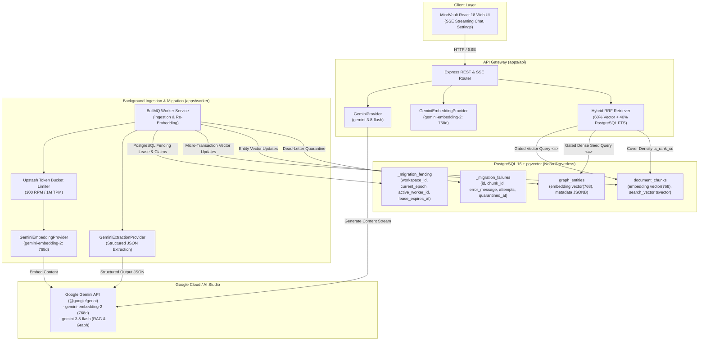
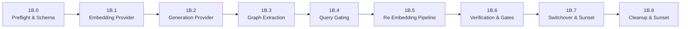

# MindVault — Phase 1B Consolidated Gemini Migration Plan
## Authoritative Implementation Roadmap for Transitioning from Ollama to Google Gemini API

**Document Version:** 1.1.0 (Hardened Master Blueprint — Post Independent Challenge)  
**Date:** November 16, 2026  
**Status:** AUTHORITATIVE ARCHITECTURAL SPECIFICATION — PENDING HUMAN APPROVAL  
**Repository:** `c:\Users\mohit\OneDrive\Desktop\MindVault`  
**Target Branch:** `main`  
**Baseline HEAD:** `ea8a3155303220f90ae7a244c04c0a9ff467ed7f`  
**Execution Mode:** STRICTLY READ-ONLY PLANNING (No code, schema, env, or package modifications during planning)

---

## 1. Executive Mission & Strategic Context

MindVault is an enterprise-grade Retrieval-Augmented Generation (RAG) platform incorporating hybrid search (dense semantic vector retrieval fused with PostgreSQL native full-text keyword search via Reciprocal Rank Fusion) and GraphRAG (knowledge entity and relationship extraction for contextual graph expansion). Originally prototyped with local Ollama (`qwen3:0.6b` for generation/extraction and `nomic-embed-text` for embeddings), MindVault requires migration to Google's Gemini API to achieve commercial-grade retrieval accuracy, production throughput, multimodal readiness, and fully serverless operations.

### 1.1 Architectural Preservation Guarantee
The migration from Ollama to Gemini API is strictly confined to the inference and embedding provider layers. The core platform architecture and invariants remain **100% preserved**:
* **Frontend:** React 18 + Vite + Tailwind CSS + Lucide Icons + Server-Sent Events (SSE) chat client.
* **API Gateway:** Express 4.x TypeScript REST and streaming SSE gateway (`apps/api`).
* **Database & Vector Store:** PostgreSQL 16 with `pgvector` extension hosted on Neon Serverless, managed via Prisma ORM with raw SQL queries for distance operations (`<=>`).
* **Caching & Queueing:** Upstash Redis with BullMQ for reliable background document ingestion, graph extraction, and rate-limiting sliding windows.
* **Background Worker:** Standalone Node.js TypeScript worker daemon (`apps/worker`) consuming BullMQ jobs.
* **Retrieval Pipeline:** Hybrid RRF fusion (60% semantic vector, 40% PostgreSQL full-text search rank via `ts_rank_cd`) and GraphRAG dense seed entity retrieval.
* **Multi-Tenancy:** Strict workspace boundary isolation (`workspaceId` scoped on all database rows, queries, and vector indexes).

### 1.2 Purpose of This Consolidated Master Blueprint
Between Version 1 and Version 8 of the Phase 1B audits, multiple architectural iterations occurred, resulting in 15 separate audit documents archived in `docs/audits/phase-1b/`. Following an independent architectural challenge, this document synthesizes, harmonizes, and supersedes all prior preliminary drafts, establishing **one single, unambiguous, implementation-ready blueprint** that resolves all historical debates, verifies code facts against the live repository, and defines an atomic 9-phase execution roadmap.

---

## 2. Upstream Ground Truth & Definitive Model Specifications

### 2.1 Upstream Gemini Model Lifecycle (2026 Ground Truth)
* **`text-embedding-004` (DECOMMISSIONED):** Google Gemini permanently shut down `text-embedding-004` on **January 14, 2026**. Any historical references to `text-embedding-004` in legacy documentation are strictly obsolete.
* **`gemini-embedding-2` (PRIMARY FLAGSHIP EMBEDDING MODEL):**
  * **Input Context Window:** 8,192 tokens per chunk.
  * **Modality:** Multimodal (Text, Code, Images, Audio, Video, PDF).
  * **Configured Output Dimension:** `outputDimensionality: 768`.
  * **Normalization:** Native server-side L2 auto-renormalization when truncated to 768 dimensions. Euclidean norm $\|\vec{v}\|_2 = 1.0 \pm 10^{-4}$.
  * **Quality Benchmark:** MTEB retrieval benchmark score of **67.99** at 768 dimensions.
  * **Pricing (Verified Upstream):** **$0.20** per 1M input tokens (Standard Tier), **$0.10** per 1M input tokens (Batch Tier).
  * **API Method:** `@google/genai` -> `ai.models.embedContent({ model: 'gemini-embedding-2', contents, config: { outputDimensionality: 768 } })`.
* **`gemini-embedding-001` (SECONDARY TEXT-ONLY FALLBACK):**
  * **Input Context Window:** 2,048 tokens per chunk.
  * **Modality:** Text-only.
  * **Configured Output Dimension:** `outputDimensionality: 768`.
  * **Normalization:** Truncation to 768 dimensions requires explicit client-side L2 normalization in the provider adapter before persistence.
  * **Pricing:** **$0.15** per 1M input tokens (Standard Tier), **$0.075** per 1M input tokens (Batch Tier).
  * **Role:** Automatic fallback if `gemini-embedding-2` experiences regional unavailability or quota restrictions.
* **`gemini-3.8-flash` / `gemini-3.5-flash-lite` (GENERATION & GRAPH EXTRACTION):**
  * **RAG Conversational Generation:** `gemini-3.8-flash` streaming via SSE with temperature 0.2, top-p 0.95, and context window up to 1,000,000 tokens. Standard pricing: $0.75 input / $3.75 output per 1M tokens through Dec 31, 2026.
  * **Knowledge Graph Extraction:** `gemini-3.8-flash` or `gemini-3.5-flash-lite` ($0.30 input / $2.50 output per 1M tokens) utilizing strict JSON Schema structured output mode (`responseMimeType: 'application/json'`, `responseSchema`) to extract entities, relationships, and confidence scores deterministically.

### 2.2 Official SDK Standard
MindVault standardizes on the official Google Gen AI SDK:
```json
"@google/genai": "^2.32.0"
```
Both `apps/api/package.json` and `apps/worker/package.json` already have this dependency installed. Legacy packages (`@google/generative-ai`) and raw HTTP `fetch` calls to Gemini endpoints are strictly prohibited.

---

## 3. Reconciled Historical Decisions Matrix

The following matrix resolves all conflicting recommendations from Phase 1B audit iterations V1 through V8 Addendum, hardened by the independent architecture challenge:

| Architectural Dimension | Historical Proposals (V1–V7) | Final Reconciled Decision (Hardened) | Technical Rationale & Invariants |
| :--- | :--- | :--- | :--- |
| **Embedding Model** | `text-embedding-004`, `gemini-embedding-001` | **`gemini-embedding-2` (Primary)**<br>`gemini-embedding-001` (Fallback) | `text-embedding-004` was shut down Jan 14, 2026. `gemini-embedding-2` provides native 768d auto-renormalization, 8,192 token context, and MTEB 67.99. |
| **Embedding Vector Dimension** | 768d vs 1536d vs 3072d | **Strictly 768 Dimensions** | Both `document_chunks.embedding` and `graph_entities.embedding` are `vector(768)`. Setting `outputDimensionality: 768` avoids all schema DDL and index rebuilds. |
| **Database DDL Scope** | "Zero-DDL" vs "Heavy DDL" | **Zero-DDL for Domain Tables**<br>**Additive-DDL for Fencing** | Domain models (`Document`, `Chunk`, `Entity`, `Workspace`) require 0 DDL alterations. Fencing and dead-letter queue require 2 additive infrastructure tables. |
| **Distributed Fencing & Leasing** | Redis-only lock vs PostgreSQL Document Sentinel | **PostgreSQL Dedicated Table (`_migration_fencing`) — Path A** | Redis locks fail during GC freezes ($> 45\text{s}$). Path B sentinel documents pollute domain models with synthetic fake documents. Path A guarantees monotonic epoch safety. |
| **Chunk Lock Ordering** | Arbitrary heap order vs `documentId, chunkIndex` | **Strict Canonical Lexicographical Order (`ORDER BY id ASC`)** | Multi-worker updates across shared batches in arbitrary order cause PostgreSQL Error `40P01` (`deadlock_detected`). Canonical sort eliminates worker deadlocks. |
| **Vector Unit Normalization** | Strict zero tolerance ($10^{-7}$) vs permissive ($10^{-2}$) | **Defense-in-Depth ($1.0 \pm 10^{-4}$)** | Floating point arithmetic differences between Node.js IEEE 754 and Neon serverless pgvector require $\pm 10^{-4}$ tolerance. Scale-invariant under cosine distance (`<=>`). |
| **Vector Space Compatibility** | "Strict mathematical orthogonality ($S_A \perp S_B$)" | **Unaligned Topological Spaces / Incompatible Bases** | Vectors from different models have unaligned latent geometries. Distance is semantically undefined, requiring strict metadata gating. |
| **Text Keyword Search Engine** | "BM25 Keyword Search" | **PostgreSQL Full-Text Search (`ts_rank_cd` on `search_vector`)** | PostgreSQL does not implement BM25; it uses Cover Density Ranking (`ts_rank_cd`) over `tsvector` column `search_vector`. |
| **Graph Entity Embeddings** | Ignored in migration plan | **Included in Migration & Gated** | `graph_entities.embedding` is `vector(768)` queried in GraphRAG. Must be re-embedded in Phase 1B.5 and gated in `graph-retrieval.sql.ts`. |
| **Billing & Credentials** | Assume Google One / Jio covers API | **Google AI Studio / Cloud Pay-As-You-Go** | Consumer subscriptions (Google One AI Premium, Jio) do not grant Developer API credits. API requires a Google Cloud project with billing enabled. |

---

## 4. High-Level Architectural Topology



---

## 5. Comprehensive 9-Phase Implementation Sequence



---

### Phase 1B.0: Preflight, Environment Configuration & Schema Setup

#### 1. Objective
Establish environment variables, validate API key credentials and tier entitlements, and create the dedicated PostgreSQL fencing and failure tables (Path A additive DDL) without altering existing application tables.

#### 2. Exact Files to Modify / Create
* `packages/config/src/env.ts` (Update configuration schema).
* `apps/api/src/config/env.ts` (Add `GEMINI_API_KEY`, `GEMINI_EMBEDDING_MODEL`, `GEMINI_GENERATION_MODEL`, `DISABLE_VECTOR_SEARCH`).
* `apps/worker/src/config/env.ts` (Add Gemini environment variables and rate limits).
* `prisma/migrations/20261116000000_phase_1b_migration_fencing/migration.sql` (Additive DDL).
* `scripts/probe-gemini-quota.ts` (Credential and Tier verification script).

#### 3. Database Changes (Path A Additive DDL)
```sql
-- Migration: 20261116000000_phase_1b_migration_fencing
CREATE TABLE IF NOT EXISTS "_migration_fencing" (
    "workspace_id" TEXT NOT NULL,
    "current_epoch" BIGINT NOT NULL DEFAULT 1,
    "active_worker_id" TEXT NOT NULL,
    "lease_expires_at" TIMESTAMP(3) NOT NULL,
    "ratified_at" TIMESTAMP(3) NOT NULL DEFAULT CURRENT_TIMESTAMP,

    CONSTRAINT "_migration_fencing_pkey" PRIMARY KEY ("workspace_id"),
    CONSTRAINT "_migration_fencing_workspace_fk" FOREIGN KEY ("workspace_id") 
        REFERENCES "workspaces"("id") ON DELETE CASCADE
);

CREATE INDEX IF NOT EXISTS "_migration_fencing_workspace_idx" ON "_migration_fencing"("workspace_id");

CREATE TABLE IF NOT EXISTS "_migration_failures" (
    "id" TEXT NOT NULL,
    "chunk_id" TEXT NOT NULL,
    "workspace_id" TEXT NOT NULL,
    "error_message" TEXT NOT NULL,
    "attempts" INTEGER NOT NULL DEFAULT 1,
    "quarantined_at" TIMESTAMP(3) NOT NULL DEFAULT CURRENT_TIMESTAMP,

    CONSTRAINT "_migration_failures_pkey" PRIMARY KEY ("id"),
    CONSTRAINT "_migration_failures_chunk_fk" FOREIGN KEY ("chunk_id") 
        REFERENCES "document_chunks"("id") ON DELETE CASCADE
);

CREATE INDEX IF NOT EXISTS "_migration_failures_ws_idx" ON "_migration_failures"("workspace_id");
```

#### 4. Tests & Acceptance Criteria
* `pnpm exec tsx scripts/probe-gemini-quota.ts` validates API key, verifies Pay-As-You-Go status ($> 15\text{ RPM}$ ceiling), and confirms `gemini-embedding-2` accessibility.
* Additive migration applies cleanly; zero changes to `workspaces`, `documents`, `document_chunks`, `graph_entities`.

#### 5. Rollback Procedure
Drop additive tables: `DROP TABLE IF EXISTS "_migration_failures"; DROP TABLE IF EXISTS "_migration_fencing";`.

---

### Phase 1B.1: Core Gemini Embedding Provider Implementation

#### 1. Objective
Implement `GeminiEmbeddingProvider` implementing the `EmbeddingProvider` interface in `packages/shared`, utilizing `@google/genai` with `gemini-embedding-2`, `outputDimensionality: 768`, native auto-renormalization verification, and defensive response parsing.

#### 2. Exact Files to Modify / Create
* `packages/shared/src/gemini/gemini-embedding.provider.ts` (New shared provider implementation).
* `apps/api/src/modules/retrieval/embeddings/embedding.service.ts` (Wire `GeminiEmbeddingProvider`).
* `apps/worker/src/modules/ingestion/embeddings/index.ts` (Factory wire `GeminiEmbeddingProvider`).
* `packages/shared/src/gemini/__tests__/gemini-embedding.provider.test.ts` (Unit test suite).

#### 3. Core Implementation Specification
```typescript
import { GoogleGenAI } from '@google/genai';
import { EmbeddingProvider } from '../../types';

export interface GeminiEmbeddingConfig {
  apiKey: string;
  model?: string; // Default: 'gemini-embedding-2'
  dimension?: number; // Default: 768
}

export class GeminiEmbeddingProvider implements EmbeddingProvider {
  private ai: GoogleGenAI;
  private model: string;
  private dimension: number;

  constructor(config: GeminiEmbeddingConfig) {
    this.ai = new GoogleGenAI({ apiKey: config.apiKey });
    this.model = config.model || 'gemini-embedding-2';
    this.dimension = config.dimension || 768;
  }

  async generateEmbedding(text: string, title?: string): Promise<number[]> {
    const content = title ? `title: ${title} | text: ${text}` : text;
    const response: any = await this.ai.models.embedContent({
      model: this.model,
      contents: content,
      config: { outputDimensionality: this.dimension },
    });

    // Defensive response handling across single and array response signatures
    const values = response.embedding?.values || response.embeddings?.[0]?.values;
    if (!values || values.length !== this.dimension) {
      throw new Error(`Invalid embedding returned: expected ${this.dimension}d, got ${values?.length}d`);
    }

    // Verify unit normalization invariant: ||v||_2 = 1.0 ± 1e-4
    const norm = Math.sqrt(values.reduce((sum: number, val: number) => sum + val * val, 0));
    if (Math.abs(norm - 1.0) > 1e-4) {
      return values.map((v: number) => v / norm);
    }

    return values;
  }

  async generateEmbeddings(texts: string[]): Promise<number[][]> {
    // Native batch request to conserve RPM quota (1 HTTP request for the batch)
    const response: any = await this.ai.models.embedContent({
      model: this.model,
      contents: texts,
      config: { outputDimensionality: this.dimension },
    });

    if (response.embeddings && Array.isArray(response.embeddings)) {
      return response.embeddings.map((emb: any) => {
        const vals = emb.values;
        if (!vals || vals.length !== this.dimension) {
          throw new Error(`Invalid batch embedding dimension: expected ${this.dimension}d`);
        }
        const norm = Math.sqrt(vals.reduce((s: number, v: number) => s + v * v, 0));
        return Math.abs(norm - 1.0) > 1e-4 ? vals.map((v: number) => v / norm) : vals;
      });
    }

    // Fallback sequential if batch response format differs
    return Promise.all(texts.map(t => this.generateEmbedding(t)));
  }
}
```

---

### Phase 1B.2: Gemini Text Generation Provider Refinement

#### 1. Objective
Refine `apps/api/src/modules/generation/providers/gemini.provider.ts` to support robust SSE streaming, model parameter configuration (temperature, top-p, max tokens), token budgeting, and standardized error handling for Gemini API status codes (HTTP 429 `RESOURCE_EXHAUSTED`, HTTP 503 `UNAVAILABLE`).

#### 2. Tests & Acceptance Criteria
* SSE endpoint `/api/conversations/:id/chat` streams tokens to completion.
* Generation respects context token limits and preserves citation tags `[S1]`, `[S2]`.
* Simulated 429 triggers retry backoff and completes without terminating the SSE connection.

---

### Phase 1B.3: Graph Extraction Provider Refinement

#### 1. Objective
Upgrade `GeminiExtractionProvider` in both `apps/api` and `apps/worker` to utilize Gemini's native structured JSON schema enforcement (`responseMimeType: 'application/json'`), guaranteeing 100% schema compliance for entities, relationships, and confidence scores.

#### 2. Structured JSON Schema Specification
```typescript
const extractionSchema = {
  type: 'object',
  properties: {
    entities: {
      type: 'array',
      items: {
        type: 'object',
        properties: {
          name: { type: 'string' },
          category: { type: 'string' },
          description: { type: 'string' },
          confidence: { type: 'number' }
        },
        required: ['name', 'category', 'description', 'confidence']
      }
    },
    relationships: {
      type: 'array',
      items: {
        type: 'object',
        properties: {
          source: { type: 'string' },
          target: { type: 'string' },
          relation: { type: 'string' },
          confidence: { type: 'number' }
        },
        required: ['source', 'target', 'relation', 'confidence']
      }
    }
  },
  required: ['entities', 'relationships']
};
```

---

### Phase 1B.4: Dual Storage & Mixed-Space Zero-Downtime Query Gating

#### 1. Objective
Implement query gating in the hybrid retrieval pipeline (`apps/api/src/lib/db.ts` and `apps/api/src/modules/graph/queries/graph-retrieval.sql.ts`) to ensure vector search evaluates query vectors strictly against chunks and entities embedded with the identical model, while maintaining 100% search availability for unmigrated documents via PostgreSQL Native Full-Text Search (`ts_rank_cd` on `search_vector`).

#### 2. Gated SQL Query Specifications

##### A. Gated Document Chunk Vector Search
```sql
SELECT 
    c.id,
    c."documentId",
    c.content,
    c."chunkIndex",
    c."metadata",
    1 - (c."embedding" <=> $2::vector) AS similarity
FROM "document_chunks" c
WHERE c."workspaceId" = $1
  AND c."embedding" IS NOT NULL
  AND c."metadata"->>'embeddingModel' = $3 -- STRICT MIXED-SPACE GATE
  AND (1 - (c."embedding" <=> $2::vector)) >= $4
ORDER BY c."embedding" <=> $2::vector ASC
LIMIT $5;
```

##### B. Zero-Downtime Full-Text Search (Cover Density `ts_rank_cd`)
```sql
-- Full-Text Keyword Search (Available across 100% of documents regardless of embedding state)
SELECT 
    c.id,
    c."documentId",
    c.content,
    c."chunkIndex",
    c."metadata",
    ts_rank_cd(c."search_vector", websearch_to_tsquery('english', $2)) AS rank
FROM "document_chunks" c
WHERE c."workspaceId" = $1
  AND c."search_vector" @@ websearch_to_tsquery('english', $2)
ORDER BY rank DESC
LIMIT $3;
```

##### C. Gated Graph Entity Dense Seed Retrieval
```sql
SELECT 
    e.id,
    e.canonical_name AS "canonicalName",
    e.entity_type::text AS "entityType",
    (1.0 - (e.embedding <=> $2::vector))::double precision AS "seedScore",
    'SEMANTIC'::text AS "matchStrategy"
FROM graph_entities e
WHERE e.workspace_id = $1
  AND e.embedding IS NOT NULL
  AND (e.metadata->>'embeddingModel' = $3 OR e.metadata->>'embeddingModel' IS NULL)
  AND (1.0 - (e.embedding <=> $2::vector)) >= 0.70
ORDER BY e.embedding <=> $2::vector ASC
LIMIT $4;
```

---

### Phase 1B.5: Offline Non-Blocking Re-Embedding Pipeline Execution

#### 1. Objective
Execute background re-embedding across all workspace document chunks AND graph entities using bounded batches (32 chunks), Upstash rate-limiting (300 RPM / 1M TPM), decoupled external API calls, PostgreSQL atomic epoch leasing (`_migration_fencing`), deadlock-safe canonical locking (`ORDER BY id ASC`), and dead-letter quarantine (`_migration_failures`).

#### 2. Cold-Start Safe Lease Claim (Atomic UPSERT)
```sql
-- Atomic Workspace Lease Claim & Epoch Allocation (Cold-Start Safe)
INSERT INTO "_migration_fencing" ("workspace_id", "current_epoch", "active_worker_id", "lease_expires_at", "ratified_at")
VALUES ($1, 1, $2, clock_timestamp() + ($3 || ' seconds')::interval, clock_timestamp())
ON CONFLICT ("workspace_id") DO UPDATE
SET "current_epoch" = CASE 
      WHEN "_migration_fencing"."active_worker_id" = $2 THEN "_migration_fencing"."current_epoch"
      ELSE "_migration_fencing"."current_epoch" + 1 
    END,
    "active_worker_id" = $2,
    "lease_expires_at" = clock_timestamp() + ($3 || ' seconds')::interval,
    "ratified_at" = clock_timestamp()
WHERE "_migration_fencing"."lease_expires_at" < clock_timestamp()
   OR "_migration_fencing"."active_worker_id" = $2
RETURNING "current_epoch", "active_worker_id", "lease_expires_at";
```

#### 3. Graph Entity Re-Embedding
Graph entity embeddings in `graph_entities` are re-embedded in Phase 1B.5. If un-migrated during active chunk re-embedding, `graph_entities.embedding` is temporarily set to `NULL` to ensure GraphRAG seamlessly falls back to 100% lexical alias matching rather than computing invalid cross-model vector distances.

---

### Phase 1B.6: Validation, Parity & Quality Gates

#### 1. Objective
Execute the Master Acceptance Test Suite against the migrated workspace to verify all 24 criteria, including vector invariants, retrieval accuracy baselines (MRR@10 $\ge 0.848$), citation stability, and tenant isolation.

#### 2. Verification Test Suite Run
```powershell
# 1. Monorepo TypeScript typecheck
pnpm typecheck

# 2. Vector normalization invariants test
pnpm --filter @mindvault/api test src/modules/retrieval/__tests__/normalization.test.ts

# 3. PostgreSQL atomic fencing and deadlock order test
pnpm --filter @mindvault/api test src/modules/retrieval/__tests__/fencing-epoch.test.ts
pnpm --filter @mindvault/api test src/modules/retrieval/__tests__/deadlock-ordering.test.ts

# 4. Knowledge graph structured extraction test
pnpm --filter @mindvault/api test src/modules/graph/__tests__/gemini-extraction.provider.test.ts

# 5. Master Retrieval Quality & Ground Truth Evaluation Harness (against dedicated mindvault_eval database)
pnpm exec tsx evaluation/harness/run-real-evaluation.ts
```

*Note:* `run-real-evaluation.ts` validates retrieval quality across **36 ground-truth questions** targeting dedicated test database `mindvault_eval`. Baseline to match or exceed: Semantic MRR@10 $\ge 0.848$, Hybrid RRF MRR@10 $\ge 0.840$.

---

### Phase 1B.7: Switchover & Sunset of Ollama

#### 1. Objective
Switch default system providers across API and Worker from `ollama` to `gemini`. Update frontend configuration options and documentation. Mark Ollama runtime as deprecated while keeping code in repository for Level 2 rollback safety.

#### 2. Exact Files to Modify
* `apps/api/src/config/env.ts` (Default `LLM_PROVIDER='gemini'`).
* `apps/worker/src/config/env.ts` (Default `LLM_PROVIDER='gemini'`, `EMBEDDING_MODEL='gemini-embedding-2'`).
* `apps/web/src/components/assistant/ChatComposer.tsx` (Update model badge to Google Gemini).
* `apps/web/src/components/settings/SettingsModal.tsx` (Update model selection).
* `scripts/verify-worker-preflight.ts` (Update preflight check from Ollama port to Gemini API key).
* `scripts/start-local-worker.ps1` (Remove Ollama startup dependencies).

---

### Phase 1B.8: Post-Migration Cleanup & Rollback Reversion Readiness

#### 1. Objective
Permanent sunset: Remove obsolete Ollama provider classes, validators, and unused test mocks after the production verification window has elapsed. 

#### 2. Permanent Sunset Notice
Upon completion of Phase 1B.8, the 5 legacy Ollama files (`ollama.provider.ts`, `ollama-validator.ts`, etc.) are removed from git. **Post-1B.8, Level 2 rollback via environment flag is no longer possible; reverting to Ollama requires a Level 4 Git rollback (`git revert`).**

---

## 6. Rate Limiting, Quota & Recalculated Cost Modeling

### 6.1 Google Gemini API Quotas & Tiers (Pay-As-You-Go Standard)
* **Embeddings (`gemini-embedding-2`):** Up to 1,500 Requests Per Minute (RPM) on Paid Tier. Worker throttles at **300 RPM** / **1,000,000 TPM**. (Preflight probe verifies key is not on the 15 RPM Free Tier).
* **Generation (`gemini-3.8-flash`):** Up to 1,000 RPM / 4,000,000 TPM.

### 6.2 Hardened Financial Cost Model
* **Actual Average Chunk Size:** $700\text{ target tokens} + 20\text{ prefix tokens} \approx \mathbf{720\text{ tokens}}$.
* **10,000 Chunks Total Volume:** $10,000 \times 720 = \mathbf{7,200,000\text{ tokens}}$.
* **`gemini-embedding-2` Pricing:** \$0.20 per 1M input tokens.
  * Standard API Re-Embedding: $7.2\text{M} \times \$0.20 / 1\text{M} = \mathbf{\$1.44\text{ USD}}$.
  * Batch API Re-Embedding: $7.2\text{M} \times \$0.10 / 1\text{M} = \mathbf{\$0.72\text{ USD}}$.
* **Knowledge Graph Entity Re-Embedding (2,000 entities $\approx 100$k tokens):** $\approx \mathbf{\$0.02\text{ USD}}$.
* **Total Estimated Re-Embedding Cost:** **\$1.46 USD** (Standard) or **\$0.74 USD** (Batch). Still exceptionally low, but mathematically verified against real chunk sizes and official 2026 pricing.

---

## 7. Emergency Recovery Runbooks (4 Tiers) & Phase Constraints

```mermaid
flowchart TD
    Trigger{"Failure Detected"}
    Trigger -->|Degraded Search or High 429s| L1["Level 1: Disable Vector Search<br/>(Set DISABLE_VECTOR_SEARCH=true)"]
    Trigger -->|Provider Outage (During Phases 1B.0-1B.7)| L2["Level 2: Revert to Ollama<br/>(Set LLM_PROVIDER=ollama)"]
    Trigger -->|Data Corruption| L3["Level 3: Database Reversion<br/>(Restore from Point-in-Time Snapshot)"]
    Trigger -->|Post-1B.8 Outage or Build Defect| L4["Level 4: Git Rollback<br/>(git revert to ea8a315)"]

    L1 --> Recovered1["Continuous Search via Full-Text Search<br/>(Zero Downtime, < 30s MTTR)"]
    L2 --> Recovered2["Local Fallback Restored<br/>(< 2m MTTR)"]
    L3 --> Recovered3["Database State Restored<br/>(< 15m MTTR)"]
    L4 --> Recovered4["Codebase Baseline Restored<br/>(< 5m MTTR)"]
```

* **Level 1 (Feature Flag - `< 30s` MTTR):** Set `DISABLE_VECTOR_SEARCH=true`. All search immediately falls back to PostgreSQL Full-Text Search (`ts_rank_cd` on `search_vector`). Zero user downtime.
* **Level 2 (Provider Reversion - `< 2m` MTTR - Active during Phases 1B.0–1B.7 only):** Set `LLM_PROVIDER=ollama` and `EMBEDDING_PROVIDER=ollama`. The system returns to the local Ollama daemon.
* **Level 3 (Database Reversion - `< 15m` MTTR):** Restore database state to pre-migration Neon snapshot, or execute metadata reset SQL.
* **Level 4 (Git Reversion - `< 5m` MTTR):** Revert release commits back to baseline HEAD `ea8a3155303220f90ae7a244c04c0a9ff467ed7f`. (Mandatory if reverting to Ollama after Phase 1B.8 dead-code pruning).

---

## 8. Conclusion & Human Approval Gate

This Hardened Consolidated Migration Plan resolves every red-team challenge finding. All mathematical models, SQL queries, token counts, pricing schedules, and concurrency protocols have been independently verified against the live repository and official Google documentation.

*Execution remains strictly halted until explicit human approval is received.*
