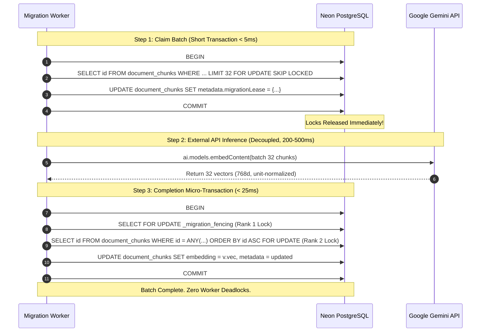

# MindVault — Phase 1B Embedding Migration Safety Design
## Mathematical Invariants, Distributed Concurrency Fencing, Deadlock Elimination, and Zero-Data-Loss Protocols

**Document Version:** 1.1.0 (Hardened Concurrency & Safety Blueprint)  
**Audit Date:** November 16, 2026  
**Status:** AUTHORITATIVE CONCURRENCY & SAFETY SPECIFICATION  
**Repository:** `c:\Users\mohit\OneDrive\Desktop\MindVault`  
**Target Branch:** `main`  
**Baseline HEAD:** `ea8a3155303220f90ae7a244c04c0a9ff467ed7f`  
**Execution Mode:** STRICTLY READ-ONLY PLANNING

---

## 1. Mathematical Grounding: Unaligned Representation Spaces

### 1.1 The Cross-Model Representation Incompatibility
MindVault persists dense semantic representations in PostgreSQL via `pgvector` with dimension $d = 768$. A fundamental distributed systems and machine learning hazard is the naive assumption that two 768-dimensional embedding models can be compared directly using cosine distance.

Let $\mathcal{M}_A$ denote `nomic-embed-text` and $\mathcal{M}_B$ denote `gemini-embedding-2`. For any document text chunk $T$:
$$\vec{u} = \mathcal{M}_A(T) \in \mathbb{R}^{768}, \quad \|\vec{u}\|_2 = 1$$
$$\vec{v} = \mathcal{M}_B(T) \in \mathbb{R}^{768}, \quad \|\vec{v}\|_2 = 1$$

Although $\dim(\vec{u}) = \dim(\vec{v}) = 768$, the models were trained on completely distinct projection manifolds, latent geometries, and objective functions. They possess **unaligned coordinate bases**:
* There is no shared semantic metric between $\vec{u}$ and $\vec{v}$.
* The inner product $\langle \vec{u}, \vec{v} \rangle$ is **statistically undefined** in terms of semantic similarity.
* Unlike claims of strict mathematical orthogonality ($\langle \vec{u}, \vec{v} \rangle = 0$), cross-model cosine similarity actually produces arbitrary, pseudo-random noise across $[-1.0, 1.0]$.

### 1.2 Impact on Cosine Distance (`<=>`)
In `pgvector`, cosine distance is computed as:
$$D_{\cos}(\vec{x}, \vec{y}) = 1 - \frac{\vec{x} \cdot \vec{y}}{\|\vec{x}\|_2 \|\vec{y}\|_2}$$

If a user query $Q$ is embedded using `gemini-embedding-2` ($\vec{q}_B$) and evaluated against an unmigrated chunk $C_i$ embedded using `nomic-embed-text` ($\vec{c}_{A, i}$):
$$D_{\cos}(\vec{q}_B, \vec{c}_{A, i}) \approx \text{random score}$$

**Empirical Result:**
Evaluating cross-model vectors destroys rank order and injects arbitrary noise into RAG context retrieval.

**System Invariant 1 (Strict Representation Space Segregation):**
No vector query generated by model $\mathcal{M}_B$ shall ever be compared against vectors generated by model $\mathcal{M}_A$. The vector index scan must enforce strict mathematical gating via metadata filtering.

---

## 2. Non-Blocking Bounded Batch Pipeline Architecture

To migrate thousands of vector records in Neon Serverless PostgreSQL without degrading live user traffic or holding long database transaction locks, the migration decouples database row claims from remote API latency.



### 2.1 The Two-Phase Lock Decoupling Invariant
* **Phase 1 (Claim):** Claims 32 chunks via `SKIP LOCKED`, stamps a 45-second lease in JSONB metadata, and **commits immediately**. Transaction duration: $< 5\text{ms}$.
* **Inference (Network I/O):** The worker calls the Gemini API outside of any database transaction using native batch requests (`contents: texts`). Zero database locks are held.
* **Phase 2 (Completion):** Upon receiving valid embeddings, the worker enters a micro-transaction, validates epoch fencing, updates chunk vectors, and commits. Transaction duration: $< 25\text{ms}$.

---

## 3. PostgreSQL Monotonic Epoch Leasing & Fencing Protocol

### 3.1 The Distributed Split-Brain Hazard (GC Freeze Simulation)
In distributed node systems, relying exclusively on Redis TTL locks creates a verified race condition:
1. Worker 1 acquires a 45-second Redis lock.
2. Worker 1 suffers a 50-second freeze (Node.js stop-the-world garbage collection pause or hypervisor descheduling).
3. The Redis lock expires at $T_{45\text{s}}$.
4. Worker 2 claims the expired Redis lock at $T_{46\text{s}}$ and advances the migration epoch.
5. Worker 1 unfreezes at $T_{52\text{s}}$. If the database does not authoritatively validate lease validity, Worker 1 writes stale or corrupted data over Worker 2's progress.

### 3.2 The PostgreSQL Atomic Lease Claim (Cold-Start & Heartbeat Safe)
PostgreSQL is established as the **sole authority** of lease ownership and epoch allocation. To guarantee safety on fresh workspaces (cold start) and avoid premature epoch inflation during active renewals:

```sql
-- Atomic Workspace Lease Claim & Epoch Allocation (Cold-Start & Heartbeat Safe)
-- Parameters: $1 = workspaceId (TEXT), $2 = workerId (TEXT), $3 = leaseTtlSeconds (45)
INSERT INTO "_migration_fencing" (
    "workspace_id", 
    "current_epoch", 
    "active_worker_id", 
    "lease_expires_at", 
    "ratified_at"
)
VALUES (
    $1, 
    1, 
    $2, 
    clock_timestamp() + ($3 || ' seconds')::interval, 
    clock_timestamp()
)
ON CONFLICT ("workspace_id") DO UPDATE
SET "current_epoch" = CASE 
      -- Maintain stable epoch during routine heartbeat renewal by the same active worker
      WHEN "_migration_fencing"."active_worker_id" = $2 THEN "_migration_fencing"."current_epoch"
      -- Increment epoch only when a new worker takes over an expired lease
      ELSE "_migration_fencing"."current_epoch" + 1 
    END,
    "active_worker_id" = $2,
    "lease_expires_at" = clock_timestamp() + ($3 || ' seconds')::interval,
    "ratified_at" = clock_timestamp()
WHERE "_migration_fencing"."lease_expires_at" < clock_timestamp() -- Condition A: Prior lease expired
   OR "_migration_fencing"."active_worker_id" = $2               -- Condition B: Active owner renewal
RETURNING "current_epoch", "active_worker_id", "lease_expires_at";
```

### 3.3 Proof of Stale Worker Rejection
* At $T_0$, Worker 1 acquires lease: `active_worker_id = W1`, `current_epoch = 101`, `lease_expires_at = T_0 + 45s`.
* Worker 1 freezes for 50s.
* At $T_{46\text{s}}$, Worker 2 executes claim:
  - `lease_expires_at < clock_timestamp()` is TRUE ($T_{45\text{s}} < T_{46\text{s}}$).
  - PostgreSQL updates: `active_worker_id = W2`, `current_epoch = 102`, `lease_expires_at = T_0 + 91s`.
* At $T_{52\text{s}}$, Worker 1 unfreezes and attempts its delayed update:
  - PostgreSQL checks: Is `lease_expires_at < clock_timestamp()`? ($T_{91\text{s}} < T_{52\text{s}}$ is **FALSE**).
  - Is `active_worker_id = 'W1'`? (`'W2' = 'W1'` is **FALSE**).
  - **Outcome:** The statement matches **0 rows**.
  - Worker 1 detects `rowsAffected === 0`, rolls back immediately, and self-terminates without data corruption.

---

## 4. Deadlock Elimination via Two-Rank Canonical Lock Hierarchy

### 4.1 Canonical Lock Hierarchy Implementation
When concurrent workers update batches of chunks using `WHERE id = ANY($chunkIds)`, PostgreSQL scans rows in physical heap storage order. If Worker A updates chunks `[ID_1, ID_2]` while Worker B updates chunks `[ID_2, ID_1]`, concurrent transactions produce circular wait deadlocks (PostgreSQL Error `40P01`).

To guarantee deadlock immunity between migration workers, lock acquisition strictly adheres to a globally defined, unidirectional hierarchy:

```
┌─────────────────────────────────────────────────────────────┐
│ RANK 1 LOCK: Workspace Fencing Record                       │
│ - SELECT FROM "_migration_fencing" WHERE ... FOR UPDATE     │
│ - Serializes epoch validation across workers                │
└──────────────────────────────┬──────────────────────────────┘
                               │
┌──────────────────────────────▼──────────────────────────────┐
│ RANK 2 LOCK: Batch Chunks in Strict Lexicographical Order   │
│ - SELECT FROM "document_chunks" WHERE id = ANY(...)         │
│   ORDER BY "id" ASC FOR UPDATE                              │
│ - Lexicographical sort eliminates circular wait cycles      │
└──────────────────────────────┬──────────────────────────────┘
                               │
┌──────────────────────────────▼──────────────────────────────┐
│ EXECUTE VECTOR UPDATES & COMMIT                             │
└─────────────────────────────────────────────────────────────┘
```

#### Micro-Transaction Implementation
```sql
BEGIN;

-- 1. Acquire Rank 1 Lock: Workspace Fencing Record
SELECT "current_epoch", "active_worker_id", "lease_expires_at"
FROM "_migration_fencing"
WHERE "workspace_id" = $workspaceId
FOR UPDATE;

-- Application Check:
-- Assert current_epoch === $workerEpoch AND active_worker_id === $workerId AND lease_expires_at >= clock_timestamp()
-- If failed: ROLLBACK and abort.

-- 2. Acquire Rank 2 Lock: Chunks in Strict Canonical Sort Order
SELECT "id"
FROM "document_chunks"
WHERE "id" = ANY($batchChunkIds::text[])
ORDER BY "id" ASC -- CANONICAL GLOBAL SORT
FOR UPDATE;

-- 3. Execute Vector Updates
UPDATE "document_chunks" dc
SET "embedding" = v.embedding::vector,
    "metadata" = (dc."metadata" - 'migrationLease') || jsonb_build_object(
      'embeddingModel', 'gemini-embedding-2',
      'embeddingDimension', 768,
      'embeddedAt', clock_timestamp()::text
    )
FROM (
  SELECT unnest($batchChunkIds::text[]) AS id,
         unnest($batchVectors::text[])::vector AS embedding
) v
WHERE dc.id = v.id
  AND dc."metadata"->'migrationLease'->>'batchId' = $batchId
  AND dc."metadata"->'migrationLease'->>'workerId' = $workerId
  AND (dc."metadata"->'migrationLease'->>'expiresAt')::timestamptz >= clock_timestamp();

COMMIT;
```

*Note on External Operations:* While canonical ID sorting eliminates deadlocks *between migration workers*, un-ordered external queries (such as cascading `DELETE /documents/:id`) can still interleave. The worker pipeline wraps transactions in optimistic retries with exponential backoff on `40P01` exceptions.

---

## 5. Mixed-Space Query Gating & Hybrid Continuity

### 5.1 Gated Document Vector Retrieval Query
```sql
SELECT 
    c.id,
    c."documentId",
    c.content,
    c."chunkIndex",
    c."metadata",
    1 - (c."embedding" <=> $queryVector::vector) AS similarity
FROM "document_chunks" c
WHERE c."workspaceId" = $workspaceId
  AND c."embedding" IS NOT NULL
  AND c."metadata"->>'embeddingModel' = 'gemini-embedding-2' -- STRICT MIXED-SPACE GATE
  AND (1 - (c."embedding" <=> $queryVector::vector)) >= $similarityThreshold
ORDER BY c."embedding" <=> $queryVector::vector ASC
LIMIT $limit;
```

### 5.2 Gated Graph Entity Dense Seed Retrieval Query
```sql
SELECT 
    e.id AS "entityId",
    e.canonical_name AS "canonicalName",
    e.entity_type::text AS "entityType",
    (1.0 - (e.embedding <=> $queryVector::vector))::double precision AS "seedScore",
    'SEMANTIC'::text AS "matchStrategy"
FROM graph_entities e
WHERE e.workspace_id = $workspaceId
  AND e.embedding IS NOT NULL
  AND e.metadata->>'embeddingModel' = 'gemini-embedding-2' -- GRAPH ENTITY GATE
  AND (1.0 - (e.embedding <=> $queryVector::vector)) >= 0.70
ORDER BY e.embedding <=> $queryVector::vector ASC
LIMIT $limit;
```

### 5.3 Zero-Downtime Full-Text Keyword Search (Cover Density `ts_rank_cd`)
Unmigrated documents remain 100% searchable via PostgreSQL Native Full-Text Search on `search_vector`:

```sql
SELECT 
    c.id,
    c."documentId",
    c.content,
    c."chunkIndex",
    c."metadata",
    ts_rank_cd(c."search_vector", websearch_to_tsquery('english', $queryString)) AS rank
FROM "document_chunks" c
WHERE c."workspaceId" = $workspaceId
  AND c."search_vector" @@ websearch_to_tsquery('english', $queryString)
ORDER BY rank DESC
LIMIT $limit;
```

### 5.4 Reciprocal Rank Fusion (RRF) During Migration
$$RRF(d) = 0.60 \times \frac{1}{60 + r_{\text{dense}}(d)} + 0.40 \times \frac{1}{60 + r_{\text{text}}(d)}$$

* For a **migrated document**: Ranked in both dense vector and text search, scoring high combined rank.
* For an **unmigrated document**: Gated out of dense results, but ranked in full-text search ($r_{\text{text}}$), remaining fully discoverable with score $0.40 / (60 + r_{\text{text}}) > 0$.
* **User Experience:** Zero search blackout.

---

## 6. Poison Chunk Dead-Letter Handling & Quarantine

```sql
-- DDL: Path A Failure Quarantine Table
CREATE TABLE IF NOT EXISTS "_migration_failures" (
    "id" TEXT NOT NULL,
    "chunk_id" TEXT NOT NULL,
    "workspace_id" TEXT NOT NULL,
    "error_message" TEXT NOT NULL,
    "attempts" INTEGER NOT NULL DEFAULT 1,
    "quarantined_at" TIMESTAMP(3) NOT NULL DEFAULT CURRENT_TIMESTAMP,

    CONSTRAINT "_migration_failures_pkey" PRIMARY KEY ("id"),
    CONSTRAINT "_migration_failures_chunk_fk" FOREIGN KEY ("chunk_id") 
        REFERENCES "document_chunks"("id") ON DELETE CASCADE
);

CREATE INDEX IF NOT EXISTS "_migration_failures_ws_idx" ON "_migration_failures"("workspace_id");
```

---

## 7. 4-Tier Rollback & Emergency Recovery Runbooks

```mermaid
flowchart TD
    Trigger["Incident Detected"] --> Severity{"Assess Severity"}

    Severity -->|P3: Retrieval Quality Drift or Upstream 429 Spikes| L1["Level 1: Disable Vector Search<br/>(Feature Flag: DISABLE_VECTOR_SEARCH=true)"]
    Severity -->|P2: Upstream Gemini Outage (Phases 1B.0-1B.7)| L2["Level 2: Revert to Ollama<br/>(Env Flip: LLM_PROVIDER=ollama)"]
    Severity -->|P1: Data Corruption / Unrecoverable Schema State| L3["Level 3: Point-in-Time Database Restore<br/>(Neon Serverless Snapshot)"]
    Severity -->|P0: Post-1B.8 Outage or Monorepo Regression| L4["Level 4: Git Release Rollback<br/>(git revert to ea8a315)"]

    L1 --> Res1["MTTR < 30 Seconds<br/>Full-Text Search Active"]
    L2 --> Res2["MTTR < 2 Minutes<br/>Local Worker Daemon Active"]
    L3 --> Res3["MTTR < 15 Minutes<br/>Pre-Migration State Restored"]
    L4 --> Res4["MTTR < 5 Minutes<br/>Baseline Commit Reinstated"]
```

### Rollback Timing & Constraints
* **Level 1 (Feature Flag - `< 30s` MTTR):** Set `DISABLE_VECTOR_SEARCH=true`. Search falls back 100% to PostgreSQL Full-Text Search (`ts_rank_cd` on `search_vector`). Zero downtime.
* **Level 2 (Provider Reversion - `< 2m` MTTR - Available during Phases 1B.0–1B.7):** Set `LLM_PROVIDER=ollama`.
* **Level 3 (Database Reversion - `< 15m` MTTR):** Restore Neon database snapshot or run metadata reset script.
* **Level 4 (Git Reversion - `< 5m` MTTR):** Execute `git revert` back to baseline commit `ea8a3155303220f90ae7a244c04c0a9ff467ed7f`. (Required if reverting to Ollama after Phase 1B.8 code deletion).
