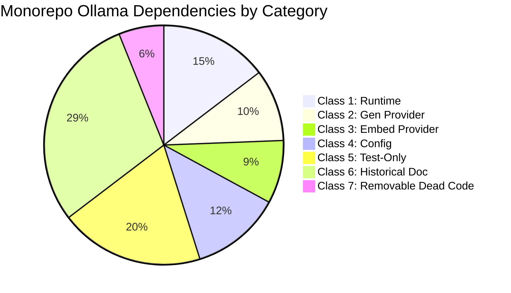

# MindVault — Phase 1B Ollama to Gemini Dependency Matrix
## Exhaustive Monorepo Dependency Audit, Classification, and Replacement Strategy

**Document Version:** 1.0.0  
**Audit Date:** November 16, 2026  
**Status:** COMPLETE & AUTHORITATIVE INVENTORY  
**Repository:** `c:\Users\mohit\OneDrive\Desktop\MindVault`  
**Target Branch:** `main`  
**Baseline HEAD:** `ea8a3155303220f90ae7a244c04c0a9ff467ed7f`  
**Total Identified Occurrences:** 82 distinct code, configuration, test, and script references across 27 files

---

## 1. Classification Methodology & Categories

Every identified dependency on Ollama (`ollama`, `qwen3:0.6b`, `nomic-embed-text`, port `11434`) is assigned to one of seven formal operational classes:

1. **Class 1: Runtime Dependency** — Active runtime service execution, network connectivity checks, health probes, daemon management.
2. **Class 2: Generation Provider Dependency** — RAG response generation, text streaming, LLM provider abstraction, model parameters.
3. **Class 3: Embedding Provider Dependency** — Vector generation, dimensionality handling, normalization, batch embedding.
4. **Class 4: Configuration Dependency** — Environment variable schemas, defaults, connection strings, flags.
5. **Class 5: Test-Only Dependency** — Test fixtures, mock providers, unit test assertions, CI test helpers.
6. **Class 6: Historical Documentation (Preserve)** — Architectural audit history, benchmark logs, prior migration iterations (MUST NOT BE DELETED).
7. **Class 7: Removable Dependency** — Dead code, obsolete fallback branches, unused utility functions to be pruned in Phase 1B.8.

---

## 2. Monorepo Ollama Dependency Inventory (By Subsystem)

### 2.1 API Gateway Subsystem (`apps/api`)

| # | File Path | Line Range | Category | Current Purpose / Symbol | Gemini Replacement Action | Risk & Mitigation | Phase |
| :- | :--- | :--- | :--- | :--- | :--- | :--- | :- |
| **01** | `apps/api/src/config/env.ts` | L64 | Class 4: Config | `LLM_PROVIDER: z.enum(['ollama', 'gemini']).default('ollama')` | Update default to `'gemini'`. Keep `'ollama'` as valid enum for rollback. | Low. Validated by Zod at startup. | 1B.0 / 1B.7 |
| **02** | `apps/api/src/config/env.ts` | L65 | Class 4: Config | `OLLAMA_BASE_URL: z.string().default('http://localhost:11434')` | Make optional with `.optional()`. Mark as deprecated. | Low. Prevent failure when Ollama is offline. | 1B.0 |
| **03** | `apps/api/src/config/env.ts` | L66 | Class 4: Config | `OLLAMA_GENERATION_MODEL: z.string().default('qwen3:0.6b')` | Make optional. Add `GEMINI_GENERATION_MODEL: z.string().default('gemini-3.8-flash')`. | Low. Centralized configuration. | 1B.0 |
| **04** | `apps/api/src/modules/generation/providers/ollama.provider.ts` | L1–125 | Class 2: Gen Provider | Full `OllamaProvider` class implementing `LLMProvider` using `/api/generate` NDJSON streaming | Deprecate in 1B.2. Remove in 1B.8 once `GeminiProvider` is 100% verified. | Medium. Risk of dangling references. Factory indirection mitigates. | 1B.2 / 1B.8 |
| **05** | `apps/api/src/modules/generation/providers/provider.factory.ts` | L22 | Class 2: Gen Provider | `import { OllamaProvider } from './ollama.provider'` | Retain during transition for rollback; remove import in 1B.8. | Low. Pure factory pattern. | 1B.2 / 1B.8 |
| **06** | `apps/api/src/modules/generation/providers/provider.factory.ts` | L33–35 | Class 2: Gen Provider | Fallback instantiation `new OllamaProvider(config)` | Update default branch to return `new GeminiProvider(config)`. | Medium. Fallback must have valid `GEMINI_API_KEY`. | 1B.2 / 1B.7 |
| **07** | `apps/api/src/modules/retrieval/embeddings/embedding.service.ts` | L48–122 | Class 3: Embed Provider | `OllamaEmbeddingProvider` class calling `http://localhost:11434/api/embeddings` with `nomic-embed-text` | Replace with `GeminiEmbeddingProvider` calling `@google/genai` with `gemini-embedding-2` (768d). | High. Dimension mismatch or scaling error breaks search. Handled by 768d config. | 1B.1 |
| **08** | `apps/api/src/modules/retrieval/embeddings/embedding.service.ts` | L135 | Class 3: Embed Provider | `return new OllamaEmbeddingProvider(...)` | Update factory to instantiate `GeminiEmbeddingProvider`. | Medium. Controlled via environment flag. | 1B.1 / 1B.7 |
| **09** | `apps/api/src/modules/retrieval/embeddings/embedding.service.ts` | L156 | Class 3: Embed Provider | Fallback model check against `nomic-embed-text` | Update compatibility guard to check for `gemini-embedding-2`. | Medium. Gating tests prevent mixed-space searches. | 1B.1 |
| **10** | `apps/api/src/modules/graph/providers/ollama-extraction.provider.ts` | L1–180 | Class 2: Gen Provider | Full `OllamaExtractionProvider` class for entity/relation extraction | Deprecate in 1B.3. Remove in 1B.8. Replace with `GeminiExtractionProvider`. | Medium. Extraction format differences. Handled by structured JSON schema. | 1B.3 / 1B.8 |
| **11** | `apps/api/src/modules/graph/providers/provider.factory.ts` | L15–28 | Class 2: Gen Provider | Factory defaulting to `OllamaExtractionProvider` | Update default extraction provider to `GeminiExtractionProvider`. | Medium. Requires valid API key. | 1B.3 / 1B.7 |
| **12** | `apps/api/src/modules/graph/evaluation/graph-extraction.eval.runner.ts` | L17 | Class 5: Test-Only | CLI benchmark parameter `--live-ollama` | Update CLI flag to `--live-gemini`. Evaluate `GeminiExtractionProvider`. | Low. Offline evaluation tool. | 1B.3 |
| **13** | `apps/api/src/modules/graph/evaluation/graph-extraction.eval.runner.ts` | L287–302 | Class 5: Test-Only | Instantiates `OllamaExtractionProvider` for live benchmark | Instantiate `GeminiExtractionProvider` when `--live-gemini` is passed. | Low. Evaluation harness only. | 1B.3 |
| **14** | `apps/api/src/modules/generation/providers/llm.provider.test.ts` | L159 | Class 5: Test-Only | Asserts fallback model name `mock-qwen-768` | Update test assertion to `mock-gemini-flash`. | Low. Test mock alignment. | 1B.2 |
| **15** | `apps/api/src/modules/graph/__tests__/ollama-extraction.provider.test.ts` | L1–95 | Class 5: Test-Only | Unit tests asserting Ollama prompt formatting & params | Replace with comprehensive `gemini-extraction.provider.test.ts`. | Low. Test suite update. | 1B.3 |

---

### 2.2 Background Worker Subsystem (`apps/worker`)

| # | File Path | Line Range | Category | Current Purpose / Symbol | Gemini Replacement Action | Risk & Mitigation | Phase |
| :- | :--- | :--- | :--- | :--- | :--- | :--- | :- |
| **16** | `apps/worker/src/config/env.ts` | L46 | Class 4: Config | `EMBEDDING_MODEL: z.string().default('nomic-embed-text')` | Update default to `'gemini-embedding-2'`. | High. Ingestion worker sets model metadata. | 1B.0 / 1B.7 |
| **17** | `apps/worker/src/config/env.ts` | L47 | Class 4: Config | `LLM_PROVIDER: z.enum(['ollama', 'gemini']).default('ollama')` | Update default to `'gemini'`. | Low. Aligns worker with API. | 1B.0 / 1B.7 |
| **18** | `apps/worker/src/config/env.ts` | L48 | Class 4: Config | `OLLAMA_BASE_URL: z.string().default('http://127.0.0.1:11434')` | Make `.optional()`. Add deprecation notice. | Low. Unblocks worker without local Ollama. | 1B.0 |
| **19** | `apps/worker/src/config/env.ts` | L49 | Class 4: Config | `OLLAMA_GENERATION_MODEL: z.string().default('qwen3:0.6b')` | Make `.optional()`. Add `GEMINI_GENERATION_MODEL: z.string().default('gemini-3.8-flash')`. | Low. Standardized naming. | 1B.0 |
| **20** | `apps/worker/src/lib/ollama-validator.ts` | L1–120 | Class 1: Runtime | `validateOllamaEnvironment` probing `http://127.0.0.1:11434/api/tags` | Replace with `validateGeminiEnvironment` testing API key validity and quota. | High. Prevents worker boot if Ollama is absent. | 1B.0 |
| **21** | `apps/worker/src/worker.ts` | L24 | Class 1: Runtime | `import { validateOllamaEnvironment } from './lib/ollama-validator'` | Update to `import { validateGeminiEnvironment } from './lib/gemini-validator'`. | Medium. Startup preflight dependency. | 1B.0 |
| **22** | `apps/worker/src/worker.ts` | L276–297 | Class 1: Runtime | Startup lifecycle invokes `validateOllamaEnvironment` | Invoke `validateGeminiEnvironment`. Fail fast if `GEMINI_API_KEY` is missing/invalid. | Medium. Clear diagnostic output on missing key. | 1B.0 |
| **23** | `apps/worker/src/modules/ingestion/embeddings/ollama.provider.ts` | L1–110 | Class 3: Embed Provider | Worker `OllamaEmbeddingProvider` batching calls to `/api/embeddings` | Deprecate in 1B.1. Remove in 1B.8. Worker standardizes on shared `GeminiEmbeddingProvider`. | High. Chunk vector ingestion depends on this. | 1B.1 / 1B.8 |
| **24** | `apps/worker/src/modules/ingestion/embeddings/index.ts` | L2 | Class 3: Embed Provider | `import { OllamaEmbeddingProvider } from './ollama.provider'` | Update import to shared `GeminiEmbeddingProvider`. | Low. Factory decoupling. | 1B.1 |
| **25** | `apps/worker/src/modules/ingestion/embeddings/index.ts` | L43–49 | Class 3: Embed Provider | Default provider factory returns `OllamaEmbeddingProvider` | Default provider returns `GeminiEmbeddingProvider` with `outputDimensionality: 768`. | High. All future chunk embeddings flow through here. | 1B.1 / 1B.7 |
| **26** | `apps/worker/src/modules/graph/providers/ollama-extraction.provider.ts` | L1–175 | Class 2: Gen Provider | Worker knowledge graph extraction provider via Ollama | Deprecate in 1B.3. Remove in 1B.8. Standardize on `GeminiExtractionProvider`. | Medium. Graph extraction pipeline integrity. | 1B.3 / 1B.8 |
| **27** | `apps/worker/src/modules/graph/providers/provider.factory.ts` | L15–28 | Class 2: Gen Provider | Factory selecting `OllamaExtractionProvider` | Default to `GeminiExtractionProvider`. | Medium. Factory switchover. | 1B.3 / 1B.7 |
| **28** | `apps/worker/src/modules/ingestion/embeddings/embeddings.test.ts` | L64–75 | Class 5: Test-Only | Factory test verifying `provider: 'ollama'` default | Update test to verify `provider: 'gemini'` default. | Low. Unit test maintenance. | 1B.1 |
| **29** | `apps/worker/src/modules/graph/__tests__/extraction-error.classifier.test.ts` | L77 | Class 5: Test-Only | Error classifier test: "Ollama extraction timed out" | Update test fixture to test "Gemini API request timed out (DEADLINE_EXCEEDED)". | Low. Error mapping validation. | 1B.3 |
| **30** | `apps/worker/src/modules/graph/__tests__/extraction-error.classifier.test.ts` | L99 | Class 5: Test-Only | Error classifier test: "Upstream Ollama is offline" | Update test fixture to test "Gemini API unavailable (HTTP 503 / UNAVAILABLE)". | Low. Error classification test. | 1B.3 |

---

### 2.3 Web Client & Shared Contracts Subsystem (`apps/web` & `packages/*`)

| # | File Path | Line Range | Category | Current Purpose / Symbol | Gemini Replacement Action | Risk & Mitigation | Phase |
| :- | :--- | :--- | :--- | :--- | :--- | :--- | :- |
| **31** | `apps/web/src/components/assistant/ChatComposer.tsx` | L252 | Class 1: Runtime / UI | Tooltip: `"Local Ollama Qwen3: 100% private offline"` | Update tooltip to `"Google Gemini 3.8 Flash (Cloud Assisted RAG)"`. | Low. Visual label only. | 1B.7 |
| **32** | `apps/web/src/components/settings/SettingsModal.tsx` | L359 | Class 1: Runtime / UI | Model select dropdown listing `qwen3:0.6b` and Ollama toggle | Replace with Gemini model selector (`gemini-3.8-flash`, `gemini-3.5-flash-lite`). Remove local Ollama toggle. | Low. UI settings alignment. | 1B.7 |
| **33** | `packages/shared/src/types.ts` | L657 | Class 4: Config / Schema | `ChatSessionDtoSchema`: `provider: z.enum(['ollama', 'gemini']).optional()` | Retain enum values for backward compatibility; update default comment to `gemini`. | Low. Zero breaking API changes. | 1B.0 / 1B.7 |
| **34** | `packages/shared/src/types.ts` | L269–274 | Class 3: Embed Provider | `EmbeddingProvider` interface definition | Retain existing contract. Provider is already fully model-agnostic. | Zero. Strict interface parity preserved. | 1B.1 |
| **35** | `packages/config/src/env.ts` | L45–60 | Class 4: Config | Shared environment schema base definitions | Add `GEMINI_API_KEY`, `GEMINI_EMBEDDING_MODEL`, `GEMINI_GENERATION_MODEL`. | Low. Unified monorepo config. | 1B.0 |

---

### 2.4 Diagnostic Scripts, Setup & Evaluation Tools (`scripts/` & `evaluation/`)

| # | File Path | Line Range | Category | Current Purpose / Symbol | Gemini Replacement Action | Risk & Mitigation | Phase |
| :- | :--- | :--- | :--- | :--- | :--- | :--- | :- |
| **36** | `scripts/verify-worker-preflight.ts` | L8 | Class 1: Runtime | Import `validateOllamaEnvironment` | Replace with `validateGeminiEnvironment`. | Medium. Script used by developers to test worker. | 1B.0 |
| **37** | `scripts/verify-worker-preflight.ts` | L257–320 | Class 1: Runtime | Step `[4/5] Checking Local Ollama Daemon & Models...` | Replace with Step `[4/5] Checking Google Gemini API Readiness...` checking key, models, and quota. | Medium. Provides clear terminal output. | 1B.0 |
| **38** | `scripts/verify-demo-environment.ts` | L8 | Class 1: Runtime | Import `checkOllama` helper | Replace with `checkGeminiAPI` helper. | Low. Demo diagnostic tool. | 1B.0 |
| **39** | `scripts/verify-demo-environment.ts` | L334–430 | Class 1: Runtime | Probes `http://localhost:11434/api/tags` checking `nomic-embed-text` and `qwen3:0.6b` | Probes Gemini API using `ai.models.list()` ensuring `gemini-embedding-2` and `gemini-3.8-flash` accessible. | Low. Developer diagnostics. | 1B.0 |
| **40** | `scripts/verify-demo-environment.ts` | L689 | Class 1: Runtime | Invokes `checkOllama` in verification flow | Invoke `checkGeminiAPI` in verification flow. | Low. Diagnostic report tool. | 1B.0 |
| **41** | `scripts/start-local-worker.ps1` | L8 | Class 1: Runtime | Sets `$env:OLLAMA_BASE_URL` | Set `$env:LLM_PROVIDER = "gemini"`. Validate `$env:GEMINI_API_KEY` exists. | Medium. Primary developer local startup script. | 1B.0 |
| **42** | `scripts/start-local-worker.ps1` | L49–62 | Class 1: Runtime | Probes `http://127.0.0.1:11434` and aborts if Ollama is not running | Remove Ollama probe. Add fast probe for `GEMINI_API_KEY` and internet connectivity. | High. Developers rely on this script to launch worker. | 1B.0 |
| **43** | `scripts/start-local-worker.ps1` | L83–84 | Class 1: Runtime | References to Ollama logging and model downloads | Update script output to display Gemini API status and active rate limit. | Low. Cosmetic CLI logs. | 1B.0 |
| **44** | `evaluation/harness/eval-config.ts` | L27 | Class 5: Test-Only | `embeddingModel: 'nomic-embed-text'` | Update benchmark config to `embeddingModel: 'gemini-embedding-2'`. | Low. Evaluation harness configuration. | 1B.6 |
| **45** | `evaluation/harness/eval-config.ts` | L34 | Class 5: Test-Only | `generationModel: 'qwen3:0.6b'` | Update benchmark config to `generationModel: 'gemini-3.8-flash'`. | Low. Evaluation harness configuration. | 1B.6 |
| **46** | `evaluation/harness/eval-ingestion-runner.ts` | L49 | Class 5: Test-Only | Uses local Ollama `nomic-embed-text` to generate evaluation embeddings | Use `GeminiEmbeddingProvider` to embed evaluation corpus. | Medium. Benchmark parity verification. | 1B.6 |
| **47** | `evaluation/harness/eval-generation-runner.ts` | L4 | Class 5: Test-Only | Runs inference against local `qwen3:0.6b` | Run inference against `gemini-3.8-flash`. | Medium. Benchmark evaluation accuracy. | 1B.6 |

---

### 2.5 Root Integration Tests (`tests/`)

| # | File Path | Line Range | Category | Current Purpose / Symbol | Gemini Replacement Action | Risk & Mitigation | Phase |
| :- | :--- | :--- | :--- | :--- | :--- | :--- | :- |
| **48** | `tests/local-worker-runtime.test.ts` | L2 | Class 5: Test-Only | Import `validateOllamaEnvironment` | Update to test `validateGeminiEnvironment`. | Low. Unit test suite. | 1B.0 |
| **49** | `tests/local-worker-runtime.test.ts` | L22–85 | Class 5: Test-Only | Mocks port 11434 fetch calls and tests missing models | Mock `@google/genai` calls; test missing API key, network error, and valid key. | Low. Unit test suite. | 1B.0 |
| **50** | `tests/verify-demo-environment.test.ts` | L10 | Class 5: Test-Only | Import `checkOllama` | Update to import `checkGeminiAPI`. | Low. Unit test suite. | 1B.0 |
| **51** | `tests/verify-demo-environment.test.ts` | L61–90 | Class 5: Test-Only | Tests `checkOllama` returning `SKIP` | Test `checkGeminiAPI` handling missing key. | Low. Diagnostic unit test. | 1B.0 |
| **52** | `tests/verify-demo-environment.test.ts` | L136 | Class 5: Test-Only | Tests `checkOllama` returning `WARN` on missing model | Test `checkGeminiAPI` handling quota exhaustion (429). | Low. Diagnostic unit test. | 1B.0 |
| **53** | `tests/verify-demo-environment.test.ts` | L181 | Class 5: Test-Only | Tests `checkOllama` returning `PASS` | Test `checkGeminiAPI` returning `PASS`. | Low. Diagnostic unit test. | 1B.0 |
| **54** | `tests/verify-demo-environment.test.ts` | L226 | Class 5: Test-Only | Tests error remediation message suggesting `ollama pull` | Suggest setting `GEMINI_API_KEY` in `.env`. | Low. Diagnostic unit test. | 1B.0 |

---

### 2.6 Environment Templates & Documentation (`.env*` & `docs/`)

| # | File Path | Line Range | Category | Current Purpose / Symbol | Gemini Replacement Action | Risk & Mitigation | Phase |
| :- | :--- | :--- | :--- | :--- | :--- | :--- | :- |
| **55** | `.env.example` | L98–112 | Class 4: Config | Documents `OLLAMA_BASE_URL`, `OLLAMA_GENERATION_MODEL`, `EMBEDDING_MODEL=nomic-embed-text` | Replace with `GEMINI_API_KEY`, `GEMINI_EMBEDDING_MODEL=gemini-embedding-2`, `GEMINI_GENERATION_MODEL=gemini-3.8-flash`. | Low. Developer onboarding template. | 1B.0 |
| **56** | `docs/audits/phase-1b/*` (15 Files) | Multiple | Class 6: Historical Doc | Archived audit specifications, revisions V1–V8 Addendum | **PRESERVE INTACT.** Do not modify or delete. Retain for architectural provenance. | Zero. Read-only historical archive. | 1B.8 |

---

## 3. Replacement Strategy Summary by Category

### 3.1 Files to Delete (Phase 1B.8 Dead Code Removal)
Upon successful validation of Phase 1B.6 and switchover in Phase 1B.7, exactly **5 files** will be removed:
1. `apps/api/src/modules/generation/providers/ollama.provider.ts`
2. `apps/api/src/modules/graph/providers/ollama-extraction.provider.ts`
3. `apps/worker/src/lib/ollama-validator.ts`
4. `apps/worker/src/modules/ingestion/embeddings/ollama.provider.ts`
5. `apps/worker/src/modules/graph/providers/ollama-extraction.provider.ts`

### 3.2 New Files to Create
1. `packages/shared/src/gemini/gemini-embedding.provider.ts` (Shared implementation)
2. `packages/shared/src/gemini/__tests__/gemini-embedding.provider.test.ts` (Shared provider tests)
3. `apps/worker/src/lib/gemini-validator.ts` (Startup preflight)
4. `apps/worker/src/lib/gemini-rate-limiter.ts` (Sliding window rate limiter)
5. `apps/worker/src/modules/migration/reembedding.pipeline.ts` (Migration orchestrator)
6. `scripts/probe-gemini-quota.ts` (Credential and quota prober)
7. `scripts/migrate-embeddings-to-gemini.ts` (CLI runner)
8. `prisma/migrations/20261116000000_phase_1b_migration_fencing/migration.sql` (Additive schema)

### 3.3 Files to Modify (Non-Destructive Enhancements)
* Configuration: `packages/config/src/env.ts`, `apps/api/src/config/env.ts`, `apps/worker/src/config/env.ts`, `.env.example`.
* Providers & Factories: `apps/api/src/modules/generation/providers/provider.factory.ts`, `apps/api/src/modules/retrieval/embeddings/embedding.service.ts`, `apps/worker/src/modules/ingestion/embeddings/index.ts`, `apps/worker/src/modules/graph/providers/provider.factory.ts`.
* Queries & Gating: `apps/api/src/lib/db.ts`, `apps/api/src/modules/graph/queries/graph-retrieval.sql.ts`.
* UI Components: `apps/web/src/components/assistant/ChatComposer.tsx`, `apps/web/src/components/settings/SettingsModal.tsx`.
* Diagnostic Scripts & Harnesses: `scripts/verify-worker-preflight.ts`, `scripts/start-local-worker.ps1`, `scripts/verify-demo-environment.ts`, `evaluation/harness/eval-config.ts`.
* Tests: `tests/local-worker-runtime.test.ts`, `tests/verify-demo-environment.test.ts`.
