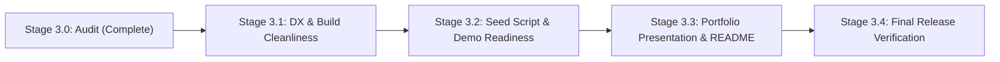

# MindVault — Phase 3.0: Product Readiness & Portfolio Release Assessment

**Stage:** 3 — Product Readiness & Portfolio Release  
**Milestone:** 3.0 — Complete Product Readiness Assessment  
**Assessment Mode:** STRICT READ-ONLY AUDIT  
**Implementation Authorization:** NOT GRANTED  
**Date:** November 9, 2026  
**Auditor:** Antigravity Autonomous Agent  
**Repository:** `MindVault` (`c:\Users\mohit\OneDrive\Desktop\MindVault`)

---

## 1. Executive Summary & Assessment Objective

MindVault has completed its foundational engineering roadmap (Phases 1–6.9), real-world RAG validation (Stage 1), and security hardening (Stage 2). The objective of Stage 3.0 is to assess MindVault **as a unified AI product ready for public portfolio demonstration and open-source GitHub release**, rather than evaluating isolated milestone components.

This audit evaluates the codebase across **4 comprehensive dimensions**:

1. **Application Experience (UI/UX):** End-to-end user journeys, authentication, workspaces, document management, conversational chat, interactive citations, GraphRAG visualization, error/loading states, and visual aesthetics.
2. **Backend & AI Capabilities:** Hybrid search, 3-way Reciprocal Rank Fusion ($k=60$), graph traversal, local/cloud LLM providers (Ollama & Gemini), BullMQ worker reliability, and security protections.
3. **Developer Experience (DX):** Installation reproducibility, environment setup, database migrations, seeding, monorepo build, typecheck, linting, and formatting health.
4. **Portfolio Presentation Readiness:** `README.md` completeness, technical differentiation, architecture diagrams, benchmark visibility, and known limitations.

---

## 2. Product Capabilities & Architectural Strengths (ALREADY GOOD)

MindVault exhibits exceptional engineering depth that sets it apart from standard wrapper projects. The following features are verified operational:

```
+---------------------------------------------------------------------------------------------------+
|                                MINDFVAULT ARCHITECTURE HIGHLIGHTS                                  |
+-----------------------------------+---------------------------------------------------------------+
| Multi-Format Ingestion Pipeline   | PDF (pdf-parse v2), DOCX, TXT, MD via async BullMQ workers    |
| Vector Embeddings & Lexical Index | 768-dim embeddings (pgvector HNSW) + PostgreSQL FTS (GIN)     |
| Hybrid Ranking & Fusion           | 3-Way Reciprocal Rank Fusion (k=60): Vector + Lexical + Graph |
| Knowledge Graph Exploration       | Recursive CTE SQL traversals, radial orbital SVG canvas       |
| Evidence-Grounded Conversational  | Dual-tier memory (sliding turns + rolling summary), citations |
| Provider Dual-Engine              | Local private Ollama (qwen3) + Cloud Google Gemini Flash      |
| Production Security Hardening     | Uniform 404 anti-enumeration, SSE disconnect stream abort     |
| Monorepo Test Coverage            | 782 / 782 tests passing across 67 test files (100% pass rate) |
+-----------------------------------+---------------------------------------------------------------+
```

### Verified Working User Journeys

1. **Authentication & Multi-Tenancy:** Secure Argon2id password hashing, rotating refresh tokens with automatic family revocation on token reuse, and strict workspace isolation.
2. **Document Management:** Uploading `.pdf`, `.docx`, `.txt`, `.md` files; asynchronous worker processing with live status polling (3s interval); document download and cascading deletion.
3. **Hybrid & GraphRAG Search:** Direct query retrieval via vector similarity, full-text lexical search, and graph relation expansion with score breakdown.
4. **Evidence-Grounded Streaming:** SSE token streaming (`POST /api/conversations/:id/messages/stream`) with clickable citations (`[S1]`, `[S2]`) that automatically highlight and scroll to source evidence chunks in a side drawer.
5. **Interactive Knowledge Graph:** Radial orbital SVG canvas with zoom, pan, node dragging, degree sizing, entity type filtering, and relation evidence drawers displaying source document text.
6. **Bespoke UI Design Tokens:** Custom "Warm Cream" (default) and "Dark Graphite" color schemes with typography-focused styling that avoids generic black-and-white templates.

---

## 3. Discovered Defects, Gaps, and Inconsistencies

During read-only inspection of the repository, several build, configuration, and documentation gaps were discovered. They are classified into prioritized categories:

```
+------------------------------------------------------------------------------------------+
|                                    DEFECT AUDIT REGISTER                                 |
+--------------------+---------------------------------------------------------------------+
| MUST FIX           | DX-01: Monorepo build failure in apps/api during `tsc` compilation  |
|                    | DX-02: `pnpm format:check` crash due to Python script misnamed .json|
|                    | DX-03: `pnpm lint` failure on regex escapes and unused expression   |
+--------------------+---------------------------------------------------------------------+
| SHOULD IMPROVE     | DOC-01: README.md outdated (frozen at Phase 5, claims 183 tests)    |
|                    | DX-04: Missing `pnpm db:seed` command for instant local demo data   |
|                    | CFG-01: `.env.example` missing Gemini API key and Graph configs     |
|                    | UI-01: CSS build warning on syntax typo in Tailwind stylesheet      |
+--------------------+---------------------------------------------------------------------+
| OPTIONAL           | UI-02: Graph canvas mobile responsive fallback list view            |
|                    | UI-03: Workspace switching transition skeleton animation            |
+--------------------+---------------------------------------------------------------------+
```

---

### 3.1 MUST FIX Issues

#### DX-01: TypeScript Compilation Failure in `apps/api` (`pnpm build`)

- **Classification:** **MUST FIX**
- **Location:** [`apps/api/src/modules/generation/__tests__/sse-cancellation.test.ts`](file:///c:/Users/mohit/OneDrive/Desktop/MindVault/apps/api/src/modules/generation/__tests__/sse-cancellation.test.ts)
- **Root Cause:**
  `apps/api/tsconfig.json` includes `src/**/*`, which compiles all test files during `pnpm build` (`tsc`). While Vitest runs via esbuild and passed 10/10 tests, strict `tsc` caught 4 typing mismatches:
  1. Line 77: `memoryDb.addWorkspaceMember` argument count mismatch.
  2. Line 279: `ollama.generateStream` argument count in direct unit call.
  3. Line 298: `gemini.generateStream` argument count in direct unit call.
  4. Line 454: Missing mandatory properties `retrieval` and `generation` in `ConversationRAGService.streamConversationMessage` call.
- **Impact:** Any developer running `pnpm build` or `pnpm typecheck` experiences an immediate exit code 1 failure.

#### DX-02: Prettier Check Failure (`pnpm format:check`)

- **Classification:** **MUST FIX**
- **Location:** `evaluation/dataset/ground-truth-manifest.json`
- **Root Cause:**
  A Python evaluation script (`import json\nquestions = [...]`) was saved with a `.json` file extension instead of `.py`.
- **Impact:** `prettier --check` crashes with:
  `[error] evaluation/dataset/ground-truth-manifest.json: SyntaxError: import can only be used in import() or import.meta.`

#### DX-03: ESLint Errors (`pnpm lint`)

- **Classification:** **MUST FIX**
- **Location:**
  - `apps/api/src/modules/conversations/prompts/conversational.prompt.ts#L385`: 3 `no-useless-escape` errors on `\-`.
  - `evaluation/harness/run-real-evaluation.ts#L54`: `@typescript-eslint/no-unused-expressions` error.
- **Impact:** `pnpm lint` fails with 4 errors and exit code 1.

---

### 3.2 SHOULD IMPROVE Issues

#### DOC-01: README Outdated & Missing Core Differentiators

- **Classification:** **SHOULD IMPROVE**
- **Location:** [`README.md`](file:///c:/Users/mohit/OneDrive/Desktop/MindVault/README.md)
- **Root Cause:**
  The root `README.md` was last updated at Phase 5. It states:
  - _"Current Status: Phase 5 Completed"_
  - _"- [ ] Phase 6: Knowledge Graph (Next Milestone)"_
  - _"183 tests across monorepo"_
- **Impact:** A recruiter or developer visiting the GitHub repository would miss the entire Phase 6 Knowledge Graph, GraphRAG 3-Way RRF, Gemini Cloud integration, Stage 1 Real-World RAG benchmarks, Stage 2 Security Hardening, and the current 782-test test suite!

#### DX-04: Missing Seed Script (`pnpm db:seed`)

- **Classification:** **SHOULD IMPROVE**
- **Location:** `prisma/schema.prisma` / `package.json`
- **Root Cause:**
  The repository has Docker and migrations, but zero seed scripts.
- **Impact:** Anyone cloning the project starts with a completely empty database. They must register, create a workspace, locate files, upload them, and wait for worker extraction before seeing any chat, search, or graph visualization in action. Providing an automated seed script utilizing `evaluation/corpus/` gives visitors an instant, turnkey demonstration.

#### CFG-01: Incomplete Environment Template (`.env.example`)

- **Classification:** **SHOULD IMPROVE**
- **Location:** [`.env.example`](file:///c:/Users/mohit/OneDrive/Desktop/MindVault/.env.example)
- **Root Cause:**
  The template omits `GEMINI_API_KEY`, `GEMINI_MODEL`, and Graph extraction worker settings (`GRAPH_EXTRACTION_MODEL`, `OLLAMA_EXTRACTION_MODEL`), leaving developers to guess configuration variable names.

#### UI-01: CSS Syntax Warning in Vite Build

- **Classification:** **SHOULD IMPROVE**
- **Location:** `apps/web/dist` build output
- **Root Cause:**
  `[esbuild css minify] ▲ [WARNING] Expected identifier but found "-" [css-syntax-error] <stdin>:2133:2: -: \s|;`
  A stray character in one of the utility classes triggers an esbuild warning during `pnpm --filter @mindvault/web build`.

---

### 3.3 OPTIONAL Enhancements

- **UI-02: Graph Canvas Mobile List Fallback:** When viewed on screens narrower than 640px, navigating an SVG graph can be clumsy. Providing an entity card list toggle improves mobile usability.
- **UI-03: Workspace Switch Skeleton Loader:** Adding a brief skeleton shimmer when changing workspaces provides a smoother visual transition.

---

## 4. UI/UX Assessment

| Screen / Flow                   | Aesthetic & Usability Evaluation                                                                                                          |      Status      |
| :------------------------------ | :---------------------------------------------------------------------------------------------------------------------------------------- | :--------------: |
| **Authentication Screen**       | Minimalist card design with Warm Cream and Dark Graphite support. Clear error handling and toggle between login and registration.         | **ALREADY GOOD** |
| **Document Library**            | Drag-and-drop file upload with progress bar, mime-type badges, live status polling, and chunk detail modals.                              | **ALREADY GOOD** |
| **Chat Timeline & Assistant**   | Clean conversational thread, user bubble with image thumbnails, streaming assistant output, code block copy, and retry controls.          | **ALREADY GOOD** |
| **Citation Presentation**       | Stable bracketed citations (`[S1]`, `[S2]`) with interactive hover states and single-click scroll-and-highlight in the SourcePanel.       | **ALREADY GOOD** |
| **Grounding Badge**             | Clear intellectual honesty indicator displaying `GROUNDED` (emerald), `PARTIALLY_GROUNDED` (amber), or `INSUFFICIENT_EVIDENCE` (rose).    | **ALREADY GOOD** |
| **Knowledge Graph Explorer**    | Interactive SVG canvas with zoom, pan, radial layout, degree sizing, node dragging, entity type filtering, and relation evidence drawers. | **ALREADY GOOD** |
| **Search & Retrieval Explorer** | Dedicated search screen with mode toggles (`semantic`, `keyword`, `graph`, `hybrid`, `graphrag`), filter controls, and timing metrics.    | **ALREADY GOOD** |
| **Settings Modal**              | Tabs for theme switcher, configured models (Gemini & Ollama), workspace renaming/deletion, and active session revocation.                 | **ALREADY GOOD** |

---

## 5. Developer Experience Assessment

| Dimension                            | Observation                                                                                               |      Verdict       |
| :----------------------------------- | :-------------------------------------------------------------------------------------------------------- | :----------------: |
| **Prerequisites**                    | Standard Node.js 20/22, pnpm 9/10, Docker Compose.                                                        |  **ALREADY GOOD**  |
| **Docker Orchestration**             | Clean `docker-compose.yml` spinning up PostgreSQL 16 (pgvector) and Redis 7 in seconds with healthchecks. |  **ALREADY GOOD**  |
| **Prisma Migrations**                | 11 cleanly sequenced migrations through knowledge graph foundations and relation pruning.                 |  **ALREADY GOOD**  |
| **Build Execution (`pnpm build`)**   | Web, Shared, and Worker build cleanly; API fails due to test typecheck errors (DX-01).                    |    **MUST FIX**    |
| **Linting (`pnpm lint`)**            | Fails with 4 errors (regex escapes & unused expression) (DX-03).                                          |    **MUST FIX**    |
| **Formatting (`pnpm format:check`)** | Fails due to Python script misnamed as `.json` (DX-02).                                                   |    **MUST FIX**    |
| **Database Seeding**                 | Completely missing. Requires manual document upload to evaluate product.                                  | **SHOULD IMPROVE** |

---

## 6. Portfolio & GitHub Release Assessment

MindVault has the technical depth to stand out in the top tier of AI engineering portfolio projects:

- **Depth over Hype:** Features real PostgreSQL pgvector cosine search, full-text tsvector search, Reciprocal Rank Fusion, transactional BullMQ worker lease fencing, and recursive CTE graph traversal.
- **Empirical Rigor:** Backed by real-world validation benchmarks across 36 questions with 100% abstention accuracy and 86.7% citation validity.
- **Production Security:** Hardened against document existence oracles, context desynchronization, and SSE stream resource leaks.

However, its current presentation in `README.md` completely understates its accomplishments. The repository presents itself as an incomplete Phase 5 project with 183 tests, hiding its GraphRAG engine and empirical benchmark achievements.

---

## 7. Guardrails: What NOT to Build

To prevent project sprawl and preserve the portfolio-grade focus, the following items are **explicitly ruled out of scope**:

1. **NO Enterprise SaaS Overhead:** Do not build multi-tenant team invitation email portals, Stripe billing, or SAML/SSO integrations.
2. **NO Cloud Infrastructure Sprawl:** Do not replace lightweight Docker Compose with Kubernetes, Terraform, or AWS Helm charts.
3. **NO UI Framework Churn:** Do not replace the existing Tailwind + Lucide aesthetic with generic UI libraries (e.g., Shadcn or Material UI).
4. **NO Additional LLM Frameworks:** Do not introduce LangChain, LlamaIndex, or CrewAI wrappers; MindVault's custom provider architecture is cleaner, faster, and more demonstrable.
5. **NO Unnecessary Database Migrations:** The schema is stable and complete; do not alter database tables or constraints.

---

## 8. Prioritized Stage 3 Milestone Plan



### Milestone 3.1: Developer Experience & Build Cleanliness

- **Target:** Fix DX-01, DX-02, DX-03, and UI-01.
- **Actions:**
  1. Correct strict typing in `apps/api/src/modules/generation/__tests__/sse-cancellation.test.ts`.
  2. Rename `evaluation/dataset/ground-truth-manifest.json` to `.py` (or convert content to valid JSON).
  3. Fix useless escape characters in `conversational.prompt.ts` and unused expression in `run-real-evaluation.ts`.
  4. Fix CSS syntax typo in web stylesheet.
  5. Verify that `pnpm build`, `pnpm typecheck`, `pnpm lint`, and `pnpm format:check` all exit code 0.

### Milestone 3.2: Seed Script & Demo Corpus Readiness

- **Target:** Address DX-04 and CFG-01.
- **Actions:**
  1. Author a turnkey database seed script: `pnpm db:seed`.
  2. Automatically seed an initial demo user (`demo@mindvault.local`), a sample workspace ("Engineering & AI Architecture"), pre-indexed documents from `evaluation/corpus/`, and pre-extracted graph entities/relations.
  3. Update `.env.example` with Gemini and Graph configuration parameters.

### Milestone 3.3: Portfolio Presentation & Documentation Polish

- **Target:** Address DOC-01 and portfolio presentation gaps.
- **Actions:**
  1. Completely rewrite root `README.md` showcasing MindVault as a full GraphRAG Personal Knowledge OS.
  2. Add clear Mermaid architecture diagrams (Ingestion -> Hybrid/Graph Retrieval -> 3-Way RRF -> Grounded Generation).
  3. Showcase empirical benchmark results (Stage 1.3.2) and security hardening guarantees (Stage 2).
  4. Update test statistics to accurately reflect **782 tests across 67 test files**.
  5. Provide clear, copy-pasteable quickstart instructions (`docker:up` -> `db:migrate` -> `db:seed` -> `dev`).

### Milestone 3.4: Final Release Verification & Packaging

- **Target:** End-to-end smoke test of clean clone, docker startup, database migration, seeding, dev servers, and test execution.
- **Deliverable:** `PHASE_3_4_FINAL_RELEASE_REPORT.md` and GitHub release readiness sign-off.

---

## 9. Conclusion & Stop Gate

MindVault is in an outstanding technical state. The underlying architecture is solid, deeply tested, and performant. Resolving the few build/lint DX issues, adding a seed script, and updating the portfolio documentation will elevate MindVault into an exceptional, production-grade AI portfolio showcase.

> [!IMPORTANT]
> **STOP GATE ENFORCED:**  
> This was a **STRICT READ-ONLY AUDIT**. No source files or configurations were modified.  
> Execution is stopped. Awaiting explicit user approval before proceeding to **Milestone 3.1 (DX & Build Cleanliness)**.
