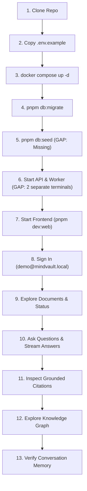
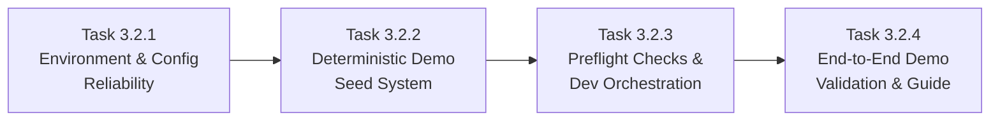

# MindVault — Milestone 3.2: Demo Readiness & Release Preparation Plan

**Document Type:** Milestone Readiness Assessment & Implementation Plan  
**Stage:** 3 — Product Readiness & Portfolio Release  
**Milestone:** 3.2 — Demo Readiness & Release Preparation  
**Mode:** STRICT READ-ONLY REPOSITORY AUDIT AND IMPLEMENTATION PLANNING  
**Status:** COMPLETE (Planning Only — No Implementation Authorized)  
**Previous Milestone:** 3.1 — Build & Tooling Reliability (ACCEPTED)

---

## 1. Executive Summary

Milestone 3.2 prepares MindVault for a reproducible, reliable, and professional demonstration suitable for technical portfolio reviews and public GitHub release.

Following the successful resolution of all build, lint, formatting, and CSS issues in Milestone 3.1, this audit evaluated the end-to-end developer experience, environment configuration, database seeding, service orchestration, and demo data quality.

### Key Audit Findings

1. **DX-04 (Missing Seed Script):** **VERIFIED GAP.** The repository currently possesses zero database seed scripts. There is no `pnpm db:seed` script configured. An empty clone leaves a new developer with an unpopulated database, requiring manual registration, manual document uploads, and live external daemons before any search, RAG, or graph capabilities can be evaluated.
2. **CFG-01 (Environment Configuration):** **VERIFIED GAP.** `.env.example` is missing 10 active runtime environment variables used by the API and Worker (`EMBEDDING_MODEL`, `STORAGE_DIR`, `GRAPH_EXTRACTION_PROVIDER`, `OLLAMA_EXTRACTION_MODEL`, `OLLAMA_EXTRACTION_TEMPERATURE`, `OLLAMA_EXTRACTION_THINK`, `OLLAMA_EXTRACTION_TIMEOUT_MS`, `GEMINI_API_KEY`, `GEMINI_MODEL`, `RERANKER_ENDPOINT`). Furthermore, `apps/web/vite.config.ts` hardcodes its proxy target to `http://localhost:4000`, completely ignoring `VITE_API_BASE_URL` and `PORT`.
3. **DEMO-01 (End-to-End Developer Experience):** **FRAGILE.** While the individual services are well-engineered, a new developer must manually orchestrate 3 distinct terminal processes (`pnpm dev:api`, `pnpm dev:worker`, `pnpm dev:web`) without a unified pre-flight health check to verify Docker, PostgreSQL, Redis, or Ollama readiness.
4. **DEMO-02 (Reproducibility & Offline Independence):** **OPPORTUNITY.** MindVault already includes deterministic test providers (`MockEmbeddingProvider`, `MockLLMProvider`, `MockExtractionProvider`). By leveraging pre-computed or deterministic seed data, a complete demonstration can be executed 100% offline without requiring paid API keys or live Ollama background processes.
5. **DEMO-03 (Demo Data Quality):** **SUFFICIENT & HIGH QUALITY.** The 6 technical core documents in `evaluation/corpus/` (`MV-DOC-01` to `MV-DOC-06`) and the 36-question evaluation dataset (`eval-questions.ts`) provide a rich, cohesive, self-referential technical knowledge vault that exercises all core capabilities: semantic retrieval, keyword retrieval, 3-way RRF, graph traversal, grounded citations, and conversational memory.

**Protected AI Architecture Status:** The core AI subsystems (3-way RRF, pgvector embeddings, GraphRAG recursive traversal, BullMQ workers, grounding guardrails, multi-tenant isolation) are 100% operational with all 782 regression tests passing.

---

## 2. Current Repository Readiness

### 2.1 Workspace Architecture & Health

| Package             | Purpose                                        | Build Status          | Test Status          | Runtime Entrypoint                  |
| :------------------ | :--------------------------------------------- | :-------------------- | :------------------- | :---------------------------------- |
| `@mindvault/shared` | Core schemas, Zod validators, DTOs, interfaces | **PASS** (`tsc`)      | Integrated           | `packages/shared/src/index.ts`      |
| `@mindvault/api`    | Express REST & SSE streaming server            | **PASS** (`tsc`)      | **PASS** (633 tests) | `apps/api/src/index.ts` (Port 4000) |
| `@mindvault/worker` | BullMQ background ingestion & graph extraction | **PASS** (`tsc`)      | **PASS** (149 tests) | `apps/worker/src/index.ts`          |
| `@mindvault/web`    | React 18 + Vite + Tailwind CSS frontend        | **PASS** (0 warnings) | N/A (E2E)            | `apps/web/src/App.tsx` (Port 5173)  |

**Overall Test Suite:** 782 / 782 tests passing across 67 test files (100% pass rate).  
**Code Quality:** Clean formatting (`pnpm format:check` passes), zero ESLint errors (`pnpm lint` passes).

### 2.2 Infrastructure & Database Migration State

- **Docker Compose:** `docker-compose.yml` configures:
  - `postgres`: `pgvector/pgvector:pg16` with `./infrastructure/docker/postgres/init.sql` (enables `vector` and `uuid-ossp`).
  - `redis`: `redis:7-alpine` on port 6379 for BullMQ queues.
- **Database Migrations:** 11 sequential, forward-only migrations exist in `prisma/migrations/`:
  1. `20261105000000_init_auth_workspaces` (Users, Workspaces, Members, Sessions)
  2. `20261105000001_add_documents_and_chunks` (Documents, DocumentChunks, pgvector)
  3. `20261106000000_add_full_text_search` (Generated `search_vector` tsvector, GIN index)
  4. `20261106000001_optimize_fts_index` (Functional GIN index)
  5. `20261106000002_add_chat_sessions_and_messages` (ChatSessions, ChatMessages, Citations)
  6. `20261107000000_phase_6_knowledge_graph_foundation` (GraphEntity, Relation, Mentions, Evidence)
  7. `20261107000100_phase_6_canonical_protection_refinement` (Canonical names, normalization)
  8. `20261107000200_phase_6_entity_types_and_weight_sync` (EntityType enum, weight triggers)
  9. `20261107000300_phase_6_trigger_concurrency_hardening` (Concurrency-hardened triggers)
  10. `20261107000400_phase_6_trigger_advisory_lock` (Postgres advisory lock protection)
  11. `20261107000500_phase_6_prune_orphaned_relations` (Orphan cleanup trigger)

All migrations apply cleanly via `pnpm db:migrate` (`prisma migrate deploy`).

---

## 3. Detailed Findings & Gap Analysis

### 3.1 DX-04: Missing Seed Script Analysis

#### Current State

- `package.json` contains scripts for `db:generate` and `db:migrate`, but **NO** `db:seed` or `seed` command.
- `prisma/schema.prisma` has no `prisma.seed` configuration.
- The only seeding logic in the repository exists inside unit/integration test suites (which seed an ephemeral in-memory database) and `evaluation/harness/eval-db.ts` (which targets the test-only `mindvault_eval` database on port 5433 using dummy `'eval_hash_not_for_auth'` password hashes).

#### Required Seed Capabilities

A production-grade demonstration requires seeding a deterministic, rich database state that allows immediate exploration:

1. **Demo User Account:**
   - Name: `Demo User`
   - Email: `demo@mindvault.local`
   - Password: `DemoPassword123!` (properly hashed with Argon2id matching `apps/api/src/modules/auth/auth.security.ts`)
2. **Demo Workspace:**
   - Name: `MindVault Architecture Showcase`
   - Slug: `demo-showcase`
   - Role: `OWNER`
3. **Core Documents (`MV-DOC-01` to `MV-DOC-06`):**
   - 6 documents created with status `COMPLETED`, chunk counts, page counts, and metadata.
   - Associated files stored in `infrastructure/storage/documents/` so file downloads work.
4. **Chunks, Dense Vectors & Full-Text Search Vectors:**
   - Chunks created with exact text content, token counts, and page numbers.
   - Dense vector embeddings (`vector(768)`) pre-computed or generated via `MockEmbeddingProvider` (or Ollama if available).
   - `search_vector` (`tsvector`) auto-generated by PostgreSQL's `GENERATED ALWAYS AS (to_tsvector('english', "content")) STORED`.
5. **Knowledge Graph Entities, Relations & Evidence:**
   - 12–15 key architectural entities (`PostgreSQL`, `Write-Ahead Logging`, `Streaming Replication`, `pgvector`, `HNSW Index`, `RAG Architecture`, `Reciprocal Rank Fusion`, `Context Assembler`, `Raft Consensus`, `AES-256-GCM`, `API Gateway`, `Server-Sent Events`, `Grounding Engine`).
   - Aliases (`Postgres` -> `PostgreSQL`, `pgvector` -> `pgvector`).
   - Cross-document directed relations with confidence weights (0.8–1.0).
   - Chunk entity mentions and relation evidence snippets linked directly to document chunks.
6. **Realistic Multi-Turn Chat Sessions:**
   - At least 2 pre-seeded conversation sessions with messages, citations (`[MV-DOC-01:Chunk 0]`), token estimates, and session summaries.

#### Idempotency & Repeatability Strategy

- The seed script must use deterministic primary keys (predictable UUIDs derived from entity names/slugs) and `upsert` / `ON CONFLICT` statements.
- Re-running `pnpm db:seed` multiple times must:
  - Update or maintain existing records.
  - Never throw unique constraint errors (`slug`, `email`, `[workspaceId, normalizedName]`, `[workspaceId, sourceEntityId, targetEntityId, relationType]`).
  - Never produce duplicate documents, chunks, or messages.

#### Tenant Isolation Safeguard

- All demo data is strictly tagged with `workspaceId: "ws_demo_showcase_001"` and `userId: "usr_demo_user_001"`.
- If a user registers their own personal account (e.g. `alice@example.com`), MindVault's authorization middleware (`authorizeWorkspace`) and row-level tenant filters ensure they cannot see or modify the demo workspace unless explicitly added as a member.

#### Offline & Zero-Paid-API Guarantee

- The seeding script must run entirely via Node.js + Prisma without requiring an active Ollama daemon, OpenAI key, or Gemini key.
- If Ollama is detected and online with `nomic-embed-text`, the seed script can optionally generate live embeddings; otherwise, it defaults to deterministic 768-dimensional normalized unit vectors generated via SHA-256 seed hashing (identical to `MockEmbeddingProvider`).

---

### 3.2 CFG-01: Environment Configuration Audit

#### Audit Matrix: Variables Declared vs. Runtime Usage

| Variable                            | In `.env.example` | Read by `api` | Read by `worker` | Default / Fallback                   | Risk / Finding                                                     |
| :---------------------------------- | :---------------: | :-----------: | :--------------: | :----------------------------------- | :----------------------------------------------------------------- |
| `NODE_ENV`                          |        Yes        |      Yes      |       Yes        | `development`                        | OK                                                                 |
| `PORT`                              |        Yes        |      Yes      |        No        | `4000`                               | OK                                                                 |
| `CORS_ORIGIN`                       |        Yes        |      Yes      |        No        | `http://localhost:5173`              | OK                                                                 |
| `JWT_ACCESS_SECRET`                 |        Yes        |      Yes      |        No        | Dev default (32 chars)               | OK                                                                 |
| `JWT_ACCESS_EXPIRY`                 |        Yes        |      Yes      |        No        | `15m`                                | OK                                                                 |
| `COOKIE_SECRET`                     |        Yes        |      Yes      |        No        | Dev default (32 chars)               | OK                                                                 |
| `REFRESH_TOKEN_EXPIRY_DAYS`         |        Yes        |      Yes      |        No        | `7`                                  | OK                                                                 |
| `POSTGRES_USER`                     |        Yes        |   (via URL)   |    (via URL)     | `mindvault`                          | OK (Docker Compose)                                                |
| `POSTGRES_PASSWORD`                 |        Yes        |   (via URL)   |    (via URL)     | `mindvault_dev_password`             | OK (Docker Compose)                                                |
| `POSTGRES_DB`                       |        Yes        |   (via URL)   |    (via URL)     | `mindvault`                          | OK (Docker Compose)                                                |
| `POSTGRES_PORT`                     |        Yes        |   (via URL)   |    (via URL)     | `5432`                               | Must match `DATABASE_URL` port                                     |
| `DATABASE_URL`                      |        Yes        |      Yes      |       Yes        | `postgresql://...`                   | OK                                                                 |
| `REDIS_HOST`                        |        Yes        |   (via URL)   |    (via URL)     | `localhost`                          | Redundant with `REDIS_URL`                                         |
| `REDIS_PORT`                        |        Yes        |   (via URL)   |    (via URL)     | `6379`                               | Redundant with `REDIS_URL`                                         |
| `REDIS_URL`                         |        Yes        |      Yes      |       Yes        | `redis://localhost:6379`             | OK                                                                 |
| `WORKER_CONCURRENCY`                |        Yes        |      No       |       Yes        | `5`                                  | OK                                                                 |
| `VITE_API_BASE_URL`                 |        Yes        |      No       |        No        | `http://localhost:4000/api`          | **CRITICAL GAP:** Ignored by Vite proxy!                           |
| `LLM_PROVIDER`                      |        Yes        |      Yes      |       Yes        | `ollama`                             | OK (`ollama`, `gemini`, `mock`)                                    |
| `OLLAMA_BASE_URL`                   |        Yes        |      Yes      |       Yes        | `http://localhost:11434`             | OK                                                                 |
| `OLLAMA_GENERATION_MODEL`           |        Yes        |      Yes      |       Yes        | `qwen3:0.6b`                         | OK                                                                 |
| `LLM_REQUEST_TIMEOUT`               |        Yes        |      Yes      |       Yes        | `60000`                              | OK                                                                 |
| `LLM_MAX_OUTPUT_TOKENS`             |        Yes        |      Yes      |       Yes        | `1024`                               | OK                                                                 |
| `LLM_TEMPERATURE`                   |        Yes        |      Yes      |       Yes        | `0.2`                                | OK                                                                 |
| **`EMBEDDING_MODEL`**               |      **NO**       |      Yes      |       Yes        | `nomic-embed-text`                   | **MISSING:** Used in `embedding.service.ts` & `ollama.provider.ts` |
| **`STORAGE_DIR`**                   |      **NO**       |      Yes      |       Yes        | `./infrastructure/storage/documents` | **MISSING:** Used in `document.storage.ts` & `lib/storage.ts`      |
| **`GRAPH_EXTRACTION_PROVIDER`**     |      **NO**       |      Yes      |       Yes        | `process.env.LLM_PROVIDER`           | **MISSING:** Provider factory fallback                             |
| **`OLLAMA_EXTRACTION_MODEL`**       |      **NO**       |      No       |       Yes        | `qwen3:0.6b`                         | **MISSING:** Read by `OllamaExtractionProvider`                    |
| **`OLLAMA_EXTRACTION_TEMPERATURE`** |      **NO**       |      No       |       Yes        | `0.0`                                | **MISSING:** Read by `OllamaExtractionProvider`                    |
| **`OLLAMA_EXTRACTION_THINK`**       |      **NO**       |      No       |       Yes        | `false`                              | **MISSING:** Read by `OllamaExtractionProvider`                    |
| **`OLLAMA_EXTRACTION_TIMEOUT_MS`**  |      **NO**       |      No       |       Yes        | `60000`                              | **MISSING:** Read by `OllamaExtractionProvider`                    |
| **`GEMINI_API_KEY`**                |      **NO**       |      Yes      |       Yes        | `undefined`                          | **MISSING:** Required if `LLM_PROVIDER=gemini`                     |
| **`GEMINI_MODEL`**                  |      **NO**       |      Yes      |       Yes        | `gemini-3.5-flash`                   | **MISSING:** Used if `LLM_PROVIDER=gemini`                         |
| **`RERANKER_ENDPOINT`**             |      **NO**       |      Yes      |        No        | `undefined`                          | **MISSING:** Optional cross-encoder endpoint                       |
| **`RERANKER_API_KEY`**              |      **NO**       |      Yes      |        No        | `undefined`                          | **MISSING:** Optional cross-encoder key                            |

#### Identified Architecture Issues in Configuration

1. **Frontend Vite Proxy Disconnect:**
   In `apps/web/vite.config.ts`:
   ```ts
   proxy: {
     '/api': {
       target: 'http://localhost:4000',
       changeOrigin: true,
       timeout: 180000,
     },
   }
   ```
   If a developer customizes `PORT=4001` or `API_PORT=4001` in `.env`, the frontend dev server continues targeting `4000`, causing all API interactions to fail with `504 Gateway Timeout` or `ECONNREFUSED`. `apps/web/vite.config.ts` must dynamically resolve `process.env.PORT` or `process.env.VITE_API_BASE_URL`.
2. **Missing Embedding & Ingestion Configuration in `.env.example`:**
   Developers setting up local Ollama have no documented indicator that `nomic-embed-text` is the required embedding model or that document files are written to `./infrastructure/storage/documents`.

---

### 3.3 DEMO-01: End-to-End Demo Experience Evaluation

We evaluated each step of the developer journey from a clean clone:



#### Detailed Gap Assessment

- **Steps 1–4 (Clone, Config, Docker, Migrate):** Functional, but lacks automated service readiness checks. If `pnpm db:migrate` runs immediately after `docker compose up -d` before Postgres finishes initialization, the migration command fails.
- **Step 5 (Seed Data):** **BLOCKING GAP.** Without a seed script, the database has 0 users, 0 workspaces, 0 documents, and 0 graph nodes. The app presents an empty state.
- **Step 6–7 (Process Execution):** Developers currently must open three separate terminal windows and run:
  - Terminal 1: `pnpm dev:api`
  - Terminal 2: `pnpm dev:worker`
  - Terminal 3: `pnpm dev:web`
    A unified dev orchestration command (`pnpm demo:dev` or `pnpm dev`) using concurrently or a simple node orchestrator is missing.
- **Step 8 (Authentication):** Without seeded credentials, the user must register.
- **Steps 9–13 (Core Demo Experience):** Once seeded, the existing web frontend fully supports:
  - Document viewing and status tracking (`DocumentLibrary`).
  - 3-Way RRF hybrid retrieval and streaming answers (`KnowledgeAssistant`).
  - Interactive citation inspection drawers (`RAGTelemetry`).
  - Force-directed knowledge graph visualization with entity and relation evidence drawers (`KnowledgeGraphView`).
  - Multi-turn conversation history and sidebar session management (`ConversationSidebar`).

---

### 3.4 DEMO-02: Reproducibility & Service Orchestration

To achieve 100% reproducible demonstrations on arbitrary developer hardware (macOS, Linux, Windows), the following dependencies must be managed:

1. **Database & Cache Readiness:**
   - Docker Compose starts Postgres and Redis with container health checks.
   - However, host processes connecting immediately need a retry/wait loop. A pre-flight script should test TCP socket connection to Postgres (`5432`/`5433`) and Redis (`6379`) before running migrations.
2. **Ollama & Model Readiness:**
   - MindVault relies on two models if using local Ollama:
     - `nomic-embed-text` (768 dimensions)
     - `qwen3:0.6b` (generation & extraction)
   - A pre-flight verification script should probe `http://localhost:11434/api/tags` to check if Ollama is running and whether these models are available.
   - If Ollama is missing or offline, the script should output clear advice on how to pull them (`ollama pull nomic-embed-text && ollama pull qwen3:0.6b`) or suggest setting `LLM_PROVIDER=mock` for an offline demo.
3. **Failure Recovery & Clean Shutdown:**
   - Both API and Worker gracefully handle `SIGINT` and `SIGTERM`.
   - Worker implements a 15-second hard safety timer and cleans up BullMQ workers and Redis connections.
   - Pre-flight scripts should confirm clean shutdowns.

---

### 3.5 DEMO-03: Demo Data Quality Assessment

#### Evaluation Corpus Analysis

The repository includes 6 technical markdown documents in `evaluation/corpus/`:

- `MV-DOC-01.md`: _Distributed Cloud Storage and Sharding Architecture Spec_ (Active-passive replication, Raft consensus leases at 1500ms, AES-256-GCM encryption).
- `MV-DOC-02.md`: _Identity and Access Management Architecture Protocol_ (Argon2id, JWT with 15m TTL, 7-day refresh token rotation, revocation cascades).
- `MV-DOC-03.md`: _Hybrid Search, Reciprocal Rank Fusion & Dense Vector Retrieval_ (3-way RRF with k=60, pgvector HNSW, GIN tsvector, cross-encoder reranker).
- `MV-DOC-04.md`: _API Gateway Routing and Server-Sent Events Protocol Specification_ (SSE stream lifecycle, connection heartbeats, 75% narrative floor / 25% graph ceiling context assembly budget).
- `MV-DOC-05.md`: _Microservice Configuration, Database Connection Pooling & Rate Limiting_ (`DB_POOL_MAX=20`, `MAX_FILE_SIZE_BYTES=26214400` / 25MB, rate limits).
- `MV-DOC-06.md`: _Grounding Engine, Citation Attribution & Anti-Hallucination Guardrails_ (Citation format `[DOC-ID:ChunkIndex]`, grounding confidence scores, hallucination deterrence).

#### Dataset Fit for Demo Scenarios

1. **Direct Factual Retrieval:** Covered by `MV-DOC-05` (e.g. "What is the maximum allowed database connection pool size?" -> `20`).
2. **Semantic Retrieval:** Covered by `MV-DOC-01` & `MV-DOC-02` (e.g. "How does the system ensure data remains protected at rest?" -> `AES-256-GCM`).
3. **3-Way Hybrid RRF:** Covered across all documents where keyword search matches exact terms (`DB_POOL_MAX`) while dense vectors match conceptual queries.
4. **Graph Relationships & Multi-Hop Traversal:** The concepts across these documents form a natural technical architecture graph:
   - `PostgreSQL` -(USES)-> `pgvector` -(ENABLES)-> `Hybrid Retrieval`
   - `RAGService` -(TRIGGERS)-> `RetrievalService` -(FEEDS_INTO)-> `ContextAssembler`
   - `Raft Consensus` -(RENEWED_VIA)-> `Heartbeat Leases`
5. **Grounded Answers & Citations:** Every answer cites specific chunks with verifiable evidence snippets.
6. **Conversational Memory:** Users can ask a multi-turn follow-up (e.g., Turn 1: "What is the JWT access token lifetime?", Turn 2: "What happens when it expires?").

**Conclusion:** The existing 6 documents are more than sufficient. No new external or synthetic documents are needed. Expanding the pre-seeded graph topology across these 6 documents is the optimal strategy.

---

## 4. Exact Files & Scripts Involved

### 4.1 New Files Proposed for Milestone 3.2

| File Path                            | Purpose                                                                                                                                    |
| :----------------------------------- | :----------------------------------------------------------------------------------------------------------------------------------------- |
| `prisma/seed.ts`                     | Primary database seed entrypoint executing idempotent upserts.                                                                             |
| `prisma/seed-data.ts`                | Deterministic seed data definitions (Users, Workspace, Documents, Chunks, Embeddings, Graph Entities, Relations, Evidence, Conversations). |
| `scripts/verify-demo-environment.ts` | Pre-flight diagnostic script checking Docker, Postgres, Redis, and Ollama/Gemini connectivity.                                             |
| `docs/DEMO_WALKTHROUGH.md`           | Comprehensive, step-by-step presenter guide and verification checklist.                                                                    |

### 4.2 Existing Files Proposed for Update

| File Path                 | Proposed Modification                                                                               | Rationale                                                               |
| :------------------------ | :-------------------------------------------------------------------------------------------------- | :---------------------------------------------------------------------- |
| `.env.example`            | Add missing runtime variables with documented defaults.                                             | Resolve CFG-01; ensure developers have complete configuration guidance. |
| `apps/web/vite.config.ts` | Make `/api` proxy target dynamically read `process.env.PORT` or `process.env.VITE_API_BASE_URL`.    | Prevent frontend proxy failure if API port is modified.                 |
| `package.json`            | Add `"db:seed": "tsx prisma/seed.ts"` and `"demo:check": "tsx scripts/verify-demo-environment.ts"`. | Provide standard, easy-to-discover developer commands.                  |

---

## 5. Proposed Implementation Breakdown

We recommend structuring Milestone 3.2 into four sequential, well-defined tasks:



### Task 3.2.1: Environment & Configuration Reliability (CFG-01)

- **Objective:** Update `.env.example` with all missing variables, accurate comments, and sensible defaults. Update `apps/web/vite.config.ts` to dynamically resolve the API target.
- **Files Modified:**
  - `.env.example`
  - `apps/web/vite.config.ts`
- **Scope Boundary:** No application source logic changed; only configuration templates and build proxy settings.

### Task 3.2.2: Deterministic Demo Seed System (DX-04)

- **Objective:** Implement `prisma/seed.ts` and `prisma/seed-data.ts` to idempotently seed the demo workspace, user, documents, chunks, vectors, knowledge graph, and conversation history.
- **Files Created:**
  - `prisma/seed-data.ts`
  - `prisma/seed.ts`
- **Files Modified:**
  - `package.json` (add `"db:seed"`, configure `"prisma": { "seed": ... }`)
- **Key Technical Requirement:** Must execute cleanly with or without live Ollama daemons; 100% offline-compatible.

### Task 3.2.3: Preflight Verification & Service Readiness (DEMO-02)

- **Objective:** Implement `scripts/verify-demo-environment.ts` to inspect PostgreSQL connection and pgvector extension, Redis connectivity, and Ollama status/models, providing clear actionable status banners.
- **Files Created:**
  - `scripts/verify-demo-environment.ts`
- **Files Modified:**
  - `package.json` (add `"demo:check"`)

### Task 3.2.4: End-to-End Demo Verification & Guide (DEMO-01, DEMO-03)

- **Objective:** Execute the complete demo flow from scratch; author `docs/DEMO_WALKTHROUGH.md` with exact question scripts, expected citations, graph exploration highlights, and troubleshooting tips.
- **Files Created:**
  - `docs/DEMO_WALKTHROUGH.md`
- **Output:** Final Milestone 3.2 Implementation Report.

---

## 6. Technical Dependencies

- **Prisma Client (`@prisma/client` ^6.2.1):** Used by `prisma/seed.ts` for database operations.
- **Argon2 (`argon2` ^0.41.1):** Used to generate valid password hashes for the demo user matching MindVault auth.
- **TypeScript (`typescript` ^5.7.2) & `tsx` (^4.19.2):** Used to execute seed and verification scripts directly.
- **Node.js Native Crypto & Fetch:** Used for deterministic vector hashing and HTTP pre-flight checks.

No new third-party production dependencies are required.

---

## 7. Security, Privacy & Tenancy Isolation Safeguards

1. **No Hardcoded Production Secrets:** `.env.example` will contain only clearly marked development placeholders (`dev_jwt_access_secret_...`).
2. **Dedicated Demo Workspace:** All seeded data belongs exclusively to `ws_demo_showcase_001`. A user's private workspaces cannot access demo data, and the demo workspace cannot access real user documents.
3. **Password Security:** The demo user password (`DemoPassword123!`) is hashed with full Argon2id parameters (19 MiB memory, 2 time iterations), ensuring realistic authentication without security downgrades.
4. **Clean Reset Protection:** The seed script will ONLY upsert or clear records in the demo workspace, never dropping other workspaces or touching unrelated tables.

---

## 8. Acceptance Criteria for Every Proposed Task

### Acceptance Criteria: Task 3.2.1 (Config)

- [ ] `.env.example` documents all 10 previously missing runtime variables (`EMBEDDING_MODEL`, `STORAGE_DIR`, `GRAPH_EXTRACTION_PROVIDER`, `OLLAMA_EXTRACTION_MODEL`, `OLLAMA_EXTRACTION_TEMPERATURE`, `OLLAMA_EXTRACTION_THINK`, `OLLAMA_EXTRACTION_TIMEOUT_MS`, `GEMINI_API_KEY`, `GEMINI_MODEL`, `RERANKER_ENDPOINT`).
- [ ] `.env.example` contains zero actual secrets.
- [ ] `apps/web/vite.config.ts` dynamically resolves the backend port from environment variables, falling back to 4000.
- [ ] `pnpm build`, `pnpm typecheck`, and `pnpm lint` pass with 0 errors.

### Acceptance Criteria: Task 3.2.2 (Seed System)

- [ ] `pnpm db:seed` executes cleanly and exits with code 0.
- [ ] Re-running `pnpm db:seed` consecutively produces zero errors and zero duplicate records (idempotent).
- [ ] Demo user `demo@mindvault.local` can authenticate via `POST /api/auth/login` with password `DemoPassword123!`.
- [ ] Demo workspace `MindVault Architecture Showcase` contains 6 completed documents and 12+ graph entities.
- [ ] At least 1 multi-turn chat session with citations exists in the demo workspace.
- [ ] Seed script executes successfully offline without external API keys or Ollama daemons.

### Acceptance Criteria: Task 3.2.3 (Preflight Checks)

- [ ] `pnpm demo:check` inspects Postgres, Redis, and Ollama, printing a clear diagnostic report.
- [ ] If Postgres or Redis is down, `pnpm demo:check` reports exact actionable commands to remediate (`pnpm docker:up`).
- [ ] If Ollama is down or missing models, `pnpm demo:check` provides exact pull commands or suggests `LLM_PROVIDER=mock`.

### Acceptance Criteria: Task 3.2.4 (Validation & Walkthrough)

- [ ] Complete demo sequence verified from clean state: Docker -> Migrate -> Seed -> Run -> Frontend.
- [ ] `docs/DEMO_WALKTHROUGH.md` authored with exact scripted prompts, expected citations, and graph exploration steps.
- [ ] All 782 regression tests continue to pass with 0 failures.

---

## 9. Verification Commands

The following non-destructive commands will be executed to verify Milestone 3.2:

```bash
# 1. Environment & Pre-flight verification
pnpm demo:check

# 2. Database migration & seeding verification
pnpm db:migrate
pnpm db:seed
# Execute second time to verify idempotency
pnpm db:seed

# 3. Monorepo integrity
pnpm build
pnpm typecheck
pnpm lint
pnpm format:check

# 4. Full test regression
npx vitest run apps/api
npx vitest run apps/worker

# 5. Production web build
pnpm --filter @mindvault/web build
```

---

## 10. Risks & Rollback Strategy

| Risk                                               | Likelihood |  Impact  | Mitigation Strategy                                                                                                        |
| :------------------------------------------------- | :--------: | :------: | :------------------------------------------------------------------------------------------------------------------------- |
| Seed script fails due to vector dimension mismatch |    Low     |  Medium  | Strict validation of 768-dim vector shape; verify pgvector schema before insert.                                           |
| Unique constraint violations on repeated seed      |   Medium   |   High   | Use deterministic UUIDs and Prisma `upsert` with explicit composite keys (`[workspaceId, normalizedName]`).                |
| Inadvertent deletion of user data                  |    Low     | Critical | Seed script filters strictly by `workspaceId = 'ws_demo_showcase_001'`; never uses unconditional `TRUNCATE` or `DELETE`.   |
| Rollback Plan                                      |     —      |    —     | Delete `prisma/seed.ts`, `prisma/seed-data.ts`, `scripts/verify-demo-environment.ts`, and revert changes via git checkout. |

---

## 11. Milestone 3.2 Sign-Off & Implementation Authorization Stop Gate

This planning document concludes the strictly read-only audit of Milestone 3.2.

> [!IMPORTANT]
> **STOP GATE NOTICE:** In accordance with the governing instructions, this milestone is in **READ-ONLY PLANNING MODE**. No code modifications, dependency installations, or script implementations have been performed.
>
> **Awaiting explicit user authorization before proceeding to implementation of Task 3.2.1, 3.2.2, 3.2.3, or 3.2.4.**
