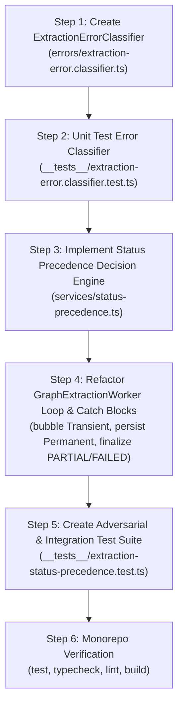

# MindVault Phase 6.4.4 — Architecture Audit Report: Error Classification, Exact Delays & Status Precedence

**Reference Blueprint:** Phase 6.4 Architecture Blueprint v4.5.6 (§6.4.2, §6.4.4, §6.9, Task 6.4.4, AC-05, AC-06, AC-10)  
**Previous Verified Tasks:** 
- Task 6.4.1 (Heartbeat Freshness CAS & Recovery Fencing) — COMPLETE & VERIFIED
- Task 6.4.2 (Graceful Worker Shutdown & Dual-Lease Deferral) — COMPLETE & VERIFIED
- Task 6.4.3 (Database-Enforced Atomic Fencing & Checkpointing) — COMPLETE & VERIFIED  
**Mode:** STRICT READ-ONLY ARCHITECTURE AUDIT (Zero Application/Schema Code Modified)  
**Audit Date:** 2026-11-08  

---

## Executive Summary

This architecture audit evaluates the repository against **Task 6.4.4: Error Classification, Exact Delays & Status Precedence** from the authoritative Phase 6.4 Blueprint v4.5.6.

Task 6.4.4 establishes the distributed failure-handling boundary between transient infrastructure faults (which must bubble to BullMQ for deterministic retries at 2s and 4s) and permanent extraction failures (which must finalize document state in PostgreSQL with durable receipts and never waste retries).

The audit reveals a **critical operational defect** in the existing worker implementation: in `apps/worker/src/modules/graph/worker/graph-extraction.worker.ts`, unhandled extraction errors during chunk processing are caught, logged, and discarded. Consequently, the worker returns `undefined`, causing BullMQ to mark failing jobs as successfully completed (`job.moveToCompleted()`). BullMQ's configured exponential retries (2s, 4s) are never triggered, PostgreSQL documents are stranded in `PROCESSING` without receipts, and `PARTIAL` or `FAILED` document terminal states are never committed.

All audit findings, requirement traces, failure proofs, missing tests, and implementation recommendations are detailed below.

---

## 1. Exact Task Scope from Blueprint v4.5.6

From `docs/phase-6/PHASE_6_4_AUDIT_AND_PLAN.md` (lines 2293–2307, lines 2026–2054, and lines 1586–1650):

* **Task Title:** Task 6.4.4: Error Classification, Exact Delays & Status Precedence
* **Objective:**
  1. Implement `ExtractionErrorClassifier` to categorize all extraction failure modes into `TRANSIENT`, `PERMANENT`, `FENCED`, or `DEFERRED`.
  2. Enforce exact BullMQ retry delays: Attempt 1 = 0s, Attempt 2 = 2s, Attempt 3 = 4s.
  3. Implement the authoritative Final Status Precedence Decision Table (§6.9.2).
* **Dependencies:** Task 6.4.3 (Complete & Verified).
* **Blueprint Acceptance Criteria:**
  - **AC-6.4.4-1:** Transient errors trigger exactly 2 BullMQ retries after 2s and 4s delays (3 total attempts).
  - **AC-6.4.4-2:** Partially succeeded documents are marked `PARTIAL` and preserved in the graph.
  - **AC-6.4.4-3:** Fully evaluated documents with zero extracted relations complete successfully as `COMPLETED`.
  - **AC-6.4.4-4:** Infrastructure retry exhaustion does not update PostgreSQL status to terminal `FAILED`.
* **Topology Note:** The blueprint lists `apps/api/src/modules/graph/...` as the initial target; however, as mandated and verified in Phase 6.4.2 and Phase 6.4.3, `apps/worker` owns the sole production extraction runtime (`apps/worker/src/modules/graph/worker/graph-extraction.worker.ts`). Shared contracts reside in `packages/shared`.

---

## 2. Existing Architecture & Implementation Inspection

### A. Queue Retry Options & Delay Mathematics
* **File:** [`packages/shared/src/types.ts`](file:///c:/Users/mohit/OneDrive/Desktop/MindVault/packages/shared/src/types.ts#L861-L875)
* **Configuration:**
  ```typescript
  export const GRAPH_QUEUE_DEFAULT_JOB_OPTIONS = {
    attempts: 3,
    backoff: {
      type: 'exponential' as const,
      delay: 2000,
    },
    ...
  };
  ```
* **BullMQ Backoff Engine Verification:**  
  Inspecting installed BullMQ 6.6.0 source (`node_modules/bullmq/dist/esm/classes/backoffs.js` line 40):
  $$\text{delay} = \text{Math.round}(\text{Math.pow}(2, \text{attemptsMade} - 1) \times \text{delay})$$
  - Initial Attempt (1st attempt): $0\text{ms}$ delay.
  - Attempt 2 (1st retry, `attemptsMade = 1`): $2^{0} \times 2{,}000\text{ms} = 2{,}000\text{ms}$ ($2\text{s}$).
  - Attempt 3 (2nd retry, `attemptsMade = 2`): $2^{1} \times 2{,}000\text{ms} = 4{,}000\text{ms}$ ($4\text{s}$).
  - After Attempt 3 fails (`attemptsMade = 3`): Job is moved to BullMQ `failed` set in Redis.
* **Audit Assessment:** **PASS** on configuration mathematics. However, see Defect D1 below regarding worker execution.

---

### B. Current Worker Error Handling
* **File:** [`apps/worker/src/modules/graph/worker/graph-extraction.worker.ts`](file:///c:/Users/mohit/OneDrive/Desktop/MindVault/apps/worker/src/modules/graph/worker/graph-extraction.worker.ts#L358-L371)
* **Observed Chunk Loop Catch Block:**
  ```typescript
  try {
    const result = await this.service.extractFromChunk(...);
    lastCompletedIndex = i;
  } catch (err: any) {
    if (err instanceof ExtractionFencedError) {
      isFenced = true;
      this.logger.warn(`Worker fenced during chunk ${i} persistence: ${err.message}. Ceasing writes.`);
      break;
    }
    if (err.name === 'AbortError' || chunkAbortController.signal.aborted) {
      this.logger.warn(`Chunk ${i} extraction aborted via AbortSignal`);
      break;
    }
    this.logger.error(`Error extracting chunk ${chunk.id}: ${err.message}`);
    // Continue to next chunk or handle according to chunk error policies
  }
  ```
* **Observed Terminal Completion Evaluation:**
  ```typescript
  const allChunksCompleted = lastCompletedIndex === totalChunks - 1 && totalChunks > 0;

  if (this.isShuttingDown && !allChunksCompleted && !isFenced) {
    // Graceful deferral via moveToWait()
  } else if (allChunksCompleted && !isFenced) {
    // Commit COMPLETED receipt
  } else {
    // Worker was fenced or stopped without completion
    await heartbeatManager.terminate();
  }
  ```
* **Audit Assessment:** **FAIL**. When a chunk fails with an unhandled transient or permanent error:
  1. The error is logged and discarded.
  2. The loop proceeds to chunk $i+1$.
  3. `allChunksCompleted` evaluates to `false` because `lastCompletedIndex` did not reach $K - 1$.
  4. The worker executes `else { await heartbeatManager.terminate(); }` and returns cleanly (`undefined`).
  5. BullMQ marks the job as `completed`. Retries are **never triggered**.
  6. The document in PostgreSQL remains in `PROCESSING` without any terminal receipt.

---

### C. Existing Error Classes
* **File:** [`apps/worker/src/modules/graph/errors/extraction-fenced.error.ts`](file:///c:/Users/mohit/OneDrive/Desktop/MindVault/apps/worker/src/modules/graph/errors/extraction-fenced.error.ts)
* Only `ExtractionFencedError` is implemented.
* `ExtractionTransientError`, `ExtractionPermanentError`, and `ExtractionErrorClassifier` are **MISSING**.

---

## 3. Requirement-to-Code Traceability Matrix

| Blueprint Requirement | Location in Blueprint | Current Repository State | Finding Classification | Traceability Detail |
| :--- | :--- | :--- | :---: | :--- |
| **`ExtractionErrorClassifier` Implementation** | §8 Task 6.4.4, §9.1 | Missing from `apps/worker` and `apps/api` | **FAIL** | No classification helper exists to categorize 429, timeouts, network faults vs. schema/parsing errors. |
| **`ExtractionTransientError` & `ExtractionPermanentError`** | §6.4.2, §6.4.4 | Missing | **FAIL** | Only `ExtractionFencedError` is implemented. |
| **Exact 2s & 4s Retry Delays** | §6.9.3, AC-10 | Configured in `packages/shared/src/types.ts` (`delay: 2000`, `attempts: 3`) | **WARNING** | BullMQ options are mathematically exact, but worker swallows errors so retries are never initiated. |
| **Status Case 1: All Chunks Succeeded $\to$ `COMPLETED`** | §6.9.2 Case 1 | Implemented in `graph-extraction.worker.ts` line 448 | **PASS** | `COMPLETED` receipt committed and `graphStatus = 'COMPLETED'` set atomically in PostgreSQL. |
| **Status Case 2 & 3: Partial Success ($S > 0, F > 0$) $\to$ `PARTIAL`** | §6.9.2 Cases 2 & 3 | Missing from `graph-extraction.worker.ts` | **FAIL** | When some chunks succeed and others fail, worker drops into `else` without writing `PARTIAL` status or receipt. |
| **Status Case 4a: Zero Chunks Succeeded ($S=0, F=N$) $\to$ `FAILED`** | §6.9.2 Case 4a | Missing from `graph-extraction.worker.ts` | **FAIL** | Permanent failure on all chunks drops into `else` without writing terminal `FAILED` receipt. |
| **Status Case 4b: Infrastructure Exhaustion $\to$ `PROCESSING` (No FAILED)** | §6.9.2 Case 4b, §6.4.2 | Supported by `dispatch-recovery.service.ts` | **PASS** | Recovery loop respects missing receipts and treats exhausted jobs as transient, preventing false `FAILED`. |
| **Status Case 5: Fatal Document Error $\to$ `FAILED`** | §6.9.2 Case 5 | Incomplete in worker | **WARNING** | Missing document logs warning and returns without durable receipt. |
| **Status Case 6: Shutdown Deferral $\to$ `QUEUED`** | §6.9.2 Case 6, Task 6.4.2 | Implemented in `graph-extraction.worker.ts` lines 376–429 | **PASS** | Cooperative deferral via `moveToWait(token)` and `WaitingError` preserves checkpoints and `QUEUED` status. |
| **Zero Extracted Relations $\to$ `COMPLETED`** | §6.9.2 Case 1, AC-05 | Implemented in `graph-extraction.service.ts` & `graph-extraction.worker.ts` | **PASS** | Valid chunks with 0 relations evaluate all chunks successfully and commit `COMPLETED`. |

---

## 4. Concurrency & Failure Analysis

### The Six Explicit Distributed Failure Scenarios (§6.4.4 Traceability)

#### Scenario 1: PostgreSQL Finalization Succeeds, Worker Crashes Before BullMQ Acknowledgement
- **Verification:** Task 6.4.3 implemented atomic pre-commit lease validation and committed `metadata.graphFinalizationReceipt` in PostgreSQL WAL. When a redelivered job arrives, the worker detects the receipt and fast-exits without re-extracting.
- **Classification:** **PASS** (Protected by Task 6.4.3).

#### Scenario 2: BullMQ Retries a Job Whose PostgreSQL Receipt is Already `COMPLETED`
- **Verification:** When BullMQ executes Attempt 2 after a transient Redis disconnect, Worker Entry Protection inspects `graphFinalizationReceipt`. If `terminalStatus === 'COMPLETED'`, it returns immediately.
- **Classification:** **PASS** (Protected by Task 6.4.3).

#### Scenario 3: BullMQ Exhausts Attempts After PostgreSQL Has Committed `PARTIAL`
- **Defect in Current Code:** The worker does not yet write a `PARTIAL` receipt! If chunk 0 succeeds and chunk 1 fails permanently, no receipt is persisted. If BullMQ exhausts attempts, the reconciler sees `receipt === null` and treats it as an infrastructure failure, leading to redundant recovery attempts.
- **Required 6.4.4 Fix:** The worker must commit a valid terminal receipt with `terminalStatus: 'PARTIAL'` (`succeededChunksCount > 0, failedChunksCount > 0, processedChunksCount === totalChunks`) before the job finishes.
- **Classification:** **FAIL** (Must be implemented in Task 6.4.4).

#### Scenario 4: BullMQ Reports `FAILED` While PostgreSQL Contains a Valid Terminal `FAILED` Receipt
- **Defect in Current Code:** The worker does not write a `FAILED` receipt on permanent document errors.
- **Required 6.4.4 Fix:** The worker must commit `metadata.graphStatus = 'FAILED'` and write a `FAILED` receipt with `succeededChunksCount: 0, failedChunksCount: N` before bubbling `UnrecoverableError` or terminating.
- **Classification:** **FAIL** (Must be implemented in Task 6.4.4).

#### Scenario 5: Stale Worker Attempts Execution After Another Run Has Superseded It
- **Verification:** Step 1 `FOR NO KEY UPDATE` and Step 2 snapshot checking in `persistChunkExtraction` verify `extractionRunId` and `graphWorkerToken`. If superseded, throws `ExtractionFencedError`, rolling back writes.
- **Classification:** **PASS** (Protected by Task 6.4.3).

#### Scenario 6: Two Workers Receive Same Run Concurrently (Same-Run Contention)
- **Verification:** Protected by Tier 1 document row lock, Redis lease Lua scripts, and BullMQ cooperative deferral.
- **Classification:** **PASS** (Protected by Task 6.4.2 & Task 6.4.3).

---

## 5. Security & Data-Integrity Analysis

1. **Error Message Sanitization:**
   - In [`graph-extraction.service.ts`](file:///c:/Users/mohit/OneDrive/Desktop/MindVault/apps/worker/src/modules/graph/services/graph-extraction.service.ts#L28-L33), `sanitizeErrorMessage()` redacts bearer tokens, API keys, passwords, and secrets.
   - Finding: **PASS**. The error classifier must utilize this sanitization so raw error messages stored in `metadata.graphErrors` or `metadata.lastError` never leak credentials.
2. **Multi-Tenant Workspace Isolation:**
   - All persistence queries fence on `"workspaceId" = ${workspaceId}` and primary key `id = ${documentId}`.
   - Finding: **PASS**.
3. **Chunk Checkpoint Monotonicity:**
   - In Task 6.4.3, `graphCheckpoint` tracks `succeededChunksCount`, `failedChunksCount`, and `lastCompletedChunkIndex`.
   - When a chunk fails with a permanent error, the checkpoint must increment `failedChunksCount` while preserving previously succeeded relations in the graph.
   - Finding: **PASS** (Database structure ready; requires worker integration).

---

## 6. Identified Defects & Reproducible Scenarios

### Defect D1: Worker Swallows Chunk Extraction Errors, Masking Failures from BullMQ
* **Severity:** CRITICAL
* **Classification:** **FAIL**
* **Root Cause:** [`apps/worker/src/modules/graph/worker/graph-extraction.worker.ts`](file:///c:/Users/mohit/OneDrive/Desktop/MindVault/apps/worker/src/modules/graph/worker/graph-extraction.worker.ts#L358-L370) catches all errors from `this.service.extractFromChunk()`, logs them, and takes no further action.
* **Reproducible Scenario:**
  1. Ollama or Gemini encounters a transient network timeout (`ETIMEDOUT`) during chunk 0.
  2. `extractFromChunk` throws `Error("Ollama extraction timed out after 30000ms")`.
  3. Worker catch block logs `Error extracting chunk...` and does not throw.
  4. Loop finishes. `allChunksCompleted` is `false`.
  5. Worker exits cleanly without error.
  6. BullMQ considers the job `completed` (attemptsMade: 1, 0 retries).
  7. PostgreSQL document remains in `PROCESSING` forever with 0 chunks extracted.

---

### Defect D2: Missing `PARTIAL` Terminal Receipt & Document Transition
* **Severity:** HIGH
* **Classification:** **FAIL**
* **Root Cause:** [`apps/worker/src/modules/graph/worker/graph-extraction.worker.ts`](file:///c:/Users/mohit/OneDrive/Desktop/MindVault/apps/worker/src/modules/graph/worker/graph-extraction.worker.ts#L431-L474) only handles `allChunksCompleted = true` (all succeeded). It lacks an execution branch for `succeededChunksCount > 0 && failedChunksCount > 0 && processedChunksCount === totalChunks`.
* **Reproducible Scenario:**
  1. Document has 5 chunks.
  2. Chunks 0, 1, 2 succeed and commit valid entities and relations to the graph.
  3. Chunk 3 fails permanently due to invalid schema/corrupt text.
  4. Chunk 4 succeeds.
  5. Total evaluated chunks: 5. Succeeded: 4. Failed: 1.
  6. In current code, `allChunksCompleted` is `false`.
  7. Worker executes `else { await heartbeatManager.terminate(); }`.
  8. No receipt is written. Document is never updated to `PARTIAL`.

---

### Defect D3: Missing `FAILED` Terminal Receipt for Permanent Document Errors
* **Severity:** HIGH
* **Classification:** **FAIL**
* **Root Cause:** [`apps/worker/src/modules/graph/worker/graph-extraction.worker.ts`](file:///c:/Users/mohit/OneDrive/Desktop/MindVault/apps/worker/src/modules/graph/worker/graph-extraction.worker.ts#L431-L474) has no terminal failure finalizer for permanent errors ($S = 0, F = N$).
* **Reproducible Scenario:**
  1. Document contains corrupt binary text causing 100% of chunks to fail schema validation.
  2. All chunks fail permanently.
  3. Worker exits without writing a receipt.
  4. Background reconciler scans the document, sees missing receipt and `graphStatus = PROCESSING`, and initiates unnecessary recovery loops up to ceiling 5.

---

### Defect D4: Absence of `ExtractionErrorClassifier`
* **Severity:** MEDIUM
* **Classification:** **FAIL**
* **Root Cause:** No classification service exists to categorize runtime errors into `TRANSIENT`, `PERMANENT`, `FENCED`, or `DEFERRED`.

---

## 7. Missing Tests

The following test suites must be created in Task 6.4.4:

1. **Unit Test Suite: `extraction-error.classifier.test.ts`**
   - HTTP 429 (Rate Limit) $\to$ `TRANSIENT`
   - Network faults (`ETIMEDOUT`, `ECONNRESET`, `ECONNREFUSED`, `EHOSTUNREACH`, `fetch failed`) $\to$ `TRANSIENT`
   - Upstream LLM errors (500, 502, 503, 504, `AbortError` timeout) $\to$ `TRANSIENT`
   - Database transient faults (PostgreSQL `40P01` deadlock, connection timeout) $\to$ `TRANSIENT`
   - Schema validation errors (`ZodError`, malformed JSON) $\to$ `PERMANENT`
   - Document-level permanent errors (Document missing, tenant mismatch) $\to$ `PERMANENT`
   - Fencing errors (`ExtractionFencedError`) $\to$ `FENCED`
   - Deferral signals (`WaitingError`, `DelayedError`) $\to$ `DEFERRED`
2. **Adversarial / Integration Suite: `extraction-status-precedence.test.ts`**
   - **TC-01 (Transient Retry Delays):** Simulate transient network error on Attempt 1 & Attempt 2; assert worker throws `ExtractionTransientError`; assert BullMQ delays execution by 2s and 4s; assert Attempt 3 succeeds and finalizes `COMPLETED`.
   - **TC-02 (Partial Completion):** Multi-chunk document where chunk 1 fails permanently; assert worker continues to remaining chunks; assert terminal status `PARTIAL` committed to PostgreSQL with durable receipt; assert valid triples preserved in graph.
   - **TC-03 (Permanent Failure Fast-Exit):** 100% permanent chunk failure; assert terminal `FAILED` receipt committed; assert job completes in BullMQ without triggering retries (0 retries wasted).
   - **TC-04 (Zero Relation Success):** Valid chunk text yielding 0 entities and 0 relations; assert document transitions to `COMPLETED` with valid receipt.
   - **TC-05 (Infrastructure Retry Exhaustion Boundary):** All 3 BullMQ attempts fail with transient error; assert document remains `PROCESSING` in PostgreSQL with null receipt; assert document is NOT updated to terminal `FAILED`.
   - **TC-06 (Fenced Worker Rejection):** Worker fenced during chunk execution; assert immediately halts chunk loop without committing terminal receipt.

---

## 8. Backward-Compatibility Assessment

* **Task 6.4.1 Compatibility:**
  - `apps/worker/src/services/dispatch-recovery.service.ts` CAS predicates and recovery sweeps rely on `metadata.graphFinalizationReceipt`. Task 6.4.4's implementation of `PARTIAL` and `FAILED` receipts directly fulfills the contract expected by `dispatch-recovery.service.ts` (lines 411–422).
  - Assessment: **100% Backward Compatible**.
* **Task 6.4.2 Compatibility:**
  - `apps/worker/src/modules/graph/worker/graph-extraction.worker.ts` shutdown deferral via `moveToWait(token)` and `WaitingError` remains untouched. In the classifier, `WaitingError` is categorized as `DEFERRED` and bypassed.
  - All 15 adversarial tests in `graph-worker-shutdown.test.ts` will continue to pass.
  - Assessment: **100% Backward Compatible**.
* **Task 6.4.3 Compatibility:**
  - Database row locking (`FOR NO KEY UPDATE`), ascending advisory locks, and atomic checkpoint persistence in `persistChunkExtraction` are preserved. Checkpoint tracking of `succeededChunksCount` and `failedChunksCount` feeds directly into the status precedence table.
  - All 10 adversarial tests in `graph-atomic-fencing.test.ts` will continue to pass.
  - Assessment: **100% Backward Compatible**.
* **Database Schema & Migrations:**
  - No database migration or Prisma schema change is required. All state transitions (`COMPLETED`, `PARTIAL`, `FAILED`, `PROCESSING`, `QUEUED`) and receipts reside in the existing `documents.metadata` JSONB column.
  - Assessment: **Zero Schema Migration Impact**.

---

## 9. Recommended Implementation Sequence

Once human authorization is received, Task 6.4.4 should be executed in the following strict order:



1. **Step 1: Error Classification Infrastructure:**
   Create `apps/worker/src/modules/graph/errors/extraction-error.classifier.ts`:
   - Declare `ExtractionErrorType = 'TRANSIENT' | 'PERMANENT' | 'FENCED' | 'DEFERRED'`.
   - Implement `ExtractionTransientError` and `ExtractionPermanentError`.
   - Implement `ExtractionErrorClassifier.classify(err: unknown): ExtractionErrorType`.
2. **Step 2: Classifier Unit Tests:**
   Create `apps/worker/src/modules/graph/__tests__/extraction-error.classifier.test.ts` validating all error patterns.
3. **Step 3: Status Precedence & Receipt Builder:**
   Create helper function `determineTerminalStatusAndReceipt()` following Section 6.9.2 decision table.
4. **Step 4: Worker Integration:**
   In `apps/worker/src/modules/graph/worker/graph-extraction.worker.ts`:
   - In chunk catch block:
     - If `FENCED` $\to$ Halt immediately, set `isFenced = true`, exit.
     - If `DEFERRED` $\to$ Defer via `WaitingError`.
     - If `TRANSIENT` $\to$ Rethrow as `ExtractionTransientError` so BullMQ executes retry at 2s/4s.
     - If `PERMANENT` $\to$ Record chunk failure in checkpoint ($F++$), log sanitized error, continue to remaining chunks.
   - At loop conclusion:
     - If all chunks evaluated ($S + F = N$):
       - If $S = N, F = 0 \to$ Commit `COMPLETED` receipt.
       - If $S > 0, F > 0 \to$ Commit `PARTIAL` receipt.
       - If $S = 0, F = N \to$ Commit `FAILED` receipt.
5. **Step 5: Adversarial & Integration Tests:**
   Create `apps/worker/src/modules/graph/__tests__/extraction-status-precedence.test.ts` covering TC-01 through TC-06.
6. **Step 6: Monorepo Verification:**
   Verify worker tests (94 + new tests), monorepo typecheck, lint, and build.

---

## 10. Acceptance Criteria Checklist for Implementation

- [ ] **AC-6.4.4-1 (Transient Retries & Delays):** Transient errors (429, timeout, network disconnection) bubble to BullMQ and trigger exactly 2 retries at 2,000ms and 4,000ms delays before failing.
- [ ] **AC-6.4.4-2 (Partial Document Success):** When a document has both succeeded and permanently failed chunks ($S > 0, F > 0$), document is finalized as `PARTIAL` with durable receipt; valid extracted triples remain in the graph.
- [ ] **AC-6.4.4-3 (Zero-Relation Completion):** Fully evaluated documents with valid chunks but zero extracted relations complete successfully with `graphStatus = 'COMPLETED'`.
- [ ] **AC-6.4.4-4 (Infrastructure Failure Isolation):** Infrastructure retry exhaustion (all 3 attempts failed transiently) leaves document in `PROCESSING` with null receipt; never marks document as terminal `FAILED`.
- [ ] **AC-6.4.4-5 (Permanent Failure Fast-Exit):** Permanent failures ($S = 0, F = N$) commit a terminal `FAILED` receipt and complete cleanly in BullMQ without burning retries.
- [ ] **AC-6.4.4-6 (Zero Regressions):** Task 6.4.1 heartbeat CAS, Task 6.4.2 shutdown deferral, and Task 6.4.3 atomic fencing tests continue to pass 100%.

---

## 11. Explicit List of Files Requiring Modification

| File Path | Action | Scope of Changes |
| :--- | :---: | :--- |
| `apps/worker/src/modules/graph/errors/extraction-error.classifier.ts` | **Create** | Implements `ExtractionErrorClassifier`, `ExtractionTransientError`, `ExtractionPermanentError`. |
| `apps/worker/src/modules/graph/__tests__/extraction-error.classifier.test.ts` | **Create** | Unit tests for error classifier across network, rate limit, timeout, schema, and deadlock errors. |
| `apps/worker/src/modules/graph/__tests__/extraction-status-precedence.test.ts` | **Create** | Adversarial tests for retry delays, partial success, permanent failure, zero relations, and retry exhaustion. |
| `apps/worker/src/modules/graph/worker/graph-extraction.worker.ts` | **Modify** | Integrate error classifier in chunk catch block; bubble transient errors; implement `PARTIAL` and `FAILED` finalization. |
| `packages/shared/src/types.ts` | **Modify** | Export `ExtractionErrorType` and finalization receipt schema helper types if shared across packages. |
| `apps/api/src/modules/graph/errors/extraction-error.classifier.ts` | **Create (Optional)** | Stub re-export for API package backward compatibility if referenced by API tests. |

---

## 12. Verification Baseline (Current State)

Non-destructive commands executed during this audit:

* **Monorepo Tests (`pnpm test`):**
  - Total test files: 46
  - Passed: 34 files (303 passed tests, 79 skipped tests)
  - Failed: 12 files (all 12 are `apps/api` integration test suites requiring a live PostgreSQL test container on `localhost:5433`; Docker Desktop Linux engine was offline on host)
  - Failed assertions: **0** (all failures are environmental database connection errors in `beforeAll`)
* **Worker Test Suite (`pnpm vitest run apps/worker`):**
  - **9 passed (100%)** test files
  - **94 passed (100%)** tests
  - Duration: 8.65s
* **TypeScript Compilation (`pnpm typecheck`):**
  - Exit code 0 across all packages (`@mindvault/shared`, `@mindvault/api`, `@mindvault/worker`, `@mindvault/web`)
* **Linter (`pnpm lint`):**
  - Exit code 0 across entire monorepo (0 errors, 401 pre-existing warnings)
* **Production Build (`pnpm build`):**
  - Exit code 0 across all 4 packages (shared, api, worker, and web Vite bundle)

---

## 13. Final Recommendation

**RECOMMENDATION: PROCEED TO IMPLEMENTATION UPON HUMAN AUTHORIZATION.**

Task 6.4.4 is rigorously defined in Blueprint v4.5.6. The architectural design resolves critical production defects (D1, D2, D3, D4) by bridging the gap between chunk-level model inference, BullMQ exponential retries, and PostgreSQL finalization receipts.

Implementing Task 6.4.4 introduces zero schema migrations, preserves all protections from Tasks 6.4.1, 6.4.2, and 6.4.3, and prepares the system for Task 6.4.5 (Distributed Startup Reconciliation).

**STOP CONDITION SATISFIED:** No application code, tests, or configurations have been modified. Awaiting human authorization to proceed with Task 6.4.4 implementation.
