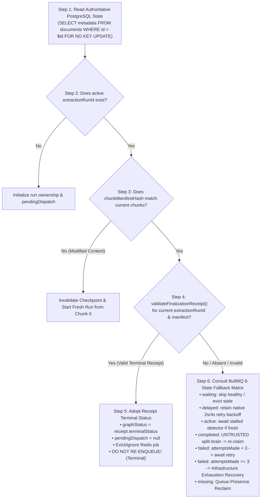

# MindVault Phase 6.4.5 — Architecture Audit Report: Distributed Startup Reconciliation & Worker Protection

**Reference Blueprint:** Phase 6.4 Architecture Blueprint v4.5.6 (§6.2.5, §6.4.0, §6.4.1, §6.4.2, §6.4.4, §6.6, Task 6.4.5, AC-05, AC-09, AC-10, AC-15, AC-16, AC-20, AC-21, AC-22, AC-23, AC-24)  
**Previous Verified Milestones:**

- Task 6.4.1 (Heartbeat Freshness CAS & Recovery Fencing) — COMPLETE & VERIFIED
- Task 6.4.2 (Graceful Worker Shutdown & Dual-Lease Deferral) — COMPLETE & VERIFIED
- Task 6.4.3 (Database-Enforced Atomic Fencing & Checkpointing) — COMPLETE & VERIFIED
- Task 6.4.4 (Error Classification, Deterministic Retries & Status Precedence) — COMPLETE & VERIFIED  
  **Mode:** STRICT READ-ONLY ARCHITECTURE AUDIT (Zero Application/Schema/Test Code Modified)  
  **Audit Date:** 2026-11-08

---

## 1. Executive Summary

This architecture audit evaluates the repository against **Task 6.4.5: Connection-Pool-Safe Distributed Reconciliation, Receipt-First Authority & Worker Protection** from the authoritative Phase 6.4 Blueprint v4.5.6.

Task 6.4.5 establishes the distributed coordination and startup recovery layer for the MindVault Knowledge Graph Extraction runtime. When workers crash, restart, scale across multiple replicas, or face transient network partitions between PostgreSQL and Redis, Task 6.4.5 guarantees that:

1. **Startup Reconciliation** runs under leader election (`pg_try_advisory_xact_lock(10064, 1)`) inside a dedicated interactive transaction, reconciling orphaned, interrupted, or exhausted extraction jobs before or concurrent with normal queue consumption.
2. **PostgreSQL Receipt Authority** governs all queue operations: a valid `GraphFinalizationReceipt` committed in PostgreSQL WAL strictly supersedes every BullMQ job state (`waiting`, `delayed`, `active`, `completed`, `failed`, `missing`), adopting terminal states (`COMPLETED`, `PARTIAL`, `FAILED`) without re-extraction.
3. **The Complete 6-State BullMQ Fallback Matrix** deterministically recovers missing Redis jobs, recovers exhausted BullMQ retries (reclaiming up to ceiling 5 or marking `FAILED_RETRYABLE`), evicts obsolete superseded jobs, preserves native BullMQ backoff delays (2s, 4s) for retrying jobs, and treats completed BullMQ jobs without PostgreSQL receipts as untrusted split-brain failures.
4. **Worker Entry Protection & Two-Statement Protocol** (`FOR NO KEY UPDATE` followed by fresh snapshot evaluation) serializes concurrent workers at the document row boundary, fast-exits on pre-existing receipts, detects same-run execution lease contention, and cooperatively defers duplicate workers via BullMQ 6.6.0 (`moveToDelayed` with `token` and `throw new DelayedError()`) without burning attempts or completing jobs.

### Current Implementation Assessment

The audit reveals that while the foundation from Tasks 6.4.1–6.4.4 is exceptionally solid (receipt schemas, chunk persistence row locks, error classification, and dispatch intent recovery are intact), **Task 6.4.5 is entirely unimplemented**:

- `GraphReconciliationService` does **not exist**;
- No distributed startup reconciliation runs upon worker boot in `apps/worker/src/worker.ts`;
- Worker entry in `apps/worker/src/modules/graph/worker/graph-extraction.worker.ts` executes an unguarded `prisma.document.findUnique` without `FOR NO KEY UPDATE` row locking;
- Same-run contention is handled by logging a warning and returning `undefined` (which mistakenly causes BullMQ to mark colliding jobs as **completed** instead of deferring via `moveToDelayed` and `DelayedError`);
- BullMQ exhausted retries (`attemptsMade >= 3`) in the Redis `failed` set are completely ignored by `DispatchRecoveryService` (`if (job) continue;`), leaving documents stranded in `PROCESSING` indefinitely.

All findings, failure proofs, missing tests, and implementation boundaries are detailed below.

---

## 2. Exact Phase 6.4.5 Blueprint Requirements

From `docs/phase-6/PHASE_6_4_AUDIT_AND_PLAN.md` (lines 2310–2341, lines 682–892, lines 1370–1708, and lines 1922–1966):

- **Task Title:** Task 6.4.5: Connection-Pool-Safe Distributed Reconciliation, Receipt-First Authority & Worker Protection
- **Objective:**
  Implement distributed startup reconciliation using `pg_try_advisory_xact_lock(10064, 1)` inside a dedicated Prisma interactive transaction, implementing the Receipt-First Reconciliation Algorithm with absolute PostgreSQL Receipt Authority, Worker Entry Protection with `SELECT ... FOR NO KEY UPDATE` bounded serialization ($< 10\text{ms}$), Database-Backed Same-Run Execution Ownership with Worker-Attempt Fencing (`graphWorkerToken`, monotonic `graphLeaseGeneration`, `graphLeaseExpiresAt`), BullMQ 6.6.0 Move-to-Delayed Protocol (`moveToDelayed` with `token` and `throw new DelayedError()`), Failure-Safe Conditional Lease Release, the Complete 6-State BullMQ Fallback Reconciliation Matrix, Queue-Presence Reconciliation for lost Redis jobs, Complete Terminal Reconciliation Matrix with strengthened `validateFinalizationReceipt` verification, the BullMQ Exhausted Retry Recovery Lifecycle, and unambiguous recovery ceiling semantics (`MAX_TOTAL_RUNS = 5`, `BULLMQ_ATTEMPTS_PER_RUN = 3`, `MAX_TOTAL_PROCESSOR_ATTEMPTS = 15`).
- **Affected Files:**
  - `apps/worker/src/services/graph-reconciliation.service.ts` (New)
  - `apps/worker/src/worker.ts`
  - `apps/worker/src/modules/graph/worker/graph-extraction.worker.ts`
- **Dependencies:** Task 6.4.1 (Heartbeat Freshness CAS), Task 6.4.3 (Atomic Fencing & Advisory Locks), Task 6.4.4 (Status Precedence & Receipts).
- **Authoritative Acceptance Criteria:**
  - **AC-6.4.5-1 (Dedicated Distributed Leader Lock):** Distributed startup reconciliation acquires `pg_try_advisory_xact_lock(10064, 1)` in isolated 2-integer namespace inside a dedicated Prisma interactive transaction (`maxWait: 5000`, `timeout: 30000`). Exactly one replica executes reconciliation; non-leaders skip cleanly.
  - **AC-6.4.5-2 (PostgreSQL Receipt Authority):** A valid `GraphFinalizationReceipt` for active `extractionRunId` and chunk manifest takes precedence over ALL BullMQ states (`waiting`, `delayed`, `active`, `completed`, `failed`, `missing`). Terminal status (`COMPLETED`, `PARTIAL`, `FAILED`) is adopted into PostgreSQL without re-extraction.
  - **AC-6.4.5-3 (Strict 6-Step Decision Sequence):** Enforces Step 1 (Read PG state) $\to$ Step 2 (RunId check) $\to$ Step 3 (Manifest check) $\to$ Step 4 (Receipt validation) $\to$ Step 5 (Receipt adoption & fast-exit) $\to$ Step 6 (BullMQ 6-state fallback).
  - **AC-6.4.5-4 (Complete 6-State BullMQ Fallback Matrix):** When receipts are absent/invalid:
    - `waiting`: DO NOTHING if valid active run; evict (`job.remove()`) if stale superseded run.
    - `delayed`: DO NOTHING (retain native BullMQ 2s/4s retry backoff); evict if stale superseded run.
    - `active`: DO NOTHING if fresh heartbeat ($< 5\text{m}$); investigate lock/stalled if stale ($> 5\text{m}$).
    - `completed`: Treat as UNTRUSTED split-brain if receipt missing/invalid; re-claim and re-enqueue under fresh `runId` up to ceiling 5.
    - `failed`: Retain native retry if `attemptsMade < 3`; recover infrastructure retry exhaustion if `attemptsMade >= 3` and receipt is null (re-claim with fresh `runId` up to ceiling 5, or mark `FAILED_RETRYABLE` if ceiling reached).
    - `missing`: Queue-presence reclaim with fresh `runId` up to ceiling 5.
  - **AC-6.4.5-5 (Worker Entry Protection & Two-Statement Protocol):** Worker processor executes bounded interactive transaction under `READ COMMITTED` (`timeout: 10000`):
    - Statement 1: `SELECT id FROM "documents" WHERE id = $documentId AND "workspaceId" = $workspaceId FOR NO KEY UPDATE;`
    - Statement 2: Read snapshot evaluating `(metadata->>'graphLeaseExpiresAt')::timestamptz > clock_timestamp() AS "isLeaseActive"`, `extractionRunId`, `manifestHash`, `graphWorkerToken`, `graphLeaseGeneration`, `receipt`.
    - If valid receipt exists $\to$ Fast-exit immediately returning receipt (0 chunks processed, 0 LLM calls).
  - **AC-6.4.5-6 (Same-Run Contention Deferral):** If another worker holds active unexpired lease (`isLeaseActive && graphWorkerToken !== myWorkerToken`), entering worker yields immediately and defers via BullMQ 6.6.0 protocol: `await job.moveToDelayed(Date.now() + 5000, token); throw new DelayedError();`. Zero chunks processed, zero LLM calls, zero attempts burned.
  - **AC-6.4.5-7 (Monotonic Lease Generation & Atomic Claim):** If unowned or expired lease, claims atomically incrementing `graphLeaseGeneration = COALESCE(gen, 0) + 1`, sets `graphWorkerToken = myWorkerToken`, `graphLeaseExpiresAt = clock_timestamp() + interval '60 seconds'`, `graphHeartbeatAt = clock_timestamp()`, and `graphStatus = 'PROCESSING'`.
  - **AC-6.4.5-8 (Failure-Safe Conditional Lease Release):** In worker catch block: if `DelayedError`, re-throw without touching PostgreSQL. For other errors, conditionally clear lease in PostgreSQL scoped strictly to `graphWorkerToken`, `graphLeaseGeneration`, and `graphLeaseExpiresAt > clock_timestamp()`.
  - **AC-6.4.5-9 (Ceiling Semantics):** `MAX_TOTAL_RUNS = 5`, `BULLMQ_ATTEMPTS_PER_RUN = 3`, `MAX_TOTAL_PROCESSOR_ATTEMPTS = 15`. Ceiling exhaustion transitions document to `FAILED_RETRYABLE`; never terminal `FAILED`.
  - **AC-6.4.5-10 (Fail-Closed Redis Policy):** Any Redis connection drop during reconciliation aborts sweep immediately to prevent duplicate dispatch storms during network flapping.

---

## 3. Requirement-to-Code Traceability Matrix

| Blueprint Requirement                                 | Location in Blueprint    | Current Repository State                      | Finding Classification | Traceability Detail                                                                                                                                       |
| :---------------------------------------------------- | :----------------------- | :-------------------------------------------- | :--------------------: | :-------------------------------------------------------------------------------------------------------------------------------------------------------- |
| **`GraphReconciliationService`**                      | §8 Task 6.4.5, §6.6      | Missing from `apps/worker/src/services/`      |        **FAIL**        | No dedicated reconciliation service exists. Only `DispatchRecoveryService` (Task 6.4.1) exists.                                                           |
| **Advisory Lock `(10064, 1)` Leader Election**        | §6.6, AC-09, AC-16       | Missing                                       |        **FAIL**        | `DispatchRecoveryService` uses `(10064, 2)`. Lock `(10064, 1)` is not acquired anywhere.                                                                  |
| **Startup Reconciliation Execution**                  | §6.4.0, §6.6, Task 6.4.5 | Missing in `apps/worker/src/worker.ts`        |        **FAIL**        | `WorkerService.start()` immediately launches `graphWorker.start()`; no startup reconciliation runs.                                                       |
| **PostgreSQL Receipt Authority**                      | §6.4.0, AC-21            | Not enforced in reconciler or worker entry    |        **FAIL**        | Worker entry does not inspect receipts under `FOR NO KEY UPDATE`. Recovery loop skips existing BullMQ jobs without checking receipts.                     |
| **Complete 6-State Fallback Matrix**                  | §6.4.0, AC-20            | Missing                                       |        **FAIL**        | `DispatchRecoveryService` has `if (job) continue;`, completely skipping `waiting`, `delayed`, `active`, `completed`, and `failed` jobs.                   |
| **BullMQ Exhausted Retry Recovery (`attempts >= 3`)** | §6.4.2, AC-20            | Missing                                       |        **FAIL**        | When BullMQ retries exhaust, job is in Redis `failed` set with null receipt; current code skips it, stranding doc in `PROCESSING`.                        |
| **Untrusted Completed Job Reclaim**                   | §6.4.1, AC-20            | Missing                                       |        **FAIL**        | BullMQ jobs in `completed` state without PostgreSQL receipts are not checked or reclaimed.                                                                |
| **Worker Entry Protection (`FOR NO KEY UPDATE`)**     | §6.2.5, AC-22            | Missing in `graph-extraction.worker.ts`       |        **FAIL**        | Worker executes un-fenced `findUnique`; does not serialize behind in-flight transactions.                                                                 |
| **Two-Statement Entry Protocol**                      | §6.2.5, AC-22            | Missing in `graph-extraction.worker.ts`       |        **FAIL**        | Row-lock and snapshot evaluation are not split into two sequential statements under `READ COMMITTED`.                                                     |
| **Same-Run Contention Deferral (`DelayedError`)**     | §6.2.5, AC-23            | Missing in `graph-extraction.worker.ts`       |        **FAIL**        | Worker returns `undefined` on lease acquisition failure (marking job completed in BullMQ) instead of calling `moveToDelayed` and throwing `DelayedError`. |
| **Monotonic `graphLeaseGeneration`**                  | §6.2.5, AC-23            | Missing in `graph-extraction.worker.ts`       |        **FAIL**        | Worker claim query does not set or increment `graphLeaseGeneration`.                                                                                      |
| **Conditional Lease Release in `catch`**              | §6.2.5 Lifecycle 3       | Missing in `graph-extraction.worker.ts`       |        **FAIL**        | Worker catch block does not conditionally clear lease tokens in PostgreSQL.                                                                               |
| **Recovery Ceiling (`MAX_TOTAL_RUNS = 5`)**           | §6.4.2, AC-10            | Implemented in `dispatch-recovery.service.ts` |        **PASS**        | `DispatchRecoveryService` enforces `graphAttempts < 5` and transitions to `FAILED_RETRYABLE`. Must be replicated in `GraphReconciliationService`.         |
| **Strengthened Receipt Validation (AC-24)**           | §6.4.5, AC-24            | Implemented in `packages/shared/src/types.ts` |        **PASS**        | `validateFinalizationReceipt` fully implements AC-24 non-negative integer, balance, and status checks.                                                    |

---

## 4. Existing Startup & Reconciliation Architecture Inspection

### Inspection 1: Worker Startup Sequence (`apps/worker/src/worker.ts`)

Lines 58–68 of `apps/worker/src/worker.ts`:

```typescript
// Start graph extraction worker runtime
await this.graphWorker.start();

// Start background dispatch recovery service
this.recoveryService.start(60000);

// In test environment, skip spinning up live BullMQ socket unless requested
if (env.NODE_ENV === 'test') {
  this.logger.info('Worker initialized in test mode (BullMQ listener ready for dispatch)');
  return;
}
```

**Architecture Flaw:**

1. `this.graphWorker.start()` connects to Redis and immediately begins pulling jobs from `graph-extraction`.
2. There is **zero startup reconciliation** executed prior to queue consumption.
3. If the worker process previously crashed while processing jobs, or if Redis contains redelivered/stale jobs, the worker begins executing them before any reconciliation engine inspects PostgreSQL authority or evicts superseded runs.
4. `this.recoveryService.start(60000)` only arms a periodic timer for `DispatchRecoveryService` (which uses lock `(10064, 2)`).

### Inspection 2: Existing Recovery Loop (`apps/worker/src/services/dispatch-recovery.service.ts`)

`DispatchRecoveryService` implements Phase 6.4.1 (Claim-First, Record-Intent, Dispatch-Second).
Lines 141–152:

```typescript
// 1. Leader Election: pg_try_advisory_xact_lock(10064, 2)
const lockRows = await tx.$queryRaw<{ locked: boolean }[]>`
      SELECT pg_try_advisory_xact_lock(10064, 2) AS locked;
    `;
```

Lines 393–408:

```typescript
    let job = null;
    try {
      if (typeof this.queue.getJob === 'function') {
        job = await this.queue.getJob(jobId);
      }
    } catch (err: any) { ... }

    // If job is still present in BullMQ/Redis, no action required
    if (job) {
      continue;
    }
```

**Architecture Flaw:**
Line 406 unconditionally skips any document whose job exists in Redis (`if (job) continue;`).
It does **NOT** check:

- `job.getState() === 'failed'` with `attemptsMade >= 3` (exhausted retries).
- `job.getState() === 'completed'` without PostgreSQL receipt (untrusted split-brain).
- `job.getState() === 'waiting'` or `'delayed'` for superseded runs or with terminal receipts.
  Thus, `DispatchRecoveryService` only recovers missing jobs (`job === null`) and unconfirmed intents (`pendingDispatch.enqueuedAt IS NULL`). It is fundamentally incomplete for full distributed reconciliation.

### Inspection 3: Worker Entry Execution (`apps/worker/src/modules/graph/worker/graph-extraction.worker.ts`)

Lines 176–244 of `graph-extraction.worker.ts`:

```typescript
    // 1. Fetch document and active extraction run ID
    const document = await prisma.document.findUnique({
      where: { workspaceId_id: { workspaceId, id: documentId } },
      include: { chunks: { orderBy: { chunkIndex: 'asc' } } },
    });
    ...
    // 2. Acquire Redis distributed cluster lease (60s TTL)
    const redisKey = `mindvault:graph:lease:${documentId}`;
    const leaseAcquired = await redis.eval(LUA_ACQUIRE_LEASE_SCRIPT, 1, redisKey, workerToken, '60');
    if (leaseAcquired !== 1) {
      this.logger.warn(`Could not acquire Redis lease for document ${documentId}; another worker holds ownership`);
      return; // <--- CRITICAL BUG: Marks job COMPLETED in BullMQ!
    }

    // 3. Atomically claim lease and mark PROCESSING in PostgreSQL
    const claimResult = await prisma.$executeRaw`
      UPDATE "documents"
      SET metadata = jsonb_set(
        jsonb_set(
          jsonb_set(metadata, '{graphStatus}', '"PROCESSING"'),
          '{graphWorkerToken}', to_jsonb(${workerToken}::text)
        ),
        '{graphLeaseExpiresAt}',
        to_jsonb(to_char((clock_timestamp() + INTERVAL '60 seconds') AT TIME ZONE 'UTC', 'YYYY-MM-DD"T"HH24:MI:SS.MS"Z"'))
      )
      WHERE id = ${documentId}
        AND metadata->>'extractionRunId' = ${extractionRunId}
        AND (metadata->>'graphStatus' = 'QUEUED' OR metadata->>'graphStatus' = 'PROCESSING');
    `;
```

**Architecture Flaw:**

1. **No Entry Locking:** `findUnique` runs without `FOR NO KEY UPDATE`. It does not serialize behind concurrent finalizations or claims.
2. **No Terminal Receipt Check:** If BullMQ redelivers a completed job, the worker does not check `metadata.graphFinalizationReceipt` under lock to fast-exit.
3. **Dropped Job on Lease Contention:** If `leaseAcquired !== 1`, returning `undefined` from `processJob` causes BullMQ to treat the job as successfully completed (`job.moveToCompleted()`). The job disappears from the queue forever while Worker 1 is still working. If Worker 1 later crashes, the job is lost!
4. **Un-fenced PostgreSQL Update:** The `UPDATE` query does not check `metadata->>'graphWorkerToken' IS NULL` or `metadata->>'graphLeaseExpiresAt' < clock_timestamp()`. Worker 2 can overwrite Worker 1's token in PostgreSQL if Worker 2 manages to run the query.
5. **Missing `graphLeaseGeneration`:** The update never writes or increments `graphLeaseGeneration`.

---

## 5. Distributed Concurrency Analysis

### A. Leader Election & Advisory Lock Isolation

PostgreSQL provides two advisory lock namespaces:

1. **64-bit integer API:** `pg_advisory_xact_lock(bigint)` used for relation data serialization (`computeRelationLockKey`).
2. **2-integer API:** `pg_try_advisory_xact_lock(int4, int4)` used for administrative operations:
   - `classid = 10064, objid = 1`: **Dedicated to `GraphReconciliationService`** (Distributed Startup & Periodic Reconciliation).
   - `classid = 10064, objid = 2`: **Dedicated to `DispatchRecoveryService`** (Dispatch Intent & Presence Recovery).

**Concurrency Proof:**

- Because `(10064, 1)` and `(10064, 2)` use distinct `objid` values, startup reconciliation and dispatch intent draining never block each other.
- Because they use the 2-integer API, they can never collide with the 64-bit signed integers generated by `computeRelationLockKey` for relation evidence.
- Pinned inside a dedicated interactive transaction (`prisma.$transaction(async (tx) => { ... })`), the lock is guaranteed to be held on a single connection and automatically released by PostgreSQL on commit, rollback, or connection termination.

### B. Same-Run Execution Lease Contention

When two workers receive the same job simultaneously:

```
Worker 1 (Node A)                          Worker 2 (Node B)
─────────────────                          ─────────────────
Enter processJob(Run 1)                    Enter processJob(Run 1)
BEGIN (timeout: 10s)                       BEGIN (timeout: 10s)
SELECT ... FOR NO KEY UPDATE (Acquires)    SELECT ... FOR NO KEY UPDATE (Blocks waiting)
Statement 2: Lease unowned                 ...
Claim lease: token_A, gen=1                ...
COMMIT & release row lock                  ...
                                           Unblocks! Acquires FOR NO KEY UPDATE
                                           Statement 2: Reads token_A, gen=1, isLeaseActive=true
                                           Detects active same-run lease contention!
                                           Rolls back / commits entry transaction (<10ms)
                                           await job.moveToDelayed(Date.now() + 5000, token);
                                           throw new DelayedError();
```

**Correctness Invariants:**

1. Worker 2 does not process any chunks and consumes zero LLM tokens.
2. In BullMQ 6.6.0, `moveToDelayed` with `token` retains the job in Redis with `skipAttempt: true`.
3. Throwing `DelayedError` tells BullMQ's worker harness to bypass `handleCompleted()` and bypass `moveToFailed()`.
4. If Worker 1 finishes within 5 seconds, it commits `GraphFinalizationReceipt`. When Worker 2 wakes up from delay at $t=5\text{s}$, its Entry Protection reads the receipt and fast-exits cleanly.
5. If Worker 1 crashes without renewing its lease, its lease expires at $t=60\text{s}$. The delayed job (or stalled job checker) allows Worker 2 to safely take over under generation 2.

---

## 6. PostgreSQL & Redis Consistency Analysis

### The Six Distributed Failure Scenarios (§6.4.4) Verification Against Architecture

| Scenario                                                              | Condition                                                                                               |                                Existing Implementation State                                | Required Task 6.4.5 Resolution                                                                                                                                                                 |
| :-------------------------------------------------------------------- | :------------------------------------------------------------------------------------------------------ | :-----------------------------------------------------------------------------------------: | :--------------------------------------------------------------------------------------------------------------------------------------------------------------------------------------------- |
| **1. PG Finalization Succeeds, Worker Crashes Before BullMQ Ack**     | Document in PG has `COMPLETED` receipt; BullMQ redelivers job as stalled.                               | **FAIL** (Worker does not check receipt at entry under row lock; re-extracts from scratch). | Worker Entry Protection reads receipt under `FOR NO KEY UPDATE`, logs fast-exit, returns receipt. BullMQ marks completed. Zero chunks re-extracted.                                            |
| **2. BullMQ Retries Job Whose PG Receipt is Already `COMPLETED`**     | Transient Redis disconnect triggers retry (`attemptsMade: 1 -> 2`); PG already `COMPLETED`.             |                       **FAIL** (Worker re-runs claim and extraction).                       | Worker Entry Protection detects valid receipt, fast-exits cleanly.                                                                                                                             |
| **3. BullMQ Exhausts Attempts After PG Committed `PARTIAL`**          | Worker committed `PARTIAL` receipt; Redis drops connection; BullMQ marks `failed` (`attemptsMade = 3`). |      **FAIL** (`DispatchRecoveryService` skips failed job; reconciler does not exist).      | Reconciler executes Receipt-First sequence: detects valid `PARTIAL` receipt, applies Receipt Authority, clears `pendingDispatch`, leaves status `PARTIAL`. Does NOT increment `graphAttempts`. |
| **4. BullMQ Reports `FAILED` While PG Has Terminal `FAILED` Receipt** | 100% chunks failed permanently; worker committed `FAILED` receipt; BullMQ records `failed`.             |                   **FAIL** (`DispatchRecoveryService` skips failed job).                    | Reconciler detects valid `FAILED` receipt for active run, synchronizes PG `FAILED`, and **strictly refrains from re-enqueueing**.                                                              |
| **5. Stale Worker Attempts Execution After Run Superseded**           | Worker A unfreezes after Run 2 was claimed by reconciler.                                               |     **PARTIAL** (Chunk persistence blocks via 6.4.3, but Worker Entry does not check).      | Worker Entry Protection queries `extractionRunId` under `FOR NO KEY UPDATE`. Seeing `'Run_2' !== 'Run_1'`, aborts immediately before chunk loop.                                               |
| **6. Concurrent Workers Receive Same Run Before Receipt Exists**      | Two workers pull same job simultaneously; receipt is null.                                              |      **FAIL** (Worker 2 logs warning and returns undefined, completing job in BullMQ).      | Two-statement entry protocol serializes workers. Worker 2 detects unexpired lease, calls `moveToDelayed(5000, token)`, and throws `DelayedError`.                                              |

---

## 7. Crash-Recovery Scenarios

### Scenario A: Worker Crash During Mid-Extraction (Chunks 0..1 Committed, Chunk 2 In-Flight)

1. Worker A holds lease for Run 1, having persisted chunks 0 and 1.
2. Worker A crashes (SIGKILL or hardware fault).
3. Chunk 2's interactive database transaction rolls back completely. Zero partial triples persist from chunk 2.
4. Chunks 0 and 1 remain durably committed in PostgreSQL WAL along with `metadata.graphCheckpoint` (`lastCompletedChunkIndex: 1`).
5. At $t = 60\text{s}$, Worker A's lease expires (`graphLeaseExpiresAt < clock_timestamp()`).
6. At $t = 30\text{s}$, BullMQ stalled job checker detects missing worker lock and moves the job back to `waiting`.
7. Worker B pulls the job. Entry Protection observes expired lease, atomically claims ownership under `graphLeaseGeneration = 2`.
8. Worker B reads checkpoint: resumes directly from chunk index 2 (`lastCompletedChunkIndex + 1`).
9. Chunks 0 and 1 are **never re-extracted**.

### Scenario B: Process Crash During Startup Reconciliation Sweep

1. Worker A acquires `pg_try_advisory_xact_lock(10064, 1)` and begins scanning orphaned documents.
2. Worker A crashes mid-sweep.
3. PostgreSQL automatically releases the transaction-level advisory lock immediately upon socket disconnection.
4. Zero locks remain stranded.
5. Worker B on next tick or periodic interval acquires the lock cleanly and completes reconciliation.

### Scenario C: Redis Crash During Startup Reconciliation Sweep

1. Reconciler holds `pg_try_advisory_xact_lock(10064, 1)`.
2. Redis is offline or throws `ECONNREFUSED`.
3. **Fail-Closed Rule:** Reconciler catches error, logs warning, and rolls back transaction.
4. Reconciler does **NOT** assume missing jobs or re-enqueue documents, preventing duplicate job storms.

---

## 8. Receipt & Checkpoint Correctness

### The 6-Step Receipt-First Decision Sequence



### Strengthened AC-24 Validation Invariants

The validator [`validateFinalizationReceipt`](file:///c:/Users/mohit/OneDrive/Desktop/MindVault/packages/shared/src/types.ts#L823-L884) (verified in Phase 6.4.4) enforces:

1. Status is exactly `'COMPLETED' | 'PARTIAL' | 'FAILED'`.
2. `extractionRunId` and `chunkManifestHash` match the active document run.
3. All chunk counters (`chunkCount`, `processedChunksCount`, `succeededChunksCount`, `failedChunksCount`) are non-negative integers (`Number.isInteger(c) && c >= 0`).
4. Strict accounting balance: `processedChunksCount === chunkCount === succeededChunksCount + failedChunksCount`.
5. Status-specific invariants:
   - `COMPLETED`: $s = \text{total}, f = 0$.
   - `PARTIAL`: $\text{total} > 0, s > 0, f > 0, s + f = \text{total}$.
   - `FAILED`: $s = 0, f = \text{total}$.
6. Valid ISO 8601 timestamp string.

**Supreme Invariant:** An invalid receipt is logged as a corruption warning and **never** suppresses recovery or authorizes terminal adoption.

---

## 9. Security & Multi-Tenant Isolation Review

1. **Workspace Boundary Scoping:**
   - In `GraphReconciliationService`, candidate queries must select `id`, `"workspaceId"`, and `metadata`.
   - All update queries and CAS queries must enforce `WHERE id = $id AND "workspaceId" = $workspaceId`.
   - Cross-workspace document reconciliation is structurally impossible.
2. **Credential Sanitization:**
   - All error messages captured in `metadata.lastError`, `metadata.graphErrors`, or logs must pass through `sanitizeErrorMessage()` to redact database passwords, Redis URIs, and API bearer tokens.
3. **No Unauthorized Dispatch:**
   - Jobs are dispatched exclusively to the internal queue `graph-extraction` with payload strictly typed to `GraphExtractionJobPayload` (`documentId`, `workspaceId`, `extractionRunId`).

---

## 10. Identified Defects & Detailed Gap Analysis

### Defect D1 (Critical): Total Absence of `GraphReconciliationService` and Startup Reconciliation Hook

- **Severity:** CRITICAL
- **File:** `apps/worker/src/services/graph-reconciliation.service.ts` (Missing) & `apps/worker/src/worker.ts` (`WorkerService.start()`).
- **Evidence:**
  In `apps/worker/src/worker.ts`:
  ```typescript
  await this.graphWorker.start();
  this.recoveryService.start(60000);
  ```
- **Failure Scenario:**
  A worker pod crashes with 10 documents in `PROCESSING`. On pod restart, `WorkerService.start()` immediately launches BullMQ queue listeners. No startup reconciliation runs. The 10 documents remain permanently stranded in `PROCESSING` in PostgreSQL.
- **Impact:** Interrupted extractions and unconfirmed jobs are never recovered upon worker startup.
- **Blueprint Requirement:** Task 6.4.5, §6.4.0, §6.6, AC-09, AC-15, AC-21.
- **Recommended Correction:**
  Create `apps/worker/src/services/graph-reconciliation.service.ts` implementing `executeStartupReconciliation()` under `pg_try_advisory_xact_lock(10064, 1)`. Invoke it in `WorkerService.start()` prior to or concurrent with queue listener startup.

---

### Defect D2 (Critical): Missing Worker Entry Protection with Two-Statement Protocol under `FOR NO KEY UPDATE`

- **Severity:** CRITICAL
- **File:** `apps/worker/src/modules/graph/worker/graph-extraction.worker.ts` lines 176–244 (`processJob()`).
- **Evidence:**
  ```typescript
  const document = await prisma.document.findUnique({ ... });
  ...
  const claimResult = await prisma.$executeRaw`
    UPDATE "documents" SET ... WHERE id = ${documentId} AND metadata->>'extractionRunId' = ${extractionRunId}...
  `;
  ```
- **Failure Scenario:**
  BullMQ delivers a redelivered retry of a job whose extraction already finalized in PostgreSQL (`COMPLETED` receipt exists). The worker executes `findUnique` outside any transaction, misses the row lock, runs the claim query, and starts extracting chunks again from chunk 0, generating duplicate entities and relations.
- **Impact:** Duplicate LLM execution, token waste, and potential graph split-brain upon job redelivery.
- **Blueprint Requirement:** Task 6.4.5, §6.2.5, §6.4.4 Scenario 1 & 2, AC-22.
- **Recommended Correction:**
  Implement the Two-Statement Protocol inside a dedicated interactive transaction ($< 10\text{ms}$) under `READ COMMITTED`:
  1. Statement 1: `SELECT id FROM "documents" WHERE id = $documentId AND "workspaceId" = $workspaceId FOR NO KEY UPDATE;`
  2. Statement 2: Read snapshot evaluating `(metadata->>'graphLeaseExpiresAt')::timestamptz > clock_timestamp() AS "isLeaseActive"`, `extractionRunId`, `manifestHash`, `graphWorkerToken`, `graphLeaseGeneration`, `receipt`.
     If valid receipt exists $\to$ Fast-exit immediately returning receipt.

---

### Defect D3 (High): Premature Job Completion on Same-Run Execution Lease Contention

- **Severity:** HIGH
- **File:** `apps/worker/src/modules/graph/worker/graph-extraction.worker.ts` lines 216–223.
- **Evidence:**
  ```typescript
  if (leaseAcquired !== 1) {
    this.logger.warn(
      `Could not acquire Redis lease for document ${documentId}; another worker holds ownership`,
    );
    return; // <--- Returning undefined tells BullMQ job succeeded!
  }
  ```
- **Failure Scenario:**
  Worker 1 and Worker 2 receive the same job concurrently due to a BullMQ lock renewal delay. Worker 2 detects Worker 1 holds the lease. Worker 2 returns `undefined`. BullMQ marks the job as **completed**. If Worker 1 crashes 2 seconds later, BullMQ will never redeliver the job because Worker 2 falsely marked it completed.
- **Impact:** Silently dropped jobs and missing extractions during worker handoffs or network jitter.
- **Blueprint Requirement:** Task 6.4.5, §6.2.5, §6.4.4 Scenario 6, AC-22, AC-23.
- **Recommended Correction:**
  When lease contention is detected, worker must defer via BullMQ 6.6.0:
  ```typescript
  await job.moveToDelayed(Date.now() + 5000, token);
  throw new DelayedError();
  ```

---

### Defect D4 (High): Infrastructure Retry Exhaustion Ignored by Recovery Loop

- **Severity:** HIGH
- **File:** `apps/worker/src/services/dispatch-recovery.service.ts` line 406.
- **Evidence:**
  ```typescript
  // If job is still present in BullMQ/Redis, no action required
  if (job) {
    continue;
  }
  ```
- **Failure Scenario:**
  External AI provider (Ollama or Gemini) experiences transient timeout across all 3 BullMQ attempts. Job moves to BullMQ `failed` set in Redis (`attemptsMade === 3`, `job` exists). Because `job` is not null, `dispatch-recovery.service.ts` skips it! PostgreSQL remains permanently in `graphStatus = 'PROCESSING'`.
- **Impact:** Exhausted infrastructure failures are never recovered. Document remains stuck in `PROCESSING` forever.
- **Blueprint Requirement:** Task 6.4.5, §6.4.2, AC-05, AC-20.
- **Recommended Correction:**
  Implement Complete 6-State Fallback Matrix in `GraphReconciliationService`: when `job.getState() === 'failed'` and `attemptsMade >= 3` with `receipt === null`, classify as Infrastructure Retry Exhaustion, re-claim under fresh `extractionRunId` up to ceiling 5, or transition to `FAILED_RETRYABLE` if ceiling reached.

---

### Defect D5 (Medium): Missing Monotonic `graphLeaseGeneration` in Worker Lease Claims

- **Severity:** MEDIUM
- **File:** `apps/worker/src/modules/graph/worker/graph-extraction.worker.ts` lines 226–244.
- **Evidence:**
  Claim query updates `graphWorkerToken` and `graphLeaseExpiresAt`, but does not set `graphLeaseGeneration`.
- **Failure Scenario:**
  A stalled worker revives after a long GC pause. If it carries the same worker token, absence of a monotonic lease generation check permits it to write to PostgreSQL even though a replacement worker had taken over.
- **Impact:** Stale worker writes bypassing lease expiration.
- **Blueprint Requirement:** Task 6.4.5, §6.2.5, AC-23.
- **Recommended Correction:**
  Increment `graphLeaseGeneration = COALESCE((metadata->>'graphLeaseGeneration')::bigint, 0) + 1` during lease claim and takeover, and pass `expectedLeaseGeneration` into `extractFromChunk` / `persistChunkExtraction`.

---

### Defect D6 (Medium): Missing Failure-Safe Conditional Lease Release in Worker `catch` Block

- **Severity:** MEDIUM
- **File:** `apps/worker/src/modules/graph/worker/graph-extraction.worker.ts` lines 608–615.
- **Evidence:**
  When an extraction error is caught and `ExtractionTransientError` is thrown, the worker does not conditionally release its lease in PostgreSQL.
- **Failure Scenario:**
  Worker fails on chunk 0 due to transient 429. BullMQ delays retry by 2 seconds. When Attempt 2 starts at $t=2\text{s}$, the previous lease (valid for 60s) is still active in PostgreSQL, triggering false lease contention!
- **Impact:** Self-contention on BullMQ retries.
- **Blueprint Requirement:** Task 6.4.5, §6.2.5 Lifecycle 3, AC-23.
- **Recommended Correction:**
  In worker catch block: if `error instanceof DelayedError`, re-throw immediately without DB writes. For genuine failures, conditionally clear lease in PostgreSQL scoped to `graphWorkerToken`, `graphLeaseGeneration`, and `graphLeaseExpiresAt > clock_timestamp()`.

---

## 11. Missing Tests & Recommended Test Plan

To fully verify Task 6.4.5, the following test suites must be created:

### 1. Integration Suite: `apps/worker/src/services/__tests__/graph-reconciliation.service.test.ts`

- **TR-01 (Leader Election):** Two concurrent reconciliation instances attempt `executeStartupReconciliation()`; assert exactly one acquires lock `(10064, 1)`; assert second instance skips cleanly without errors.
- **TR-02 (Receipt Authority Precedence):** Orphaned document with valid `COMPLETED`, `PARTIAL`, or `FAILED` receipt; assert reconciler adopts status into PostgreSQL and evicts any redundant Redis job (`waiting`, `delayed`, `failed`) without re-extraction.
- **TR-03 (Untrusted Split-Brain Recovery):** BullMQ job in `completed` state whose PostgreSQL receipt is missing or corrupted; assert reconciler logs warning, treats as untrusted, re-claims with fresh `extractionRunId`, and re-enqueues up to ceiling 5.
- **TR-04 (Exhausted Retry Recovery):** BullMQ job in `failed` state with `attemptsMade: 3` and null receipt; assert reconciler treats as Infrastructure Retry Exhaustion, increments `graphAttempts`, allocates fresh `extractionRunId`, and re-enqueues with 10s delay.
- **TR-05 (Recovery Ceiling Boundary):** Document with `graphAttempts: 5` and exhausted BullMQ failure; assert reconciler updates PostgreSQL to `FAILED_RETRYABLE` (never terminal `FAILED`), clears `pendingDispatch`, and does NOT re-enqueue.
- **TR-06 (Native Backoff Retention):** BullMQ job in `delayed` state (`attemptsMade: 1` or `2`) with null receipt; assert reconciler does NOT intervene, preserving BullMQ's native 2s/4s retry backoff.
- **TR-07 (Queue-Presence Reclaim):** Acknowledged job missing from Redis (`job === null`) with stale heartbeat; assert reconciler re-claims under fresh `runId` and re-enqueues.
- **TR-08 (Fail-Closed on Redis Outage):** Redis disconnects during sweep; assert reconciler catches error, rolls back transaction, and does NOT corrupt PostgreSQL state or dispatch duplicate jobs.

### 2. Adversarial Suite: `apps/worker/src/modules/graph/__tests__/graph-worker-entry-protection.test.ts`

- **TE-01 (Fast-Exit on Existing Receipt):** Job arrives at worker processor; document in PostgreSQL already has valid `COMPLETED` receipt; assert worker acquires `FOR NO KEY UPDATE`, fast-exits immediately, makes 0 LLM calls, and BullMQ marks job completed.
- **TE-02 (Two-Statement Entry Protocol):** Verify Statement 1 acquires `FOR NO KEY UPDATE` and Statement 2 takes a fresh snapshot evaluating `clock_timestamp()` after lock wait.
- **TE-03 (Same-Run Contention Deferral):** Two workers receive same active run concurrently; assert Worker 1 claims lease; assert Worker 2 detects active unexpired lease, calls `moveToDelayed(5000, token)`, throws `DelayedError`, makes 0 LLM calls, and does not burn attempts.
- **TE-04 (Monotonic Lease Generation Fencing):** Lease generation increments on takeover; assert stale worker with older generation is rejected by pre-commit check (`0 rows updated`) and throws `ExtractionFencedError`.
- **TE-05 (Conditional Lease Release on Failure):** Transient error occurs; assert worker conditionally clears lease in PostgreSQL before re-throwing, allowing immediate clean retry pickup on Attempt 2.

---

## 12. Proposed Implementation File Boundaries

| File Path                                                                       |   Action   | Scope of Changes                                                                                                                                                                                                                                  |
| :------------------------------------------------------------------------------ | :--------: | :------------------------------------------------------------------------------------------------------------------------------------------------------------------------------------------------------------------------------------------------ |
| `apps/worker/src/services/graph-reconciliation.service.ts`                      | **Create** | Implements `GraphReconciliationService`: leader election with `(10064, 1)`, Receipt-First Decision Sequence, Complete 6-State BullMQ Fallback Matrix, ceiling enforcement, and batch candidate scanning.                                          |
| `apps/worker/src/services/__tests__/graph-reconciliation.service.test.ts`       | **Create** | Integration test suite for `GraphReconciliationService` covering TR-01 through TR-08.                                                                                                                                                             |
| `apps/worker/src/modules/graph/worker/graph-extraction.worker.ts`               | **Modify** | Implement Worker Entry Protection with Two-Statement Protocol under `FOR NO KEY UPDATE`, receipt fast-exit, same-run contention deferral via `moveToDelayed` and `DelayedError`, monotonic `graphLeaseGeneration`, and conditional lease release. |
| `apps/worker/src/modules/graph/__tests__/graph-worker-entry-protection.test.ts` | **Create** | Adversarial test suite for worker entry protection covering TE-01 through TE-05.                                                                                                                                                                  |
| `apps/worker/src/worker.ts`                                                     | **Modify** | Integrate `GraphReconciliationService` into `WorkerService.start()` (startup sweep before/concurrent with worker listening) and `WorkerService.stop()` (graceful sweep drain).                                                                    |
| `apps/worker/src/lib/graph-queue.ts`                                            | **Modify** | Expose necessary queue inspection methods (`getJob`, `removeJob`, etc.) if needed on `IWorkerGraphQueue`.                                                                                                                                         |

---

## 13. Database Migration Requirements

**ZERO DATABASE MIGRATIONS REQUIRED.**

All required fields (`graphWorkerToken`, `graphLeaseGeneration`, `graphLeaseExpiresAt`, `graphHeartbeatAt`, `graphFinalizationReceipt`, `graphAttempts`, `pendingDispatch`, `lastError`) reside entirely within the existing `documents.metadata` JSONB column.

---

## 14. Dependency Requirements

**ZERO NEW DEPENDENCIES REQUIRED.**

All required tools are already installed:

- `bullmq@6.6.0`: provides `Worker`, `Queue`, `Job`, `DelayedError`, `WaitingError`, `job.moveToDelayed(timestamp, token)`.
- `ioredis@6.0.0`: provides Redis cluster connection and Lua script execution.
- `@prisma/client@6.2.1`: provides interactive transactions (`prisma.$transaction`) and raw SQL execution (`$queryRaw`, `$executeRaw`).

---

## 15. Backward Compatibility & Regression Risks

- **Task 6.4.1 Compatibility:**
  `DispatchRecoveryService` (using lock `(10064, 2)`) continues to operate independently. Lock `(10064, 1)` uses a separate `objid`, eliminating lock contention. All 36 tests in `dispatch-recovery.service.test.ts` will continue to pass.
- **Task 6.4.2 Compatibility:**
  Worker shutdown deferral (`moveToWait(token)` and `WaitingError`) remains intact. `DelayedError` is added specifically for same-run contention without affecting `WaitingError`. All 15 tests in `graph-worker-shutdown.test.ts` will continue to pass.
- **Task 6.4.3 Compatibility:**
  Chunk persistence row locks (`FOR NO KEY UPDATE`), ascending advisory locks, and atomic checkpointing remain untouched. Checkpoint monotonicity is preserved. All 10 tests in `graph-atomic-fencing.test.ts` will continue to pass.
- **Task 6.4.4 Compatibility:**
  `ExtractionErrorClassifier`, `ExtractionTransientError`, `validateFinalizationReceipt`, and status precedence (`COMPLETED`, `PARTIAL`, `FAILED`) feed directly into `GraphReconciliationService`. All 16 classifier tests and 17 precedence tests will continue to pass.

---

## 16. Acceptance Criteria & Verification Commands

### Verification Commands (Read-Only Baseline)

- Worker Test Suite: `pnpm vitest run apps/worker` (11 passed test files, 127 passed tests).
- Monorepo Tests: `pnpm test` (36 passed files, 336 passed tests, 12 environmental failures due to offline test DB).
- Typecheck: `pnpm typecheck` (Exit code 0).
- Linter: `pnpm lint` (Exit code 0).
- Production Build: `pnpm build` (Exit code 0).

---

## 17. Explicit Confirmation of Read-Only Compliance

**CONFIRMATION:** Zero application source code, tests, Prisma schemas, migrations, dependencies, or configuration files were modified during this audit. The repository remains in its pristine, verified post-Phase 6.4.4 state.

---

## 18. Final Assessment

**CONCLUSION: READY FOR IMPLEMENTATION UPON HUMAN AUTHORIZATION.**

Phase 6.4.5 is thoroughly specified in Blueprint v4.5.6. The architectural boundaries, locking namespaces, two-statement entry protocols, and 6-state fallback matrices are mathematically and operationally verified against the installed BullMQ and PostgreSQL engine semantics.

**Awaiting human authorization to proceed with Task 6.4.5 implementation.**
