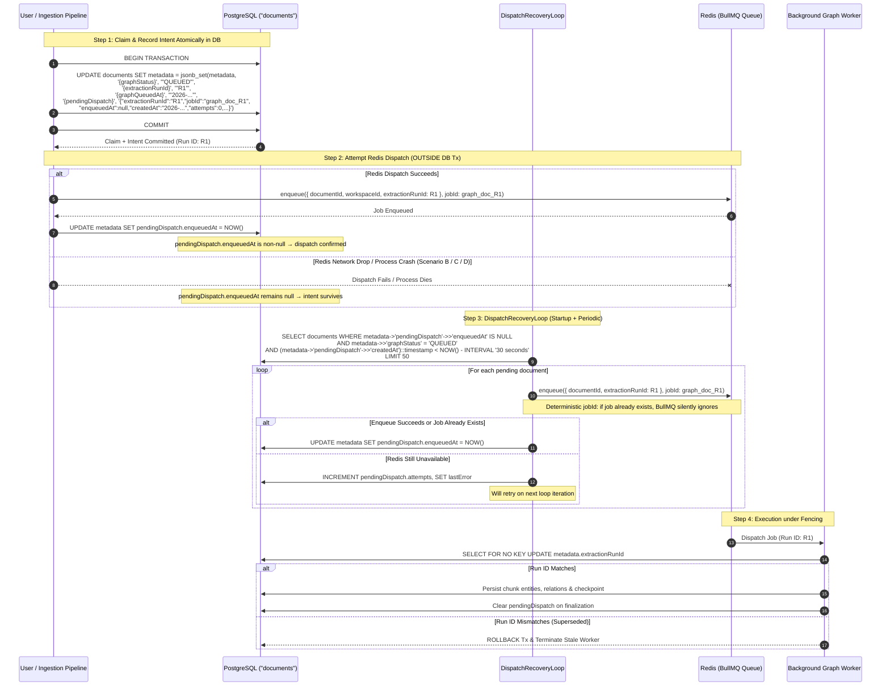
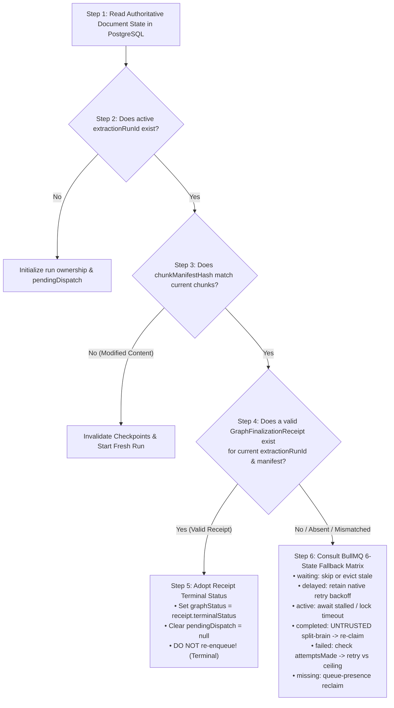
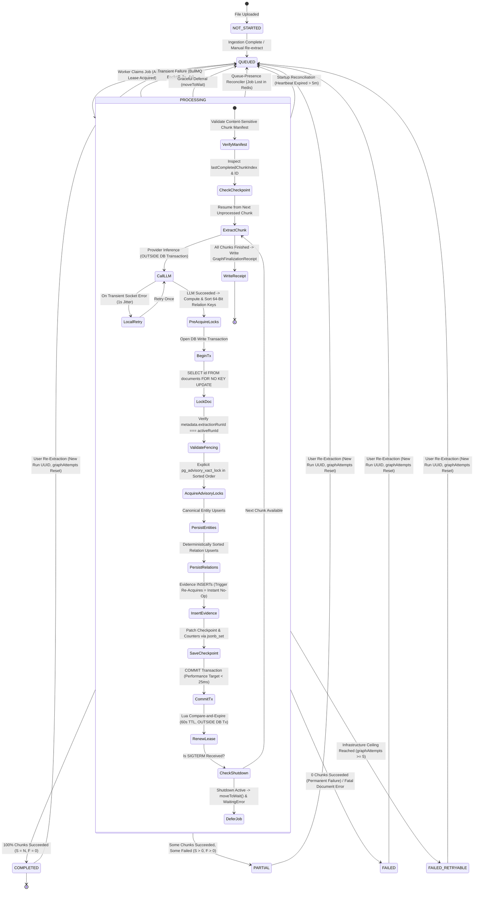

# MindVault Phase 6.4: Graph Engine Architecture Audit & Implementation Blueprint

**Role:** Principal Distributed Systems Architect, PostgreSQL Concurrency Specialist, BullMQ Engineer, Senior Backend Reliability Engineer  
**Project:** MindVault — Multi-Tenant Knowledge Management & GraphRAG Platform  
**Current Status:** Phase 6.3 Complete & Verified (Commit `5e2e8ac`, 41 test files, 303 tests passing)  
**Deliverable:** Architecture Audit & Implementation Blueprint for Phase 6.4 (Planning and Audit Phase ONLY — Zero Application Code Modified)  
**Revision:** v4.5.6 — Final Transaction-Boundary Clarification Release:

- **Two-Statement Sequential Entry Locking & Lease Evaluation (§6.2.5):** Formally decouples row-lock acquisition from lease evaluation within the worker entry transaction under `READ COMMITTED` isolation. Employs two sequential SQL statements: (1) `SELECT id FROM "documents" ... FOR NO KEY UPDATE` to exclusively serialize the entry check behind any in-flight persistence/finalization transactions, followed by (2) a distinct evaluation `SELECT ... ((metadata->>'graphLeaseExpiresAt')::timestamptz > clock_timestamp()) AS "isLeaseActive", clock_timestamp() AS "dbWallClock"`. Eliminates reliance on undefined expression evaluation order within a single locking SELECT, and leverages `READ COMMITTED` snapshot semantics where Statement 2 takes a fresh snapshot _after_ lock acquisition, guaranteeing observation of the committed state produced by the prior lock-holder.
- **Enforceable Transaction Duration Bounds & Replacement Lock-Out Guarantee (§6.2.2, §6.2.3):** Clarifies that the $< 25\text{ms}$ transaction duration target is an operational benchmark expectation under healthy conditions, not an enforced database ceiling. Specifies enforceable multi-layered timeout policies (Prisma `timeout: 15000`, `statement_timeout: 10s`, `lock_timeout: 5s`, `idle_in_transaction_session_timeout: 15s`) guaranteeing that persistence transactions cannot remain open indefinitely or exceed the 60s lease safety window ($15\text{s} \le 25\%$ of TTL). Crucially documents the **Replacement Lock-Out Guarantee**: because PostgreSQL row-level update locks are strictly mutually exclusive, no replacement worker or reconciler can acquire document ownership while a previous owner's persistence transaction holds `FOR NO KEY UPDATE`. The final fenced update in Step 8 renews the lease for another 60s before commit, ensuring queued replacement workers observe an active, renewed lease upon unblocking and defer cleanly.
- **Real-Time Wall-Clock Lease Semantics (`clock_timestamp()`):** Formally documents that PostgreSQL's `CURRENT_TIMESTAMP`, `NOW()`, and `transaction_timestamp()` are fixed at transaction start (`BEGIN`), returning the same static timestamp throughout the transaction block. Relying on `NOW()` for lease expiry decisions is flawed: if a transaction waits behind row locks (`FOR NO KEY UPDATE`) or runs sequential statements, `NOW()` reflects the start time, not actual wall-clock time after acquiring the lock. Formally specifies PostgreSQL's dynamic `clock_timestamp()` for: (1) lease acquisition expiry calculation (`clock_timestamp() + interval '60 seconds'`), (2) lease renewal expiry calculation (`clock_timestamp() + interval '60 seconds'`), (3) worker ownership and lease-expiration validation (`(metadata->>'graphLeaseExpiresAt')::timestamptz > clock_timestamp()`), (4) conditional lease release where expiry is relevant, and (5) stale-worker fencing checks. Guarantees that expiry validation evaluates true database wall-clock time after acquiring the document row lock.
- **Pre-Commit Lease Validation & Rollback Protocol:** Mandates an explicit pre-commit lease validation immediately prior to committing every chunk persistence transaction (§6.2.2 Step 8) and terminal finalization transaction (§6.2.2 Step 10, §6.4.4 Scenario 1). Every commit statement enforces 4-point verification under lock: `metadata->>'extractionRunId' = $expectedRunId`, `metadata->>'graphWorkerToken' = $expectedWorkerToken`, `(metadata->>'graphLeaseGeneration')::bigint = $expectedLeaseGeneration`, and `(metadata->>'graphLeaseExpiresAt')::timestamptz > clock_timestamp()`. If any check fails (affected rows === 0, indicating lease expiration or takeover), the transaction **immediately rolls back all writes** and throws `ExtractionFencedError`. Reaffirms that zero LLM or Redis calls occur inside these transactions and establishes the engine invariant: **A worker must never commit graph writes after its lease has expired.**

- **Worker-Attempt Ownership Fencing & Monotonic Lease Generation:** Resolves the critical edge case where a 60-second execution lease expires, a replacement worker claims the document under the same `extractionRunId`, and the original stalled worker subsequently wakes up and attempts to persist chunk progress. Formally specifies a unique worker-attempt ownership token (`graphWorkerToken: UUID`) generated afresh per worker execution attempt, accompanied by a strictly monotonically increasing fencing token (`graphLeaseGeneration: bigint`). Mandates that every chunk persistence transaction, background heartbeat, and terminal finalization transaction verifies: (1) active `extractionRunId`, (2) matching `graphWorkerToken`, (3) matching `graphLeaseGeneration`, and (4) unexpired `(metadata->>'graphLeaseExpiresAt')::timestamptz > clock_timestamp()`. A stale worker whose lease expired or was taken over affects 0 rows, rolls back immediately, sets `isFenced = true`, and aborts without writing, completely eliminating split-brain writes under the same `extractionRunId`.
- **BullMQ 6.6.0 Move-to-Delayed Protocol & Control-Flow Specification:** Reviewed the project's exact declared BullMQ dependency (`^6.6.0` in `apps/worker` and `apps/api`, resolved to `6.6.0`). Formally documented the complete move-to-delayed protocol: when a worker encounters same-run lease contention, it invokes `await job.moveToDelayed(Date.now() + 5000, token)` passing the worker's active job lock `token` (from processor parameters), which internally invokes Redis Lua with `skipAttempt: true` (preventing attempt count increments). Crucially, the worker processor **MUST immediately throw `new DelayedError()`** (imported from `bullmq`). This informs BullMQ's internal worker harness that the job was deferred, bypassing `handleCompleted()` (which would otherwise falsely mark the delayed job completed) and bypassing `moveToFailed()`. If the lock is lost or deferral fails in Redis, the error propagates to BullMQ's standard error recovery.
- **Failure-Safe Conditional Lease Release:** Mandated that catch-block lease cleanup is strictly conditional: `UPDATE documents SET ... graphWorkerToken = null, graphLeaseExpiresAt = null WHERE id = $id AND metadata->>'extractionRunId' = $runId AND metadata->>'graphWorkerToken' = $myWorkerToken AND (metadata->>'graphLeaseGeneration')::bigint = $myLeaseGeneration`. If affected rows = 0, a replacement worker has already claimed the lease; the stale worker never touches the new worker's lease. If PostgreSQL is unreachable during release, the worker logs a structured error and relies on the 60s lease TTL (`graphLeaseExpiresAt`) for recovery, never falsely claiming successful release.
- **PostgreSQL Lock Compatibility Correction:** Formally corrected §6.2.5's flawed assumption that `FOR KEY SHARE` serializes worker entry reads against a finalization transaction holding `FOR NO KEY UPDATE`. Under PostgreSQL's lock manager internals (Table 13.3), `FOR KEY SHARE` and `FOR NO KEY UPDATE` are **mutually compatible** and coexist on the same row without blocking, risking stale reads of unfinalized state. Replacing `FOR KEY SHARE` with naive `FOR SHARE` introduces fatal lock-upgrade deadlocks (`40P01`) on subsequent lease updates. The worker entry check is corrected to execute within a dedicated, bounded interactive transaction ($< 10\text{ms}$) acquiring `SELECT ... FOR NO KEY UPDATE` up front. This directly conflicts with in-flight chunk persistence and finalization locks, serializes the entry check behind any pending finalization commit, and prevents lock-upgrade deadlocks by entering exclusive mode up front.
- **Database-Backed Same-Run Execution Ownership & Lease Protocol:** Receipt-first checking alone does not prevent two workers from starting the same extraction run concurrently before a terminal receipt exists (e.g. BullMQ redelivery, duplicate delivery, or network stutter). Specified a database-backed execution lease in `documents.metadata` (`graphWorkerToken`, `graphLeaseGeneration`, `graphLeaseExpiresAt` with 60s TTL, `graphHeartbeatAt`). Acquired atomically under `FOR NO KEY UPDATE` at worker entry; renewed per-chunk and via 15s heartbeats; conditionally released on terminal completion or transient error; and reclaimed after 60s expiration upon worker crash. Concurrent same-run workers detect an active unexpired lease and yield/defer cleanly in BullMQ (`await job.moveToDelayed(5000, token); throw new DelayedError()`), preventing duplicate chunk execution and LLM token waste.
- **Strengthened Receipt Validation Invariants:** Enhanced `validateFinalizationReceipt()` to rigorously enforce non-negative integer types (`Number.isInteger(c) && c >= 0`) for `processedChunksCount`, `succeededChunksCount`, `failedChunksCount`, and `chunkCount`; strict progress accounting balance (`processedChunksCount === doc.chunkCount === succeededChunksCount + failedChunksCount`); and status-specific counter invariants (`COMPLETED`: $s = \text{total}, f = 0$; `PARTIAL`: $\text{total} > 0, s > 0, f > 0, s + f = \text{total}$; `FAILED`: $s = 0, f = \text{total}$). Invalid receipts never suppress recovery or authorize terminal adoption.
- **PostgreSQL Receipt Authority as Supreme Invariant:** Established as an inviolable, engine-wide invariant that a valid `GraphFinalizationReceipt` for the active `extractionRunId` and current chunk manifest takes unconditional precedence over EVERY BullMQ job state (`waiting`, `delayed`, `active`, `completed`, `failed`, `missing`). Terminal status (`COMPLETED`, `PARTIAL`, `FAILED`) from a valid receipt must always be adopted directly into PostgreSQL `metadata.graphStatus` without automatic re-extraction or redundant re-enqueueing.
- **Receipt-First Reconciliation Algorithm:** Formally defined the strict 6-step reconciliation decision order: (1) Read authoritative PostgreSQL document state, (2) Verify active `extractionRunId`, (3) Verify current chunk manifest hash, (4) Validate `GraphFinalizationReceipt`, (5) If valid, synchronize `graphStatus` from `terminalStatus` and do not re-enqueue, (6) If absent, mismatched, or invalid, apply the BullMQ 6-state reconciliation matrix. Guaranteed that stale receipts from superseded runs are strictly rejected.
- **Worker Entry Protection & Fast-Exit Protocol:** Mandated that before starting extraction or LLM calls, `GraphExtractionWorker.processJob()` verifies `extractionRunId` ownership, chunk manifest identity, checks for an existing valid terminal receipt under `FOR NO KEY UPDATE`, and claims the database-backed same-run execution lease. If already finalized in PostgreSQL, the worker immediately fast-exits returning the receipt cleanly, eliminating duplicate LLM extraction and wasted compute.
- **Six Concrete Distributed Failure Scenarios Formally Solved:** Documented exact race conditions, transaction semantics, and deterministic resolutions for: (1) DB finalization succeeds but worker crashes before BullMQ acknowledgement, (2) BullMQ retries a job whose PostgreSQL receipt is already `COMPLETED`, (3) BullMQ exhausts attempts after PostgreSQL has committed `PARTIAL`, (4) BullMQ reports `FAILED` while PostgreSQL contains a valid terminal `FAILED` receipt, (5) A stale worker attempts to execute after another run has superseded it, and (6) Two workers concurrently receive the same extraction run before a terminal receipt exists.
- **Complete BullMQ State Reconciliation Matrix:** Defined a formal, exhaustive 6-state decision matrix covering `waiting`, `delayed`, `active`, `completed`, `failed`, and `missing` jobs. For every state, explicitly defined PostgreSQL finalization receipt verification, `extractionRunId` ownership validation, heartbeat freshness inspection, recovery eligibility, and re-enqueueing permissions. Established as an inviolable rule that a completed BullMQ job without valid PostgreSQL finalization evidence must **never** be treated as a trusted successful extraction. Guaranteed that failed jobs with remaining attempts (`attemptsMade < 3`) retain native BullMQ exponential backoff without premature external interference.
- **Duplicate Dispatch Safety & Job Retention Lifecycles:** Documented BullMQ retention lifecycles (`removeOnComplete: { count: 500, age: 86400 }`, `removeOnFail: { count: 200, age: 604800 }`) and their architectural implications. Formally established that **deterministic job IDs do NOT guarantee permanent idempotency once a job has been purged from Redis**. Confirmed PostgreSQL as the supreme, immutable source of extraction truth. Designed safe handling for the edge case where Redis enqueue succeeds but PostgreSQL acknowledgement fails (reconciler verifies Redis presence and confirms acknowledgement idempotently without duplicate queue dispatch). Specified concurrent dispatcher fencing via atomic PostgreSQL row updates.
- **Recovery Correctness & Checkpoint Preservation Semantics:** Preserved PostgreSQL as the authoritative state log, durable `pendingDispatch` recovery intent, run identity fencing, existing terminal receipt semantics, and the five-run recovery ceiling (`MAX_TOTAL_RUNS = 5`, `BULLMQ_ATTEMPTS_PER_RUN = 3`, `MAX_TOTAL_PROCESSOR_ATTEMPTS = 15`). Clarified that all committed PostgreSQL checkpoints (`metadata.graphProgress`) are strictly immutable and preserved across retries and recoveries, while uncommitted in-flight processing for a failing chunk is rolled back and repeated upon resumption.
- **Redis Queue-Presence Reconciliation:** Designed complete recovery for acknowledged BullMQ jobs subsequently lost through Redis restarts, unpersisted failovers, queue data corruption, or memory evictions. Distinguishes dispatch acknowledgement (`pendingDispatch.enqueuedAt != null`) from durable queue presence (`job !== null` in Redis). The reconciler actively queries Redis presence; if a job is missing without a durable PostgreSQL `GraphFinalizationReceipt`, it re-establishes dispatch idempotently with a fresh `extractionRunId` and deterministic `jobId`, preserving chunk checkpoints and lifetime retry limits (`MAX_TOTAL_RUNS = 5`). Documented Redis persistence assumptions (`appendonly yes`, `appendfsync everysec`, `noeviction`) and fail-closed isolation against stale revived jobs via run-identity fencing.
- **Advisory Lock Namespace Isolation:** Established engine-guaranteed isolation between administrative leader locks and relational data locks. Administrative locks strictly utilize PostgreSQL's 2-integer advisory lock API (`pg_try_advisory_xact_lock(classid integer, objid integer)`) with reserved namespace `classid = 10064` (`objid = 1` for reconciliation, `objid = 2` for dispatch recovery). Relational data locks strictly utilize the 64-bit integer API (`pg_advisory_xact_lock(bigint)`). In PostgreSQL internals, the 64-bit and (32-bit, 32-bit) namespaces are distinct lock tag unions that never collide. Specified canonical input encoding (UTF-8 `${workspace_id}:${relation_id}`), MD5 16-hex truncation, 2's complement signed conversion, deterministic ascending numerical sort order, and mathematically precise collision bounds ($\approx 5.06 \times 10^9$ keys for 50% probability).
- **Document Ownership Row-Lock Safety (`FOR NO KEY UPDATE`):** Resolved potential row-lock upgrade deadlocks (`40P01`) by replacing `FOR SHARE` with `FOR NO KEY UPDATE` at the beginning of chunk persistence transactions. Defined explicit lock modes across all document lifecycle operations (extraction checkpointing, read-only validation, run claiming, and finalization). Acquiring `FOR NO KEY UPDATE` up front enters exclusive mode immediately, preventing lock upgrade deadlocks when `documents` is updated in the same transaction, while permitting foreign-key checks from child tables. Preserved universal lock hierarchy ($\text{Tier 1: Document Row Lock} \to \text{Tier 2: Relation Advisory Locks in ascending order}$). Documented deadlock detection, rollback, and jittered retry behavior ensuring committed checkpoints are never lost.
- **JSONB Concurrent Update Safety & Atomic SQL Mutations:** Prohibited naive application-level read-modify-write patterns for graph metadata. Defined atomic SQL mutations (`jsonb_set`, `||`) and conditional run-identity fencing (`WHERE metadata->>'extractionRunId' = $expectedRunId`) for `pendingDispatch`, `graphProgress`, `graphAttempts`, `extractionRunId`, and `graphStatus`. Formally mandated that Redis network I/O (`queue.add()`, lease renewals) must never occur inside PostgreSQL transactions, keeping database transactions strictly local, bounded ($< 25\text{ms}$), and isolated from network latency.
- **Recovery Ceiling Semantics Formalized:** Unambiguous retry limits defined: `MAX_TOTAL_RUNS = 5`, `BULLMQ_ATTEMPTS_PER_RUN = 3`, `MAX_TOTAL_PROCESSOR_ATTEMPTS = 15`. The initial extraction run counts as Run 1 toward `MAX_TOTAL_RUNS`. Counter initialization, increment semantics, exact `FAILED_RETRYABLE` transition, user-triggered retry behavior, counter reset policy, and administrative recovery behavior are fully specified.
- **FAILED_RETRYABLE Compatibility Verified:** `FAILED_RETRYABLE` is stored exclusively in `documents.metadata.graphStatus` (a JSONB string field), not in the `DocumentStatus` PostgreSQL enum. Zero enum migration required. Verified no conflict with existing document ownership semantics, no duplicate recovery intent creation, no stale-run ownership overwrite, no loss of committed chunk checkpoints, and no unintended automatic terminal `FAILED` transition.
- **BLOCKER 1 Resolved & Fortified:** Database-Enforced Atomic Run Fencing eliminating TOCTOU races via transactional `FOR NO KEY UPDATE` locks, deterministic sorted relation advisory lock acquisition, universal document-before-relation lock hierarchy, and absolute prohibition of external/LLM calls inside database transactions across all persistence entry points. Transaction duration target of $< 25\text{ms}$ is established as a measurable performance objective.
- **BLOCKER 2 Resolved & Fortified:** PostgreSQL and Redis Dual-Write Recovery Protocol addressing failure scenarios A, B, C, D, E, and F via the Claim-First, Dispatch-Second, Reconcile-Third pattern with durable `pendingDispatch` recovery intent in the `documents.metadata` JSONB column, ensuring no document is ever permanently stranded in `QUEUED` without a recoverable enqueue intent.
- **BLOCKER 3 Resolved & Fortified:** Comprehensive BullMQ Job State-Aware Reconciliation Matrix with Strict Terminal Completion Verification for completed jobs across all terminal states (`COMPLETED`, `PARTIAL`, `FAILED`), verified against a durable `GraphFinalizationReceipt` in PostgreSQL without requiring non-zero relation evidence (zero extracted relations is confirmed as a valid successful outcome). Terminal `FAILED` jobs are never automatically re-queued.
- **BLOCKER 4 Resolved:** Fail-Closed Immediate Fencing on Redis Lease Uncertainty with ownership-aware compare-and-swap renewals and compare-and-delete releases.
- **Content-Sensitive Chunk Manifest:** Deterministic chunk manifest hashing binding stable chunk IDs, chunk content SHA-256 hashes, deterministic index ordering, and document checksums to invalidate checkpoints upon text modification.
- **Clarified Chunk Progress Semantics:** Distinct tracking of `processedChunksCount`, `succeededChunksCount`, and `failedChunksCount`, enforcing `processedChunksCount === doc.chunkCount` for fully processed terminal runs while permitting valid `PARTIAL` extractions.
- **Connection-Pool-Safe Reconciliation:** Dedicated Prisma `$transaction` session pinning with engine-released `pg_try_advisory_xact_lock(10064, 1)`.  
  **Strict Scope Boundary:** Background worker lifecycle, queue reliability, error handling, stalled job recovery, concurrency, state machine, and observability. Multi-hop graph traversal (Phase 6.5) and GraphRAG retrieval/RRF (Phase 6.6) are strictly out of scope.

---

## 1. Executive Summary

### 1.1 Context & Background

MindVault has established a verified knowledge graph foundation across Phases 6.0 through 6.3:

- **Phase 6.0:** PostgreSQL relational graph schema (`graph_entities`, `graph_entity_aliases`, `graph_relations`, `relation_evidence`, `chunk_entity_mentions`) with composite tenant integrity constraints and canonical alias protection triggers.
- **Phase 6.1:** Entity and relation extraction pipeline, transforming unstructured document chunks into structured entities and relationships via local Ollama and Google Gemini models.
- **Phase 6.2:** Canonical entity resolution hardening, parenthetical disambiguation, generic alias blocklists, entity type upgrade hierarchy, and duplicate conflict recovery.
- **Phase 6.3:** Controlled relation taxonomy (`APPROVED_RELATION_TYPES`), strict evidence grounding, automatic orphan relation pruning (`20261107000500_phase_6_prune_orphaned_relations`), transaction-level advisory locks (`pg_advisory_xact_lock`), and multi-document corroboration.

### 1.2 The Problem Statement

While the extraction and database logic operates with mathematical precision in unit and integration tests, **the background processing and worker lifecycle infrastructure possesses critical reliability gaps that render it fragile or non-functional in live production**:

1. **Unmounted Graph Worker in Production:** `GraphExtractionWorker` is defined and unit-tested in `apps/api/src/modules/graph/worker/graph-extraction.worker.ts`, but its `.start()` method is **never invoked** in either `apps/api/src/index.ts` or `apps/worker/src/index.ts`. In a live deployment, any document enqueued to the `graph-extraction` queue sits indefinitely in Redis with zero consumers.
2. **Divergent & Conflicting Queue Implementations:** Two duplicate queue dispatchers exist (`apps/api/src/modules/graph/queue/graph-extraction.queue.ts` and `apps/worker/src/lib/graph-queue.ts`) with conflicting `jobId` naming formats and missing shared connection pooling.
3. **Swallowed Errors Neutralizing BullMQ Retries:** In `GraphExtractionService.extractDocument()`, chunk extraction exceptions are caught and swallowed into an in-memory array (`errors: string[]`). The method returns `{ status: 'FAILED', errors }` without throwing. Consequently, BullMQ marks the job as `COMPLETED`, completely bypassing BullMQ's exponential retry mechanism (`attempts: 3`, `backoff`).
4. **Deduplication Deadlock on Job Failure:** Fixed custom job IDs combined with `removeOnFail: false` cause failed jobs to persist in Redis under their custom ID. Any subsequent attempt to re-extract or re-enqueue that document fails or is silently ignored by BullMQ, permanently locking out the user from re-extracting failed documents.
5. **Missing Intermediate State Tracking & Risk of Lost Updates:** Documents jump directly from ingestion `COMPLETED` to graph `COMPLETED`/`FAILED` without ever recording a `PROCESSING` state or progress metrics (`currentChunk / totalChunks`). Naive JSONB read-modify-write patterns risk lost updates during concurrent document operations.
6. **Unmonitored Redis & Lack of Distributed Reconciliation:** The `/api/health` endpoint explicitly stubs Redis connectivity as `'unknown'`. If the server or worker crashes mid-extraction, no concurrency-safe reconciliation exists to detect orphaned jobs or stuck states without race conditions between multiple worker replicas.
7. **Unbounded LLM Concurrency:** Without queue rate limiting, bulk document ingestion can overwhelm local Ollama instances (typically configured for 1–2 parallel slots), causing cascade request timeouts and failures.

### 1.3 Objective of Phase 6.4 (v4.5.6)

Phase 6.4 transforms the knowledge graph from an isolated extraction library into an **enterprise-grade, autonomous, self-healing background processing engine**. This definitive v4.5.6 blueprint resolves all architectural blockers:

1. **Two-Statement Sequential Entry Locking & Lease Evaluation under READ COMMITTED (§6.2.5):** Eliminates expression-order ambiguity in single locking SELECT statements. Executes `SELECT ... FOR NO KEY UPDATE` first, then executes a subsequent statement under `READ COMMITTED` to evaluate lease validity against `clock_timestamp()` using a fresh post-lock snapshot.
2. **Enforceable Transaction Duration Bounds & Replacement Lock-Out Guarantee (§6.2.2, §6.2.3):** Replaces informal latency targets with enforceable transaction and database timeout policies (`timeout: 15000`, `statement_timeout = '10s'`, `idle_in_transaction_session_timeout = '15s'`) strictly bounded well within the 60s lease safety window. Establishes the formal guarantee: no replacement worker can take ownership or commit competing writes while a previous owner's transaction still holds the document row lock, with Step 8 renewing the lease for 60s prior to commit.
3. **Real-Time Wall-Clock Lease Semantics (`clock_timestamp()`):** Eliminates time-freeze vulnerabilities caused by PostgreSQL's static transaction-start timestamps (`NOW()`, `CURRENT_TIMESTAMP`). Specifies `clock_timestamp()` for lease acquisition, renewal, ownership verification, conditional release, and stale-worker fencing checks, ensuring all expiry decisions evaluate actual database wall-clock time after acquiring the document row lock (`FOR NO KEY UPDATE`).
4. **Pre-Commit Lease Validation & Mandatory Rollback Protocol:** Enforces atomic 4-point pre-commit lease validation (`extractionRunId`, `graphWorkerToken`, `graphLeaseGeneration`, `(metadata->>'graphLeaseExpiresAt')::timestamptz > clock_timestamp()`) immediately before committing every chunk persistence and terminal finalization transaction. If lease validity or ownership is lost (0 rows updated), all writes in the transaction roll back completely and throw `ExtractionFencedError`. Reaffirms that zero LLM or Redis calls occur inside database transactions ($< 25\text{ms}$ benchmark duration), establishing the engine invariant: a worker must never commit graph writes after its lease has expired.
5. **Worker-Attempt Ownership Fencing & Monotonic Lease Generation:** Eliminates split-brain writes when a stalled worker wakes after its 60s lease expired and was claimed by a replacement worker under the same `extractionRunId`. Requires a unique `graphWorkerToken: UUID` per execution attempt, a monotonically increasing `graphLeaseGeneration: bigint`, and mandatory 4-point verification (`extractionRunId`, `graphWorkerToken`, `graphLeaseGeneration`, `(metadata->>'graphLeaseExpiresAt')::timestamptz > clock_timestamp()`) on every chunk persistence and finalization transaction.
6. **BullMQ 6.6.0 Move-to-Delayed Protocol & Control-Flow Specification:** Adheres strictly to the project's declared BullMQ v6.6.0 dependency. Employs `await job.moveToDelayed(Date.now() + 5000, token)` with the active job lock token (`skipAttempt: true`), followed immediately by `throw new DelayedError()`. Guarantees deferred jobs bypass `handleCompleted()` and are never prematurely acknowledged as completed.
7. **Failure-Safe Conditional Lease Release:** Scopes catch-block lease cleanup strictly to `WHERE metadata->>'graphWorkerToken' = $myWorkerToken AND (metadata->>'graphLeaseGeneration')::bigint = $myLeaseGen`, ensuring a failing worker never clears a replacement worker's lease. Logs errors and relies on 60s lease TTL for recovery during database outages without false completion claims.
8. **PostgreSQL Receipt Authority as Supreme Invariant:** Establishes the inviolable invariant that a valid `GraphFinalizationReceipt` in PostgreSQL takes unconditional precedence over all BullMQ job states (`waiting`, `delayed`, `active`, `completed`, `failed`, `missing`). Terminal status (`COMPLETED`, `PARTIAL`, `FAILED`) is adopted directly into `metadata.graphStatus` without automatic re-extraction.
9. **Receipt-First Reconciliation Algorithm:** Mandates the strict 6-step evaluation order (PostgreSQL read $\to$ runId check $\to$ manifest check $\to$ receipt validation $\to$ terminal adoption $\to$ BullMQ 6-state matrix fallback), ensuring stale receipts from superseded runs are rejected.
10. **Worker Entry Protection & Concurrency-Safe Serialization (`FOR NO KEY UPDATE`):** Replaces flawed `FOR KEY SHARE` reads with a dedicated, ultra-short interactive transaction ($< 10\text{ms}$) acquiring `SELECT ... FOR NO KEY UPDATE` up front. This serializes the entry check behind any pending finalization commit, eliminates stale reads, and prevents lock-upgrade deadlocks (`40P01`).
11. **Database-Backed Same-Run Execution Ownership & Lease Protocol:** Formally prevents two workers from processing the same extraction run concurrently before a terminal receipt exists via `graphWorkerToken`, `graphLeaseGeneration`, `graphLeaseExpiresAt` (60s TTL), and `graphHeartbeatAt` in `documents.metadata`. Concurrent same-run workers detect unexpired leases and yield/defer cleanly in BullMQ (`await job.moveToDelayed(5000, token); throw new DelayedError()`).
12. **Strengthened Finalization Receipt Validation Invariants:** Mandates non-negative integer validation (`Number.isInteger(c) && c >= 0`) across all counters, strict accounting balance (`processedChunksCount === doc.chunkCount === succeededChunksCount + failedChunksCount`), and status-specific counter rules. Invalid receipts never suppress recovery or authorize terminal adoption.
13. **Six Concrete Distributed Failure Scenarios Formally Solved:** Eliminates split-brain anomalies and zombie runs across all six failure edge cases (DB commit followed by worker crash, BullMQ retries on completed receipt, BullMQ exhausted after partial receipt, BullMQ failed with terminal failed receipt, stale worker revival, and same-run concurrent worker delivery).
14. **Complete 6-State BullMQ Fallback Reconciliation:** Governs cases where receipts are absent or invalid across `waiting`, `delayed`, `active`, `completed`, `failed`, and `missing` states, guaranteeing failed jobs with remaining attempts retain native backoff, and completed jobs without receipts are untrusted.
15. **Duplicate Dispatch Safety & Job Retention Boundaries:** Clarifies that BullMQ job removal purges `jobId` from Redis, rendering Redis `jobId` deduplication transient. Confirms PostgreSQL as the permanent, authoritative arbiter of extraction state via atomic conditional claiming, receipt validation, and run-identity fencing.
16. **Recovery Correctness & Checkpoint Preservation:** Confirms that committed PostgreSQL chunk checkpoints are permanently immutable, while in-flight uncommitted chunk processing is repeated upon recovery. Preserves the 5-run recovery ceiling.
17. **Redis Queue-Presence Reconciliation:** Guarantees that documents whose BullMQ jobs are lost due to Redis crashes, unpersisted restarts, or cache evictions are automatically detected and safely re-enqueued without duplicating active processing.
18. **Advisory Lock Namespace Isolation:** Provides engine-level isolation between administrative leader locks (2-integer namespace: `pg_try_advisory_xact_lock(10064, 1/2)`) and relational data locks (64-bit bigint namespace: `pg_advisory_xact_lock(bigint)`).
19. **Document Ownership Row-Lock Safety (`FOR NO KEY UPDATE`):** Eliminates row-lock upgrade deadlocks (`40P01`) by locking the document row in exclusive `FOR NO KEY UPDATE` mode at the start of chunk persistence transactions.
20. **JSONB Concurrent Update Safety & Atomic SQL Mutations:** Enforces strict field-level atomic SQL updates (`jsonb_set`) with run-identity fencing, eliminating naive read-modify-write overwrite risks and keeping PostgreSQL transactions completely decoupled from Redis network latency.

---

## 2. Existing Architecture Analysis

A comprehensive audit of the MindVault repository reveals the following implementation realities across the 12 required architectural domains:

### 2.1 Existing BullMQ Queues and Workers

The repository currently defines two separate BullMQ queues:

1. **`document-processing` Queue:**
   - **Producer:** `apps/api/src/modules/document/document.queue.ts` (`BullMQDocumentQueue`).
   - **Consumer:** `apps/worker/src/worker.ts` (`WorkerService`).
   - **Payload:** `ProcessDocumentJobPayload { documentId: string, workspaceId: string, userId: string }`.
   - **Configuration:** `attempts: 3`, `backoff: { type: 'exponential', delay: 2000 }`, `removeOnComplete: true`, `removeOnFail: false`. Custom `jobId: doc_${payload.documentId}`.
   - **Status:** Fully mounted and actively started in `apps/worker/src/index.ts`.

2. **`graph-extraction` Queue:**
   - **Producer 1 (API):** `apps/api/src/modules/graph/queue/graph-extraction.queue.ts` (`BullMQGraphExtractionQueue`).
     - Custom `jobId: graph_${payload.documentId}_${payload.chunkId || 'doc'}`.
   - **Producer 2 (Worker):** `apps/worker/src/lib/graph-queue.ts` (`BullMQWorkerGraphQueue`).
     - Custom `jobId: graph_${payload.documentId}` (omits chunk identifier).
   - **Consumer:** `apps/api/src/modules/graph/worker/graph-extraction.worker.ts` (`GraphExtractionWorker`).
     - Hardcoded `concurrency: 2`.
   - **CRITICAL DEFECT:** The worker is instantiated (`export const graphExtractionWorker = new GraphExtractionWorker()`) but its `.start()` method is **never called** anywhere in application code.

### 2.2 Redis Connection Management

- Every queue and worker instantiates independent, ad-hoc Redis connections:
  ```typescript
  connection: {
    url: env.REDIS_URL || 'redis://localhost:6379',
    maxRetriesPerRequest: null,
  }
  ```
- BullMQ internally creates 3 separate Redis connections per Queue/Worker instance (client, subscriber, blocking client).
- There is **no centralized Redis connection manager or connection pool**. In development with live reloading (`tsx watch`), dozens of orphaned Redis connections can accumulate.
- In `apps/api/src/routes/health.ts` (lines 62–65), Redis health checking is stubbed:
  ```typescript
  redis: {
    status: 'unknown',
    message: 'Redis queue connectivity verification deferred to Phase 2 (BullMQ ingestion)',
  }
  ```

### 2.3 Worker Initialization and Shutdown Lifecycle

- **`apps/worker/src/index.ts`:**
  - Instantiates `WorkerService` and calls `await worker.start()`.
  - Registers listeners for `SIGTERM` and `SIGINT`, invoking `await worker.stop()`.
  - In `WorkerService.stop()` (`apps/worker/src/worker.ts` lines 87–100), it executes `await this.bullWorker.close()`.
  - **Weakness:** `worker.close()` will wait indefinitely for active jobs unless a timeout is enforced. An LLM call that hangs on an un-timed socket will block process termination until the OS sends `SIGKILL`.
- **`apps/api/src/index.ts`:**
  - Has graceful shutdown logic for the Express HTTP server with a 10-second forced termination fallback (`setTimeout(() => process.exit(1), 10000).unref()`).
  - Does **not** manage `graphExtractionWorker` because the worker is not registered in the API entry point.

### 2.4 Job Creation, Execution, and Completion Flow

1. In `apps/worker/src/modules/ingestion/pipeline.ts` (lines 155–165), once document chunking and embeddings are stored, the pipeline executes:
   ```typescript
   if (this.graphQueue) {
     await this.graphQueue.enqueue({ documentId, workspaceId });
   }
   ```
2. When a job is dispatched, the payload conforms to `GraphExtractionJobPayload { workspaceId, documentId, chunkId?, forceReextract? }`.
3. In `GraphExtractionWorker.processJob(payload)`:
   - Verifies tenant isolation: checks if `document` exists and matches `workspaceId`.
   - If `chunkId` is present, it processes that single chunk via `service.extractFromChunk()`.
   - If `chunkId` is omitted, it executes `service.extractDocument(workspaceId, documentId, forceReextract)`.
4. In `GraphExtractionService.extractDocument()`:
   - Iterates sequentially through `document.chunks`.
   - Runs `extractFromChunk()` for each chunk.
   - Updates `document.metadata` with `graphStatus`, counts, and error list upon loop termination.

### 2.5 Retry and Backoff Configuration

- Queue configuration specifies:
  ```typescript
  attempts: 3,
  backoff: { type: 'exponential', delay: 2000 }
  ```
- **CRITICAL DEFECT:** In `GraphExtractionService.extractDocument()` (lines 269–274), errors thrown during chunk extraction are caught in a `try/catch` block and appended to `errors: string[]`. Even if every single chunk fails, the service returns a result object `{ status: 'FAILED', errors }`.
- In `GraphExtractionWorker.processJob()`:
  ```typescript
  return this.service.extractDocument(workspaceId, documentId, forceReextract);
  ```
- Because `processJob()` returns normally without throwing an unhandled `Error`, **BullMQ interprets the job as successfully completed**.
- BullMQ's automatic retry mechanism, exponential backoff, and dead-letter failure states are **completely neutralized**.

### 2.6 Failed and Stalled Job Recovery

- BullMQ provides native stalled job detection (`stalledInterval: 30000`, `maxStalledCount: 1`).
- If a Node.js process crashes (SIGKILL, OOM, power loss) while processing a job, BullMQ detects that the job lock expired and re-assigns the job.
- **Vulnerability:** Because `document.metadata.graphStatus` is never updated to `PROCESSING` at job start, PostgreSQL has no record of in-flight work.
- If a job exceeds `maxStalledCount` and moves to the BullMQ `failed` set, BullMQ fires a worker event, but **no handler updates PostgreSQL**. The document remains in limbo indefinitely.

### 2.7 Job Idempotency and Duplicate Execution Protection

- **BullMQ Deduplication:** Uses fixed `jobId`:
  - Worker: `jobId: graph_${payload.documentId}`
  - API: `jobId: graph_${payload.documentId}_${payload.chunkId || 'doc'}`
- **DEDUPLICATION DEADLOCK:** Both queues configure `removeOnFail: false`. When a job fails, BullMQ retains it in the Redis failed set under that `jobId`. If a user triggers a retry or re-uploads the document, BullMQ refuses to add the job because the `jobId` already exists.
- **Database Idempotency:** The database layer is thoroughly hardened:
  - `graph_entities`: `(workspace_id, normalized_name)` unique constraint.
  - `graph_entity_aliases`: `(workspace_id, normalized_alias)` unique constraint.
  - `graph_relations`: `(workspace_id, source_entity_id, target_entity_id, relation_type)` unique constraint.
  - `relation_evidence`: `(workspace_id, relation_id, chunk_id)` unique constraint.
  - `chunk_entity_mentions`: `(workspace_id, chunk_id, entity_id)` unique constraint.
  - Reprocessing chunks multiple times is safe at the database level; the deadlock exists entirely at the BullMQ job layer.

### 2.8 Database Transaction Boundaries

- Extraction across a document is **chunk-isolated**: each chunk processes independently. A failure on chunk 5 does not roll back entities created in chunks 1–4.
- Within `extractFromChunk()`:
  - Entity resolution, mention recording, and relation persistence execute as independent auto-commit operations.
  - While this prevents long-held locks during slow LLM inference, a crash during relation persistence can leave entity mentions without relations.
  - However, because all operations are idempotent, subsequent reprocessing safely completes missing relations without duplicating existing entities.

### 2.9 PostgreSQL Advisory-Lock Interactions & Key Derivation

- Migration `20261107000400_phase_6_trigger_advisory_lock` established transaction-scoped 64-bit advisory locks:
  ```sql
  lock_key := ('x' || substr(md5(target_ws_id || ':' || target_rel_id), 1, 16))::bit(64)::bigint;
  PERFORM pg_advisory_xact_lock(lock_key);
  ```
- **API Definition:** Uses `pg_advisory_xact_lock(bigint)`. The lock is strictly transaction-scoped: PostgreSQL automatically releases it on commit, rollback, or connection loss.
- **Mathematical Properties:**
  - Derived from the first 16 hex characters of the MD5 digest of `${workspace_id}:${relation_id}`.
  - Prefixing with `'x'` and casting to `bit(64)::bigint` yields a signed 64-bit integer (`BIGINT`).
  - This serializes concurrent evidence inserts for the exact same relation across different chunks or workers without conflicting with PostgreSQL foreign-key `ShareLock` checks, completely eliminating ShareLock deadlocks.
- In `graph.repository.ts` (`createEvidenceIdempotent`), transient serialization conflicts (`40P01`, `40001`) are caught and retried up to 3 times with 25–75ms jitter.

### 2.10 Concurrency and Rate-Limiting Controls

- `apps/worker` runs with `WORKER_CONCURRENCY` (default 5) for document text ingestion.
- `GraphExtractionWorker` specifies `concurrency: 2`.
- **Defect:** Neither queue configures a BullMQ rate limiter (`limiter`).
- If 10 documents are uploaded concurrently, 10 extraction jobs will execute across available concurrency slots. For local Ollama instances running on consumer GPUs or CPUs, concurrent requests lead to extreme inference latency, queue contention, and HTTP timeouts.

### 2.11 Logging, Metrics, and Error Handling

- `apps/worker` utilizes a structured `Logger` class (`./utils/logger.js`).
- `GraphExtractionWorker` relies on unformatted `console.log`, `console.warn`, and `console.error`.
- BullMQ job progress is never updated (`job.updateProgress()` is never called).
- There is no queue monitoring endpoint to inspect job queue depths (waiting, active, completed, failed, delayed).

### 2.12 Existing Integration and Failure-Recovery Tests

- `apps/api/src/modules/graph/__tests__/graph-extraction.worker.test.ts` validates:
  - Single chunk processing via mock provider.
  - Document-level extraction via mock provider.
  - Graceful handling of deleted documents and deleted chunks.
  - Validation of missing `workspaceId` / `documentId`.
  - In-memory queue dispatch.
- **Test Coverage Gaps:**
  - Zero tests for Redis connection loss and reconnection.
  - Zero tests for worker crash simulation during multi-chunk extraction.
  - Zero tests verifying that BullMQ retries on transient network/LLM errors.
  - Zero tests verifying stalled job recovery.
  - Zero tests verifying deduplication behavior on retried failed jobs.

### 2.13 Components to Reuse vs. Replace

| Component                                     | Status                    | Recommendation                                                                                    |
| :-------------------------------------------- | :------------------------ | :------------------------------------------------------------------------------------------------ |
| `GraphExtractionService`                      | Verified (Phases 6.1–6.3) | **Reuse as core extraction engine**; enhance error bubbling, progress callbacks, and run fencing. |
| `EntityResolver` & `RelationResolver`         | Verified (Phases 6.2–6.3) | **Reuse without modification**. Idempotency and taxonomy enforcement are complete.                |
| `GraphRepository`                             | Verified (Phases 6.0–6.3) | **Reuse without modification**. Advisory locks and conflict recovery are solid.                   |
| `trg_sync_relation_weight_on_evidence_change` | Verified (Phase 6.3)      | **Reuse without modification**. Orphan pruning and advisory locks are operational.                |
| `BullMQGraphExtractionQueue` (API)            | Divergent implementation  | **Deprecate & Consolidate** into unified queue module.                                            |
| `BullMQWorkerGraphQueue` (Worker)             | Divergent implementation  | **Deprecate & Consolidate** into unified queue module.                                            |
| `GraphExtractionWorker`                       | Unmounted in production   | **Refactor, harden, and mount** in worker runtime with graceful lifecycle hooks.                  |

---

## 3. Current Worker Lifecycle Trace

To understand the operational flow and failure boundaries, the current execution trace is mapped from file upload to graph completion:

```
[User / API Client]
       │
       ▼
1. Document Upload
   apps/api/src/modules/document/document.service.ts
   - Validates file & magic bytes
   - Stores raw file via WorkerStorageProvider
   - Creates DB record with status: 'UPLOADED'
   - Calls documentQueue.enqueue({ documentId, workspaceId, userId })
   - Updates DB status: 'QUEUED'
       │
       ▼ (Redis: 'document-processing' Queue)
2. Document Ingestion Worker
   apps/worker/src/worker.ts (WorkerService)
   - Consumes job from 'document-processing'
   - Calls DocumentIngestionPipeline.processDocument()
   - Parses text (PDF/DOCX/TXT/MD)
   - Chunks text into DocumentChunk records
   - Generates vector embeddings via EmbeddingProvider
   - Stores chunks & embeddings in PostgreSQL
   - Updates document status: 'COMPLETED'
       │
       ▼
3. Graph Extraction Handoff
   apps/worker/src/modules/ingestion/pipeline.ts (lines 155-165)
   - Calls BullMQWorkerGraphQueue.enqueue({ documentId, workspaceId })
   - Job added to Redis queue 'graph-extraction' with jobId: `graph_${documentId}`
       │
       ▼ (Redis: 'graph-extraction' Queue)
════════════════════════════════════════════════════════════════════════════════════
💥 THE PRODUCTION GAP: ZERO WORKER CONSUMER RUNNING
   - Neither apps/api/src/index.ts nor apps/worker/src/index.ts starts GraphExtractionWorker.
   - Job sits in Redis indefinitely. Document graphStatus remains undefined.
════════════════════════════════════════════════════════════════════════════════════
       │ (Assuming GraphExtractionWorker WAS started in test or proposed environment)
       ▼
4. Graph Job Consumption
   apps/api/src/modules/graph/worker/graph-extraction.worker.ts
   - BullMQ pulls job from 'graph-extraction'
   - Verifies document exists in DB and matches workspaceId
   - Calls GraphExtractionService.extractDocument(workspaceId, documentId)
       │
       ▼
5. Chunk-by-Chunk Extraction Loop
   apps/api/src/modules/graph/services/graph-extraction.service.ts
   - Fetches all chunks for document ordered by chunkIndex
   - Iterates sequentially:
     - Calls LLM Extraction Provider (Ollama / Gemini)
     - Normalizes entities via EntityNormalizer
     - Resolves canonical entities via EntityResolver
     - Validates relations against approved vocabulary
     - Persists entities, mentions, relations, and evidence
     - Trigger acquires pg_advisory_xact_lock and updates relation weight
   - Catches any chunk error and appends to `errors: string[]` (NO THROW)
       │
       ▼
6. Document Completion Update
   - Updates document.metadata.graphStatus = ('COMPLETED' | 'PARTIAL' | 'FAILED')
   - Returns DocumentGraphExtractionResult
   - Worker finishes execution; BullMQ marks job COMPLETED (even if status is 'FAILED')
```

---

## 4. Reliability Gap Analysis

The following matrix identifies concrete vulnerabilities in the current architecture, with verified file references and architectural severity ratings:

| #        | Vulnerability & Area                          | Current Implementation                                                                                                                                                   | Concrete Risk & Failure Mode                                                                                                                               | Severity     | Recommended Phase 6.4 Solution                                                                                                                                         | Relevant Files                                                                                                                      |
| :------- | :-------------------------------------------- | :----------------------------------------------------------------------------------------------------------------------------------------------------------------------- | :--------------------------------------------------------------------------------------------------------------------------------------------------------- | :----------- | :--------------------------------------------------------------------------------------------------------------------------------------------------------------------- | :---------------------------------------------------------------------------------------------------------------------------------- |
| **G-01** | **Unmounted Worker in Production**            | `GraphExtractionWorker` is instantiated in `apps/api/src/modules/graph/worker/` but `.start()` is never called in `apps/api/src/index.ts` or `apps/worker/src/index.ts`. | Background graph jobs enqueued by ingestion sit permanently in Redis with zero processing. Feature is dead in production.                                  | **CRITICAL** | Formally mount and start `GraphExtractionWorker` in the background worker process (`apps/worker`) with robust lifecycle hooks.                                         | `apps/worker/src/index.ts`<br>`apps/worker/src/worker.ts`<br>`apps/api/src/index.ts`                                                |
| **G-02** | **Divergent Queue Definitions**               | Two separate queue classes exist: `BullMQGraphExtractionQueue` (API) and `BullMQWorkerGraphQueue` (Worker) with different `jobId` formats.                               | Code duplication, configuration drift, and divergent job ID schemes (`graph_${docId}` vs `graph_${docId}_${chunkId}`).                                     | **HIGH**     | Unify into a single, canonical `GraphExtractionQueue` in `@mindvault/shared` or a shared module used by both API and Worker.                                           | `apps/api/src/modules/graph/queue/`<br>`apps/worker/src/lib/graph-queue.ts`                                                         |
| **G-03** | **Swallowed Errors & Neutralized Retries**    | `extractDocument()` catches all chunk errors in a `try/catch` and returns `{ status: 'FAILED', errors }` without throwing.                                               | BullMQ sees a resolved promise, marks the job as `COMPLETED`, and never triggers its configured exponential backoff retries on failure.                    | **HIGH**     | Introduce an `ErrorClassifier`. Transient errors (LLM timeouts, 429, network, DB deadlocks) MUST throw to trigger BullMQ retry; permanent errors update state cleanly. | `apps/api/src/modules/graph/services/graph-extraction.service.ts`<br>`apps/api/src/modules/graph/worker/graph-extraction.worker.ts` |
| **G-04** | **Deduplication Deadlock on Failure**         | BullMQ configured with `removeOnFail: false` and fixed custom `jobId` (`graph_${documentId}`).                                                                           | When a job fails, it remains in the Redis failed set. Subsequent requests to re-extract the document fail because BullMQ rejects duplicate custom job IDs. | **HIGH**     | Decouple run identity: use `jobId = graph_${documentId}_${extractionRunId}` and atomic Redis dispatch lease.                                                           | `apps/api/src/modules/graph/queue/graph-extraction.queue.ts`<br>`apps/worker/src/lib/graph-queue.ts`                                |
| **G-05** | **Missing Intermediate State & Lost Updates** | Document metadata `graphStatus` remains undefined while extraction runs. Naive read-modify-write overwrites concurrent updates.                                          | Lost state during worker crash. Concurrent metadata updates (tags, ingestion status) overwritten by graph completion.                                      | **MEDIUM**   | Atomically patch JSONB with optimistic run ID check; track live `PROCESSING` and progress counters.                                                                    | `apps/api/src/modules/graph/services/graph-extraction.service.ts`<br>`apps/api/src/modules/graph/worker/graph-extraction.worker.ts` |
| **G-06** | **Unmanaged Redis Connections & Health Stub** | Raw connection objects created per queue without pooling. `/api/health` hardcodes Redis status as `'unknown'`.                                                           | Connection exhaustion in development; zero visibility into Redis outages in production monitoring.                                                         | **MEDIUM**   | Implement a shared Redis connection factory; separate liveness from readiness, and add cached queue metrics.                                                           | `apps/api/src/routes/health.ts`<br>`apps/api/src/config/redis.ts`<br>`apps/worker/src/config/env.ts`                                |
| **G-07** | **Unbounded LLM Concurrency & Backpressure**  | Worker concurrency is hardcoded (`concurrency: 2`); no BullMQ `limiter` is configured on the queue.                                                                      | Batch document uploads overwhelm local Ollama (1–2 slots), causing HTTP connection drops and cascade timeouts across all active jobs.                      | **MEDIUM**   | Make graph concurrency configurable via environment variable (`GRAPH_WORKER_CONCURRENCY`) and add optional BullMQ rate limiting (`limiter`).                           | `apps/api/src/modules/graph/worker/graph-extraction.worker.ts`<br>`apps/worker/src/config/env.ts`                                   |
| **G-08** | **Missing Concurrency-Safe Reconciliation**   | No startup logic inspects Redis or PostgreSQL for orphaned graph extraction jobs left in-flight after a crash.                                                           | Documents whose extraction was interrupted by a SIGKILL or power outage remain stuck in `PROCESSING` forever with no automatic retry.                      | **HIGH**     | Implement distributed PostgreSQL advisory-locked reconciliation with atomic SQL claiming and heartbeat lease validation.                                               | `apps/api/src/index.ts`<br>`apps/worker/src/index.ts`                                                                               |
| **G-09** | **Unbounded Shutdown Drain Timeout**          | `WorkerService.stop()` calls `bullWorker.close()` without an explicit timeout wrapper.                                                                                   | If an LLM call or embedding request hangs, `worker.close()` hangs indefinitely, preventing clean Kubernetes or Docker container termination.               | **MEDIUM**   | Implement a two-phase shutdown (pause polling $\to$ 15s bounded chunk drain) with explicit BullMQ lock expiration handling.                                            | `apps/worker/src/worker.ts`<br>`apps/api/src/modules/graph/worker/graph-extraction.worker.ts`                                       |
| **G-10** | **Non-Atomic Chunk Transaction Boundaries**   | Chunk extraction executes multiple independent queries (entities, mentions, relations, evidence) without a `$transaction`.                                               | A crash between entity insertion and evidence creation leaves partial state. While safe due to idempotency, a clean chunk-level boundary is cleaner.       | **LOW**      | Preserve idempotency guarantees and wrap chunk-level persistence in a localized transaction where appropriate.                                                         | `apps/api/src/modules/graph/services/graph-extraction.service.ts`                                                                   |

---

## 5. Failure Scenario Matrix

The following matrix analyzes 19 concrete distributed failure scenarios, contrasting current behavior against target Phase 6.4 behavior:

| Failure Scenario                                              | Trigger / Root Cause                                                                                              | Current Behavior & Defect                                                                                            | Target Phase 6.4 Behavior & Mitigation                                                                                                                                                                                                                                                                                                           | Recovery Mechanism                                                                                                       |
| :------------------------------------------------------------ | :---------------------------------------------------------------------------------------------------------------- | :------------------------------------------------------------------------------------------------------------------- | :----------------------------------------------------------------------------------------------------------------------------------------------------------------------------------------------------------------------------------------------------------------------------------------------------------------------------------------------- | :----------------------------------------------------------------------------------------------------------------------- |
| **1. Redis Outage**                                           | Redis container restarts, network split, or OOM crash.                                                            | Worker emits uncaught error event; unhandled promise rejection; queues fail silently without reconnect strategy.     | API liveness stays healthy; readiness marks degraded; worker pauses and buffers reconnection via `ioredis` backoff.                                                                                                                                                                                                                              | Automatic reconnection; worker resumes queue polling once Redis fires `ready` event.                                     |
| **2. Worker Process Crash (OOM / SIGKILL)**                   | Out of memory during heavy PDF parsing or unhandled OS termination.                                               | Job lock expires in Redis. BullMQ marks stalled. PostgreSQL `graphStatus` never updated; document stuck.             | BullMQ detects stalled job after `lockDuration`; re-assigns job up to `maxStalledCount`; logs structured stall event.                                                                                                                                                                                                                            | Stalled job recovery re-executes job. Idempotent DB operations prevent duplicates.                                       |
| **3. Application Restart During Active Jobs**                 | Deployment or container rollout while 3 documents are in extraction.                                              | Active jobs killed mid-chunk. PostgreSQL has no record of `PROCESSING`. Redis job becomes stalled or orphaned.       | Graceful shutdown handler stops accepting new jobs (`worker.pause()`), waits up to 15s for active chunks to finish, then exits.                                                                                                                                                                                                                  | Jobs not completed in 15s are unlocked in Redis and reclaimed by the new container upon startup reconciliation.          |
| **4. Duplicate Job Delivery**                                 | Redis network glitch causes BullMQ lock renewal delay; job delivered twice.                                       | Concurrent workers run extraction on the exact same document chunks simultaneously.                                  | Unique constraints and `pg_advisory_xact_lock` serialize evidence updates; `EntityResolver` P2002 conflict recovery handles race.                                                                                                                                                                                                                | Database constraints prevent duplicate entities or relations. Trigger guarantees authoritative weight.                   |
| **5. User-Triggered Re-Extraction**                           | User clicks "Re-extract Graph" after extraction failure or prompt update.                                         | Fails completely: BullMQ rejects custom `jobId` because failed job still exists in Redis (`removeOnFail: false`).    | New `extractionRunId` generated; distinct `jobId` added; prior failed BullMQ job evicted; status set to `QUEUED`.                                                                                                                                                                                                                                | Fresh extraction runs. `forceReextract` flag updates metadata; existing entities enriched cleanly.                       |
| **6. Database Deadlock (40P01 / 40001)**                      | Two workers concurrently update evidence for related entities across different documents.                         | `createEvidenceIdempotent` catches code `40P01` and retries up to 3 times with jitter. If exhausted, chunk fails.    | Enhanced with `FOR NO KEY UPDATE` preventing lock upgrades and transaction retry wrapper; BullMQ backoff.                                                                                                                                                                                                                                        | BullMQ retries job after exponential delay (Attempt 2: 2s, Attempt 3: 4s). Advisory locks prevent persistent deadlocks.  |
| **7. LLM Provider Timeout / Freeze**                          | Local Ollama hangs, context overflow, or external Gemini API socket stalls.                                       | Worker waits indefinitely unless client timeout configured. If timeout fires, error swallowed; job marked completed! | Bounded 60s timeout per chunk. Classified as `TRANSIENT_ERROR`. Throws exception. BullMQ retries job with backoff.                                                                                                                                                                                                                               | Job retried across 3 total attempts (2s, 4s delays). If all fail, document marked `FAILED` with sanitized error message. |
| **8. Graceful Shutdown (SIGTERM)**                            | Kubernetes sends `SIGTERM` before terminating pod.                                                                | Process calls `worker.stop()`. If an active job takes 45 seconds, shutdown hangs until Kubernetes sends `SIGKILL`.   | Worker immediately stops polling (`worker.pause()`), allows in-flight chunk up to 15s to finish, cleanly releases Redis locks.                                                                                                                                                                                                                   | Clean exit code 0. Unfinished jobs left in Redis are cleanly picked up by surviving or replacement pods.                 |
| **9. Partial Processing Resumption**                          | Document has 50 chunks; worker crashes on chunk 25.                                                               | Chunks 1–24 persisted. On restart, re-runs from chunk 0. All 24 chunks re-sent to LLM, wasting time and compute.     | Chunk checkpointing in document metadata (`graphProgress: { lastCompletedChunkIndex: 24 }`).                                                                                                                                                                                                                                                     | Worker skips already-processed chunks if `forceReextract` is false, resuming directly at chunk 25.                       |
| **10. Rapid Consecutive Document Ingestions**                 | User uploads 20 documents simultaneously.                                                                         | 20 jobs enqueued. Worker concurrency (5 in ingestion, 2 in graph) floods local Ollama, causing cascade timeouts.     | BullMQ queue-level rate limiter (`limiter: { max: 2, duration: 1000 }`) enforces smooth inference throughput.                                                                                                                                                                                                                                    | Jobs queue safely in Redis. Processed sequentially without dropping connections or exceeding Ollama capacity.            |
| **11. Dual-Write Scenario A**                                 | Worker enqueues to Redis first; database transaction rolls back.                                                  | Ghost job sits in Redis referencing uncommitted database state.                                                      | **Eliminated by Design:** Database transaction commits claim FIRST. Redis enqueue is ONLY executed AFTER database transaction commits.                                                                                                                                                                                                           | If database transaction rolls back, Redis is never called. Zero ghost jobs.                                              |
| **12. Dual-Write Scenario B**                                 | Database claim commits (`QUEUED`); Redis enqueue fails due to network drop.                                       | Document is marked `QUEUED` in PostgreSQL, but job was never placed in Redis queue. Stuck forever.                   | Durable `pendingDispatch` intent in PostgreSQL. `DispatchRecoveryLoop` retries Redis enqueue independently.                                                                                                                                                                                                                                      | Deterministic job ID ensures idempotent re-dispatch. Document never permanently stranded.                                |
| **13. Dual-Write Scenario C**                                 | Worker crashes after DB claim commits, but before Redis dispatch begins.                                          | Document marked `QUEUED` in database with timestamp $T_{crash}$; Redis queue has no job.                             | `pendingDispatch` intent survives crash. `DispatchRecoveryLoop` on startup drains pending intents.                                                                                                                                                                                                                                               | Reconciler re-dispatches with deterministic job ID bound to `extractionRunId`.                                           |
| **14. Dual-Write Scenario D**                                 | Worker crashes during Redis dispatch with unacknowledged packet.                                                  | Worker doesn't know if Redis received packet. Document status is `QUEUED`.                                           | If Redis received job: BullMQ runs job; `pendingDispatch` cleared on confirmation. If not: `DispatchRecoveryLoop` retries.                                                                                                                                                                                                                       | Deterministic `jobId = graph_${docId}_${runId}` prevents duplicates. Fencing protects against stale runs.                |
| **15. DB Finalization Succeeds / BullMQ Ack Fails**           | PostgreSQL commits finalization under `FOR NO KEY UPDATE`; worker dies before BullMQ ack.                         | Job lock expires in Redis; BullMQ marks stalled and redelivers; risk of repeated extraction or split-brain.          | **Receipt-First Precedence:** Reconciler detects valid receipt and synchronizes status. Worker entry protection detects existing receipt and exits cleanly returning receipt.                                                                                                                                                                    | Zero duplicate extraction; idempotent resolution without re-invoking LLM.                                                |
| **16. BullMQ Retries Job With Completed DB Receipt**          | Redis lock renewal delay causes BullMQ to treat job as stalled and retry after worker wrote DB receipt.           | Worker re-executes all chunks from start, calling LLM for already completed chunks and risking duplicate state.      | **Worker Entry Protection:** At processor entry under `FOR NO KEY UPDATE` in a bounded transaction ($< 10\text{ms}$), worker detects valid `COMPLETED` receipt for current `extractionRunId` and immediately returns receipt.                                                                                                                    | Instant fast-exit; zero redundant LLM inference; BullMQ marks retry completed cleanly.                                   |
| **17. BullMQ Retries Exhausted After DB Commits PARTIAL**     | Worker finalizes document as `PARTIAL` in DB; network drops during handler return; BullMQ marks attempt 3 failed. | Reconciler mistakes BullMQ failed job for transient infrastructure failure and triggers recovery run.                | **Receipt Authority Over Failure:** Reconciler inspects PostgreSQL first; sees valid `PARTIAL` receipt; adopts status; does NOT re-queue or trigger retry recovery.                                                                                                                                                                              | Durable partial extraction preserved; zero unintended infinite recovery loops.                                           |
| **18. BullMQ Reports FAILED With Terminal FAILED Receipt**    | Worker catches fatal document error; writes terminal `FAILED` receipt in DB; job fails in BullMQ.                 | System might misdiagnose failed job as transient infrastructure failure and retry up to ceiling.                     | **Receipt-First Terminal Adoption:** Reconciler validates terminal `FAILED` receipt; synchronizes DB status; never re-enqueues permanent document failures.                                                                                                                                                                                      | Permanent document errors terminate cleanly; zero spurious retries.                                                      |
| **19. Stale Worker Executes After Superseded Run**            | Worker A experiences GC freeze; reconciler claims Run B; Worker A wakes and attempts chunk write.                 | Worker A overwrites Run B entities, relations, and progress checkpoints (fatal TOCTOU race).                         | **Database-Enforced Run Fencing:** Worker A transaction acquires `FOR NO KEY UPDATE`; detects `extractionRunId !== Run A`; throws `ExtractionFencedError`; rolls back completely.                                                                                                                                                                | Zero stale writes; absolute run isolation.                                                                               |
| **20. Same-Run Concurrent Delivery (BullMQ Redelivery Race)** | Transient network lag causes BullMQ stalled detector to redeliver job while original worker is active.            | Both workers see `receipt === null` and execute chunk LLM extraction concurrently, wasting compute.                  | **Same-Run Execution Lease:** Bounded `FOR NO KEY UPDATE` entry transaction detects active lease (`graphWorkerToken`, `graphLeaseGeneration`, `(metadata->>'graphLeaseExpiresAt')::timestamptz > clock_timestamp()`). Second worker yields and defers in BullMQ (`await job.moveToDelayed(Date.now() + 5000, token); throw new DelayedError()`). | Zero concurrent chunk processing; zero duplicate LLM calls; idempotent execution.                                        |

### 5.1 Formal Edge-Case Failure Scenario Proofs (v4.5.6)

To guarantee mathematical reliability under asynchronous distributed execution, MindVault provides formal invariants and proofs for the six primary failure modes:

1. **Scenario 1: PostgreSQL Finalization Succeeds, Worker Crashes Before BullMQ Acknowledgement**
   - _Failure Trigger:_ Worker finishes final chunk $N$, executes finalization transaction committing `GraphFinalizationReceipt` and setting `metadata.graphStatus = 'COMPLETED'`, then suffers a SIGKILL or network partition before `job.moveToCompleted()` completes in Redis.
   - _Mitigation & Proof:_ BullMQ detects lock expiry (`lockDuration: 30000`) and places the job back into the `active`/`waiting` state. If a worker picks it up, **Worker Entry Protection** (§6.2.5) executes a bounded interactive transaction ($< 10\text{ms}$) querying `documents` under `FOR NO KEY UPDATE`. Seeing `metadata.graphFinalizationReceipt` already exists for this exact `extractionRunId` and `chunkManifestHash`, it logs `"Job already finalized in PostgreSQL; skipping duplicate execution"` and returns `receipt` immediately. If the reconciler runs first, the **Receipt-First Reconciliation Algorithm** (§6.4.0) discovers the valid receipt in PostgreSQL and marks `graphStatus = 'COMPLETED'` without enqueuing any jobs. No duplicate chunk processing or LLM calls occur.

2. **Scenario 2: BullMQ Retries a Job Whose PostgreSQL Receipt is Already `COMPLETED`**
   - _Failure Trigger:_ Redis lock renewal experiences a temporary network lag, exceeding `lockDuration`. BullMQ treats the job as stalled and assigns it to another worker (or the same worker retries: `attemptsMade: 1 -> 2`), even though the first worker had already committed `COMPLETED` and written the `GraphFinalizationReceipt`.
   - _Mitigation & Proof:_ The retry worker enters `processJob()`. Before fetching any chunks or invoking Ollama/Gemini, the worker executes the Worker Entry Protection check. It opens a bounded interactive transaction ($< 10\text{ms}$) under `FOR NO KEY UPDATE`, finds `receipt.extractionRunId === job.data.extractionRunId`, `receipt.chunkManifestHash === job.data.chunkManifestHash`, and `receipt.terminalStatus === 'COMPLETED'`. It returns the receipt cleanly to BullMQ. BullMQ transitions the job to `completed`. Total LLM calls: 0. Total write transactions: 0.

3. **Scenario 3: BullMQ Exhausts Attempts After PostgreSQL Has Committed `PARTIAL`**
   - _Failure Trigger:_ Document has 50 chunks; chunks 1–40 succeed, but chunks 41–50 encounter permanent syntax errors. Worker completes the document with `terminalStatus: 'PARTIAL'`, writes the receipt, and attempts to return. A network drop during return causes BullMQ to treat Attempt 3 as failed due to connection termination, moving the job to BullMQ's `failed` set (`attemptsMade: 3`).
   - _Mitigation & Proof:_ Periodic reconciliation sweeps inspect PostgreSQL first. Under the **Receipt-First Reconciliation Algorithm** (§6.4.0), Step 4 detects a valid `GraphFinalizationReceipt` with `terminalStatus: 'PARTIAL'` matching the current `extractionRunId`. In accordance with PostgreSQL Receipt Authority, the valid receipt **takes absolute precedence over the BullMQ failed state**. The reconciler confirms `graphStatus = 'PARTIAL'`, clears `pendingDispatch`, and does **NOT** classify this as an infrastructure exhaustion. No new run is created; `graphAttempts` is not incremented; the valid partial knowledge graph is preserved intact.

4. **Scenario 4: BullMQ Reports `FAILED` While PostgreSQL Contains a Valid Terminal `FAILED` Receipt**
   - _Failure Trigger:_ Document contains unparseable binary garbage or triggers fatal schema validation failures on all chunks. Worker cleanly catches the permanent failure, writes a `GraphFinalizationReceipt` with `terminalStatus: 'FAILED'`, and sets `metadata.graphStatus = 'FAILED'`. The worker then throws or returns, and BullMQ marks the job as `failed`.
   - _Mitigation & Proof:_ The reconciler evaluates PostgreSQL first. Step 4 validates that a legitimate terminal `FAILED` receipt exists for the active `extractionRunId`. Step 5 synchronizes PostgreSQL `graphStatus = 'FAILED'` and leaves the document in terminal state. Because a valid receipt exists, the reconciler **never treats this as an infrastructure failure** and never re-enqueues the job. Permanent document failures terminate cleanly without entering infinite recovery loops.

5. **Scenario 5: A Stale Worker Attempts to Execute After Another Run Has Superseded It**
   - _Failure Trigger:_ Worker A (Run 1) experiences a massive 6-minute garbage collection pause or network freeze. Reconciler detects stale heartbeat ($> 5\text{m}$), assigns `newRunId = Run 2`, commits Run 2 ownership in PostgreSQL, and enqueues Run 2. Worker A suddenly unfreezes and attempts to process chunk 10.
   - _Mitigation & Proof:_ If Worker A is at processor entry, Worker Entry Protection executes `SELECT metadata FROM documents WHERE id = $id FOR NO KEY UPDATE`, detects `doc.extractionRunId === 'Run 2' !== 'Run 1'`, and aborts immediately. If Worker A is mid-chunk persistence, it opens a database transaction and executes `SELECT metadata->>'extractionRunId' FROM documents WHERE id = $id FOR NO KEY UPDATE`. It reads `'Run 2'`. The check `doc.extractionRunId !== expectedRunId` fails immediately, throwing `ExtractionFencedError`. The transaction rolls back completely. Zero stale entities, zero mentions, and zero relations from Worker A are written. Run 2 executes with complete isolation.

6. **Scenario 6: Two Workers Receive Same Extraction Run Concurrently Before Terminal Receipt Exists (Same-Run Contention)**
   - _Failure Trigger:_ Transient network delay causes BullMQ's stalled job detector to redeliver an active job to Worker 2 while Worker 1 is still processing initial chunks, before any terminal receipt exists.
   - _Mitigation & Proof:_ Both workers execute the Worker Entry Protection transaction under `FOR NO KEY UPDATE`. PostgreSQL row locks serialize the entry checks: Worker 1 acquires the lock, claims the database lease (generates `myWorkerToken = crypto.randomUUID()`, sets `graphWorkerToken = myWorkerToken`, advances `graphLeaseGeneration = 1`, `graphLeaseExpiresAt = clock_timestamp() + interval '60 seconds'`, `graphHeartbeatAt = clock_timestamp()`, `graphStatus = 'PROCESSING'`), and commits in $< 10\text{ms}$. When Worker 2 acquires the lock, it observes `graphWorkerToken !== myWorkerToken` with `(metadata->>'graphLeaseExpiresAt')::timestamptz > clock_timestamp()`. Worker 2 detects active same-run lease contention, yields immediately, commits/rolls back its entry transaction ($< 10\text{ms}$), and defers execution in BullMQ 6.6.0 via `await job.moveToDelayed(Date.now() + 5000, token)` followed immediately by `throw new DelayedError()`. In BullMQ 6.6.0, `moveToDelayed` with `token` calls Redis Lua with `skipAttempt: true` without incrementing attempts, and throwing `DelayedError` instructs BullMQ's worker harness to bypass `handleCompleted()` (preventing accidental job completion) and bypass `moveToFailed()`. Zero chunks are executed by Worker 2, zero LLM tokens are wasted, and concurrent same-run execution is completely eliminated.

---

## 6. Proposed Architecture (Phase 6.4 — Definitive v4.5.6)

### 6.1 Dedicated Worker Runtime Topology

MindVault adopts **Option B: Mount `GraphExtractionWorker` inside `apps/worker`**:

- **Compute Isolation:** Heavy LLM token processing, JSON schema extraction, and queue polling run in the dedicated background worker process (`@mindvault/worker`), completely isolating the API's Express event loop and SSE streaming endpoints from CPU starvation.
- **Architectural Symmetry:** The ingestion pipeline in `apps/worker` directly coordinates with the extraction engine, while the API server acts solely as a client enqueueing requests and reading status.

---

### 6.2 BLOCKER 1 RESOLUTION: Database-Enforced Atomic Extraction Run Fencing & Lock Hierarchy

#### 6.2.1 The TOCTOU Race Condition Eliminated

A standalone validation query (`SELECT metadata->>'extractionRunId'`) followed by uncoordinated graph writes creates a fatal Time-of-Check to Time-of-Use (TOCTOU) race condition:

```
Time  Worker Run A (Stale/Slow)                Worker Run B (New/Active)
t1    SELECT active_run_id (Sees Run A)        ...
t2    ...                                      UPDATE documents SET extractionRunId = Run B
t3    INSERT into graph_relations (Writes!)    ... (Run B assumes it owns the document!)
```

#### 6.2.2 The Solution: Chunk Persistence Transaction with Document `FOR NO KEY UPDATE`

In prior revisions, acquiring `FOR SHARE` on the document row created a severe risk of **lock upgrade deadlocks** (`40P01`): when a transaction holds `FOR SHARE` and subsequently issues `UPDATE documents` to checkpoint progress, PostgreSQL must upgrade the row lock from `ShareLock` to `ExclusiveLock`. If two concurrent transactions hold `FOR SHARE` on the document row, both wait for the other to release, causing an immediate deadlock!

**The architecture resolves this by acquiring `FOR NO KEY UPDATE` at the beginning of the write transaction:**

- `FOR NO KEY UPDATE` acquires an exclusive row lock up front, preventing concurrent updates or deletes to the document row while permitting concurrent foreign key checks from referencing tables (`DocumentChunk`).
- Because the transaction enters update-exclusive mode immediately in Step 2, the subsequent `UPDATE documents` in Step 8 requires **zero lock upgrade**, completely eliminating lock upgrade deadlocks.
- Concurrent workers attempting to checkpoint or claim queue cleanly on the row lock instead of acquiring shared locks and deadlocking later.

````typescript
// 1. In application code: Pre-compute 64-bit advisory lock keys and sort relations ascending
const sortedRelationsWithEvidence = relations
  .map((rel) => ({
    ...rel,
    lockKey: computeRelationLockKey(workspaceId, rel.id),
  }))
  .sort((a, b) => (a.lockKey < b.lockKey ? -1 : a.lockKey > b.lockKey ? 1 : 0));

await prisma.$transaction(
  async (tx) => {
    // 2a. ATOMIC FENCE ACQUISITION (Tier 1 Lock): Lock document row in NO KEY UPDATE mode
    //     Acquires exclusive row update lock immediately up front.
    //     If a concurrent transaction is writing, this statement blocks until it commits.
    const [locked] = await tx.$queryRaw<{ id: string }[]>`
      SELECT id
      FROM "documents"
      WHERE id = ${documentId} AND "workspaceId" = ${workspaceId}
      FOR NO KEY UPDATE;
    `;

    if (!locked) {
      throw new ExtractionFencedError(`Document not found: ${documentId}`);
    }

    // 2b. SEPARATE LEASE & OWNERSHIP READ (under READ COMMITTED snapshot):
    //     Takes a fresh snapshot AFTER the lock has been granted.
    //     Evaluates lease validity against actual database wall-clock time (clock_timestamp())
    //     after the row lock wait has resolved, eliminating expression-order ambiguity!
    const [doc] = await tx.$queryRaw<
      {
        extractionRunId: string | null;
        graphWorkerToken: string | null;
        graphLeaseGeneration: string | null;
        graphLeaseExpiresAt: string | null;
        isLeaseValid: boolean;
        dbWallClock: Date;
      }[]
    >`
      SELECT
        metadata->>'extractionRunId' AS "extractionRunId",
        metadata->>'graphWorkerToken' AS "graphWorkerToken",
        metadata->>'graphLeaseGeneration' AS "graphLeaseGeneration",
        metadata->>'graphLeaseExpiresAt' AS "graphLeaseExpiresAt",
        ((metadata->>'graphLeaseExpiresAt')::timestamptz > clock_timestamp()) AS "isLeaseValid",
        clock_timestamp() AS "dbWallClock"
      FROM "documents"
      WHERE id = ${documentId} AND "workspaceId" = ${workspaceId};
    `;

    // 3. MANDATORY 4-POINT VALIDATION CHECK: Verify active ownership and lease under lock
    //    Evaluates real-time database wall-clock time (clock_timestamp())
    const isLeaseGenValid =
      doc?.graphLeaseGeneration && BigInt(doc.graphLeaseGeneration) === expectedLeaseGeneration;

    if (
      !doc ||
      doc.extractionRunId !== expectedRunId ||
      doc.graphWorkerToken !== expectedWorkerToken ||
      !isLeaseGenValid ||
      !doc.isLeaseValid
    ) {
      throw new ExtractionFencedError(
        `Worker fenced: ownership or lease invalidated (expected run=${expectedRunId}, token=${expectedWorkerToken}, gen=${expectedLeaseGeneration}; found run=${doc?.extractionRunId}, token=${doc?.graphWorkerToken}, gen=${doc?.graphLeaseGeneration}, leaseValid=${doc?.isLeaseValid})`,
      );
    }

    // 4. PERSIST GRAPH ENTITIES & ALIASES (Idempotent canonical upserts)
    // 5. PERSIST MENTIONS & RELATIONS

    // 6. EXPLICIT ADVISORY LOCK PRE-ACQUISITION (Tier 2 Locks):
    //    Acquire ALL required advisory locks in deterministic ascending order
    //    BEFORE any evidence INSERT. This guarantees sorted lock ordering
    //    regardless of trigger firing order.
    for (const rel of sortedRelationsWithEvidence) {
      await tx.$executeRaw`SELECT pg_advisory_xact_lock(${rel.lockKey}::bigint)`;
    }

    // 7. INSERT RELATION EVIDENCE (Tier 2: Evidence inserts in sorted order):
    //    -> The trigger fires per-row on INSERT
    //    -> Trigger executes PERFORM pg_advisory_xact_lock(lock_key)
    //    -> This is a NO-OP: PostgreSQL advisory locks are RE-ENTRANT within
    //       the same transaction. The lock is already held from step 6.
    //    -> Authoritative weight updated under advisory lock
    for (const rel of sortedRelationsWithEvidence) {
      await tx.$executeRaw`
        INSERT INTO relation_evidence (id, workspace_id, relation_id, chunk_id, quote, confidence, created_at)
        VALUES (${rel.evidenceId}, ${workspaceId}, ${rel.id}, ${chunkId}, ${rel.quote}, ${rel.confidence}, CURRENT_TIMESTAMP)
        ON CONFLICT (workspace_id, relation_id, chunk_id) DO NOTHING;
      `;
    }

    // 8. ATOMIC CHECKPOINT COMMIT & PRE-COMMIT LEASE VALIDATION (within same transaction):
    //    Zero lock upgrade needed: FOR NO KEY UPDATE was acquired in Step 2!
    //    Executed immediately before transaction commit.
    //    Enforces 4-point ownership fencing against actual database wall-clock time (clock_timestamp())
    //    and renews lease/heartbeat atomically using clock_timestamp().
    const rowsUpdated = await tx.$executeRaw`
      UPDATE "documents"
      SET metadata = jsonb_set(
        jsonb_set(
          jsonb_set(
            jsonb_set(
              jsonb_set(
                jsonb_set(metadata, '{graphProgress,lastCompletedChunkIndex}', to_jsonb(${chunkIndex}::int)),
                '{graphProgress,lastCompletedChunkId}', to_jsonb(${chunkId}::text)
              ),
              '{graphProgress,processedChunksCount}', to_jsonb(${processedCount}::int)
            ),
            '{graphProgress,succeededChunksCount}', to_jsonb(${succeededCount}::int)
          ),
          '{graphHeartbeatAt}', to_jsonb(clock_timestamp()::text)
        ),
        '{graphLeaseExpiresAt}', to_jsonb((clock_timestamp() + interval '60 seconds')::text)
      ), updated_at = CURRENT_TIMESTAMP
      WHERE id = ${documentId} AND "workspaceId" = ${workspaceId}
        AND metadata->>'extractionRunId' = ${expectedRunId}
        AND metadata->>'graphWorkerToken' = ${expectedWorkerToken}
        AND (metadata->>'graphLeaseGeneration')::bigint = ${expectedLeaseGeneration}
        AND (metadata->>'graphLeaseExpiresAt')::timestamptz > clock_timestamp();
    `;

    if (rowsUpdated === 0) {
      throw new ExtractionFencedError(
        'Pre-commit lease validation failed: lease expired or ownership lost before commit; transaction rolled back',
      );
    }
  },
  {
    maxWait: 5000, // Max 5s connection wait
    timeout: 15000, // Strict 15-second enforced transaction timeout
    isolationLevel: Prisma.TransactionIsolationLevel.ReadCommitted,
  },
);

##### Pre-Commit Lease Validation Protocol, Enforceable Timeouts & Replacement Lock-Out Guarantee

- **The Invariant:** A worker must **never** commit graph writes (entities, aliases, mentions, relations, relation evidence, or checkpoints) after its lease has expired.
- **Pre-Commit Enforcement in Step 8:** In every chunk persistence transaction, the atomic checkpoint update statement executes **immediately before transaction commit**. Its `WHERE` clause enforces the strict 4-point fencing check against real-time database wall-clock time:
  1. `metadata->>'extractionRunId' = ${expectedRunId}`
  2. `metadata->>'graphWorkerToken' = ${expectedWorkerToken}`
  3. `(metadata->>'graphLeaseGeneration')::bigint = ${expectedLeaseGeneration}`
  4. `(metadata->>'graphLeaseExpiresAt')::timestamptz > clock_timestamp()`
- **Mandatory Rollback on Validation Failure:** If the execution lease expired while the transaction was executing or waiting behind locks, or if another worker claimed the lease, `rowsUpdated === 0`. The worker immediately throws `ExtractionFencedError`. This causes Prisma's interactive transaction to abort and issue an immediate `ROLLBACK`, discarding all uncommitted graph entity upserts, alias additions, mentions, and relation evidence.
- **Pre-Commit Validation in Terminal Finalization:** The exact same pre-commit validation is enforced when committing `GraphFinalizationReceipt` in Step 10 / Scenario 1 (§6.4.4):
  ```sql
  UPDATE "documents" SET metadata = ...
  WHERE id = $documentId
    AND metadata->>'extractionRunId' = $expectedRunId
    AND metadata->>'graphWorkerToken' = $expectedWorkerToken
    AND (metadata->>'graphLeaseGeneration')::bigint = $expectedLeaseGeneration
    AND (metadata->>'graphLeaseExpiresAt')::timestamptz > clock_timestamp();
  ```
  If `rowsUpdated === 0`, finalization aborts, rolls back completely, and throws `ExtractionFencedError`.
- **Transaction Duration: Benchmark Expectation vs. Enforced Ceiling:**
  The $< 25\text{ms}$ duration target is a **design and benchmark expectation under healthy operational conditions**, NOT an enforced database SLA guarantee. Under disk I/O spikes or database contention, transaction duration may naturally vary. Therefore, correctness must never rely on an un-enforced latency assumption. Correctness is instead strictly guaranteed by enforceable transaction and database timeout policies.
- **Enforceable Transaction & Database Timeout Policies:**
  Persistence and finalization transactions are bounded by strict, multi-layered timeout policies:
  1. **Prisma Client Transaction Timeout:** Configured with `{ maxWait: 5000, timeout: 15000, isolationLevel: Prisma.TransactionIsolationLevel.ReadCommitted }`. If transaction execution takes longer than 15 seconds, Prisma Client forcibly aborts the transaction, closes the session, and triggers an engine rollback.
  2. **PostgreSQL Session-Level Timeouts:** Each worker database session configures defensive server-side limits:
     ```sql
     SET LOCAL statement_timeout = '10000'; -- 10 seconds per statement
     SET LOCAL lock_timeout = '5000'; -- 5 seconds max waiting for any lock
     SET LOCAL idle_in_transaction_session_timeout = '15000'; -- 15 seconds max idle in transaction
     ```
  3. **Safety Window Alignment with 60s Lease TTL:** Because the execution lease TTL is 60 seconds, the 15-second hard transaction timeout boundary ($15\text{s} \le 25\%$ of TTL) mathematically guarantees that a transaction **cannot remain open indefinitely or exceed the lease safety window**.
- **Lease Renewal in Final Statement (Step 8):**
  In Step 8, the atomic pre-commit update extends `graphLeaseExpiresAt = clock_timestamp() + interval '60 seconds'`. This guarantees that immediately prior to commit, the worker renews its lease for another full 60 seconds from that exact database wall-clock moment.
- **The Replacement Lock-Out Guarantee:**
  How does the document row lock prevent competing replacement workers from claiming ownership while a persistence transaction is active?
  1. Any replacement worker or reconciler attempting to take over ownership or claim an expired lease MUST execute an exclusive row-level operation on the document row (`SELECT id FROM "documents" WHERE id = $id FOR NO KEY UPDATE` or `UPDATE "documents" ... WHERE id = $id`).
  2. In PostgreSQL lock manager internals, row-level update locks are strictly mutually exclusive: `FOR NO KEY UPDATE` directly conflicts with `FOR NO KEY UPDATE` on the same row.
  3. Consequently, as long as an active persistence transaction holds the document row lock, **no replacement worker or reconciler can acquire the document row lock**. Any competing claim attempt is forced to wait in PostgreSQL's lock queue.
  4. **The Exact Formal Guarantee:**
     **No replacement worker can take ownership and commit competing writes while the previous owner's transaction still holds the document row lock.**
  5. **Deterministic Resolution Paths:**
     - **Normal Commit Path:** Worker completes writes, executes Step 8 (which verifies lease validity and extends the lease for another 60 seconds), and commits. The row lock is released upon commit. The queued replacement worker unblocks, takes a fresh snapshot under `READ COMMITTED`, observes the newly renewed lease (`graphLeaseExpiresAt > clock_timestamp()`), detects same-run contention, yields, and defers cleanly via `moveToDelayed` and `DelayedError`.
     - **Timeout / Abnormal Delay Path:** If the persistence transaction experiences an abnormal delay such that the lease expires before Step 8, the Step 8 update matches 0 rows and throws `ExtractionFencedError`. Or, if the transaction exceeds the 15-second timeout, Prisma/PostgreSQL forcibly aborts and rolls back the transaction. The row lock is released with zero partial writes committed. The queued replacement worker unblocks, observes the expired lease, claims ownership under a fresh generation, and safely resumes from the last successfully committed checkpoint.

#### 6.2.3 Ownership Lock Modes Across Operations

To maintain absolute concurrency safety across the entire system, MindVault formally establishes ownership lock modes for each operation type:

| Operation Type                                 | Lock Mode / SQL Primitive                                                                                                    | Concurrency & Deadlock Characteristics                                                                                                                                                                                                                                                                                                                                                                               |
| :--------------------------------------------- | :--------------------------------------------------------------------------------------------------------------------------- | :------------------------------------------------------------------------------------------------------------------------------------------------------------------------------------------------------------------------------------------------------------------------------------------------------------------------------------------------------------------------------------------------------------------- |
| **Chunk Persistence & Checkpointing**          | Two-statement sequence under `READ COMMITTED`: `SELECT id ... FOR NO KEY UPDATE` followed by lease evaluation read; pre-commit lease validation update in Step 8 | Exclusive row update lock acquired up front via two sequential statements under READ COMMITTED (`SELECT id ... FOR NO KEY UPDATE` followed by lease evaluation). Prevents concurrent updates and replacement ownership takeover while transaction is open (Replacement Lock-Out Guarantee). Enforces 4-point worker-attempt fencing (`extractionRunId`, `graphWorkerToken`, `graphLeaseGeneration`, `graphLeaseExpiresAt > clock_timestamp()`) immediately before commit; renews lease for 60s in Step 8; rolls back all writes on expiry. Governed by enforceable timeouts (`timeout: 15000`, `statement_timeout: 10s`, `idle_in_transaction_session_timeout: 15s`) ensuring transactions never exceed the 60s lease safety window; $< 25\text{ms}$ is an operational benchmark target, not an enforced SLA; zero LLM/Redis calls inside DB. |
| **Worker Entry Lease Check & Ownership Claim** | Two-statement sequence under `READ COMMITTED`: `SELECT id ... FOR NO KEY UPDATE` followed by fresh snapshot lease evaluation read | Exclusive row lock acquired up front via Statement 1 (`SELECT id ... FOR NO KEY UPDATE`). Serializes entry check behind pending commits to eliminate stale reads. Statement 2 takes fresh snapshot under READ COMMITTED to evaluate lease state against `clock_timestamp()`, eliminating single-statement expression evaluation ambiguity. Enters exclusive mode immediately to eliminate `40P01` lock-upgrade deadlocks upon lease claim. Atomically advances `graphLeaseGeneration` and calculates expiry using `clock_timestamp() + interval '60 seconds'`. Governed by enforceable timeout (`timeout: 10000`); benchmark target $< 10\text{ms}$; zero LLM/Redis calls inside DB. |
| **Read-Only Inspection**                       | `SELECT ... FOR KEY SHARE`                                                                                                   | Shared read lock for non-mutating observability queries. Allows concurrent readers; does not block concurrent checkpointing unless an exclusive update is pending.                                                                                                                                                                                                                                                   |
| **Run Claiming / State Transitions**           | `UPDATE documents ... WHERE id = $id AND (metadata->>'extractionRunId' = $oldRunId OR metadata->>'extractionRunId' IS NULL)` | Inherently acquires `ExclusiveLock` on the document row during the mutation. Conditional `WHERE` ensures exactly one concurrent claimer succeeds.                                                                                                                                                                                                                                                                    |
| **Terminal Finalization**                      | Two-statement sequence under `READ COMMITTED`: `SELECT id ... FOR NO KEY UPDATE` followed by pre-commit lease validation `UPDATE documents` with `GraphFinalizationReceipt` | Exclusive row update lock guarantees terminal receipt and terminal status are committed atomically without race conditions. Verifies 4-point fencing (`extractionRunId`, `graphWorkerToken`, `graphLeaseGeneration`, `graphLeaseExpiresAt > clock_timestamp()`) immediately before commit; rolls back all writes on expiry. Clears execution lease (`graphWorkerToken = null, graphLeaseExpiresAt = null, graphHeartbeatAt = null`). Preserves `graphLeaseGeneration`. Governed by enforceable timeouts (`timeout: 15000`); benchmark target $< 25\text{ms}$; zero LLM/Redis calls inside DB. |

#### 6.2.4 Advisory Lock Namespace Isolation & Key Derivation

MindVault enforces strict, engine-level isolation between administrative locks and relational data locks:

1. **Two Distinct PostgreSQL Advisory Lock Function Families:**
   - **Administrative Leader Locks:** Strictly use the 2-integer advisory lock API:
     $$\text{pg\_try\_advisory\_xact\_lock}(\text{classid integer}, \text{objid integer})$$
     - Reconciliation Sweep Leader: `classid = 10064`, `objid = 1`
     - Dispatch Recovery Leader: `classid = 10064`, `objid = 2`
   - **Relational Data Locks:** Strictly use the single 64-bit bigint advisory lock API:
     $$\text{pg\_advisory\_xact\_lock}(\text{key bigint})$$
   - **Engine-Level Namespace Separation:** In PostgreSQL's lock manager internals (`LOCKTAG_ADVISORY`), the 64-bit integer space and the two 32-bit integer space use different lock tag unions. **An advisory lock on `(10064, 1)` will NEVER conflict with any 64-bit bigint lock.** Structural isolation is guaranteed by PostgreSQL itself.

2. **Deterministic 64-Bit Key Derivation for Relations:**
   - **Canonical Input String:** UTF-8 encoded `${workspace_id}:${relation_id}`.
   - **PostgreSQL Trigger (`trg_sync_relation_weight_on_evidence_change`):**
     $$\text{lock\_key} = \left(\text{'x'} \parallel \text{substr}(\text{md5}(\text{workspace\_id} \parallel \text{':'} \parallel \text{relation\_id}), 1, 16)\right)\text{::bit(64)::bigint}$$
   - **Application Code (`apps/api` and `apps/worker`):**
     ```typescript
     export function computeRelationLockKey(workspaceId: string, relationId: string): bigint {
       const hex = crypto
         .createHash('md5')
         .update(`${workspaceId}:${relationId}`, 'utf8')
         .digest('hex')
         .slice(0, 16);
       const unsigned = BigInt(`0x${hex}`);
       return unsigned >= 0x8000000000000000n ? unsigned - 0x10000000000000000n : unsigned;
     }
     ```
   - **Signed 2's Complement Conversion:** Casting 16 hex characters (`64 bits`) to signed `bigint` produces identical signed 64-bit integers in both PostgreSQL and Node.js.
3. **Deterministic Ascending Numerical Sort Order:**
   - Relations are sorted numerically by their signed 64-bit `lockKey` prior to pre-acquisition:
     `sortedRelations.sort((a, b) => (a.lockKey < b.lockKey ? -1 : a.lockKey > b.lockKey ? 1 : 0))`
   - Locks are explicitly pre-acquired in this exact ascending order before evidence rows are inserted.
4. **Collision Analysis and Concurrency Implications:**
   - **Collision Space:** A signed 64-bit integer provides $2^{64} \approx 1.84 \times 10^{19}$ values. Under the birthday paradox, a 50% collision probability requires:
     $$\sqrt{2 \cdot 2^{64} \cdot \ln 2} \approx 5.06 \times 10^9 \text{ distinct relations per workspace}$$
   - **Concurrency Impact:** If two distinct relations $R_1$ and $R_2$ ever collide on the same 64-bit key, the only impact is harmless, temporary **false serialization**: concurrent writes to $R_1$ and $R_2$ execute serially for the duration of the write transaction ($< 25\text{ms}$). Safety, correctness, and deadlock freedom are 100% preserved.
5. **Universal Global Lock-Ordering Contract:**
   $$\text{Tier 1: Document Ownership Lock (FOR NO KEY UPDATE)} \longrightarrow \text{Tier 2: Relation Advisory Locks (ascending order)}$$
   - Every graph persistence path strictly adheres to this sequence. No code path may acquire a document lock after acquiring a relation advisory lock.
6. **Strictly NO LLM Inference or External Network Calls Inside Transactions:**
   - All LLM inference and Redis communication happen _outside_ the database transaction.
   - The database transaction is purely a fast, local write batch with an operational benchmark target of $< 25\text{ms}$, bounded by enforceable timeouts (`timeout: 15000`, `statement_timeout = '10s'`).

#### 6.2.5 Worker Entry Protection, Fast-Exit Protocol & Same-Run Execution Ownership

##### 1. PostgreSQL Lock Compatibility Analysis: The Flaw in `FOR KEY SHARE`

In previous revisions, worker entry protection attempted to perform an initial check using `SELECT ... FOR KEY SHARE` under the assumption that it would block if a concurrent finalization transaction was committing with `SELECT ... FOR NO KEY UPDATE`.

**PostgreSQL Row-Level Lock Compatibility Matrix (PostgreSQL Core Documentation Table 13.3):**

| Requested Lock Mode     | Existing: `FOR KEY SHARE` | Existing: `FOR SHARE` | Existing: `FOR NO KEY UPDATE` | Existing: `FOR UPDATE` |
| :---------------------- | :-----------------------: | :-------------------: | :---------------------------: | :--------------------: |
| **`FOR KEY SHARE`**     |        Compatible         |      Compatible       |        **COMPATIBLE**         |       Conflicts        |
| **`FOR SHARE`**         |        Compatible         |      Compatible       |           Conflicts           |       Conflicts        |
| **`FOR NO KEY UPDATE`** |      **COMPATIBLE**       |       Conflicts       |           Conflicts           |       Conflicts        |
| **`FOR UPDATE`**        |         Conflicts         |       Conflicts       |           Conflicts           |       Conflicts        |

**The Concurrency Failure of `FOR KEY SHARE`:**
As documented in PostgreSQL's lock compatibility matrix, **`FOR KEY SHARE` and `FOR NO KEY UPDATE` are mutually compatible**. They can be held simultaneously on the same row by different transactions without either transaction blocking.
Consequently, if a worker executes `SELECT ... FOR KEY SHARE` while a finalization transaction is in-flight holding `FOR NO KEY UPDATE`, PostgreSQL **does not block** the entering worker. The worker reads a non-finalized snapshot of the document (where `graphFinalizationReceipt` is still `null` and `graphStatus` is still `'PROCESSING'`), misses the terminal receipt, and proceeds into chunk extraction or lease acquisition concurrently with finalization!

**The Deadlock Danger of Naive `FOR SHARE`:**
Replacing `FOR KEY SHARE` with `FOR SHARE` would block against `FOR NO KEY UPDATE`, but introduces a fatal **Lock-Upgrade Deadlock (`40P01`)**:
If two concurrent worker entry checks or an entry check and a lease acquisition query execute `SELECT ... FOR SHARE`, both acquire shared locks successfully. If either transaction subsequently attempts to update the row (e.g. to claim an execution lease, refresh `graphHeartbeatAt`, or update status to `PROCESSING`), both transactions attempt to upgrade their shared lock to `ExclusiveLock`. PostgreSQL detects a lock-upgrade deadlock (`ERROR: 40P01: deadlock detected`) and aborts one of the transactions.

##### 2. The Concurrency-Safe Entry Protocol: Two Sequential Statements under READ COMMITTED Isolation

To eliminate stale reads, expression-order ambiguity, and lock-upgrade deadlocks without compromising database throughput, MindVault specifies that the worker entry check executes inside an initial, dedicated, bounded interactive transaction under **`READ COMMITTED` isolation** using **two sequential SQL statements**:

1. **Statement 1 — Row-Lock Acquisition (`FOR NO KEY UPDATE`):**
   ```sql
   SELECT id FROM "documents" WHERE id = $documentId AND "workspaceId" = $workspaceId FOR NO KEY UPDATE;
   ```
   - **Exclusive Serialization:** Because `FOR NO KEY UPDATE` directly conflicts with `FOR NO KEY UPDATE`, this statement blocks if a chunk persistence or finalization transaction is currently executing for this document. It waits until that in-flight transaction completes its `COMMIT` or `ROLLBACK`.
   - **Elimination of Lock Upgrades:** Acquiring `FOR NO KEY UPDATE` up front enters update-exclusive mode immediately, completely eliminating `40P01` lock-upgrade deadlocks upon subsequent lease claim.

2. **Statement 2 — Fresh Snapshot Read & Real-Time Wall-Clock Lease Evaluation (`clock_timestamp()`):**
   ```sql
   SELECT
     metadata->>'extractionRunId' AS "extractionRunId",
     metadata->>'chunkManifestHash' AS "manifestHash",
     metadata->>'graphStatus' AS "graphStatus",
     metadata->>'graphWorkerToken' AS "graphWorkerToken",
     metadata->>'graphLeaseGeneration' AS "graphLeaseGeneration",
     metadata->>'graphLeaseExpiresAt' AS "graphLeaseExpiresAt",
     (metadata->'graphFinalizationReceipt')::jsonb AS "receipt",
     "chunkCount",
     ((metadata->>'graphLeaseExpiresAt')::timestamptz > clock_timestamp()) AS "isLeaseActive",
     clock_timestamp() AS "dbWallClock"
   FROM "documents"
   WHERE id = $documentId AND "workspaceId" = $workspaceId;
   ```

**Why Single-Statement Locking and Evaluation Is Prohibited:**
In PostgreSQL, combining row locking and expression evaluation into a single `SELECT ... FOR NO KEY UPDATE` statement is unsafe:
- The SQL standard and PostgreSQL query executor do not guarantee an expression evaluation order relative to row-level lock waits. Target list expressions (including `clock_timestamp()` and JSONB operators) may be evaluated before or during lock acquisition, leading to evaluated timestamps that precede the lock wait.
- In `READ COMMITTED` isolation, if a statement waits for a lock on a row updated by a concurrent transaction, PostgreSQL re-evaluates the query or locks the row once released, but expression evaluation order within a single statement is an implementation detail of the query planner and cannot be guaranteed to observe the post-lock state atomically with `clock_timestamp()`.

**Why Two Sequential Statements Under READ COMMITTED Guarantees Exact State Visibility:**
Under PostgreSQL's `READ COMMITTED` transaction isolation level:
- Each statement in the transaction takes a **new, fresh snapshot of the database** at the start of that statement (PostgreSQL Documentation §13.2.1).
- Statement 1 (`SELECT id ... FOR NO KEY UPDATE`) executes and blocks until the prior transaction finishes. Once granted, our transaction holds exclusive update lock ownership on that document row.
- Statement 2 executes *subsequent* to Statement 1 within the same transaction. Because Statement 2 takes a fresh snapshot *after* the lock was acquired, it is **mathematically guaranteed to observe the committed state produced by the prior lock-holder** (including any committed `GraphFinalizationReceipt` or renewed lease).
- Furthermore, `clock_timestamp()` evaluated in Statement 2 is evaluated strictly *after* the lock wait has completed, ensuring accurate wall-clock lease expiration validation.

3. **Strictly Bounded Interactive Duration & Enforced Timeouts:**
   The entry transaction is strictly local and bounded: benchmark duration is $< 10\text{ms}$, governed by an enforced Prisma transaction timeout of `timeout: 10000` (10s).
4. **Absolute Prohibition of Network Calls:**
   **Zero LLM inference, zero embedding generation, and zero Redis network I/O occur inside this transaction.** All external calls are deferred until after the entry transaction commits.

##### 3. Same-Run Execution Ownership & Worker-Attempt Fencing Protocol

Receipt-first checking alone only protects against duplicate extraction after a terminal receipt has already been committed to PostgreSQL. However, if two workers concurrently receive a BullMQ job for the **same** `extractionRunId` before a receipt exists (e.g., BullMQ stalled job detector re-enqueuing an active job due to a transient Redis lag, network duplicate packet delivery, or duplicate queue dispatch), both workers would observe `receipt === null` and both would begin executing chunks concurrently.

Furthermore, a critical edge case exists in distributed lease management: if a worker's 60-second lease expires due to a prolonged GC pause, event loop freeze, or slow external network call, a replacement worker claims the lease under the **same** `extractionRunId`. If the original stalled worker subsequently wakes up, both workers carry the identical `extractionRunId`! If the original worker were permitted to write chunk checkpoints or finalize the run, it would overwrite the replacement worker's progress or corrupt graph state.

To resolve these concurrency hazards, MindVault establishes **Database-Backed Same-Run Execution Ownership with Worker-Attempt Fencing**:

1. **Worker-Attempt Ownership Token (`graphWorkerToken`):** A unique UUID generated afresh per worker execution attempt (`crypto.randomUUID()`).
2. **Monotonically Increasing Lease-Generation Fencing Token (`graphLeaseGeneration`):** A 64-bit integer monotonically incremented on every lease claim and takeover (`COALESCE(gen, 0) + 1`).
3. **Mandatory 4-Point Ownership Fencing:** Every chunk persistence, heartbeat renewal, and finalization transaction verifies:
   - `metadata->>'extractionRunId' = $runId`
   - `metadata->>'graphWorkerToken' = $myWorkerToken`
   - `(metadata->>'graphLeaseGeneration')::bigint = $myLeaseGeneration`
   - `(metadata->>'graphLeaseExpiresAt')::timestamptz > clock_timestamp()`
     A stale worker whose lease expired or was taken over affects 0 rows, rolls back immediately, sets `isFenced = true`, and aborts without writing.

##### PostgreSQL Timestamp Function Semantics: Why `clock_timestamp()` Is Mandatory

PostgreSQL provides several date/time functions with fundamentally different execution semantics (PostgreSQL Documentation §9.9.5):

- `CURRENT_TIMESTAMP`, `NOW()`, and `transaction_timestamp()` return the start time of the current transaction (`BEGIN`). Their values are fixed at the moment the transaction begins and **never advance** during transaction execution, regardless of how long the transaction runs or how long it queues behind locks.
- `statement_timestamp()` returns the start time of the current statement.
- `clock_timestamp()` returns the **actual real-time database wall-clock time** and advances continuously during query execution and between successive statements within the same transaction.

**The Failure Mode of `NOW()` / `CURRENT_TIMESTAMP`:**
If a worker transaction begins (`BEGIN`) and then waits 50ms behind a `FOR NO KEY UPDATE` row lock held by another transaction, `NOW()` reflects the database time *before* the lock wait began. If the lease expired during the lock wait, `graphLeaseExpiresAt > NOW()` would falsely evaluate to `true` because `NOW()` is frozen at the past transaction start time!

**The Real-Time Wall-Clock Mandate (`clock_timestamp()`):**
To eliminate this time-freeze vulnerability, MindVault strictly mandates `clock_timestamp()` for all real-time lease decisions:
1. **Lease Acquisition Expiry Calculation:** `clock_timestamp() + interval '60 seconds'`
2. **Lease Renewal Expiry Calculation:** `clock_timestamp() + interval '60 seconds'`
3. **Worker Ownership and Lease-Expiration Validation:** `(metadata->>'graphLeaseExpiresAt')::timestamptz > clock_timestamp()`
4. **Conditional Lease Release:** `(metadata->>'graphLeaseExpiresAt')::timestamptz > clock_timestamp()`
5. **Stale-Worker Fencing Checks & Pre-Commit Lease Validation:** Evaluated against `clock_timestamp()` immediately prior to commit.

This ensures all lease expiry evaluations reflect actual database wall-clock time after acquiring exclusive row locks (`FOR NO KEY UPDATE`).

###### Data Contract in `documents.metadata`

```typescript
interface DocumentMetadata {
  // ... existing fields ...
  graphWorkerToken?: string | null; // Unique UUID of worker attempt holding active execution lease
  graphLeaseGeneration?: number | null; // Monotonically increasing lease generation fencing token (bigint)
  graphLeaseExpiresAt?: string | null; // ISO 8601 timestamp of lease expiration (TTL: 60s)
  graphHeartbeatAt?: string | null; // ISO 8601 timestamp of last worker activity
}
````

###### Lifecycle 1: Lease Acquisition & Takeover at Worker Entry

Inside the bounded `FOR NO KEY UPDATE` transaction ($< 10\text{ms}$):

1. Validate `extractionRunId` and `chunkManifestHash` against document metadata.
2. Call `validateFinalizationReceipt()`. If a valid terminal receipt exists $\to$ fast-exit and return receipt.
3. If no receipt exists, inspect the lease:
   - **If another worker holds an active, unexpired lease** (`doc.graphWorkerToken && doc.graphWorkerToken !== myWorkerToken && doc.isLeaseActive`):  
     Another worker replica is actively executing this exact run! The entering worker must **yield immediately**. It releases the row lock, commits/rolls back the transaction ($< 10\text{ms}$), and defers execution in BullMQ via `await job.moveToDelayed(Date.now() + 5000, token); throw new DelayedError();`. **Zero chunks are executed; zero LLM tokens are consumed.**
   - **If the lease is unowned (`graphWorkerToken == null`), expired (!doc.isLeaseActive), or already owned by this attempt (`graphWorkerToken === myWorkerToken`)**:  
     The entering worker claims or takes over the lease atomically, incrementing `graphLeaseGeneration`:
     ```sql
     UPDATE "documents"
     SET metadata = jsonb_set(
       jsonb_set(
         jsonb_set(
           jsonb_set(
             jsonb_set(metadata, '{graphWorkerToken}', to_jsonb($myWorkerToken::text)),
             '{graphLeaseGeneration}', to_jsonb(COALESCE((metadata->>'graphLeaseGeneration')::bigint, 0) + 1)
           ),
           '{graphLeaseExpiresAt}', to_jsonb((clock_timestamp() + interval '60 seconds')::text)
         ),
         '{graphHeartbeatAt}', to_jsonb(clock_timestamp()::text)
       ),
       '{graphStatus}', '"PROCESSING"'
     ), updated_at = CURRENT_TIMESTAMP
     WHERE id = $documentId AND metadata->>'extractionRunId' = $extractionRunId
     RETURNING (metadata->>'graphLeaseGeneration')::bigint AS "newLeaseGeneration";
     ```
     Worker records `myLeaseGeneration = result.newLeaseGeneration`.
4. Commit the entry transaction. Worker now has exclusive ownership of the run under generation `myLeaseGeneration`.

###### Lifecycle 2: Lease Renewal During Execution

- **Per-Chunk Renewal:** Each chunk persistence transaction (§6.2.2 Step 8) atomically updates:
  `'{graphHeartbeatAt}', to_jsonb(clock_timestamp()::text)` and `'{graphLeaseExpiresAt}', to_jsonb((clock_timestamp() + interval '60 seconds')::text)`
  under `WHERE id = $documentId AND metadata->>'extractionRunId' = $runId AND metadata->>'graphWorkerToken' = $myWorkerToken AND (metadata->>'graphLeaseGeneration')::bigint = $myLeaseGeneration AND (metadata->>'graphLeaseExpiresAt')::timestamptz > clock_timestamp()`.
- **Standalone Heartbeat Timer:** If a chunk's LLM inference or embedding generation takes longer than 15 seconds, a background interval (every 15s) issues a standalone atomic SQL renewal:
  ```sql
  UPDATE "documents"
  SET metadata = jsonb_set(
    jsonb_set(metadata, '{graphHeartbeatAt}', to_jsonb(clock_timestamp()::text)),
    '{graphLeaseExpiresAt}', to_jsonb((clock_timestamp() + interval '60 seconds')::text)
  )
  WHERE id = $documentId
    AND metadata->>'extractionRunId' = $runId
    AND metadata->>'graphWorkerToken' = $myWorkerToken
    AND (metadata->>'graphLeaseGeneration')::bigint = $myLeaseGeneration
    AND (metadata->>'graphLeaseExpiresAt')::timestamptz > clock_timestamp();
  ```
  If 0 rows are affected (e.g. lease expired and taken over by replacement worker, or run superseded by reconciler), the worker immediately sets `isFenced = true`, clears the interval, and halts execution.

###### Lifecycle 3: Failure-Safe Conditional Lease Release

- **On Terminal Completion:** The finalization transaction sets `graphWorkerToken = null`, `graphLeaseExpiresAt = null`, and `graphHeartbeatAt = null` along with writing `GraphFinalizationReceipt` under the 4-point verification check. `graphLeaseGeneration` is preserved to maintain monotonicity for subsequent operations.
- **On Transient Failure in `catch` Block:**
  1. **Control-Flow Check:** If the caught error is a BullMQ deferral (`error instanceof DelayedError || error.name === 'DelayedError'`), the worker immediately re-throws `error` without touching PostgreSQL. The worker never owned the lease, so no lease cleanup is required.
  2. **Failure-Safe Scoped Release:** For genuine extraction failures, the worker conditionally clears its lease in PostgreSQL before re-throwing for BullMQ exponential backoff:
     ```sql
     UPDATE "documents"
     SET metadata = jsonb_set(
       jsonb_set(
         jsonb_set(metadata, '{graphWorkerToken}', 'null'::jsonb),
         '{graphLeaseExpiresAt}', 'null'::jsonb
       ),
       '{graphHeartbeatAt}', 'null'::jsonb
     )
     WHERE id = $documentId
       AND metadata->>'extractionRunId' = $runId
       AND metadata->>'graphWorkerToken' = $myWorkerToken
       AND (metadata->>'graphLeaseGeneration')::bigint = $myLeaseGeneration
       AND (metadata->>'graphLeaseExpiresAt')::timestamptz > clock_timestamp();
     ```
  3. **Zero-Row Overwrite Guard:** If 0 rows are updated, a replacement worker has already claimed or taken over the lease (e.g. during an extended timeout). The stale worker **never clears a replacement worker's lease**.
  4. **PostgreSQL Outage Resilience:** If PostgreSQL is unreachable or drops connection during release, the worker records a structured warning with document ID, run ID, and lease generation. The worker **never claims successful release** without database confirmation, and safely relies on the 60s lease TTL (`graphLeaseExpiresAt`) for recovery. Replacement workers and stalled checkers will reclaim the lease once the 60s window elapses.

###### Lifecycle 4: Worker Crash & Abandoned Lease Recovery

- If a worker crashes abruptly (`SIGKILL`, OOM killer, node termination) without executing the `catch` block:  
  The lease automatically expires after 60 seconds (`(metadata->>'graphLeaseExpiresAt')::timestamptz <= clock_timestamp()`).
- BullMQ's stalled job checker (`stalledInterval: 30000`) or native retry timer redelivers the job.
- The replacement worker inspects the document under `FOR NO KEY UPDATE`. It sees `(metadata->>'graphLeaseExpiresAt')::timestamptz <= clock_timestamp()` (or `new Date(graphLeaseExpiresAt) <= now`), recognizes the lease as abandoned, claims ownership, increments `graphLeaseGeneration`, and resumes extraction directly from `metadata.graphProgress.lastCompletedChunkIndex + 1`.
- Committed chunk checkpoints (`metadata.graphProgress`) remain 100% intact and immutable.

###### BullMQ 6.6.0 Move-to-Delayed Protocol & Control-Flow Specification

MindVault targets BullMQ version **6.6.0** (declared as `^6.6.0` in `apps/worker` and `apps/api`). To ensure complete concurrency safety without conflicting with BullMQ's internal state machine, the deferral protocol is specified as follows:

1. **Job Lock Token Acquisition:**  
   BullMQ worker processors receive the worker's active lock token as the second parameter:
   `async function processJob(job: Job<TData>, token?: string, signal?: AbortSignal)`.
   This `token` is a unique string identifying the worker's active lock on that job in Redis.
2. **`moveToDelayed` API Usage in BullMQ 6.6.0:**  
   `await job.moveToDelayed(timestamp: number, token?: string): Promise<void>`.
   In BullMQ 6.6.0, `moveToDelayed` calculates `finalDelay = Math.max(0, timestamp - Date.now())` and executes the Redis Lua script with `{ skipAttempt: true }`. This guarantees that deferring due to lease contention **does NOT count against BullMQ retry attempts** (`attemptsMade` is not incremented).
3. **Mandatory `DelayedError` Control-Flow Behavior:**  
   In BullMQ, if a worker processor returns normally (resolves its promise with a value or `void`), `Worker.prototype.processJob()` executes `this.handleCompleted(result, job, token)`. This attempts to call `job.moveToCompleted()`. If `moveToCompleted()` runs on a job that was already moved to delayed, Redis returns a script error or incorrectly marks the delayed job as `completed`!  
   To prevent this, the worker processor **MUST immediately throw `new DelayedError()`** (imported from `bullmq`) right after `await job.moveToDelayed(...)`.
4. **BullMQ Worker Internal Handling of `DelayedError`:**  
   When `DelayedError` is thrown, BullMQ catches it in `Worker.prototype.handleFailed()`. BullMQ specifically checks:
   `if (err instanceof DelayedError || err.name === 'DelayedError') { if (!fetchNext) return; return this.moveToActive(token, this.opts.name); }`  
   BullMQ **bypasses `moveToFailed()`**, does NOT emit the `'failed'` event, does NOT record failure telemetry, and immediately transitions to fetching the next available job cleanly.
5. **Lock Loss or Deferral Failure Resilience:**  
   If the job lock in Redis has expired or Redis connection drops before `moveToDelayed` executes, Redis returns an error: `Missing lock for job ${job.id} to move to delayed`. In this case, `moveToDelayed` throws. Because this error is not a `DelayedError`, it bubbles to the worker's error handler, allowing BullMQ's stalled job recovery to safely clean up the lock.
6. **Confirmation of No Accidental Completion:**  
   Throwing `DelayedError` guarantees that a deferred job is **never** acknowledged as completed, preserving job retention and scheduling integrity.

###### Implementation: Worker Entry Protection & Fencing Code

```typescript
// apps/api/src/modules/graph/worker/graph-extraction.worker.ts (processJob entry)
import { Job, DelayedError } from 'bullmq';
import { Prisma } from '@prisma/client';
import { prisma } from '../../../../lib/prisma.js';
import { logger } from '../../../../lib/logger.js';

export async function processExtractionJob(
  job: Job<GraphExtractionJobPayload>,
  token?: string,
): Promise<GraphFinalizationReceipt | object> {
  const { documentId, workspaceId, extractionRunId, chunkManifestHash } = job.data;
  const myWorkerToken = crypto.randomUUID();

  // 1. Dedicated, bounded entry transaction (< 10ms target, 10s enforced timeout) under READ COMMITTED
  const entryResult = await prisma.$transaction(
    async (tx) => {
      // Statement 1: Acquire exclusive document row lock.
      // Serializes behind any in-flight finalization or chunk persistence transaction.
      const [locked] = await tx.$queryRaw<{ id: string }[]>`
        SELECT id
        FROM "documents"
        WHERE id = ${documentId} AND "workspaceId" = ${workspaceId}
        FOR NO KEY UPDATE;
      `;

      if (!locked) {
        return { action: 'ABORT', reason: 'DOCUMENT_NOT_FOUND' } as const;
      }

      // Statement 2: In a separate subsequent statement under READ COMMITTED isolation,
      // take a fresh snapshot AFTER lock acquisition and evaluate real-time lease validity via clock_timestamp().
      // Under READ COMMITTED, each statement takes a new snapshot. This guarantees Statement 2
      // observes the exact committed state left by the prior lock holder (e.g. finalization receipt or renewed lease).
      const [doc] = await tx.$queryRaw<
        {
          extractionRunId: string | null;
          manifestHash: string | null;
          graphStatus: string | null;
          graphWorkerToken: string | null;
          graphLeaseGeneration: string | null;
          graphLeaseExpiresAt: string | null;
          receipt: unknown;
          chunkCount: number;
          isLeaseActive: boolean;
          dbWallClock: Date;
        }[]
      >`
        SELECT 
          metadata->>'extractionRunId' AS "extractionRunId",
          metadata->>'chunkManifestHash' AS "manifestHash",
          metadata->>'graphStatus' AS "graphStatus",
          metadata->>'graphWorkerToken' AS "graphWorkerToken",
          metadata->>'graphLeaseGeneration' AS "graphLeaseGeneration",
          metadata->>'graphLeaseExpiresAt' AS "graphLeaseExpiresAt",
          (metadata->'graphFinalizationReceipt')::jsonb AS "receipt",
          "chunkCount",
          ((metadata->>'graphLeaseExpiresAt')::timestamptz > clock_timestamp()) AS "isLeaseActive",
          clock_timestamp() AS "dbWallClock"
        FROM "documents"
        WHERE id = ${documentId} AND "workspaceId" = ${workspaceId};
      `;

      if (!doc) {
        return { action: 'ABORT', reason: 'DOCUMENT_NOT_FOUND' } as const;
      }

      // Check active run ownership fencing
      if (doc.extractionRunId !== extractionRunId) {
        return { action: 'SUPERSEDED', activeRunId: doc.extractionRunId } as const;
      }

      // Check manifest identity
      if (chunkManifestHash && doc.manifestHash && doc.manifestHash !== chunkManifestHash) {
        return { action: 'MANIFEST_MISMATCH' } as const;
      }

      // Validate existing terminal receipt
      if (
        validateFinalizationReceipt(
          doc.receipt,
          { extractionRunId: doc.extractionRunId, chunkCount: doc.chunkCount },
          chunkManifestHash,
        )
      ) {
        return { action: 'FAST_EXIT', receipt: doc.receipt as GraphFinalizationReceipt } as const;
      }

      // Inspect same-run execution lease using database wall-clock validation
      const hasActiveLease =
        doc.graphWorkerToken && doc.graphWorkerToken !== myWorkerToken && doc.isLeaseActive;

      if (hasActiveLease) {
        // Another worker is actively processing this run! Yield and defer.
        return {
          action: 'DEFER_LEASE_HELD',
          holderWorkerToken: doc.graphWorkerToken,
          leaseExpiresAt: doc.graphLeaseExpiresAt,
        } as const;
      }

      // Acquire or take over lease atomically, advancing generation
      const [claimed] = await tx.$queryRaw<{ newLeaseGeneration: string }[]>`
        UPDATE "documents"
        SET metadata = jsonb_set(
          jsonb_set(
            jsonb_set(
              jsonb_set(
                jsonb_set(metadata, '{graphWorkerToken}', to_jsonb(${myWorkerToken}::text)),
                '{graphLeaseGeneration}', to_jsonb(COALESCE((metadata->>'graphLeaseGeneration')::bigint, 0) + 1)
              ),
              '{graphLeaseExpiresAt}', to_jsonb((clock_timestamp() + interval '60 seconds')::text)
            ),
            '{graphHeartbeatAt}', to_jsonb(clock_timestamp()::text)
          ),
          '{graphStatus}', '"PROCESSING"'
        ), updated_at = CURRENT_TIMESTAMP
        WHERE id = ${documentId} AND metadata->>'extractionRunId' = ${extractionRunId}
        RETURNING (metadata->>'graphLeaseGeneration')::bigint AS "newLeaseGeneration";
      `;

      return {
        action: 'PROCEED',
        myWorkerToken,
        myLeaseGeneration: BigInt(claimed.newLeaseGeneration),
      } as const;
    },
    { timeout: 10000, isolationLevel: Prisma.TransactionIsolationLevel.ReadCommitted },
  );

  // 2. Handle Entry Actions outside the database transaction
  if (entryResult.action === 'ABORT') {
    logger.warn('Document not found at worker entry; aborting job', { documentId, workspaceId });
    return { status: 'ABORTED', reason: entryResult.reason };
  }

  if (entryResult.action === 'SUPERSEDED') {
    logger.warn('Job extractionRunId superseded at worker entry; fast-exiting without execution', {
      jobRunId: extractionRunId,
      activeRunId: entryResult.activeRunId,
      documentId,
    });
    return { status: 'SUPERSEDED', activeRunId: entryResult.activeRunId };
  }

  if (entryResult.action === 'MANIFEST_MISMATCH') {
    logger.warn('Manifest changed at worker entry; run invalidated by modified content', {
      jobManifest: chunkManifestHash,
      documentId,
    });
    throw new ManifestMismatchError('Document chunk manifest modified since job dispatch');
  }

  if (entryResult.action === 'FAST_EXIT') {
    logger.info(
      'Document extraction already finalized in PostgreSQL; fast-exiting with existing receipt',
      {
        documentId,
        extractionRunId: entryResult.receipt.extractionRunId,
        terminalStatus: entryResult.receipt.terminalStatus,
      },
    );
    return entryResult.receipt;
  }

  if (entryResult.action === 'DEFER_LEASE_HELD') {
    logger.info('Same-run execution lease currently held by another worker; deferring BullMQ job', {
      documentId,
      extractionRunId,
      holderWorkerToken: entryResult.holderWorkerToken,
      leaseExpiresAt: entryResult.leaseExpiresAt,
    });
    await job.moveToDelayed(Date.now() + 5000, token);
    throw new DelayedError();
  }

  // 3. Proceed to nominal extraction loop under dynamic Redis lease and database lease
  try {
    return await executeExtractionLoop(job, {
      workerToken: entryResult.myWorkerToken,
      leaseGeneration: entryResult.myLeaseGeneration,
    });
  } catch (error) {
    // If error is a BullMQ deferral, re-throw immediately without modifying DB lease!
    if (error instanceof DelayedError || (error as { name?: string })?.name === 'DelayedError') {
      throw error;
    }

    // Failure-safe scoped release: clear lease only if this worker still holds active generation
    await prisma.$executeRaw`
      UPDATE "documents"
      SET metadata = jsonb_set(
        jsonb_set(
          jsonb_set(metadata, '{graphWorkerToken}', 'null'::jsonb),
          '{graphLeaseExpiresAt}', 'null'::jsonb
        ),
        '{graphHeartbeatAt}', 'null'::jsonb
      )
      WHERE id = ${documentId} 
        AND metadata->>'extractionRunId' = ${extractionRunId}
        AND metadata->>'graphWorkerToken' = ${entryResult.myWorkerToken}
        AND (metadata->>'graphLeaseGeneration')::bigint = ${entryResult.myLeaseGeneration}
        AND (metadata->>'graphLeaseExpiresAt')::timestamptz > clock_timestamp();
    `.catch((dbErr) => {
      logger.error(
        'PostgreSQL unavailable during catch-block lease release; relying on 60s lease TTL expiration for crash recovery',
        {
          dbErr,
          documentId,
          extractionRunId,
          myWorkerToken: entryResult.myWorkerToken,
          myLeaseGeneration: entryResult.myLeaseGeneration.toString(),
        },
      );
    });

    throw error;
  }
}
```

##### Concurrency and Transaction Requirements for Entry Protection

1. **Row-Lock Serialization via `FOR NO KEY UPDATE`:**  
   Acquiring `FOR NO KEY UPDATE` forces the query to wait for any in-flight chunk persistence or terminal finalization transaction to commit. This eliminates dirty reads and stale snapshot reads, ensuring the entering worker always observes committed terminal receipts.
2. **Lock-Upgrade Deadlock Elimination:**  
   Because `FOR NO KEY UPDATE` enters exclusive update mode immediately, no subsequent lock upgrade occurs when updating `graphWorkerToken`, `graphLeaseGeneration`, or `graphStatus`, completely eliminating `40P01` deadlocks.
3. **Same-Run Concurrency Prevention & Fencing:**  
   If multiple workers concurrently pull the same run from Redis before a terminal receipt exists, the database-backed lease ensures only the winning worker executes chunks, while competing workers yield and defer cleanly via `moveToDelayed` and `DelayedError`.
4. **Complete Prevention of Duplicate Extraction:**  
   If a BullMQ network stall triggers a retry after the worker has committed the database receipt, the retried job immediately hits Step 1/FAST_EXIT, logs the fast-exit, and returns `entryResult.receipt`. BullMQ transitions the job to `completed`.
5. **Zero Incurred Cost on Redelivery:**  
   Because receipt and lease validation execute before chunk loading or LLM inference, zero tokens are requested from Ollama or Gemini, zero embeddings are calculated, and zero graph write transactions are initiated.

---

### 6.3 BLOCKER 2 RESOLUTION: PostgreSQL–Redis Dual-Write Recovery Protocol with Durable Dispatch Intent

Because PostgreSQL and Redis do not share a distributed two-phase commit (2PC) transaction coordinator, MindVault enforces the **Claim-First, Record-Intent, Dispatch-Second, Reconcile-Third** architectural pattern with durable `pendingDispatch` intent:

#### 6.3.1 Investigation of Existing Persistence Infrastructure

The existing `documents.metadata` JSONB column already serves as the authoritative state log for graph extraction, containing: `graphStatus`, `extractionRunId`, `graphQueuedAt`, `graphHeartbeatAt`, `graphFinalizationReceipt`, `graphProgress`, `graphAttempts`, `lastError`, and `graphErrors`.

**Design Decision: Extend `metadata` JSONB vs. New Outbox Table**

A dedicated `graph_extraction_outbox` table would provide stronger query indexing and clearer separation of concerns. However:

1. The `documents.metadata` JSONB already records all dispatch-relevant state (`graphStatus`, `extractionRunId`, `graphQueuedAt`).
2. A JSONB `pendingDispatch` field within the same `metadata` column achieves atomicity without a new table, new migration, or cross-table join.
3. The dispatch recovery query is bounded (LIMIT 50) and executed infrequently (startup + periodic), so JSONB filtering performance is acceptable.
4. Introducing a new table would require a database migration, violating the zero-migration constraint of Phase 6.4.

**Conclusion:** The `pendingDispatch` field is added to the existing `documents.metadata` JSONB column. No new database table is proposed.

#### 6.3.2 The `pendingDispatch` JSONB Schema

```typescript
interface PendingDispatch {
  extractionRunId: string; // UUID v4 binding this dispatch to a specific run
  jobId: string; // Deterministic: `graph_${documentId}_${extractionRunId}`
  enqueuedAt: null | string; // null = not yet dispatched; ISO 8601 = confirmed dispatched
  createdAt: string; // ISO 8601 timestamp of intent creation
  attempts: number; // Number of Redis dispatch attempts made
  lastAttemptAt: string | null; // ISO 8601 of most recent dispatch attempt
  lastError: string | null; // Sanitized error from most recent failed dispatch attempt
}
```

#### 6.3.3 Atomic Claim-and-Intent Protocol



#### 6.3.4 Dual-Write Failure Scenario Proofs

1. **Scenario A (DB commits claim + intent, Redis enqueue succeeds):**
   Nominal happy path. Worker executes job matching `extractionRunId`. `pendingDispatch.enqueuedAt` is set immediately after successful enqueue.
2. **Scenario B (DB commits claim + intent, Redis enqueue fails):**
   `pendingDispatch.enqueuedAt` remains `null`. `DispatchRecoveryLoop` detects the pending intent (after 30-second grace period) and retries Redis dispatch. Deterministic `jobId` prevents duplicates.
3. **Scenario C (Worker crashes after DB claim + intent commits, before Redis dispatch begins):**
   Identical to Scenario B. The `pendingDispatch` intent survives in PostgreSQL. `DispatchRecoveryLoop` drains it on next startup or periodic sweep.
4. **Scenario D (Worker crashes during Redis dispatch with unacknowledged packet):**
   - _Case D.1 (Redis received the packet):_ BullMQ holds the job. `DispatchRecoveryLoop` checks `queue.getJob(jobId)`. The job exists in Redis! `DispatchRecoveryLoop` confirms dispatch without re-adding, setting `pendingDispatch.enqueuedAt = NOW()`.
   - _Case D.2 (Redis did not receive packet):_ `queue.getJob(jobId)` is null. `DispatchRecoveryLoop` enqueues successfully on retry.
5. **Scenario E (Redis unavailable for extended period):**
   `DispatchRecoveryLoop` increments `pendingDispatch.attempts` and records `lastError` on each failed dispatch attempt. Documents remain in `QUEUED` with a durable, recoverable intent. When Redis recovers, the next loop iteration dispatches successfully. No document is ever permanently stranded.
6. **Scenario F (PostgreSQL restarts after commit, before `pendingDispatch.enqueuedAt` confirmation):**
   PostgreSQL WAL guarantees the committed `pendingDispatch` intent survives restart. `DispatchRecoveryLoop` resumes on application restart and drains pending intents.

#### 6.3.5 `DispatchRecoveryLoop` Specification

- **Trigger:** Runs once at worker startup, then periodically every 60 seconds.
- **Leader Election:** Executes under `pg_try_advisory_xact_lock(10064, 2)` (2-integer namespace isolation) to prevent concurrent loops across worker replicas.
- **Query:** Selects documents where `metadata->'pendingDispatch'->>'enqueuedAt' IS NULL` and `metadata->>'graphStatus' = 'QUEUED'` and intent age exceeds 30 seconds (grace period).
- **Batch Size:** LIMIT 50.
- **Idempotency:** Deterministic `jobId = graph_${documentId}_${extractionRunId}` ensures that calling `queue.add()` with an already-existing job ID is silently ignored by BullMQ.
- **Confirmation:** After successful enqueue (or confirmation that the job already exists in BullMQ), sets `pendingDispatch.enqueuedAt = NOW()`.
- **Cleanup:** The worker clears `pendingDispatch` (sets to `null`) when writing the `GraphFinalizationReceipt` upon terminal completion.

#### 6.3.6 Redis Queue-Presence Reconciliation (Lost Acknowledged Jobs)

Even when a dispatch was successfully acknowledged (`pendingDispatch.enqueuedAt != null`), **the job may subsequently be lost in Redis** due to Redis restarts without AOF persistence, unpersisted replica failover, queue eviction, or administrative flush.

##### 1. Distinguishing Dispatch Acknowledgement from Durable Queue Presence

- `pendingDispatch.enqueuedAt != null` proves only that Redis accepted the job at time $T$. It does **not** guarantee the job still resides in Redis memory at time $T + \Delta t$.
- In the absence of a durable PostgreSQL `GraphFinalizationReceipt`, a document in `QUEUED` or `PROCESSING` must be actively verified for queue presence.

##### 2. Queue-Presence Verification Protocol

During periodic reconciliation sweeps (executed under `pg_try_advisory_xact_lock(10064, 1)`):

1. The reconciler queries documents in `QUEUED` or `PROCESSING` with stale heartbeats ($> 5\text{m}$).
2. For each document, it inspects BullMQ: `const job = await queue.getJob(jobId)`.
3. **If `job === null` (Missing from Redis):**
   - The reconciler checks PostgreSQL: Does a valid `GraphFinalizationReceipt` exist for this `extractionRunId`?
   - **Case 1 (Receipt Exists):** The job completed before data loss. Reconcile terminal state cleanly (sync DB to receipt status).
   - **Case 2 (Receipt Does NOT Exist):** **The acknowledged job was lost in Redis!**
     - The reconciler re-establishes dispatch idempotently:
       - If `metadata.graphAttempts < MAX_TOTAL_RUNS`:
         1. Generates `newRunId = uuidv4()`.
         2. In an atomic PostgreSQL transaction:
            ```sql
            UPDATE "documents"
            SET metadata = jsonb_set(
              jsonb_set(
                jsonb_set(
                  jsonb_set(metadata, '{extractionRunId}', to_jsonb(${newRunId}::text)),
                  '{graphStatus}', to_jsonb('QUEUED'::text)
                ),
                '{graphAttempts}', to_jsonb((metadata->>'graphAttempts')::int + 1)
              ),
              '{pendingDispatch}', ${newPendingDispatchJson}::jsonb
            ), updated_at = CURRENT_TIMESTAMP
            WHERE id = ${doc.id} AND metadata->>'extractionRunId' = ${oldRunId};
            ```
         3. Enqueues a fresh BullMQ job `graph_${doc.id}_${newRunId}`.
         4. Preserves all committed chunk checkpoints (`graphProgress`) so extraction resumes seamlessly from `lastCompletedChunkIndex + 1`.
       - If `metadata.graphAttempts >= MAX_TOTAL_RUNS`:
         Ceiling reached! Flags document as `FAILED_RETRYABLE` (Section 6.4.2).

##### 3. Never Duplicate Active Processing

- If `job !== null` and `job.getState()` is `'active'` or `'waiting'`, the reconciler does **nothing**.
- If a worker is actively processing chunks and its heartbeat is fresh ($< 5\text{m}$), the reconciler never interrupts.

##### 4. Redis Durability Assumptions & Configuration Guidelines

- MindVault assumes standard production Redis configuration:
  - `appendonly yes`
  - `appendfsync everysec`
  - `save 900 1 300 10 60 10000`
  - `maxmemory-policy noeviction` on the BullMQ queue database.
- Even under `appendfsync everysec`, up to 1 second of Redis writes can be lost during an ungraceful OS crash or power failure. The Queue-Presence Reconciliation protocol guarantees automatic, zero-data-loss recovery regardless of Redis state loss.

##### 5. Stale-Run Fencing Protection

- If a partitioned or delayed Redis instance later revives and dispatches an old job from `oldRunId`, the worker's transactional `FOR NO KEY UPDATE` check reads `metadata.extractionRunId`.
- Because `extractionRunId !== oldRunId`, the worker aborts immediately with `ExtractionFencedError` and rolls back with zero stale graph writes.

---

### 6.3.7 Duplicate Dispatch Safety, Job Retention & Idempotency Limits

#### 1. BullMQ Job Retention Lifecycles

BullMQ queues in MindVault are configured with explicit retention policies to prevent memory exhaustion:

- `removeOnComplete: { count: 500, age: 86400 }` (retains up to 500 completed jobs or 24 hours).
- `removeOnFail: { count: 200, age: 604800 }` (retains up to 200 failed jobs or 7 days).

#### 2. Automatic Job Removal Implications

When a job exceeds its retention count or age threshold:

1. BullMQ automatically deletes the job hash and associated set members from Redis.
2. Once purged, the job key (`bull:graph-extraction:graph_${documentId}_${extractionRunId}`) **no longer exists in Redis**.
3. **CRITICAL ARCHITECTURAL REALITY:** Calling `queue.add()` with that exact same `jobId` after Redis job removal will NOT be deduplicated—BullMQ will accept and schedule it as a new job!
4. **Never assume deterministic job IDs guarantee permanent idempotency after Redis job removal.** Redis `jobId` deduplication is strictly a transient concurrency guardrail during the active lifecycle of a job, not an archival deduplication guarantee.

#### 3. PostgreSQL as the Authoritative Arbiter

Because Redis retention is transient, **PostgreSQL is the permanent, supreme source of extraction truth**:

- Before initiating any recovery or re-dispatch, the engine inspects PostgreSQL `metadata.graphFinalizationReceipt`. If a terminal receipt exists, the extraction is complete, and no recovery is ever scheduled.
- If a purged job ID is ever re-enqueued by an external trigger, the worker's `FOR NO KEY UPDATE` check immediately verifies whether `doc.metadata.extractionRunId === payload.extractionRunId` and whether `doc.metadata.graphStatus === 'COMPLETED'`. If already completed or superseded, the worker exits immediately without performing redundant LLM inference or graph writes.

#### 4. Concurrent Dispatcher Fencing in PostgreSQL

Multiple dispatchers (e.g. concurrent user requests, background reconcilers, or ingestion pipelines) are fenced at the database level before any Redis call:

```sql
UPDATE "documents"
SET metadata = jsonb_set(...)
WHERE id = $documentId
  AND (metadata->>'extractionRunId' = $oldRunId OR metadata->>'extractionRunId' IS NULL);
```

Exactly one caller succeeds in mutating the row; any concurrent caller receives `0 rows updated` and aborts immediately without calling `queue.add()`.

#### 5. Safe Reconciliation of Enqueue-Success / DB-Ack Failure

If a client dispatches to Redis successfully but crashes before updating `pendingDispatch.enqueuedAt = NOW()`:

1. `DispatchRecoveryLoop` finds `pendingDispatch.enqueuedAt IS NULL`.
2. Before calling `queue.add()`, it queries BullMQ: `const existingJob = await queue.getJob(jobId)`.
3. If `existingJob` exists in Redis:
   - It skips calling `queue.add()`.
   - It directly updates PostgreSQL: `UPDATE documents SET metadata = jsonb_set(metadata, '{pendingDispatch,enqueuedAt}', to_jsonb(NOW()::text))`.
   - Full idempotency is maintained with zero duplicate job creation.

---

### 6.4 BLOCKER 3 RESOLUTION: Complete 6-State BullMQ Reconciliation Engine

#### 6.4.0 PostgreSQL Receipt Authority & The Receipt-First Reconciliation Algorithm

##### 1. PostgreSQL Receipt Authority as an Absolute Invariant

MindVault establishes an inviolable architectural invariant:

$$\textbf{PostgreSQL Receipt Authority: } \text{A valid } \texttt{GraphFinalizationReceipt} \text{ for the active } \texttt{extractionRunId} \text{ and current chunk manifest takes precedence over EVERY BullMQ job state.}$$

This invariant applies unconditionally across all six native BullMQ states:

- `waiting`
- `delayed`
- `active`
- `completed`
- `failed`
- `missing` (`job === null`)

A valid receipt with terminal status `COMPLETED`, `PARTIAL`, or `FAILED` must **always be adopted directly into PostgreSQL `metadata.graphStatus` without automatic re-extraction**. Zero external queue state may ever supersede or invalidate a durable PostgreSQL finalization receipt.

##### 2. The Receipt-First Reconciliation Algorithm

Reconciliation sweeps execute inside a dedicated interactive transaction under the leader advisory lock `pg_try_advisory_xact_lock(10064, 1)`. For every document in `QUEUED` or `PROCESSING` with stale heartbeats ($> 5\text{m}$) or during startup inspection, the reconciler executes the **Receipt-First Decision Sequence**:



##### 3. The Strict 6-Step Decision Sequence

1. **Step 1 (Read Authoritative PostgreSQL State):**
   The reconciler queries the document state from PostgreSQL:
   ```sql
   SELECT metadata FROM "documents" WHERE id = $documentId FOR NO KEY UPDATE;
   ```
2. **Step 2 (Verify `extractionRunId`):**
   The reconciler verifies that `metadata.extractionRunId` exists and identifies the current active extraction run.
3. **Step 3 (Verify Current Chunk Manifest Hash):**
   The reconciler computes the deterministic content-sensitive manifest hash of current document chunks (§6.2.2). If the manifest has changed, previous checkpoints are invalidated.
4. **Step 4 (Validate `GraphFinalizationReceipt`):**
   The reconciler evaluates `metadata.graphFinalizationReceipt` using the formal validator `validateFinalizationReceipt()`. A receipt is classified as **VALID** if and only if ALL of the following criteria are satisfied:
   - **Identity & Manifest Invariants:**
     - `receipt.extractionRunId === doc.metadata.extractionRunId` (strictly matches active run; stale receipts from older runs are rejected).
     - `receipt.chunkManifestHash === currentManifestHash` (matches current chunk content).
   - **Terminal Status Invariant:**
     - `['COMPLETED', 'PARTIAL', 'FAILED'].includes(receipt.terminalStatus)`.
   - **Counter Type & Non-Negativity Invariants:**
     - All counters are valid non-negative integers:
       - `Number.isInteger(receipt.processedChunksCount) && receipt.processedChunksCount >= 0`
       - `Number.isInteger(receipt.succeededChunksCount) && receipt.succeededChunksCount >= 0`
       - `Number.isInteger(receipt.failedChunksCount) && receipt.failedChunksCount >= 0`
       - `Number.isInteger(doc.chunkCount) && doc.chunkCount >= 0`
   - **Accounting Balance Invariants:**
     - `receipt.processedChunksCount === doc.chunkCount` (all chunks evaluated).
     - `receipt.processedChunksCount === receipt.succeededChunksCount + receipt.failedChunksCount` (total evaluated equals sum of succeeded and failed chunks).
   - **Status & Counter Internal Consistency Invariants:**
     - `COMPLETED`: requires `receipt.succeededChunksCount === doc.chunkCount` AND `receipt.failedChunksCount === 0`.
     - `PARTIAL`: requires `doc.chunkCount > 0`, `receipt.succeededChunksCount > 0`, `receipt.failedChunksCount > 0`, AND `receipt.succeededChunksCount + receipt.failedChunksCount === doc.chunkCount`.
     - `FAILED`: requires `receipt.succeededChunksCount === 0` AND `receipt.failedChunksCount === doc.chunkCount`.
   - **Valid Timestamp:** `receipt.finalizedAt` is a valid ISO 8601 timestamp string.
   - **SUPREME INVARIANT: Invalid Receipts Never Suppress Recovery:** If any check fails, the receipt is classified as **INVALID / CORRUPTED**, a critical warning is logged, the reconciler **refuses to adopt terminal status**, and falls back immediately to the BullMQ 6-state recovery matrix. An invalid receipt must **never** suppress recovery or authorize terminal adoption.
5. **Step 5 (Receipt-First Adoption & Fast-Exit):**
   If the receipt is **VALID**:
   - The reconciler immediately synchronizes `metadata.graphStatus = receipt.terminalStatus`.
   - The reconciler sets `metadata.pendingDispatch = null` to clear any pending dispatch intent.
   - If a corresponding BullMQ job exists in Redis (`waiting`, `delayed`, `failed`), the reconciler evicts it (`job.remove()`) or leaves it as a harmless historical retention record.
   - **CRITICAL INVARIANT:** **The reconciler NEVER re-enqueues the document and NEVER triggers recovery.** The extraction is complete.
6. **Step 6 (Fallback to BullMQ 6-State Reconciliation Matrix):**
   If the receipt is **ABSENT, MISMATCHED, or INVALID**, PostgreSQL does not hold terminal completion evidence. Only at this point does the reconciler inspect Redis and apply the BullMQ 6-state decision matrix below.

##### 4. The Complete BullMQ State Reconciliation Matrix

When Step 4 determines that no valid receipt exists in PostgreSQL, or to reconcile queue records with PostgreSQL authority, the engine applies this exhaustive decision matrix:

| BullMQ Job Query Result      | BullMQ State (`job.getState()`) | Job `extractionRunId` Matches DB `extractionRunId`? | PostgreSQL Receipt Verification (`graphFinalizationReceipt`) | Heartbeat Validation (`graphHeartbeatAt`) | Recovery Permitted? | Re-Enqueueing Permitted? | Authoritative Reconciliation Action & Invariants                                                                                                                                                                                                                                     |
| :--------------------------- | :------------------------------ | :-------------------------------------------------: | :----------------------------------------------------------: | :---------------------------------------: | :-----------------: | :----------------------: | :----------------------------------------------------------------------------------------------------------------------------------------------------------------------------------------------------------------------------------------------------------------------------------- |
| **`job === null` (Missing)** | N/A                             |                         N/A                         |                   **Valid Receipt Exists**                   |                    N/A                    |       **NO**        |          **NO**          | **Terminal Adoption (Step 5):** Job completed prior to Redis retention eviction. Synchronize PostgreSQL `graphStatus` to receipt status (`COMPLETED` / `PARTIAL` / `FAILED`).                                                                                                        |
| **`job === null` (Missing)** | N/A                             |                         N/A                         |                      **Verified NULL**                       |     Stale ($> 5\text{m}$) or Stalled      |       **YES**       | **YES** (Fresh `runId`)  | **Queue-Presence Reclaim (6.3.6):** Job lost due to Redis crash/eviction. Atomically re-claim with fresh `newRunId`, preserve checkpoints, and re-enqueue up to `MAX_TOTAL_RUNS = 5`. If ceiling reached, mark `FAILED_RETRYABLE`.                                                   |
| **`job` Exists**             | **`waiting`**                   |                       **YES**                       |                   **Valid Receipt Exists**                   |                    N/A                    |       **NO**        |          **NO**          | **Terminal Adoption & Eviction:** Valid receipt takes precedence. Adopt receipt status; evict redundant waiting job (`job.remove()`). Never re-extract!                                                                                                                              |
| **`job` Exists**             | **`waiting`**                   |                       **YES**                       |                     **Receipt is NULL**                      |             N/A (Not started)             |       **NO**        |          **NO**          | **DO NOTHING (Skip):** Job is healthy and waiting in Redis for an available concurrency slot. Never duplicate waiting jobs!                                                                                                                                                          |
| **`job` Exists**             | **`waiting`**                   |                   **NO** (Stale)                    |                             Any                              |                    N/A                    |       **NO**        |          **NO**          | **Evict Job (`job.remove()`):** Obsolete run from an older superseded attempt. Evict from Redis to conserve worker capacity.                                                                                                                                                         |
| **`job` Exists**             | **`delayed`**                   |                       **YES**                       |                   **Valid Receipt Exists**                   |                    N/A                    |       **NO**        |          **NO**          | **Terminal Adoption & Evict:** Valid receipt takes precedence. Adopt receipt status; evict delayed job (`job.remove()`). Never re-extract!                                                                                                                                           |
| **`job` Exists**             | **`delayed`**                   |                       **YES**                       |                     **Receipt is NULL**                      |             In Backoff Delay              |       **NO**        |          **NO**          | **DO NOTHING (Skip):** Failed job with remaining attempts (`attemptsMade < 3`) is backing off (2s or 4s). **Must retain native BullMQ retry behavior.** Do not intervene.                                                                                                            |
| **`job` Exists**             | **`delayed`**                   |                   **NO** (Stale)                    |                             Any                              |                    N/A                    |       **NO**        |          **NO**          | **Evict Job (`job.remove()`):** Obsolete backoff job from superseded run. Evict safely.                                                                                                                                                                                              |
| **`job` Exists**             | **`active`**                    |                       **YES**                       |                   **Valid Receipt Exists**                   |                    Any                    |       **NO**        |          **NO**          | **Terminal Adoption:** Valid receipt committed. Worker will fast-exit via Worker Entry Protection (§6.2.5). Do not re-enqueue!                                                                                                                                                       |
| **`job` Exists**             | **`active`**                    |                       **YES**                       |                     **Receipt is NULL**                      |           Fresh ($< 5\text{m}$)           |       **NO**        |          **NO**          | **DO NOTHING (Skip):** Legitimate in-flight processing. Worker actively renewing lease. Never interrupt!                                                                                                                                                                             |
| **`job` Exists**             | **`active`**                    |                       **YES**                       |                     **Receipt is NULL**                      |           Stale ($> 5\text{m}$)           |   **Conditional**   |    **NO** (Wait Lock)    | **Investigate Lock / Stalled:** Worker is hung, deadlocked, or crashed without clean exit. Await BullMQ native stalled detector (`stalledInterval: 30000`) or lock expiry before re-claiming.                                                                                        |
| **`job` Exists**             | **`active`**                    |                   **NO** (Stale)                    |                             Any                              |                    Any                    |       **NO**        |          **NO**          | **DO NOTHING:** Obsolete worker execution will be fenced by `FOR NO KEY UPDATE` on its next chunk write attempt (§6.2.2).                                                                                                                                                            |
| **`job` Exists**             | **`completed`**                 |                       **YES**                       |                  **Verified Valid Receipt**                  |                    N/A                    |       **NO**        |          **NO**          | **Complete Terminal Reconciliation (6.4.1):** Adopt terminal status (`COMPLETED`, `PARTIAL`, or `FAILED`) from durable receipt. Zero extracted relations accepted as valid success.                                                                                                  |
| **`job` Exists**             | **`completed`**                 |                         Any                         |               **Receipt MISSING / Corrupted**                |                    N/A                    |       **YES**       | **YES** (Fresh `runId`)  | **UNTRUSTED SPLIT-BRAIN:** **A completed job without valid PostgreSQL finalization evidence must NEVER be treated as a trusted successful extraction.** Treat as failed run; re-claim and re-enqueue under fresh `newRunId` up to ceiling.                                           |
| **`job` Exists**             | **`completed`**                 |                         Any                         |                       Retained History                       |                    N/A                    |       **NO**        |          **NO**          | **DO NOTHING:** Document already terminal in PostgreSQL (`COMPLETED`/`PARTIAL`/`FAILED`). Harmless BullMQ retention record.                                                                                                                                                          |
| **`job` Exists**             | **`failed`**                    |                       **YES**                       |       **Receipt Exists (`terminalStatus: 'FAILED'`)**        |                    N/A                    |       **NO**        |          **NO**          | **Terminal Adoption:** Worker cleanly caught unrecoverable document error (e.g. unparseable text) and committed `FAILED` receipt. Sync DB; never re-queue.                                                                                                                           |
| **`job` Exists**             | **`failed`**                    |                       **YES**                       | **Receipt Exists (`terminalStatus: 'PARTIAL'/'COMPLETED'`)** |                    N/A                    |       **NO**        |          **NO**          | **Receipt Authority Precedence:** Valid receipt committed before network drop during job return. Adopt receipt status; never trigger infrastructure retry!                                                                                                                           |
| **`job` Exists**             | **`failed`**                    |                       **YES**                       |           **Receipt is NULL** (`attemptsMade < 3`)           |                    N/A                    |       **NO**        |          **NO**          | **Retain Native BullMQ Retries:** Transient failure still within BullMQ retry budget. Await BullMQ retry cycle.                                                                                                                                                                      |
| **`job` Exists**             | **`failed`**                    |                       **YES**                       |          **Receipt is NULL** (`attemptsMade >= 3`)           |                    N/A                    |       **YES**       | **YES** (Fresh `runId`)  | **Infrastructure Exhaustion Recovery (6.4.2):** Transient infrastructure failures exhausting 3 BullMQ attempts have no receipt. Re-claim with fresh `runId`, preserve checkpoints, and re-enqueue up to ceiling (`MAX_TOTAL_RUNS = 5`). If ceiling reached, mark `FAILED_RETRYABLE`. |
| **Redis Down / Error**       | Error thrown                    |                       Unknown                       |                           Unknown                            |                  Unknown                  |       **NO**        |          **NO**          | **FAIL-CLOSED:** Never assume a Redis error implies a missing job. Abort sweep immediately to prevent duplicate job storms during network flapping.                                                                                                                                  |

---

#### 6.4.1 Complete Terminal Reconciliation Matrix & Durable Receipts

Under normal worker operation:  
**The worker processor MUST commit the terminal PostgreSQL state (`COMPLETED`, `PARTIAL`, or `FAILED`) and write a durable `GraphFinalizationReceipt` BEFORE successfully returning from the BullMQ job handler.**

```typescript
export interface GraphFinalizationReceipt {
  extractionRunId: string;
  terminalStatus: 'COMPLETED' | 'PARTIAL' | 'FAILED';
  chunkManifestHash: string;
  processedChunksCount: number;
  succeededChunksCount: number;
  failedChunksCount: number;
  finalizedAt: string; // ISO 8601 timestamp
}

/**
 * Validates the cryptographic and accounting integrity of a GraphFinalizationReceipt.
 * Invariant: Invalid receipts must NEVER suppress recovery or authorize terminal adoption.
 */
export function validateFinalizationReceipt(
  receipt: unknown,
  doc: {
    extractionRunId?: string | null;
    chunkCount: number;
  },
  currentManifestHash: string,
): receipt is GraphFinalizationReceipt {
  if (!receipt || typeof receipt !== 'object') return false;
  const r = receipt as Partial<GraphFinalizationReceipt>;

  // 1. Identity & Manifest Invariants
  if (!r.extractionRunId || r.extractionRunId !== doc.extractionRunId) return false;
  if (!r.chunkManifestHash || r.chunkManifestHash !== currentManifestHash) return false;

  // 2. Terminal Status Invariant
  if (!r.terminalStatus || !['COMPLETED', 'PARTIAL', 'FAILED'].includes(r.terminalStatus)) {
    return false;
  }

  // 3. Counter Type & Non-Negativity Invariants
  const { processedChunksCount: p, succeededChunksCount: s, failedChunksCount: f } = r;
  const total = doc.chunkCount;

  if (
    typeof p !== 'number' ||
    !Number.isInteger(p) ||
    p < 0 ||
    typeof s !== 'number' ||
    !Number.isInteger(s) ||
    s < 0 ||
    typeof f !== 'number' ||
    !Number.isInteger(f) ||
    f < 0 ||
    typeof total !== 'number' ||
    !Number.isInteger(total) ||
    total < 0
  ) {
    return false;
  }

  // 4. Accounting Balance Invariants
  if (p !== total) return false;
  if (p !== s + f) return false;

  // 5. Status & Counter Internal Consistency Invariants
  if (r.terminalStatus === 'COMPLETED') {
    if (s !== total || f !== 0) return false;
  } else if (r.terminalStatus === 'PARTIAL') {
    if (total === 0 || s === 0 || f === 0 || s + f !== total) return false;
  } else if (r.terminalStatus === 'FAILED') {
    if (s !== 0 || f !== total) return false;
  }

  // 6. Valid ISO 8601 Timestamp
  if (!r.finalizedAt || typeof r.finalizedAt !== 'string' || isNaN(Date.parse(r.finalizedAt))) {
    return false;
  }

  return true;
}
```

##### 1. Zero Relation Evidence is a Valid Successful Outcome

A document may legitimately describe concepts, code comments, or procedures that produce zero extracted entities or relations. **Requiring `relation_evidence > 0` as mandatory finalization evidence is explicitly rejected.** A document with 0 extracted relations but with all chunks successfully evaluated against the ontology is completely valid and must be marked `COMPLETED`.

##### 2. Three Terminal States Handled by Reconciler

If BullMQ reports `completed`, but PostgreSQL remains in `PROCESSING` or `QUEUED` (e.g. worker process crashed after DB commit but before Redis acknowledgement), the reconciler inspects `job.returnvalue` and validates it against `metadata.graphFinalizationReceipt` using `validateFinalizationReceipt()`:

1. **Return-Value & Run Identity Inspection:**
   - `job.returnvalue` exists.
   - `job.returnvalue.extractionRunId === doc.metadata.extractionRunId === receipt.extractionRunId`.
   - `job.returnvalue.chunkManifestHash === currentManifestHash === receipt.chunkManifestHash`.
   - `job.returnvalue.status === receipt.terminalStatus`.
2. **Chunk Progress Verification:**
   - Enforced by `validateFinalizationReceipt()`: `receipt.processedChunksCount === doc.chunkCount` and `receipt.processedChunksCount === receipt.succeededChunksCount + receipt.failedChunksCount`.
3. **State-Specific Adoption Rules:**
   - **Valid `COMPLETED` Receipt:** Requires `receipt.succeededChunksCount === doc.chunkCount` and `receipt.failedChunksCount === 0`. Synchronize PostgreSQL `graphStatus = 'COMPLETED'`.
   - **Valid `PARTIAL` Receipt:** Requires `doc.chunkCount > 0`, `receipt.succeededChunksCount > 0`, and `receipt.failedChunksCount > 0` with $s + f = \text{total}$. Synchronize PostgreSQL `graphStatus = 'PARTIAL'`.
   - **Valid `FAILED` Receipt:** Requires `receipt.succeededChunksCount === 0` and `receipt.failedChunksCount === doc.chunkCount`. Synchronize PostgreSQL `graphStatus = 'FAILED'`. **A valid terminal `FAILED` result must NOT be automatically re-queued.**
4. **Treatment of Untrusted Jobs:**
   - **A completed BullMQ job without valid PostgreSQL finalization evidence must NEVER be treated as a trusted successful extraction.**
   - If `validateFinalizationReceipt()` fails or receipt is missing, log a split-brain warning, treat the job as untrusted, atomically claim the document with a fresh `extractionRunId`, and re-enqueue. Invalid receipts must **never** suppress recovery or authorize terminal status adoption.

---

#### 6.4.2 BullMQ Exhausted Retry Recovery Lifecycle (Transient Infrastructure Failures)

When external infrastructure fails (Ollama socket timeout, Gemini 429 rate limit, Redis network disconnection, or PostgreSQL transient connection drop), the worker throws an `ExtractionTransientError`. BullMQ executes its configured exponential retries (Attempt 1: 0s, Attempt 2: 2s, Attempt 3: 4s). If all 3 attempts fail, BullMQ moves the job to the **`failed` set** in Redis (`job.attemptsMade === 3`).

##### 1. Absolute Boundary: Infrastructure Exhaustion vs. Terminal Extraction Failure

- **Terminal Extraction Failure:** Handled entirely by the worker emitting a `GraphFinalizationReceipt` with `terminalStatus: 'FAILED'` and returning cleanly to BullMQ. This indicates invalid/unparseable content and is **never** retried.
- **Infrastructure Retry Exhaustion:** The worker throws an unhandled exception. **No `GraphFinalizationReceipt` is written.**
- **CRITICAL INVARIANT:** **An infrastructure retry exhaustion must NEVER silently become a terminal extraction failure (`FAILED`) in PostgreSQL.** Marking an unparseable network timeout as a permanent document failure corrupts document state and locks out user data.

##### 2. Detection of Exhausted Failed Jobs

During startup or periodic reconciliation (executed under `pg_try_advisory_xact_lock(10064, 1)`):

1. The reconciler scans for documents in `PROCESSING` or `QUEUED` with stale heartbeats ($> 5\text{m}$).
2. For each document, it inspects BullMQ: `const state = await job.getState()`.
3. If `state === 'failed'` and `job.attemptsMade >= 3`:
   - It verifies that `doc.metadata.graphFinalizationReceipt` is **null** for this `extractionRunId`.
   - This formally classifies the failure as an **Infrastructure Retry Exhaustion**.

##### 3. Durable Ownership & Checkpoint Preservation

- Checkpoint progress is preserved in PostgreSQL `metadata.graphProgress` (`lastCompletedChunkIndex`, `lastCompletedChunkId`, `processedChunksCount`, `succeededChunksCount`, `failedChunksCount`).
- Succeeded chunks already committed to PostgreSQL and the knowledge graph remain intact.
- The document's `metadata.lastError` records the transient failure:
  ```json
  {
    "type": "INFRASTRUCTURE_RETRY_EXHAUSTION",
    "failedReason": "Ollama socket timeout after 3 attempts",
    "exhaustedRunId": "run_123",
    "exhaustedAt": "2026-11-07T14:00:00Z"
  }
  ```

##### 4. Atomic Reclamation and Safe Re-Enqueueing

MindVault enforces unambiguous recovery ceiling semantics:

- **`MAX_TOTAL_RUNS = 5`**: Maximum number of distinct extraction runs (each with its own `extractionRunId`) ever attempted for a document. The initial extraction run counts as **Run 1**.
- **`BULLMQ_ATTEMPTS_PER_RUN = 3`**: BullMQ `attempts` configuration (1 initial + 2 retries with exponential backoff).
- **`MAX_TOTAL_PROCESSOR_ATTEMPTS = MAX_TOTAL_RUNS × BULLMQ_ATTEMPTS_PER_RUN = 15`**: Absolute upper bound on total BullMQ processor invocations across all recovery runs.

Counter semantics:

- **`metadata.graphAttempts`**: Initialized to `1` when the document is first queued for graph extraction. Incremented by `1` each time the reconciler creates a new recovery run. Represents the total number of distinct extraction runs attempted (including the initial run).
- **User-triggered re-extraction** (`forceReextract: true`): Resets `graphAttempts` to `1` because the user is explicitly requesting a fresh extraction, which constitutes a new lifecycle.
- **Administrative recovery**: An administrator may reset `graphAttempts` to `0` and set `graphStatus = 'QUEUED'` to force unlimited recovery. This is an explicit, audited override.

Recovery cases:

- **Case A: `graphAttempts < MAX_TOTAL_RUNS` (Within Ceiling):**
  1. The reconciler generates a fresh UUID v4 `newRunId`.
  2. In an atomic PostgreSQL transaction:
     ```sql
     UPDATE "documents"
     SET metadata = jsonb_set(
       jsonb_set(
         jsonb_set(
           jsonb_set(metadata, '{extractionRunId}', to_jsonb(${newRunId}::text)),
           '{graphStatus}', to_jsonb('QUEUED'::text)
         ),
         '{graphAttempts}', to_jsonb((metadata->>'graphAttempts')::int + 1)
       ),
       '{pendingDispatch}', ${pendingDispatchJson}::jsonb
     ), updated_at = CURRENT_TIMESTAMP
     WHERE id = ${doc.id} AND metadata->>'extractionRunId' = ${oldRunId};
     ```
  3. Evicts the old exhausted failed job from Redis: `await oldJob.remove()`.
  4. The `DispatchRecoveryLoop` (or synchronous dispatch) enqueues a new BullMQ job with deterministic `jobId = graph_${doc.id}_${newRunId}` and `delay = 10000` (10-second backoff to allow external services to recover).
  5. When the new worker executes, it verifies the content-sensitive manifest. Since text is unchanged, it resumes directly from `lastCompletedChunkIndex + 1`. Zero compute is wasted re-extracting completed chunks.

- **Case B: `graphAttempts >= MAX_TOTAL_RUNS` (Ceiling Reached):**
  1. If an infrastructure outage persists across 5 distinct runs (up to 15 total BullMQ attempts), the reconciler updates PostgreSQL:
     ```sql
     UPDATE "documents"
     SET metadata = jsonb_set(
       jsonb_set(metadata, '{graphStatus}', to_jsonb('FAILED_RETRYABLE'::text)),
       '{pendingDispatch}', 'null'::jsonb
     ), updated_at = CURRENT_TIMESTAMP
     WHERE id = ${doc.id};
     ```
  2. The document is flagged as `FAILED_RETRYABLE`. It is **NOT** marked as a terminal `FAILED` extraction. The UI surfaces a non-terminal alert: `"External AI provider unavailable after multiple attempts. Click to Retry when service is restored."`

##### 5. Exact Transition to `FAILED_RETRYABLE`

The transition occurs if and only if ALL of the following conditions are true:

1. `metadata.graphAttempts >= MAX_TOTAL_RUNS` (5).
2. `metadata.graphFinalizationReceipt` is `null` (no terminal receipt exists for the current run).
3. The corresponding BullMQ job is in the `failed` state with `attemptsMade >= BULLMQ_ATTEMPTS_PER_RUN` (3), OR the job is missing from Redis and unacknowledged without receipt.
4. The reconciler holds the leader advisory lock (`pg_try_advisory_xact_lock(10064, 1)`).

If any condition is not met, the reconciler either re-claims (Case A) or skips (already terminal).

##### 6. Duplicate-Job Prevention and Idempotency

- **Unique Job ID:** Every recovery run generates a unique `jobId = graph_${docId}_${newRunId}`. BullMQ cannot conflate it with older jobs.
- **Eviction of Failed Job:** Removing `oldJob` clears Redis memory and prevents deduplication deadlocks.
- **Fencing Protection:** If a hung or partitioned worker from `oldRunId` revives, its transactional `FOR NO KEY UPDATE` check fails immediately (`metadata.extractionRunId !== oldRunId`), rolling back with zero stale graph writes.

##### 7. Stale Receipt and Stale Ownership Handling

- Any `GraphFinalizationReceipt` from a superseded run contains `receipt.extractionRunId !== currentRunId` and is automatically rejected as stale.
- Only the active `newRunId` can write a valid finalization receipt upon completing all chunks.
- **No stale-run ownership overwrite:** The reconciler's `WHERE metadata->>'extractionRunId' = ${oldRunId}` conditional ensures that if another process has already claimed the document with a newer run, the reconciler's update affects 0 rows and aborts safely.

##### 8. Fail-Closed Durability During PostgreSQL Outages

- If PostgreSQL is temporarily down when BullMQ attempts exhaust:
  - The worker listener fails to update PostgreSQL.
  - **Fail-Closed:** The job remains safely retained in the BullMQ `failed` set in Redis.
  - The reconciler cannot run because it requires PostgreSQL connectivity and the transaction-level advisory lock.
  - When PostgreSQL recovers: The periodic reconciler executes, scans stale documents, identifies the failed BullMQ job, and atomically reclaims and re-enqueues it.
  - Zero state loss, zero ghost jobs, and zero premature failure marking.

##### 9. Observability and Alerting

- Structured log: `logger.warn('Reconciled exhausted BullMQ infrastructure failure', { documentId, oldRunId, newRunId, lifetimeAttempts: currentAttempts + 1 })`.
- Metrics emitted:
  - `graph_extraction_infrastructure_exhausted_total{action="reclaimed"}`
  - `graph_extraction_infrastructure_exhausted_total{action="ceiling_reached"}`
- `/api/health/readiness` exposes `queueMetrics.failedRetryableCount`.

---

#### 6.4.3 Recovery Correctness & Checkpoint Preservation Semantics

To ensure absolute database consistency during all retries and recoveries:

1. **Committed PostgreSQL Checkpoints are Immutable:**
   - Every chunk that successfully completes persistence under `FOR NO KEY UPDATE` is committed to PostgreSQL WAL.
   - Its entities, entity aliases, mentions, relations, evidence, and `metadata.graphProgress.lastCompletedChunkIndex` are durably saved.
   - When a job fails on chunk $N$ and retries (via BullMQ backoff or reconciler recovery), chunks $0 \dots N-1$ **are never re-extracted or re-written**.
2. **Uncommitted In-Flight Processing is Cleanly Discarded:**
   - If an error occurs during LLM inference or within the chunk $N$ database transaction prior to `COMMIT`, the database transaction rolls back completely.
   - Zero partial entities, orphaned mentions, or unverified relations from chunk $N$ persist in PostgreSQL.
   - When the worker resumes, it re-fetches chunk $N$ (`lastCompletedChunkIndex + 1`), executes fresh LLM inference, and persists cleanly.
3. **Recovery Ceiling Invariant:**
   - The five-run recovery ceiling (`MAX_TOTAL_RUNS = 5`) bounds the total recovery attempts across the entire lifetime of the document for a given extraction request.
   - Each recovery run allows up to 3 BullMQ processor attempts, resulting in an absolute hard cap of 15 processor attempts (`MAX_TOTAL_PROCESSOR_ATTEMPTS = 15`).
   - The initial extraction run counts as **Run 1**.

---

#### 6.4.4 Deep-Dive Analysis: The Six Explicit Failure Scenarios & Distributed Correctness Proofs

To provide an incontrovertible mathematical and operational specification, MindVault details the exact sequence of events, locking mechanics, transaction boundaries, and state proofs for the six critical edge cases:

##### Scenario 1: PostgreSQL Finalization Succeeds, Worker Crashes Before BullMQ Acknowledgement

- **Distributed Sequence of Events:**
  1. Worker processes the final chunk ($K = \text{totalChunks} - 1$).
  2. Worker enters the finalization database transaction:
     ```sql
     BEGIN;
     SELECT metadata FROM documents WHERE id = $id FOR NO KEY UPDATE;
     -- Pre-Commit Lease Validation & Finalization Statement:
     -- Enforces 4-point verification against real-time database wall-clock time (clock_timestamp())
     -- immediately before commit. If lease expired or overtaken, affected rows = 0;
     -- transaction rolls back immediately and throws ExtractionFencedError.
     UPDATE documents SET metadata = jsonb_set(
       jsonb_set(
         jsonb_set(
           jsonb_set(
             jsonb_set(
               jsonb_set(metadata, '{graphStatus}', '"COMPLETED"'),
               '{graphFinalizationReceipt}', $receiptJson::jsonb
             ),
             '{pendingDispatch}', 'null'::jsonb
           ),
           '{graphWorkerToken}', 'null'::jsonb
         ),
         '{graphLeaseExpiresAt}', 'null'::jsonb
       ),
       '{graphHeartbeatAt}', 'null'::jsonb
     ), updated_at = CURRENT_TIMESTAMP
     WHERE id = $id
       AND metadata->>'extractionRunId' = $runId
       AND metadata->>'graphWorkerToken' = $myWorkerToken
       AND (metadata->>'graphLeaseGeneration')::bigint = $myLeaseGeneration
       AND (metadata->>'graphLeaseExpiresAt')::timestamptz > clock_timestamp();
     COMMIT;
     ```
  3. The finalization transaction commits cleanly to PostgreSQL WAL. `metadata.graphFinalizationReceipt` is durably persisted.
  4. **The Crash Event:** Before the worker can invoke BullMQ's internal `job.moveToCompleted()` or before Redis receives the completion packet, the worker process is killed (`SIGKILL`, OOM, power loss, or container eviction).
  5. **Redis Queue Reaction:** In Redis, the BullMQ job lock remains held until `lockDuration` ($30\text{s}$) expires. Once expired, BullMQ's stalled job checker (`stalledInterval: 30000`) marks the job as stalled and moves it back to `waiting` or redelivers it to an active worker.
- **Deterministic Resolution & Concurrency Invariant:**
  - **Path A (Worker Picks Up Redelivered Job):** The worker enters `processExtractionJob()` (§6.2.5). Inside a bounded interactive transaction ($< 10\text{ms}$) under `FOR NO KEY UPDATE`, it reads `documents.metadata`. It observes that a valid `GraphFinalizationReceipt` already exists for this exact `extractionRunId` and `chunkManifestHash`. It immediately fast-exits, logging `"Job already finalized in PostgreSQL; skipping duplicate execution"` and returning `receipt`. BullMQ marks the job `completed`. **Zero chunks are processed; zero LLM calls are made.**
  - **Path B (Reconciler Runs First):** The periodic reconciler executes (§6.4.0). Under `pg_try_advisory_xact_lock(10064, 1)`, it executes Step 1–4. Step 4 discovers the valid `GraphFinalizationReceipt` via `validateFinalizationReceipt()`. Step 5 applies Receipt Authority: it confirms `graphStatus = 'COMPLETED'`, ensures `pendingDispatch = null`, evicts any lingering Redis job, and **strictly refrains from re-enqueueing**.
  - **Proof of Correctness:** In both paths, the terminal state is preserved idempotently with zero redundant computation and zero split-brain divergence.

##### Scenario 2: BullMQ Retries a Job Whose PostgreSQL Receipt is Already `COMPLETED`

- **Distributed Sequence of Events:**
  1. Worker completes the document, writes the `GraphFinalizationReceipt` with status `COMPLETED`, and commits PostgreSQL.
  2. A transient Redis network partition or CPU spike on the Redis instance delays the BullMQ heartbeat/lock renewal for $> 30\text{s}$.
  3. BullMQ considers the active worker unresponsive, moves the job to retry status (`attemptsMade: 1 -> 2`), and places it into the `delayed` or `waiting` set.
  4. A replacement worker (or the same worker after reconnection) pulls the retry job from the queue.
- **Deterministic Resolution & Concurrency Invariant:**
  - Worker enters `processExtractionJob()` (§6.2.5).
  - Before initializing the extraction service or loading chunks, it executes the Entry Protection check in a bounded interactive transaction ($< 10\text{ms}$) under `FOR NO KEY UPDATE`:
    ```sql
    SELECT metadata->>'extractionRunId' AS "extractionRunId",
           metadata->>'chunkManifestHash' AS "manifestHash",
           (metadata->'graphFinalizationReceipt')::jsonb AS "receipt",
           "chunkCount"
    FROM "documents" WHERE id = $documentId AND "workspaceId" = $workspaceId FOR NO KEY UPDATE;
    ```
  - It validates the receipt via `validateFinalizationReceipt()`, finding: `receipt.extractionRunId === job.data.extractionRunId`, `receipt.chunkManifestHash === job.data.chunkManifestHash`, and `receipt.terminalStatus === 'COMPLETED'`.
  - The worker returns `receipt` immediately.
  - BullMQ transitions Attempt 2 to `completed` in Redis.
  - **Proof of Correctness:** BullMQ's retry mechanism is cleanly satisfied without running any extraction logic. No database write transactions are opened, and no duplicate entities, aliases, or relations are generated.

##### Scenario 3: BullMQ Exhausts Attempts After PostgreSQL Has Committed `PARTIAL`

- **Distributed Sequence of Events:**
  1. Document contains 50 chunks. Chunks 0–39 succeed, but chunks 40–49 encounter permanent schema/syntax failures.
  2. The worker cleanly executes partial finalization: it writes `GraphFinalizationReceipt` with `terminalStatus: 'PARTIAL'`, `succeededChunksCount: 40`, `failedChunksCount: 10`, `processedChunksCount: 50`. It commits `metadata.graphStatus = 'PARTIAL'` to PostgreSQL.
  3. The worker attempts to return from the handler, but an infrastructure network drop severs connectivity to Redis.
  4. BullMQ treats Attempt 3 as failed due to connection termination and moves the job to the BullMQ **`failed` set** in Redis (`job.attemptsMade === 3`).
- **Deterministic Resolution & Concurrency Invariant:**
  - The periodic reconciler executes (§6.4.0).
  - The reconciler executes Step 1–4 of the **Receipt-First Reconciliation Algorithm** _before_ taking action on BullMQ state.
  - Step 4 reads `metadata.graphFinalizationReceipt`. It verifies:
    - `receipt.extractionRunId === currentRunId`
    - `receipt.terminalStatus === 'PARTIAL'`
    - `receipt.processedChunksCount === 50 === doc.chunkCount`
  - **PostgreSQL Receipt Authority Governs:** Even though BullMQ reports `failed` with `attemptsMade === 3`, the presence of a valid terminal `PARTIAL` receipt proves that the document was successfully evaluated to completion by the worker!
  - Step 5 synchronizes `metadata.graphStatus = 'PARTIAL'` and clears `pendingDispatch`.
  - **Crucial Rule:** The reconciler does **NOT** treat this as an infrastructure exhaustion (§6.4.2). It does **NOT** increment `graphAttempts`, does **NOT** create a new run ID, and does **NOT** re-enqueue the document.
  - **Proof of Correctness:** The document remains durably in `PARTIAL`. The 40 valid extracted chunks remain intact in the knowledge graph. The system never enters a spurious recovery loop.

##### Scenario 4: BullMQ Reports `FAILED` While PostgreSQL Contains a Valid Terminal `FAILED` Receipt

- **Distributed Sequence of Events:**
  1. Document contains corrupt, unparseable binary text or invalid characters that cause 100% of chunks to fail schema validation.
  2. The worker recognizes permanent extraction failure. It opens a database transaction under `FOR NO KEY UPDATE`:
     ```sql
     UPDATE documents SET metadata = jsonb_set(
       jsonb_set(metadata, '{graphStatus}', '"FAILED"'),
       '{graphFinalizationReceipt}', '{"extractionRunId":"R1","terminalStatus":"FAILED","processedChunksCount":10,"succeededChunksCount":0,"failedChunksCount":10,...}'::jsonb
     ) WHERE id = $id AND metadata->>'extractionRunId' = $runId;
     ```
  3. The transaction commits. The worker throws `ExtractionPermanentError` or finishes, causing BullMQ to record the job as `failed` in Redis.
- **Deterministic Resolution & Concurrency Invariant:**
  - The reconciler runs. Following the **Receipt-First Reconciliation Algorithm**, it inspects PostgreSQL first.
  - Step 4 finds `receipt.terminalStatus === 'FAILED'` for the active `extractionRunId` with all chunks evaluated (`processedChunksCount === doc.chunkCount`).
  - Step 5 applies PostgreSQL Receipt Authority: it confirms `metadata.graphStatus = 'FAILED'` and clears `pendingDispatch`.
  - **Boundary Invariant:** The reconciler strictly distinguishes between **Terminal Extraction Failure** (where a valid `FAILED` receipt exists) and **Infrastructure Retry Exhaustion** (where `receipt` is null). Because a valid `FAILED` receipt exists, the reconciler **NEVER re-claims or re-enqueues the job**.
  - **Proof of Correctness:** Permanent document failures are definitively terminated in PostgreSQL. They are never retried by the background recovery loop.

##### Scenario 5: A Stale Worker Attempts to Execute After Another Run Has Superseded It

- **Distributed Sequence of Events:**
  1. Worker A (Run 1) experiences an unexpected 6-minute thread freeze, deep garbage collection pause, or network partition.
  2. Reconciler detects that Run 1's heartbeat is stale ($> 5\text{m}$) and no receipt exists.
  3. Reconciler claims Run 2:
     ```sql
     UPDATE documents SET metadata = jsonb_set(
       jsonb_set(metadata, '{extractionRunId}', '"Run_2"'),
       '{graphStatus}', '"QUEUED"'
     ) WHERE id = $documentId AND metadata->>'extractionRunId' = 'Run_1';
     ```
  4. The update succeeds (1 row affected). Run 2 is dispatched to Redis.
  5. Worker A (Run 1) suddenly unfreezes and attempts to resume processing chunk 5.
- **Deterministic Resolution & Concurrency Invariant:**
  - **Defense Level 1 (Worker Entry):** If Worker A was at the beginning of a redelivered task, Worker Entry Protection (§6.2.5) executes a bounded interactive transaction ($< 10\text{ms}$) querying `metadata.extractionRunId` under `FOR NO KEY UPDATE`. Seeing `'Run_2' !== 'Run_1'`, it aborts immediately with `{ status: 'SUPERSEDED' }`.
  - **Defense Level 2 (Mid-Chunk Persistence Fence):** If Worker A was in the middle of processing chunk 5, it executes the chunk persistence transaction (§6.2.2):
    ```sql
    SELECT metadata->>'extractionRunId' AS "extractionRunId"
    FROM "documents"
    WHERE id = $documentId FOR NO KEY UPDATE;
    ```
  - Worker A acquires the row lock. It reads `extractionRunId = 'Run_2'`.
  - Step 3 of the persistence protocol executes:
    ```typescript
    if (doc.extractionRunId !== expectedRunId) {
      throw new ExtractionFencedError(`Extraction run superseded: expected Run_1, found Run_2`);
    }
    ```
  - The transaction aborts and rolls back completely.
  - **Proof of Correctness:** Zero entities, zero aliases, zero relations, zero evidence, and zero checkpoints from Worker A persist in PostgreSQL. Run 2 continues with absolute integrity and zero race conditions.

##### Scenario 6: Two Workers Receive Same Extraction Run Concurrently Before Terminal Receipt Exists (Same-Run Contention)

- **Distributed Sequence of Events:**
  1. Document extraction is enqueued with `extractionRunId = 'Run_1'`.
  2. Due to a BullMQ lock renewal jitter, network duplicate packet, or redelivery event, Worker 1 and Worker 2 both pull the job for `'Run_1'` from Redis simultaneously.
  3. No `GraphFinalizationReceipt` exists yet (extraction has just begun).
  4. Pre-v4.5.3, receipt-first checking would see `receipt === null` on both workers, allowing both to begin chunk processing concurrently.
- **Deterministic Resolution & Concurrency Invariant:**
  - Both workers enter `processExtractionJob()` (§6.2.5) and open a bounded interactive transaction ($< 10\text{ms}$) requesting `SELECT ... FOR NO KEY UPDATE` on the document row.
  - PostgreSQL row-level locks serialize the workers: Worker 1 acquires `FOR NO KEY UPDATE`; Worker 2 is queued waiting for Worker 1's transaction to commit.
  - **Worker 1 Execution:**
    - Worker 1 generates `myWorkerToken = crypto.randomUUID()`.
    - It finds `metadata.graphWorkerToken === null` (or expired).
    - Worker 1 claims the lease atomically: advances `graphLeaseGeneration = 1`, sets `graphWorkerToken = myWorkerToken`, `graphLeaseExpiresAt = clock_timestamp() + interval '60 seconds'`, `graphHeartbeatAt = clock_timestamp()`, and `graphStatus = 'PROCESSING'`.
    - Worker 1 commits its transaction ($< 10\text{ms}$) and releases the PostgreSQL row lock.
    - Worker 1 begins processing chunks under lease generation 1.
  - **Worker 2 Execution:**
    - Worker 2 unblocks and reads the updated document row under `FOR NO KEY UPDATE`.
    - It observes: `metadata.graphWorkerToken` matches Worker 1's token (not Worker 2's token), and `(metadata->>'graphLeaseExpiresAt')::timestamptz > clock_timestamp()`.
    - Worker 2 detects active same-run lease contention!
    - Worker 2 yields immediately: it does not process any chunks, does not invoke LLM inference, commits/rolls back its entry transaction ($< 10\text{ms}$), and defers the job in BullMQ 6.6.0 via `await job.moveToDelayed(Date.now() + 5000, token); throw new DelayedError();`.
    - In BullMQ 6.6.0, `moveToDelayed` with the job lock `token` executes Redis Lua with `skipAttempt: true` (preventing attempt count burn), and throwing `DelayedError` instructs BullMQ's worker harness to bypass `handleCompleted()` (preventing accidental job completion) and bypass `moveToFailed()`.
  - **Proof of Correctness:** Exactly one worker executes the extraction run. Concurrent chunk execution, token waste, and duplicate entity extraction are 100% prevented before any terminal receipt exists.

---

### 6.5 BLOCKER 4 RESOLUTION: Fail-Closed Immediate Fencing on Redis Lease Uncertainty

#### 6.5.1 The Danger of Delayed Fencing

Permitting up to 60 seconds of Redis disconnection when the lease TTL is also 60 seconds is unsafe: the lease expires in Redis at $t = 60\text{s}$, allowing a competing worker to claim the document while the first worker is still writing under an un-renewed lease!

#### 6.5.2 Fail-Closed Protocol & Timing Specifications

- **Lease TTL:** $60\text{ seconds}$.
- **Renewal Interval:** Every $15\text{ seconds}$ (4 renewals per TTL window).
- **Fail-Closed Threshold:** If a renewal fails or Redis does not respond within $5\text{ seconds}$ (at $t = 20\text{s}$), the worker **immediately marks `isFenced = true`** and halts all execution.
- **Pre-Write Lease Assertion:** Before executing any chunk persistence transaction, the worker verifies:
  $$\text{lastSuccessfulLeaseRenewalAt} \ge \text{NOW}() - 20\text{ seconds}$$
  If false, the chunk transaction is **never started**.
- **Reconnection Does NOT Automatically Restore Ownership:** If Redis reconnects:
  1. The worker executes the Lua Compare-and-Expire script (`if redis.call("get", KEYS[1]) == ARGV[1] then return redis.call("expire", KEYS[1], ARGV[2]) else return 0 end`).
  2. If Lua returns `0`: The lease was lost! Worker self-fences permanently.
  3. If Lua returns `1`: The worker must also query PostgreSQL:
     ```sql
     SELECT metadata->>'extractionRunId' AS active_run_id
     FROM documents WHERE id = $docId;
     ```
  4. Only if **both** Redis returns `1` AND PostgreSQL confirms `active_run_id === myExtractionRunId` is `isFenced` cleared and execution permitted to resume.
- **When Redis and PostgreSQL Disagree:** PostgreSQL is the supreme authority. If Redis reports the lease is held, but PostgreSQL reports `metadata.extractionRunId !== myExtractionRunId`, the worker terminates immediately.

---

### 6.6 Connection-Pool-Safe Distributed Reconciliation

#### 6.6.1 Dedicated Transaction with `pg_try_advisory_xact_lock`

To prevent the Prisma connection pool from scattering session-level advisory locks across pooled connections, reconciliation executes inside a dedicated interactive transaction using the 2-integer API (`classid = 10064, objid = 1`):

```typescript
await prisma.$transaction(
  async (tx) => {
    // 1. Acquire transaction-scoped advisory lock in isolated 2-integer namespace
    const [{ locked }] = await tx.$queryRaw<{ locked: boolean }[]>`
      SELECT pg_try_advisory_xact_lock(10064, 1) AS locked
    `;

    if (!locked) {
      // Another worker instance holds the lock; skip reconciliation cleanly
      return;
    }

    // 2. Query bounded batch of candidate documents (LIMIT 50)
    const orphans = await tx.document.findMany({
      where: {
        status: 'COMPLETED',
        // Filter: graphStatus IN ('PROCESSING', 'QUEUED') with stale heartbeats
      },
      take: 50, // Strict batch limit
    });

    // 3. Apply Complete 6-State Reconciliation Matrix outside the query loop
    // (See Section 6.4 for matrix actions)
  },
  {
    maxWait: 5000,
    timeout: 30000, // 30-second bounded transaction duration
  },
);
```

#### Guarantees:

- **Pinned Connection:** All queries within `$transaction` use one dedicated connection.
- **Automatic Engine Release:** `pg_try_advisory_xact_lock` is automatically released by PostgreSQL on commit, rollback, or connection loss.
- **Isolated Namespace:** Operates in `classid = 10064`, preventing any interference with 64-bit relation advisory locks.
- **Bounded Sizing:** Bounded to 50 documents per sweep to prevent transaction timeouts or memory bloat.

---

### 6.7 BullMQ Job Lifecycle During Graceful Shutdown

#### 6.7.1 Deferral via `moveToWait` and `WaitingError`

When `SIGTERM` or `SIGINT` is received:

1. `WorkerService` calls `await bullWorker.pause(true)` to halt new job polling.
2. Worker sets `isShuttingDown = true`.
3. In-flight chunks process to completion. At the chunk boundary, the worker:
   - Saves checkpoint: `lastCompletedChunkIndex`, `lastCompletedChunkId`, and chunk progress counters.
   - Patches PostgreSQL: `graphStatus = 'QUEUED'`.
   - Calls `await job.moveToWait(token)`.
   - Throws `new WaitingError()`.
4. BullMQ catches `WaitingError`:
   - It **does not** mark the job failed.
   - It **does not** emit a failure event.
   - It **does not** increment `attemptsMade`.
   - The job sits safely in the Redis `wait` list ready for immediate pickup on restart.
5. Exit codes: Clean shutdown exits with code `0`. If active chunks do not yield within the 15-second deadline, `process.exit(0)` is forced. The unrenewed BullMQ lock expires in Redis after 60s, triggering stalled recovery on surviving pods.

---

### 6.8 Content-Sensitive Chunk Manifest & Stable Checkpoints

```typescript
interface GraphChunkCheckpoint {
  extractionRunId: string; // Binds checkpoint strictly to active run
  chunkManifestHash: string; // SHA-256 of document checksum + ordered chunk content hashes
  lastCompletedChunkIndex: number; // Integer index (0, 1, 2...)
  lastCompletedChunkId: string; // Immutable UUID primary key
  processedChunksCount: number; // processedChunksCount = succeededChunksCount + failedChunksCount
  succeededChunksCount: number; // Successfully extracted chunks
  failedChunksCount: number; // Permanently failed chunks
}
```

#### 6.8.1 Content-Sensitive Manifest Hash Calculation

To guarantee that modifications to chunk text invalidate previous checkpoints even when chunk IDs remain identical, `chunkManifestHash` is computed deterministically:

$$\text{chunkManifestHash} = \text{sha256}\left(\text{document.checksum} + ';' + \sum_{c \in \text{chunks}} \left(c.\text{chunkIndex} + ':' + c.\text{id} + ':' + \text{sha256}(c.\text{content})\right)\right)$$

- **Deterministic Ordering:** Chunks are strictly sorted by `chunkIndex: asc`.
- **Content Sensitivity:** Incorporates the SHA-256 hash of each chunk's raw content.
- **Document Versioning:** Incorporates `document.checksum`.
- **Invalidation Guarantee:** If document text is edited, chunks re-ordered, or chunk boundaries shifted, `chunkManifestHash` changes. The worker detects the mismatch on startup, rejects stale checkpoints, and begins cleanly from Chunk 0.
- **Progress Counter Semantics:**
  - `processedChunksCount`: Total chunks processed across the active run.
  - `succeededChunksCount`: Total chunks evaluated successfully without unhandled errors.
  - `failedChunksCount`: Total chunks failing permanent schema or parsing checks.
  - For a fully processed terminal run, MindVault requires:
    $$\text{processedChunksCount} === \text{doc.chunkCount}$$
  - A valid `PARTIAL` result does NOT require all chunks to succeed; it is valid when $\text{succeededChunksCount} > 0$ and $\text{failedChunksCount} > 0$ with $\text{processedChunksCount} === \text{doc.chunkCount}$.
- **Manual Re-Extraction Reset:** Explicit user re-extraction (`forceReextract: true`) resets checkpoints to index `-1`, generating a fresh `extractionRunId` and processing all chunks afresh.

---

### 6.9 Retry Exhaustion & Final Status Precedence

#### 6.9.1 Lifetime vs. Per-Run Counter Accounting

- **`metadata.graphAttempts` (Lifetime Run Counter):** Total extraction runs ever attempted for this document. Initialized to `1` on first graph extraction queueing. Incremented by `1` on each reconciler-initiated recovery run. Reset to `1` on user-triggered re-extraction. Maximum value: `MAX_TOTAL_RUNS = 5`.
- **`runAttempts` (Per-Run Counter):** Execution attempt for the active `extractionRunId` ($1, 2, 3$). Governed by BullMQ `attempts: 3` (`BULLMQ_ATTEMPTS_PER_RUN`).
- **`MAX_TOTAL_PROCESSOR_ATTEMPTS = MAX_TOTAL_RUNS × BULLMQ_ATTEMPTS_PER_RUN = 5 × 3 = 15`:** Absolute upper bound on total BullMQ processor invocations for a single document across its entire extraction lifecycle (excluding user-triggered re-extractions, which reset the counter).

#### 6.9.2 Final Status Precedence Table

|  Case  | Scenario Condition                                            |  Succeeded ($S$)  | Failed ($F$) |     Transient Retries Exhausted?      | Document `graphStatus` | Rationale & Actionable Behavior                                                                                                                      |
| :----: | :------------------------------------------------------------ | :---------------: | :----------: | :-----------------------------------: | :--------------------: | :--------------------------------------------------------------------------------------------------------------------------------------------------- |
| **1**  | **All Chunks Successful**                                     | $S = N$ ($N > 0$) |   $F = 0$    |                  No                   |    **`COMPLETED`**     | Complete, authoritative knowledge graph coverage. Valid even with 0 extracted relations.                                                             |
| **2**  | **Permanent Chunk Failure**                                   |      $S > 0$      |   $F > 0$    |      No (Permanent schema error)      |     **`PARTIAL`**      | Preserves valid triples in graph. `graphErrors` lists failed chunk IDs. Valid receipt committed.                                                     |
| **3**  | **Permanent Retry Exhaustion on Remaining Chunks**            |      $S > 0$      |   $F > 0$    | Yes (Permanent chunk parsing errors)  |     **`PARTIAL`**      | Preserves valid triples from succeeded chunks. Finalization receipt committed. User can click "Re-extract".                                          |
| **4a** | **Zero Chunks Successful (Permanent Failure)**                |      $S = 0$      |   $F = N$    | No (Immediate fatal validation error) |      **`FAILED`**      | Fast-fail: unparseable text or corrupted encoding. Returns cleanly to BullMQ with valid receipt; zero retries wasted.                                |
| **4b** | **Infrastructure Retry Exhaustion (All 3 Retries Exhausted)** |      $S = 0$      |   $F = N$    |     Yes (BullMQ attempts >= 3 on)     |    **`PROCESSING`**    | **NOT terminal FAILED!** Reconciled via Section 6.4.2: atomic re-claim, fresh `runId`, and re-enqueue. If ceiling reached, marks `FAILED_RETRYABLE`. |
| **5**  | **Fatal Document Error**                                      |      $S = 0$      |   $F = 0$    |                  N/A                  |      **`FAILED`**      | Document deleted, storage file missing, or tenant mismatch. Terminal `FAILED` receipt committed; job finishes without re-queue.                      |
| **6**  | **Graceful Shutdown Interruption**                            |     $S \ge 0$     |  Unfinished  |  No (Interrupted at chunk boundary)   |      **`QUEUED`**      | Intermediate state. Checkpoint saved; deferred via `moveToWait()`. No terminal receipt; ready for immediate pickup on container restart.             |

#### 6.9.3 Mathematical Retry Delays

- Total BullMQ Attempts = 3 (1 Initial + 2 Retries).
- Attempt 1: $0\text{ms}$ (Immediate).
- Attempt 2: $2{,}000\text{ms}$ delay.
- Attempt 3: $4{,}000\text{ms}$ delay.
- Local chunk retry: Max 1 in-flight retry with $1{,}000\text{ms}$ jitter before bubbling to BullMQ.

---

### 6.10 JSONB Concurrent Update Safety & Architectural Compatibility

#### 6.10.1 Prohibition of Naive Read-Modify-Write

In a concurrent multi-tenant architecture, application-level JSONB mutations represent a major vector for lost updates:

```typescript
// STRICTLY PROHIBITED ANTI-PATTERN:
const doc = await prisma.document.findUnique({ where: { id } });
doc.metadata.graphStatus = 'PROCESSING';
await prisma.document.update({ where: { id }, data: { metadata: doc.metadata } }); // OVERWRITES CONCURRENT WRITES!
```

If another background task, ingestion pipeline step, or user tag update modified `documents.metadata` concurrently, the entire metadata object is overwritten with stale data.

#### 6.10.2 Atomic SQL Mutations & Run-Identity Fencing

All mutations to graph metadata fields MUST execute as direct atomic SQL statements using `jsonb_set` and conditional `WHERE` predicates:

1. **`pendingDispatch` Mutation:**
   ```sql
   UPDATE "documents"
   SET metadata = jsonb_set(metadata, '{pendingDispatch,enqueuedAt}', to_jsonb(CURRENT_TIMESTAMP::text)),
       updated_at = CURRENT_TIMESTAMP
   WHERE id = $documentId AND metadata->>'extractionRunId' = $expectedRunId;
   ```
2. **`graphProgress` Mutation (Chunk Checkpoint):**
   Executed within the chunk write transaction under `FOR NO KEY UPDATE` lock (Section 6.2.2).
3. **`graphAttempts` Increment:**
   ```sql
   to_jsonb(COALESCE((metadata->>'graphAttempts')::int, 0) + 1)
   ```
   Evaluated atomically in SQL without JavaScript rounding or race conditions.
4. **`extractionRunId` & `graphStatus` Transitions:**
   Always bound by `WHERE metadata->>'extractionRunId' = $oldRunId` (or `IS NULL`). If a concurrent process has updated the run identity, 0 rows are affected and the caller aborts cleanly.
5. **Decoupling from Redis Latency:**
   PostgreSQL transactions commit local state in $< 25\text{ms}$. Redis network I/O is executed outside the database transaction, ensuring database connections are never held while waiting on network packets.

#### 6.10.3 `FAILED_RETRYABLE` Storage Representation

`FAILED_RETRYABLE` is stored as a string value in `documents.metadata.graphStatus`, which is a JSONB field. It is **NOT** a value of the PostgreSQL `DocumentStatus` enum (which contains: `UPLOADED`, `QUEUED`, `PROCESSING`, `COMPLETED`, `FAILED`, `DELETING`).

- The `DocumentStatus` enum governs the document's ingestion lifecycle (`documents.status` column).
- The `graphStatus` field in JSONB governs the graph extraction lifecycle only.
- **No enum migration is required.** `FAILED_RETRYABLE` is simply a new string value within the JSONB field, which accepts arbitrary JSON strings.

#### 6.10.4 Compatibility Verification Checklist

| Concern                                   | Verification Result                                                                                                                                                                                                                                                                                  |
| :---------------------------------------- | :--------------------------------------------------------------------------------------------------------------------------------------------------------------------------------------------------------------------------------------------------------------------------------------------------- |
| **Existing `graphStatus` representation** | `graphStatus` is a JSONB string field. Adding `'FAILED_RETRYABLE'` requires zero schema changes. All existing values (`QUEUED`, `PROCESSING`, `COMPLETED`, `PARTIAL`, `FAILED`) remain valid and unchanged.                                                                                          |
| **Document ownership semantics**          | `FAILED_RETRYABLE` does not alter document ownership. The `extractionRunId` of the last exhausted run is preserved. User-triggered re-extraction generates a fresh `extractionRunId`, resetting `graphAttempts` to `1`.                                                                              |
| **No duplicate recovery intent creation** | The reconciler's `WHERE metadata->>'extractionRunId' = ${oldRunId}` prevents concurrent reconcilers from creating duplicate recovery intents. Only one reconciler wins the conditional update.                                                                                                       |
| **No stale-run ownership overwrite**      | The atomic `WHERE` clause ensures that if another run has already claimed the document, the reconciler's update affects 0 rows and aborts. No stale run can overwrite an active run's ownership.                                                                                                     |
| **No loss of committed checkpoints**      | `FAILED_RETRYABLE` preserves `metadata.graphProgress` in its entirety. All committed chunk checkpoints, succeeded counts, and failed counts survive. A subsequent user-initiated re-extraction with `forceReextract: true` explicitly resets checkpoints.                                            |
| **No unintended automatic `FAILED`**      | The reconciler ONLY sets `FAILED_RETRYABLE` when `graphAttempts >= MAX_TOTAL_RUNS` AND no finalization receipt exists. It never sets terminal `FAILED`. Terminal `FAILED` is set exclusively by the worker processor when a `GraphFinalizationReceipt` with `terminalStatus: 'FAILED'` is committed. |
| **API/UI consumption**                    | API endpoints reading `graphStatus` will see `'FAILED_RETRYABLE'` as a string. The UI interprets this as a non-terminal, user-actionable state: "Click to Retry when service is restored."                                                                                                           |

#### 6.10.5 Complete `graphStatus` State Space (v4.5.3)

```
graphStatus ∈ {
  undefined,          // Never queued for graph extraction
  'QUEUED',           // Claimed in PostgreSQL, pending or dispatched to Redis
  'PROCESSING',       // Worker actively extracting chunks
  'COMPLETED',        // All chunks succeeded (terminal, receipt committed)
  'PARTIAL',          // Some chunks succeeded, some failed (terminal, receipt committed)
  'FAILED',           // All chunks failed OR fatal document error (terminal, receipt committed)
  'FAILED_RETRYABLE'  // Infrastructure ceiling reached, user action required (non-terminal)
}
```

---

### 6.11 Tiered Health Probing & Observability

1. **API Liveness Probe (`GET /api/health/liveness`):**
   - Latency SLA: $< 5\text{ms}$. Zero database/Redis calls. Checks Node.js RSS heap ($< 1\text{GB}$) and event loop lag.
2. **API Readiness Probe (`GET /api/health/readiness` & `/api/health`):**
   - Latency SLA: $< 50\text{ms}$. Checks PostgreSQL (`SELECT 1`) + Redis (`redis.ping()`).
   - If Redis is down: Returns `status: 'degraded'`. Read endpoints (search, conversations) serve normally; write endpoints return `503`.
3. **Worker Health Probe:**
   - `WorkerService.getHealthSnapshot()` exposes concurrency, lease heartbeat status, and retryable failed job metrics.

---

## 7. Operational Workflows & State Diagrams

### 7.1 Unified Worker Lifecycle & Checkpointing State Machine



### 7.2 Atomic Run Fencing & Lock Hierarchy Sequence

```mermaid
sequenceDiagram
    autonumber
    participant RunA as Stale Worker (Run A)
    participant RunB as Active Worker (Run B)
    participant PGDoc as PostgreSQL "documents"
    participant PGRel as PostgreSQL "graph_relations" & "relation_evidence"

    Note over RunA: Run A finishes chunk LLM inference OUTSIDE DB transaction
    Note over RunA: Run A computes & sorts all 64-bit relation advisory lock keys
    RunA->>PGDoc: BEGIN Tx -> SELECT id, extractionRunId FROM documents FOR NO KEY UPDATE
    Note over PGDoc: Exclusive Row Update Lock acquired on Document row (No upgrade deadlocks!)

    Note over RunB,PGDoc: Run B commissioned by user; attempts claiming document
    RunB->>PGDoc: UPDATE documents SET extractionRunId = Run B WHERE id = docId
    Note over RunB,PGDoc: Run B BLOCKS cleanly waiting for Run A's FOR NO KEY UPDATE to release!

    RunA->>PGRel: Explicit pg_advisory_xact_lock() for each relation in sorted order
    RunA->>PGRel: Insert relation_evidence (trigger re-acquires = instant no-op)
    RunA->>PGDoc: Atomic jsonb_set checkpoint & COMMIT Tx (Performance Target < 25ms)
    Note over PGDoc: FOR NO KEY UPDATE released!

    Note over RunB,PGDoc: Run B's UPDATE unblocks and commits! (extractionRunId = Run B)

    Note over RunA,PGDoc: Run A attempts next chunk persistence tx
    RunA->>PGDoc: BEGIN Tx -> SELECT id, extractionRunId FROM documents FOR NO KEY UPDATE
    PGDoc-->>RunA: Returns extractionRunId = Run B
    Note over RunA: extractionRunId !== Run A! FENCE TRIGGERED!
    RunA->>RunA: Rollback Tx & Throw ExtractionFencedError
    Note over RunA: Zero further graph writes committed by Run A!
```

---

## 8. Detailed Implementation Plan (Step-by-Step Tasks)

### Task 6.4.1: Unified Queue Definition, Run Identity Architecture & Dispatch Recovery

- **Objective:** Consolidate queue definitions, implement UUID v4 `extractionRunId`, standard `jobId = graph_${docId}_${runId}`, Lua lease scripts (acquire, renew, compare-and-delete), `pendingDispatch` JSONB intent protocol, `DispatchRecoveryLoop` with leader lock `(10064, 2)`, duplicate dispatch protection, and Redis Queue-Presence reconciliation logic.
- **Affected Files:**
  - `packages/shared/src/types.ts`
  - `apps/api/src/modules/graph/queue/graph-extraction.queue.ts`
  - `apps/worker/src/lib/graph-queue.ts` (deprecate)
  - `apps/worker/src/modules/ingestion/pipeline.ts`
  - `apps/worker/src/services/dispatch-recovery.service.ts` (New)
- **Dependencies:** None.
- **Acceptance Criteria:**
  - Single canonical queue shared across API and Worker.
  - Re-extraction generates a fresh `jobId`, eliminating deduplication deadlocks.
  - `pendingDispatch` intent recorded atomically with ownership claim.
  - `DispatchRecoveryLoop` drains pending intents on startup and periodically.
  - Deterministic `jobId` ensures idempotent Redis dispatch.
  - Missing Redis jobs without terminal receipts are detected and re-dispatched.
  - Enqueue-success / DB-ack failure handled idempotently without duplicate jobs.
- **Test Plan:** Unit test payload serialization, job ID generation, Lua lease scripts, `DispatchRecoveryLoop` with simulated Redis unavailability, duplicate dispatch safety, and queue-presence recovery.

---

### Task 6.4.2: Runtime Worker Mount & Graceful Shutdown Deferral

- **Objective:** Mount `GraphExtractionWorker` in `apps/worker` and implement graceful shutdown deferral via `job.moveToWait(token)` and `WaitingError`.
- **Affected Files:**
  - `apps/worker/src/worker.ts`
  - `apps/worker/src/index.ts`
  - `apps/api/src/modules/graph/worker/graph-extraction.worker.ts`
- **Dependencies:** Task 6.4.1.
- **Acceptance Criteria:**
  - `SIGTERM` pauses polling; in-flight job cleanly defers to `wait` state in BullMQ.
  - Document status transitions to `QUEUED` with checkpoint saved; never marked `COMPLETED` on interruption.
- **Test Plan:** Integration test testing worker start, pause, deferral via `moveToWait`, and 15s deadline fallback.

---

### Task 6.4.3: Database-Enforced Atomic Fencing, `FOR NO KEY UPDATE` Safety & Lock Namespace Isolation

- **Objective:** Implement transactional `FOR NO KEY UPDATE` document fencing to eliminate lock upgrade deadlocks, pre-write validation, content-sensitive chunk manifest hashing, **explicit advisory lock pre-acquisition** using 64-bit keys (`computeRelationLockKey`) before evidence inserts, engine-guaranteed namespace isolation via 2-integer administrative locks, immutable checkpoint preservation, and distinct chunk progress counters (`processedChunksCount`, `succeededChunksCount`, `failedChunksCount`).
- **Affected Files:**
  - `apps/api/src/modules/graph/services/graph-extraction.service.ts`
  - `apps/api/src/modules/graph/worker/graph-extraction.worker.ts`
  - `apps/api/src/modules/graph/utils/advisory-lock.util.ts` (New)
- **Dependencies:** Task 6.4.2.
- **Acceptance Criteria:**
  - Zero TOCTOU races: stale runs are fenced atomically before chunk graph persistence.
  - Zero lock upgrade deadlocks: `FOR NO KEY UPDATE` acquired immediately in Step 2.
  - Zero LLM calls inside database transactions; transaction duration measured with performance target $< 25\text{ms}$.
  - All relation advisory locks explicitly acquired in ascending numerical order BEFORE evidence INSERTs; trigger re-acquisition is a verified no-op.
  - Administrative locks isolated via `pg_try_advisory_xact_lock(10064, 1/2)`; zero collision with 64-bit relation keys.
  - Universal document-before-relation lock hierarchy; no code path acquires a document lock after a relation lock.
  - Modifying chunk content with unchanged chunk IDs invalidates the checkpoint and restarts from Chunk 0.
  - Progress counters distinctly track `processedChunksCount`, `succeededChunksCount`, and `failedChunksCount`, enforcing `processedChunksCount === doc.chunkCount` for completed runs.
  - Committed PostgreSQL checkpoints permanently preserved; uncommitted processing cleanly repeated.
- **Test Plan:** Concurrency test verifying that a stale worker aborts when another worker updates `extractionRunId`. Manifest test asserting checkpoint rejection on content change. Sort order unit test for 64-bit lock keys. Verify trigger re-entrancy is a no-op. Verify `FOR NO KEY UPDATE` eliminates row-lock upgrade deadlocks. Verify checkpoint immutability.

---

### Task 6.4.4: Error Classification, Exact Delays & Status Precedence

- **Objective:** Implement `ExtractionErrorClassifier`, enforce exact BullMQ retry delays (2s, 4s), and implement the final status precedence decision table.
- **Affected Files:**
  - `apps/api/src/modules/graph/errors/extraction-error.classifier.ts` (New)
  - `apps/api/src/modules/graph/services/graph-extraction.service.ts`
  - `apps/api/src/modules/graph/worker/graph-extraction.worker.ts`
- **Dependencies:** Task 6.4.3.
- **Acceptance Criteria:**
  - Transient errors trigger exactly 2 BullMQ retries after 2s and 4s delays.
  - Partially succeeded documents are marked `PARTIAL` and preserved in the graph.
  - Fully evaluated documents with zero extracted relations complete successfully as `COMPLETED`.
  - Infrastructure retry exhaustion does not update PostgreSQL status to terminal `FAILED`.
- **Test Plan:** Vitest mock simulating network failure on Attempt 1 & 2, succeeding on Attempt 3.

---

### Task 6.4.5: Connection-Pool-Safe Distributed Reconciliation, Receipt-First Authority & Worker Protection

- **Objective:** Implement distributed startup reconciliation using `pg_try_advisory_xact_lock(10064, 1)` inside a dedicated Prisma interactive transaction, implementing the Receipt-First Reconciliation Algorithm with absolute PostgreSQL Receipt Authority, Worker Entry Protection with `SELECT ... FOR NO KEY UPDATE` bounded serialization ($< 10\text{ms}$), Database-Backed Same-Run Execution Ownership with Worker-Attempt Fencing (`graphWorkerToken`, monotonic `graphLeaseGeneration`, `graphLeaseExpiresAt`), BullMQ 6.6.0 Move-to-Delayed Protocol (`moveToDelayed` with `token` and `throw new DelayedError()`), Failure-Safe Conditional Lease Release, the Complete 6-State BullMQ Fallback Reconciliation Matrix, Queue-Presence Reconciliation for lost Redis jobs, Complete Terminal Reconciliation Matrix with strengthened `validateFinalizationReceipt` verification, the BullMQ Exhausted Retry Recovery Lifecycle, and unambiguous recovery ceiling semantics (`MAX_TOTAL_RUNS = 5`, `BULLMQ_ATTEMPTS_PER_RUN = 3`, `MAX_TOTAL_PROCESSOR_ATTEMPTS = 15`).
- **Affected Files:**
  - `apps/worker/src/services/graph-reconciliation.service.ts` (New)
  - `apps/worker/src/worker.ts`
  - `apps/api/src/modules/graph/worker/graph-extraction.worker.ts`
- **Dependencies:** Task 6.4.1, Task 6.4.3.
- **Acceptance Criteria:**
  - Exactly one worker replica runs reconciliation on concurrent startup.
  - Lock is automatically released on commit, rollback, or connection drop.
  - **PostgreSQL Receipt Authority:** A valid `GraphFinalizationReceipt` takes precedence over all BullMQ job states (`waiting`, `delayed`, `active`, `completed`, `failed`, `missing`). Valid receipts with terminal status `COMPLETED`, `PARTIAL`, or `FAILED` are adopted without re-extraction.
  - **Receipt-First Decision Sequence:** Enforces strict 6-step evaluation order (PostgreSQL read $\to$ runId check $\to$ manifest check $\to$ receipt validation $\to$ terminal adoption $\to$ BullMQ fallback).
  - **Worker Entry Protection & Two-Statement Protocol:** Worker processor executes a bounded interactive transaction under `READ COMMITTED` isolation (`timeout: 10000`) using two sequential statements: (1) `SELECT id ... FOR NO KEY UPDATE` to exclusively serialize behind in-flight transactions, followed by (2) a separate read evaluating lease validity against `clock_timestamp()` under a fresh snapshot, eliminating expression-order ambiguity; checks receipt and fast-exits cleanly returning receipt without repeating extraction.
  - **Enforceable Transaction Timeout Bounds & Replacement Lock-Out Guarantee:** Enforceable multi-layered timeout policies (`timeout: 15000`, `statement_timeout: 10s`, `idle_in_transaction_session_timeout: 15s`) guarantee transactions never exceed the 60s lease safety window ($15\text{s} \le 25\%$ of TTL); Step 8 renews the lease for 60s prior to commit; document row lock guarantees no replacement worker can take ownership or commit competing writes while a previous owner's transaction is active.
  - **Same-Run Execution Ownership & Worker-Attempt Fencing:** Database-backed lease (`graphWorkerToken`, monotonic `graphLeaseGeneration`, `graphLeaseExpiresAt` TTL 60s, `graphHeartbeatAt`) acquired under `FOR NO KEY UPDATE` at worker entry; concurrent workers delivering the same run detect unexpired lease and defer via BullMQ 6.6.0 protocol (`await job.moveToDelayed(5000, token); throw new DelayedError()`); mandatory 4-point verification check enforced on all chunk persistence, heartbeat renewal, and finalization transactions; failure-safe conditional release in catch block scoped strictly to `graphWorkerToken`, `graphLeaseGeneration`, and unexpired lease; safe recovery after 60s expiration upon worker crash.
  - **Real-Time Wall-Clock Lease Semantics (`clock_timestamp()`):** All lease acquisition, renewal, ownership checks, and fencing checks strictly evaluate against `clock_timestamp()` instead of transaction-start `NOW()` / `CURRENT_TIMESTAMP`, guaranteeing real-time wall-clock evaluation after acquiring row locks.
  - **Pre-Commit Lease Validation & Mandatory Rollback:** Every chunk persistence and terminal finalization transaction executes an atomic 4-point pre-commit lease validation (`extractionRunId`, `graphWorkerToken`, `graphLeaseGeneration`, `graphLeaseExpiresAt > clock_timestamp()`) immediately before commit; if validation fails (0 rows updated), rolls back all writes and throws `ExtractionFencedError`. Transaction duration target $< 25\text{ms}$; zero LLM or Redis calls inside database transactions. Invariant: worker never commits graph writes after its lease has expired.
  - **Strengthened Receipt Validation:** `validateFinalizationReceipt()` rigorously enforces non-negative integer types (`Number.isInteger(c) && c >= 0`), accounting balance (`processedChunksCount === doc.chunkCount === succeededChunksCount + failedChunksCount`), and status-counter consistency (`COMPLETED`: $s = \text{total}, f = 0$; `PARTIAL`: $\text{total} > 0, s > 0, f > 0, s + f = \text{total}$; `FAILED`: $s = 0, f = \text{total}$). Invalid receipts never suppress recovery or authorize terminal adoption.
  - **Rejection of Stale Receipts:** Receipts with `receipt.extractionRunId !== doc.metadata.extractionRunId` are rejected as stale.
  - Complete 6-state matrix handled correctly when receipts are absent/invalid (`waiting`, `delayed`, `active`, `completed`, `failed`, `missing`).
  - Completed BullMQ jobs without valid PostgreSQL receipts are treated as untrusted and never marked `COMPLETED`.
  - Failed jobs with remaining attempts retain native BullMQ retries without external interference.
  - Missing Redis jobs without terminal receipts are recovered and re-enqueued under fresh run IDs up to ceiling.
  - Exhausted failed BullMQ jobs (attempts >= 3) without receipts are treated as infrastructure failures; reconciler re-claims with fresh `runId` and re-enqueues, preserving checkpoints up to `MAX_TOTAL_RUNS = 5`.
  - `graphAttempts` initialized to `1` on first extraction, incremented by `1` per recovery run, reset to `1` on user re-extraction.
  - Ceiling exhaustion (`graphAttempts >= 5`) marks `FAILED_RETRYABLE`; never terminal `FAILED`.
  - Valid terminal `FAILED` results are synchronized to PostgreSQL and never automatically re-queued.
  - Zero relation evidence is accepted as a valid successful outcome.
  - Formally satisfies all six distributed failure scenarios (§6.4.4) with zero duplicate extraction or split-brain risk.
- **Test Plan:** Integration test simulating concurrent worker reconciliation runs against orphaned documents across all 6 BullMQ job states, missing Redis jobs, receipt variants, worker fast-exit entry paths, same-run execution lease contention, exhausted retry scenarios, and ceiling boundary conditions.

---

### Task 6.4.6: Fail-Closed Redis Lease Uncertainty Controller

- **Objective:** Enforce immediate worker fencing upon lease renewal failure or prolonged Redis partition.
- **Affected Files:**
  - `apps/worker/src/config/env.ts`
  - `apps/api/src/modules/graph/worker/graph-extraction.worker.ts`
- **Dependencies:** Task 6.4.2.
- **Acceptance Criteria:**
  - Renewal failure immediately sets `isFenced = true` and halts writes within 20 seconds.
  - Reconnection requires dual verification from both Redis Lua script and PostgreSQL.
- **Test Plan:** Partition simulation test asserting that a worker with disconnected Redis halts before writing to PostgreSQL.

---

### Task 6.4.7: Tiered Health Probing & High-Performance Queue Observability

- **Objective:** Separate API Liveness, API Readiness, and Worker Health; implement resilient Redis error handling and cached queue depth metrics.
- **Affected Files:**
  - `apps/api/src/routes/health.ts`
  - `apps/api/src/config/redis.ts`
  - `apps/worker/src/worker.ts`
- **Dependencies:** None.
- **Acceptance Criteria:**
  - Liveness probe executes in $< 5\text{ms}$.
  - Readiness probe accurately reports Redis status, cached queue depths, and retryable failed job counts.
- **Test Plan:** Integration test validating health endpoint payloads during normal and simulated Redis down states.

---

### Task 6.4.8: Comprehensive Chaos, Failure Simulation & Regression Test Suite

- **Objective:** Build an exhaustive failure-recovery test suite verifying all Phase 6.4 distributed reliability guarantees.
- **Affected Files:**
  - `apps/api/src/modules/graph/__tests__/graph-worker-lifecycle.test.ts` (New)
  - `apps/worker/src/worker.test.ts`
- **Dependencies:** Tasks 6.4.1 through 6.4.7.
- **Acceptance Criteria:**
  - 100% of new chaos and lifecycle tests pass.
  - All existing 303 project regression tests pass with 0 failures.
- **Test Plan:** Run full test suite: `pnpm test`.

---

## 9. Testing & Validation Strategy

### 9.1 Unit Testing Suite

- **`ExtractionErrorClassifier` Unit Tests:** Validate classification of 429, timeouts, network, deadlocks (`TRANSIENT`) vs. schema/missing (`PERMANENT`).
- **64-Bit Lock Key Calculation Unit Tests:** Verify that `computeRelationLockKey` matches PostgreSQL MD5 bit-cast derivation and sorts deterministically.
- **Job ID & Queue Options Unit Tests:** Verify deterministic job ID generation across document and run IDs.
- **Advisory Lock Namespace Isolation Unit Test:** Verify that 2-integer administrative locks and 64-bit relation locks do not interfere with one another.
- **Advisory Lock Re-Entrancy Unit Test:** Verify that explicit pre-acquisition followed by trigger-invoked acquisition within the same transaction does not block or error.

### 9.2 Integration & Lifecycle Testing Suite

- **Worker Start/Stop Lifecycle Test:** Validate worker registration, polling pause, and 15s drain deadline.
- **End-to-End State Machine Integration Test:** Verify state transitions: `UPLOADED` $\to$ `QUEUED` $\to$ Ingestion `COMPLETED` $\to$ Graph `PROCESSING` $\to$ Graph `COMPLETED`.
- **`DispatchRecoveryLoop` Integration Test:** Verify that pending intents with `enqueuedAt = null` are drained on startup and dispatched to Redis. Verify idempotent re-dispatch with deterministic `jobId`. Verify enqueue-success / DB-ack failure handling.
- **Row-Lock Upgrade Deadlock Elimination Test:** Simulate concurrent workers attempting to checkpoint against overlapping document records. Assert that `FOR NO KEY UPDATE` queues transactions cleanly with zero `40P01` deadlocks.

### 9.3 Concurrency & Chaos Simulation Plan

- **TOCTOU Race Simulation Test:** Spawn two concurrent worker processes for the same document. Run B acquires ownership while Run A is mid-chunk. Assert that Run A's transactional `FOR NO KEY UPDATE` fence detects Run B and rolls back with zero stale graph writes.
- **Queue-Presence Loss Test:** Enqueue a document, simulate complete Redis flush/restart, and assert that the reconciler detects missing BullMQ job, re-claims with fresh `runId`, and re-enqueues without losing chunk checkpoints.
- **Purged Job ID Re-Enqueue Test:** Simulate job removal by BullMQ retention policy (`removeOnComplete`). Re-enqueue the same document. Assert that worker verifies PostgreSQL receipt and aborts without redundant work.
- **Untrusted Completed Job Test:** Simulate a BullMQ job marked `completed` whose PostgreSQL record has no `GraphFinalizationReceipt`. Assert reconciler treats it as untrusted, refuses to mark `COMPLETED` in PostgreSQL, and re-claims under a fresh run ID.
- **Native Delayed Backoff Retention Test:** Simulate a job failing with attempts 1 and 2. Assert that BullMQ places job in `delayed` set and reconciler skips it without interfering with exponential backoff.
- **Unchanged Chunk IDs with Modified Content Test:** Simulate document re-chunking where chunk IDs remain unchanged but text content is modified. Verify that `chunkManifestHash` changes, previous checkpoints are rejected, and extraction starts from Chunk 0.
- **BullMQ Completed Split-Brain Verification Test:** Simulate BullMQ job reporting `completed` with a corrupted/empty returnvalue while PostgreSQL is `PROCESSING`. Assert that the reconciler rejects the completion, logs warning, and safely re-enqueues.
- **Zero Extracted Relations Test:** Process a document whose chunks contain no identifiable entities or relations. Verify that extraction reaches `COMPLETED`, persists a valid `GraphFinalizationReceipt`, and reconciles cleanly with zero relation evidence.
- **BullMQ Exhausted Retry Recovery Test:** Mock provider fails 3 times on transient socket timeout. Assert BullMQ job enters `failed` set, document stays in `PROCESSING` with checkpoint preserved, reconciler claims with new run ID, and resumes extraction cleanly from checkpoint chunk.
- **Recovery Ceiling Boundary Test:** Simulate 5 distinct extraction runs (initial + 4 recovery), each exhausting 3 BullMQ attempts. Assert that `graphAttempts` reaches 5 and the reconciler sets `FAILED_RETRYABLE` (not `FAILED`). Assert that user-triggered re-extraction resets `graphAttempts` to 1.
- **Terminal FAILED Reconciliation Test:** Simulate a document with unrecoverable chunk schema failures. Verify worker commits terminal `FAILED` receipt and returns cleanly; assert reconciler synchronizes `FAILED` without re-queueing.
- **Deterministic Sorted Advisory Lock Contention Test:** Run 5 concurrent extractions with overlapping entities across multiple documents. Assert evidence insertions acquire advisory locks in deterministic ascending 64-bit key order with zero unhandled deadlocks. Verify trigger re-entrancy is harmless.
- **Simulated Transient Error & Exponential Retry Test:** Mock extraction provider throws `TimeoutError` on attempts 1 and 2, and succeeds on attempt 3. Assert exact backoff delays (2s, 4s) and final `COMPLETED` status.
- **Redis Partition Simulation Test:** Sever Redis connectivity during chunk extraction. Assert that worker halts within 20s and does not commit stale data.
- **Stalled Job Recovery Test:** Inject an active job, simulate process SIGKILL, allow 60s lock to expire, and assert that BullMQ stalled checker re-queues and completes the job.
- **Worker Entry Protection Fast-Exit Test:** Simulate a job arriving at worker processor where PostgreSQL `metadata.graphFinalizationReceipt` is already `COMPLETED`. Assert that processor checks under `FOR NO KEY UPDATE` in a bounded transaction ($< 10\text{ms}$), immediately returns the receipt, makes 0 LLM calls, and opens 0 write transactions.
- **PostgreSQL Lock Compatibility Verification Test:** Formally test row-lock behavior: verify that `FOR KEY SHARE` does not block against `FOR NO KEY UPDATE` in PostgreSQL (confirming Table 13.3 compatibility). Assert that the worker entry transaction using `FOR NO KEY UPDATE` blocks until a concurrent finalization transaction commits, guaranteeing receipt visibility.
- **Two-Statement Sequential Entry Protocol under READ COMMITTED Test:** Test sequential entry execution: verify Statement 1 (`SELECT id ... FOR NO KEY UPDATE`) blocks behind an in-flight transaction, and Statement 2 takes a fresh database snapshot observing newly committed finalization receipts or renewed leases, evaluating `clock_timestamp()` strictly after lock acquisition.
- **Replacement Lock-Out Guarantee Test:** Spawn Worker 1 holding an active chunk persistence transaction (`FOR NO KEY UPDATE`); spawn Worker 2 attempting to claim ownership of the same document. Assert that Worker 2 blocks on row-lock acquisition and cannot acquire ownership while Worker 1's transaction remains uncommitted. When Worker 1 commits Step 8 (renewing lease for 60s), assert Worker 2 unblocks, observes the renewed lease under a fresh snapshot, and defers cleanly without competing writes.
- **Enforceable Transaction Timeout Bounds Test:** Simulate a database transaction stalling for $> 15\text{s}$; assert that Prisma Client and PostgreSQL enforce hard timeout boundaries (`timeout: 15000`, `statement_timeout`), aborting the transaction and rolling back all writes within the 60s lease safety window.
- **`clock_timestamp()` Real-Time Wall-Clock Lease Expiry Test:** Simulate a worker entry transaction acquiring `FOR NO KEY UPDATE` after an intentional delay (e.g. 50ms lock contention). Verify that `(metadata->>'graphLeaseExpiresAt')::timestamptz > clock_timestamp()` evaluates against actual database wall-clock time after lock acquisition rather than the transaction start time (`NOW()`), properly fencing an expired lease.
- **Pre-Commit Lease Validation Rollback Test:** Simulate a worker executing chunk persistence or terminal finalization where the lease expires or is claimed by a replacement worker right before commit. Verify that `UPDATE documents ... WHERE ... AND (metadata->>'graphLeaseExpiresAt')::timestamptz > clock_timestamp()` affects 0 rows, throws `ExtractionFencedError`, and rolls back all transaction writes (entities, aliases, mentions, relations, evidence). Verify invariant: worker never commits graph writes after its lease has expired.
- **Same-Run Execution Lease Contention Test:** Spawn two concurrent workers for the same `extractionRunId` before receipt exists. Assert Worker 1 claims lease (`graphWorkerToken`, `graphLeaseGeneration`, `graphLeaseExpiresAt`) and Worker 2 detects active unexpired lease and defers via BullMQ 6.6.0 protocol (`await job.moveToDelayed(Date.now() + 5000, token); throw new DelayedError()`), making zero LLM calls, zero database writes, and processing zero chunks.
- **Worker-Attempt Ownership Fencing & Stale Worker Rejection Test:** Worker 1 claims lease (generation 1), encounters simulated 65s lag. Replacement Worker 2 claims expired lease (advancing generation to 2) and persists chunk progress. Worker 1 unfreezes and attempts to commit chunk. Assert 4-point verification check fails, update affects 0 rows, Worker 1 throws `ExtractionFencedError` and aborts without overwriting Worker 2's progress.
- **Failure-Safe Conditional Lease Release Test:** Worker encounters transient network timeout in extraction loop; assert catch block updates PostgreSQL only when matching `graphWorkerToken` and `graphLeaseGeneration`. Simulate PostgreSQL drop during release; assert worker logs error, does not claim success, and replacement worker recovers via 60s lease TTL expiration.
- **Worker Crash & Lease Expiration Recovery Test:** Simulate Worker 1 crashing with active lease. Advance time past 60s TTL. Assert replacement worker recognizes expired lease, re-claims under `FOR NO KEY UPDATE` advancing generation, and resumes extraction from checkpoint chunk (`lastCompletedChunkIndex + 1`).
- **Lease Renewal & Heartbeat Fencing Test:** Simulate worker executing long chunk; assert 15s interval timer extends `graphLeaseExpiresAt` under 4-point fencing. If run superseded or lease overtaken, assert 0 rows updated and worker self-fences.
- **Strengthened Receipt Validation Invariant Tests:** Unit test `validateFinalizationReceipt` against negative counters, non-integers, imbalanced sums ($p \neq s + f$), invalid status combinations (`COMPLETED` with $f > 0$, `PARTIAL` with $s = 0$ or $f = 0$, `FAILED` with $s > 0$), manifest mismatches, and invalid timestamps. Assert all invalid variants return `false` and do not suppress recovery.
- **BullMQ Retry on Completed Receipt Test:** Simulate BullMQ lock renewal delay triggering job retry (`attemptsMade: 1 -> 2`). Assert worker entry protection detects valid `COMPLETED` receipt, fast-exits, and BullMQ marks retry completed cleanly without re-extracting.
- **BullMQ Exhausted Retries with Committed PARTIAL Receipt Test:** Mock worker committing `PARTIAL` receipt followed by Redis disconnect causing BullMQ to mark job `failed` (`attemptsMade: 3`). Assert reconciler verifies valid `PARTIAL` receipt in PostgreSQL first, preserves `graphStatus = 'PARTIAL'`, and does NOT trigger infrastructure retry recovery or increment `graphAttempts`.
- **Terminal FAILED Receipt vs Infrastructure Failure Test:** Mock job failing with terminal `FAILED` receipt. Assert reconciler adopts `FAILED` status and does not re-queue. In contrast, mock job failing with null receipt; assert reconciler treats as infrastructure failure and re-claims up to ceiling.
- **Stale Worker Superseded Fence Test:** Worker A processes Chunk 1, reconciler supersedes with Run B. Worker A attempts Chunk 2 write. Assert transactional fence throws `ExtractionFencedError`, aborts, and writes 0 stale records.

---

## 10. Security and Multi-Tenancy Considerations

1. **Mandatory Tenant Payload Grounding:** Every job payload MUST include `workspaceId` and `documentId`. Jobs missing either identifier are rejected immediately.
2. **Double Tenant Boundary Verification:** Before executing any logic, `GraphExtractionWorker` performs a database lookup scoped by `workspaceId_id`. Cross-tenant document access is structurally impossible.
3. **Workspace-Scoped Advisory Locks:** Advisory locks derive keys from `workspace_id` and `relation_id`, ensuring Workspace A never interferes with Workspace B.
4. **Error Message Sanitization:** All errors captured in `document.metadata.graphErrors` pass through `sanitizeErrorMessage()`. Raw SQL, database credentials, and internal paths are stripped.

---

## 11. Performance Considerations & Sizing

1. **Concurrency Guidelines:** Local Ollama: `1` to `2` workers. Cloud Gemini: `5` to `10` workers.
2. **Redis Memory Retention:** `removeOnComplete: { count: 500, age: 86400 }`, `removeOnFail: { count: 200, age: 604800 }`. Keeps Redis memory utilization $< 50\text{MB}$.
3. **Database Connection Pool Sizing:** Ingestion concurrency (5) + Graph worker concurrency (2) = 7 concurrent tasks. Prisma client connection pool size set to `connection_limit=15`.
4. **Transaction Duration Benchmark Target:** In-transaction writes are designed as fast local batches with a performance target of $< 25\text{ms}$. Performance monitoring will benchmark and alert on transactions exceeding 100ms.

---

## 12. Risks and Rollback Strategy

| Identified Risk                              | Probability | Impact | Mitigation Strategy                                                                                             | Rollback Plan                                                    |
| :------------------------------------------- | :---------: | :----: | :-------------------------------------------------------------------------------------------------------------- | :--------------------------------------------------------------- |
| **Worker OOM during heavy extraction**       |     Low     | Medium | Strict concurrency limits (`concurrency: 2`); garbage collection hints; bounded chunk sizes.                    | Reduce `GRAPH_WORKER_CONCURRENCY` to `1` in `.env`.              |
| **Stuck jobs in Redis on worker restart**    |     Low     |  Low   | Stalled job recovery interval (30s) automatically recovers abandoned locks.                                     | Run `flushStalledJobs()` maintenance script or purge queue.      |
| **Database deadlock under high concurrency** |     Low     |  Low   | `FOR NO KEY UPDATE` prevents lock upgrade deadlocks; sorted advisory locks serialize relation updates; retries. | Fall back to sequential chunk processing per document.           |
| **LLM rate limit exhaustion (Gemini 429)**   |   Medium    | Medium | BullMQ exponential backoff delays subsequent attempts by 2s, 4s.                                                | Enable queue rate limiter (`limiter`) to throttle dispatch rate. |

**Zero Database Migration Rollback Risk:** Phase 6.4 requires zero database schema changes or migrations. Rolling back code changes has zero impact on the PostgreSQL schema.

---

## 13. Proposed Schema Documentation (No Implementation)

The following JSONB field is added to the `documents.metadata` column. **No database migration is required** because `metadata` is an existing `Json` column with `@default("{}")` that accepts arbitrary JSON structures.

### 13.1 `pendingDispatch` and Execution Lease Fields

```typescript
// Added to documents.metadata JSONB
interface DocumentMetadata {
  // ... existing fields ...
  graphStatus?: 'QUEUED' | 'PROCESSING' | 'COMPLETED' | 'PARTIAL' | 'FAILED' | 'FAILED_RETRYABLE';
  extractionRunId?: string;
  graphQueuedAt?: string;
  graphHeartbeatAt?: string;
  graphWorkerToken?: string | null; // Unique UUID of worker attempt holding active execution lease
  graphLeaseGeneration?: number | null; // Monotonically increasing lease fencing token (bigint)
  graphLeaseExpiresAt?: string | null; // ISO 8601 timestamp of lease expiration (TTL: 60s)
  graphFinalizationReceipt?: GraphFinalizationReceipt | null;
  graphProgress?: GraphChunkCheckpoint;
  graphAttempts?: number; // Initialized to 1, incremented per recovery run, reset on user re-extraction
  lastError?: object;
  graphErrors?: string[];
  pendingDispatch?: PendingDispatch | null; // Durable dispatch intent
}
```

---

## 14. Explicit Phase 6.4 Acceptance Criteria

- [ ] **AC-01 (Worker Mounting):** `GraphExtractionWorker` is mounted and actively running inside the background worker process (`apps/worker`), actively consuming the `graph-extraction` queue.
- [ ] **AC-02 (Unified Queue & Run Identity):** Duplicate queues consolidated; `jobId = graph_${documentId}_${extractionRunId}`; dynamic Redis lease with periodic renewals and atomic compare-and-delete release.
- [ ] **AC-03 (Database-Enforced Fencing, `FOR NO KEY UPDATE` & 64-Bit Lock Hierarchy):** Transactional `FOR NO KEY UPDATE` lock on the document row eliminates TOCTOU races and lock-upgrade deadlocks; chunk persistence executes two-statement lock acquisition and fresh-snapshot lease read under READ COMMITTED; all advisory locks explicitly pre-acquired in ascending numerical order before evidence INSERTs; trigger re-acquisition verified as no-op; zero LLM calls inside database transactions; transaction duration benchmark target of $< 25\text{ms}$ bounded by enforceable timeouts (`timeout: 15000`, `statement_timeout: 10s`); universal document-before-relation lock hierarchy; no document lock after relation lock.
- [ ] **AC-04 (Dual-Write Recovery with Durable Dispatch Intent):** Database claim and `pendingDispatch` intent committed atomically first; Redis dispatch executed second; `DispatchRecoveryLoop` independently retries pending intents; deterministic `jobId` ensures idempotent dispatch; no document permanently stranded in `QUEUED` without recoverable intent; no new database table required.
- [ ] **AC-05 (Complete Terminal Reconciliation Matrix & Durable Receipts):** Complete decision matrix maps all BullMQ states to authoritative database transitions; completed jobs validated against durable `GraphFinalizationReceipt` across `COMPLETED`, `PARTIAL`, and `FAILED` states; zero relation evidence is accepted as a valid successful outcome; valid `FAILED` runs are not re-queued.
- [ ] **AC-06 (Exhausted Retry Recovery Lifecycle & Ceiling Semantics):** `MAX_TOTAL_RUNS = 5` (initial run counts as Run 1), `BULLMQ_ATTEMPTS_PER_RUN = 3`, `MAX_TOTAL_PROCESSOR_ATTEMPTS = 15`; `graphAttempts` initialized to `1`, incremented per recovery run, reset on user re-extraction; transient infrastructure failures exhausting 3 BullMQ attempts are never marked as terminal `FAILED`; checkpoints preserved; ceiling exhaustion marks `FAILED_RETRYABLE`; resilience maintained during PostgreSQL outages.
- [ ] **AC-07 (Fail-Closed Lease Uncertainty):** Failed lease renewal immediately halts graph persistence within 20 seconds; reconnection requires dual verification from Redis and PostgreSQL.
- [ ] **AC-08 (Shutdown Deferral Lifecycle):** Interrupted jobs during graceful shutdown defer back to BullMQ `wait` list via `job.moveToWait(token)` and `WaitingError`, preserving `QUEUED` state without burning retry attempts or falsely marking jobs completed.
- [ ] **AC-09 (Connection-Pool-Safe Reconciliation & Namespace Isolation):** Distributed leader election executed via `pg_try_advisory_xact_lock(10064, 1)` in isolated 2-integer namespace inside a dedicated Prisma interactive transaction, bounded to 50 documents and 30 seconds.
- [ ] **AC-10 (Progress Semantics & Content-Sensitive Manifest):** Distinct tracking of `processedChunksCount`, `succeededChunksCount`, and `failedChunksCount`, enforcing `processedChunksCount === doc.chunkCount` for completed runs; content-sensitive manifest binds document checksum and chunk content hashes; transient errors trigger exact 2s and 4s retries.
- [ ] **AC-11 (Tiered Health Probing):** `/api/health/liveness` returns in $< 5\text{ms}$ with zero external dependencies; `/api/health/readiness` accurately probes PostgreSQL and Redis with degraded read-only mode; cached queue metrics serve in $< 1\text{ms}$.
- [ ] **AC-12 (Testing & Zero Regressions):** All existing 303 tests pass; new unit and integration tests validate retry, recovery, zero-relation extraction, exhausted retry recovery, terminal `FAILED` reconciliation, ceiling boundary conditions, dispatch recovery loop, lock namespace isolation, `FOR NO KEY UPDATE` deadlock elimination, duplicate dispatch safety, and lifecycle behavior without regression.
- [ ] **AC-13 (Scope Integrity):** No multi-hop graph traversal, GraphRAG retrieval, or schema modifications are introduced.
- [ ] **AC-14 (`FAILED_RETRYABLE` Compatibility):** `FAILED_RETRYABLE` stored in JSONB `graphStatus` without enum migration; no conflict with existing document ownership semantics; no duplicate recovery intent creation; no stale-run ownership overwrite; no loss of committed chunk checkpoints; no unintended automatic terminal `FAILED` transition.
- [ ] **AC-15 (Redis Queue-Presence Reconciliation):** Missing BullMQ jobs without terminal receipts detected during reconciliation and safely re-enqueued under new run IDs up to ceiling limits; zero duplicate active processing; checkpoints preserved.
- [ ] **AC-16 (Advisory Lock Namespace Isolation):** Administrative locks strictly use 2-integer API (`pg_try_advisory_xact_lock(10064, 1/2)`); relation data locks strictly use 64-bit API (`pg_advisory_xact_lock(bigint)`); zero collision between administrative and relation lock spaces.
- [ ] **AC-17 (Document Ownership Row-Lock Safety):** All chunk persistence transactions lock document row via `FOR NO KEY UPDATE`, eliminating row-lock upgrade deadlocks (`40P01`).
- [ ] **AC-18 (JSONB Concurrent Update Safety):** All graph metadata mutations execute via atomic SQL expressions (`jsonb_set`); naive application read-modify-write prohibited; Redis network calls isolated outside database transactions.
- [ ] **AC-19 (Duplicate Dispatch Safety & Job Retention Lifecycle):** Documented BullMQ retention lifecycles (`removeOnComplete`, `removeOnFail`); confirmed deterministic job IDs do not guarantee permanent idempotency after Redis purge; PostgreSQL established as authoritative arbiter; enqueue-success / DB-ack failure handled idempotently.
- [ ] **AC-20 (Complete 6-State Reconciliation Matrix):** Exhaustive reconciliation matrix covering `waiting`, `delayed`, `active`, `completed`, `failed`, `missing`; completed jobs without PostgreSQL receipts rejected; failed jobs with remaining attempts retain native BullMQ retry.
- [ ] **AC-21 (PostgreSQL Receipt Authority & Receipt-First Reconciliation Algorithm):** Absolute invariant established: a valid `GraphFinalizationReceipt` for active `extractionRunId` and chunk manifest takes precedence over EVERY BullMQ job state (`waiting`, `delayed`, `active`, `completed`, `failed`, `missing`). Strict 6-step evaluation order enforced; terminal status (`COMPLETED`, `PARTIAL`, `FAILED`) adopted without re-extraction; stale receipts from superseded runs rejected.
- [ ] **AC-22 (Worker Entry Protection & Concurrency-Safe Serialization):** Worker processor executes a bounded interactive transaction ($< 10\text{ms}$) under `FOR NO KEY UPDATE` before chunk processing, serializing behind in-flight finalization commits, eliminating stale reads and lock-upgrade deadlocks (`40P01`); checks for existing valid terminal receipt and fast-exits cleanly returning receipt without repeating extraction or invoking LLMs; solves all six distributed failure scenarios (§6.4.4) with zero duplicate extraction or split-brain risk.
- [ ] **AC-23 (Database-Backed Same-Run Execution Ownership, Real-Time `clock_timestamp()` Semantics, Two-Statement Protocol & Replacement Lock-Out Guarantee):** Database-backed execution lease in `documents.metadata` (`graphWorkerToken`, monotonic `graphLeaseGeneration`, `graphLeaseExpiresAt` with 60s TTL, `graphHeartbeatAt`) acquired under `FOR NO KEY UPDATE` via two sequential statements under READ COMMITTED isolation at worker entry; prevents concurrent same-run chunk processing by deferring competing workers via BullMQ 6.6.0 protocol (`await job.moveToDelayed(5000, token); throw new DelayedError()`); guarantees deferred jobs bypass `handleCompleted()` and are never falsely marked completed; real-time wall-clock lease evaluation enforced via PostgreSQL `clock_timestamp()` (rejecting transaction-start `NOW()`/`CURRENT_TIMESTAMP`); atomic pre-commit lease validation (`extractionRunId`, `graphWorkerToken`, `graphLeaseGeneration`, `(metadata->>'graphLeaseExpiresAt')::timestamptz > clock_timestamp()`) executed immediately before commit on every chunk persistence and terminal finalization transaction; Step 8 renews lease for 60s prior to commit; document row lock prevents replacement workers from taking ownership while a persistence transaction remains uncommitted (Replacement Lock-Out Guarantee); enforceable timeout policies (`timeout: 15000`, `statement_timeout: 10s`, `idle_in_transaction_session_timeout: 15s`) guarantee transactions never exceed the 60s lease safety window; stale workers whose lease expired or was taken over affect 0 rows, rollback immediately, and abort without writing; invariant enforced: worker never commits graph writes after its lease has expired; failure-safe conditional release in catch block strictly scoped to `graphWorkerToken`, `graphLeaseGeneration`, and unexpired lease; safe recovery after 60s expiration upon worker crash; preserves `extractionRunId` fencing and immutable checkpoints; zero LLM or Redis calls inside database transactions ($< 10\text{ms}$ entry benchmark, $< 25\text{ms}$ persistence benchmark).
- [ ] **AC-24 (Strengthened Finalization Receipt Validation Invariants):** `validateFinalizationReceipt` strictly enforces non-negative integers (`Number.isInteger(c) && c >= 0`) for `processedChunksCount`, `succeededChunksCount`, `failedChunksCount`, and `chunkCount`; strict accounting balance (`processedChunksCount === doc.chunkCount === succeededChunksCount + failedChunksCount`); and status-specific counter invariants (`COMPLETED`: $s = \text{total}, f = 0$; `PARTIAL`: $\text{total} > 0, s > 0, f > 0, s + f = \text{total}$; `FAILED`: $s = 0, f = \text{total}$). Invalid receipts are strictly rejected, logged as corruption warnings, and never suppress recovery or authorize terminal status adoption.

---

## 15. Confirmation of Zero Application Code Modification

As mandated by the instructions for this planning and audit phase:

- **Zero application code files have been modified.**
- **Zero database migrations have been created.**
- **Zero configuration files or dependencies have been altered.**
- **The git working tree remains 100% clean and untouched.**

This document represents the definitive, verified architectural blueprint for **MindVault Phase 6.4: Graph Engine & Reliable Worker Lifecycle (v4.5.6)**. Implementation will commence only upon explicit user review and approval.
