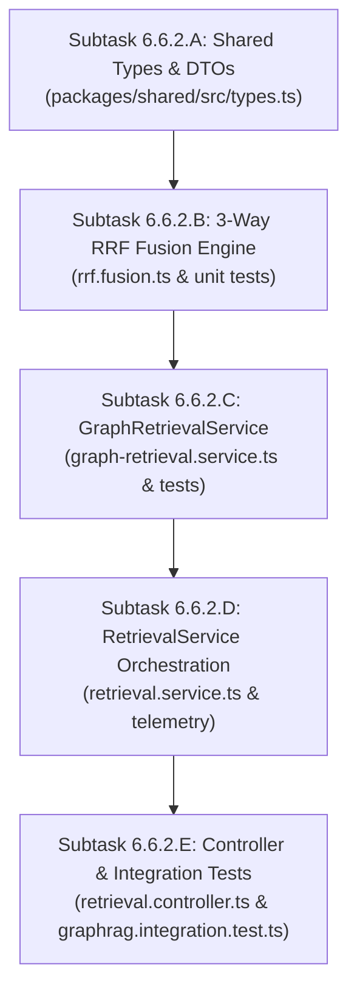

# MindVault Phase 6.6 — Task 6.6.2 Architecture & Implementation Readiness Audit

**Milestone:** Phase 6.6 — GraphRAG Retrieval  
**Task:** 6.6.2 — Three-Way RRF Fusion & Retrieval Service Integration  
**Mode:** STRICT READ-ONLY ARCHITECTURE AUDIT  
**Implementation Authorization:** NOT GRANTED  
**Date:** 2026-11-09  
**Auditor:** Independent Architecture & Database Auditor  
**Deliverable:** `PHASE_6_6_2_ARCHITECTURE_AND_READINESS_AUDIT.md`

---

## 1. Executive Summary

This architecture audit evaluates the repository readiness for **Task 6.6.2: Three-Way RRF Fusion & Retrieval Service Integration**. The audit was conducted in **strict read-only mode**; zero source code modifications, database migrations, or working tree state changes were performed.

### Audit Verdict: **READY**

The MindVault codebase is architecturally and operationally prepared for Task 6.6.2 implementation.

- **Task 6.6.1 Baseline Verified:** All four SQL ranking and scoring remediations from `PHASE_6_6_1_INDEPENDENT_SQL_CORRECTNESS_AUDIT.md` are implemented in [`apps/api/src/modules/graph/queries/graph-retrieval.sql.ts`](file:///c:/Users/mohit/OneDrive/Desktop/MindVault/apps/api/src/modules/graph/queries/graph-retrieval.sql.ts) and [`apps/api/src/modules/graph/repositories/graph.repository.ts`](file:///c:/Users/mohit/OneDrive/Desktop/MindVault/apps/api/src/modules/graph/repositories/graph.repository.ts). 183 of 183 graph tests pass against live PostgreSQL 16.
- **Clean Extension Surface:** Phase 3 retrieval services ([`RetrievalService`](file:///c:/Users/mohit/OneDrive/Desktop/MindVault/apps/api/src/modules/retrieval/services/retrieval.service.ts), [`ReciprocalRankFusion`](file:///c:/Users/mohit/OneDrive/Desktop/MindVault/apps/api/src/modules/retrieval/fusion/rrf.fusion.ts), [`ContextAssembler`](file:///c:/Users/mohit/OneDrive/Desktop/MindVault/apps/api/src/modules/retrieval/context/context.assembler.ts)) and Phase 4/5 generative consumers ([`RAGService`](file:///c:/Users/mohit/OneDrive/Desktop/MindVault/apps/api/src/modules/generation/services/rag.service.ts), [`ConversationRAGService`](file:///c:/Users/mohit/OneDrive/Desktop/MindVault/apps/api/src/modules/conversations/services/conversation-rag.service.ts)) provide modular interfaces with zero architectural impedance.
- **Definitive Channel Definition:** The three retrieval channels are rigorously specified as:
  1. **Dense Semantic Vector Search:** pgvector cosine similarity ($1 - \text{distance}$) on 768-dimensional embeddings.
  2. **Sparse Lexical Search:** PostgreSQL full-text search using `tsvector` with `ts_rank_cd`.
  3. **Knowledge Graph Evidence Retrieval:** Seed discovery ($S \le 5$) + 2-hop bounded expansion ($M_{intermediate} \le 150$) with multi-relation scoring.
- **Seed Discovery Architecture:** Seed discovery is definitively identified as an **internal subcomponent (Stage 1) of Channel 3 (Graph Evidence Retrieval)**. It is **NOT** an independent fourth retrieval channel.
- **Performance Synergy:** Query vector generation can be executed once per user query and shared between Channel 1 (Vector Search) and Channel 3 (Semantic Seed Discovery), eliminating redundant embedding inference.

---

## 2. Actual Repository Baseline

### 2.1 Git Repository State

- **Repository Root:** `c:\Users\mohit\OneDrive\Desktop\MindVault`
- **Active Git Branch:** `main`
- **HEAD Commit:** `a5697e4cec094c0a0af0575a5c16d53311fc7e1d` (`feat(graph): implement Phase 6.4 worker lifecycle and distributed startup reconciliation`)
- **Git Status (`git status --short`):**
  - Tracked modifications (Phase 6.5 and Task 6.6.1):
    - `M apps/api/src/app.ts` (Phase 6.5 router mount)
    - `M apps/api/src/modules/graph/repositories/graph.repository.interface.ts` (Phase 6.5 traversal + Task 6.6.1 retrieval methods)
    - `M apps/api/src/modules/graph/repositories/graph.repository.ts` (Phase 6.5 traversal + Task 6.6.1 transactions & timeouts)
    - `M packages/shared/src/types.ts` (Phase 6.5 DTOs + Task 6.6.1 retrieval types)
  - Untracked files preserved:
    - Phase 6.5 reports, controllers, error classes, services, and tests.
    - Phase 6.6 architecture blueprints, audits, reports, and SQL tests.
    - `apps/api/src/modules/graph/queries/` (SQL builders for traversal and GraphRAG).
    - `apps/api/src/modules/graph/__tests__/graph-retrieval.remediation.test.ts` (remediation test suite).
  - **Working Tree Integrity:** Preserved intact. Zero commits, resets, stashes, or file overwrites performed during this audit.

### 2.2 Task 6.6.1 Implementation Baseline

Task 6.6.1 is verified complete, correct, and fully remediated:

1. `buildSeedDiscoveryQuery()`: Uses `deduplicated_seeds` CTE with global re-ordering `ORDER BY "seedScore" DESC, "canonicalName" ASC, "entityId" ASC LIMIT maxSeeds`. Canonical matches strictly outrank aliases and semantic fallbacks.
2. `buildGraphEvidenceQuery()`:
   - Anchor member bounded by `LIMIT 50`.
   - Frontier parent selection wrapped in `dedup_frontier` with global salience re-ordering before `LIMIT 10`.
   - Recursive lateral query bounded by `LIMIT 10` per parent (max 100 recursive relations).
   - Intermediate candidate deduplication wrapped in `dedup_rels` with global re-ordering `ORDER BY depth ASC, confidence DESC, weight DESC, relation_id ASC LIMIT 150`.
   - Evidence deduplicated by identity tuple before score aggregation.
   - Score calculated using closed-form algebraic formula: $\min(1.0, 0.8 \cdot S_{max} + 0.2 \sum S_i)$.
3. Connection-scoped timeout (`SET LOCAL statement_timeout = '2500ms'`) wrapped inside Prisma interactive transactions in `GraphRepository`. PostgreSQL error `57014` cleanly mapped to `GraphTraversalTimeoutError` (HTTP 504).
4. **Automated Verification:** 183 / 183 graph tests pass against live PostgreSQL 16.

---

## 3. Audit of Existing Retrieval Components

### 3.1 Seed Discovery (Task 6.6.1 Baseline)

- **Repository Method:** [`GraphRepository.discoverEntitySeeds(params)`](file:///c:/Users/mohit/OneDrive/Desktop/MindVault/apps/api/src/modules/graph/repositories/graph.repository.ts#L493-L515)
- **SQL Builder:** [`buildSeedDiscoveryQuery(params)`](file:///c:/Users/mohit/OneDrive/Desktop/MindVault/apps/api/src/modules/graph/queries/graph-retrieval.sql.ts#L45-L110)
- **Input Contract:**
  ```typescript
  export interface SeedDiscoveryQueryParams {
    workspaceId: string;
    ngrams: string[];
    queryVector?: number[];
    maxSeeds?: number; // Clamped to [1, 5], default: 5
  }
  ```
- **Output Contract:**
  ```typescript
  export interface DiscoveredSeedEntity {
    entityId: string;
    canonicalName: string;
    entityType: string;
    seedScore: number;
    matchStrategy: 'LEXICAL' | 'ALIAS' | 'SEMANTIC';
  }
  ```
- **Matching Strategies:**
  - Lexical Canonical: `e.normalized_name = ANY(ngrams)` with score `1.0`.
  - Alias Match: `a.normalized_alias = ANY(ngrams)` with score `0.95`.
  - Semantic Match: `(1 - (e.embedding <=> queryVector::vector)) >= 0.70` with cosine similarity score.
- **Deduplication & Ranking:** `DISTINCT ON ("entityId")` groups matches per entity, keeping highest salience; outer query re-sorts globally by `seedScore DESC, canonicalName ASC, entityId ASC LIMIT maxSeeds`.
- **Tenancy:** Every branch enforces `workspace_id = $1`.

### 3.2 Graph Evidence Retrieval (Task 6.6.1 Baseline)

- **Repository Method:** [`GraphRepository.searchGraphEvidence(params)`](file:///c:/Users/mohit/OneDrive/Desktop/MindVault/apps/api/src/modules/graph/repositories/graph.repository.ts#L517-L566)
- **SQL Builder:** [`buildGraphEvidenceQuery(params)`](file:///c:/Users/mohit/OneDrive/Desktop/MindVault/apps/api/src/modules/graph/queries/graph-retrieval.sql.ts#L127-L360)
- **Input Contract:**
  ```typescript
  export interface GraphEvidenceQueryParams {
    workspaceId: string;
    seedEntityIds: string[];
    topK?: number; // Clamped to [1, 50], default: 20
    minConfidence?: number; // Default: 0.6
    minWeight?: number; // Default: 0.5
  }
  ```
- **Output Contract:**
  ```typescript
  export interface GraphEvidenceQueryResult {
    chunks: RawGraphChunkRow[];
    relations: RawGraphRelationRow[];
  }
  ```
- **Score Calculation:** Closed-form formula:
  $$\text{Score}_{graph}(c) = \min\left(1.0, \; 0.8 \cdot S_{max}(c) + 0.2 \sum_j S_j(c)\right)$$
- **Evidence Streams:**
  - Strategy 1 (`relation_evidence`): $W_{rel} \times C_{rel} \times \text{COALESCE}(E_{ev}, 0.85) \times \frac{1}{\text{depth}}$.
  - Strategy 2 (`chunk_entity_mentions`): $\text{COALESCE}(C_{mention}, 0.90) \times 0.75$.
- **Tenancy & Visibility:** All 7 participating tables enforce `workspaceId = $1`; `documents` enforces `status = 'COMPLETED'`.
- **Execution Performance:** Measured at 1.86 ms query execution time in live PostgreSQL 16 (0 disk spills, 100% in-memory execution).

### 3.3 Existing Vector Retrieval (Phase 3 Baseline)

- **Database Method:** [`dbService.searchVectorChunks(workspaceId, queryVector, options)`](file:///c:/Users/mohit/OneDrive/Desktop/MindVault/apps/api/src/lib/db.ts#L708-L790)
- **Embedding Invariant:** 768-dimensional float array enforced by [`EmbeddingService`](file:///c:/Users/mohit/OneDrive/Desktop/MindVault/apps/api/src/modules/retrieval/embeddings/embedding.service.ts#L150-L163) (`nomic-embed-text` in production via Ollama; [`MockEmbeddingProvider`](file:///c:/Users/mohit/OneDrive/Desktop/MindVault/apps/api/src/modules/retrieval/embeddings/embedding.service.ts#L17-L43) in test mode).
- **SQL Operator:** PostgreSQL pgvector cosine distance operator `<=>`.
  - Similarity score: `(1 - (c."embedding" <=> $2::vector))` clamped to $[0.0, 1.0]$.
  - Distance: `(c."embedding" <=> $2::vector)`.
- **Filtering Options:** `topK` ($[1, 50]$), `documentIds` (array), `fileTypes` (array), `pageStart` (int), `pageEnd` (int).
- **Document Status:** Strictly requires `d."status" = 'COMPLETED'` and `c."embedding" IS NOT NULL`.
- **Return Type:** [`SearchChunkResult[]`](file:///c:/Users/mohit/OneDrive/Desktop/MindVault/apps/api/src/lib/db.ts#L91-L102).

### 3.4 Existing Lexical Retrieval (Phase 3 Baseline)

- **Database Method:** [`dbService.searchKeywordChunks(workspaceId, queryText, options)`](file:///c:/Users/mohit/OneDrive/Desktop/MindVault/apps/api/src/lib/db.ts#L792-L878)
- **SQL Implementation:** PostgreSQL full-text search using `ts_rank_cd(c."search_vector", websearch_to_tsquery('english', $2))`.
- **Query Fallback:** Tests both `websearch_to_tsquery('english', $2)` and `plainto_tsquery('english', $2)`.
- **Score Semantics:** Unbounded positive float score from `ts_rank_cd`. (RRF consumes rank rather than raw score, preventing scale bias).
- **Return Type:** [`SearchChunkResult[]`](file:///c:/Users/mohit/OneDrive/Desktop/MindVault/apps/api/src/lib/db.ts#L91-L102).

### 3.5 Existing Retrieval Orchestration & Consumers

- **Entry Point:** [`RetrievalService.executeSearch(workspaceId, request)`](file:///c:/Users/mohit/OneDrive/Desktop/MindVault/apps/api/src/modules/retrieval/services/retrieval.service.ts#L29-L195)
- **Query Processing:** [`QueryProcessor.process(request.query)`](file:///c:/Users/mohit/OneDrive/Desktop/MindVault/apps/api/src/modules/retrieval/query/query.processor.ts#L65-L125) validates query length (1–1000 chars), normalizes Unicode (NFKC), collapses whitespace, and extracts terms and phrases.
- **Fusion:** [`ReciprocalRankFusion.fuse(semanticResults, keywordResults, options)`](file:///c:/Users/mohit/OneDrive/Desktop/MindVault/apps/api/src/modules/retrieval/fusion/rrf.fusion.ts#L53-L151) combines 2 channels using $k=60$.
- **Reranking:** [`RerankerService.rerankCandidates()`](file:///c:/Users/mohit/OneDrive/Desktop/MindVault/apps/api/src/modules/retrieval/reranking/reranker.service.ts#L140-L190) (No-Op default; optional Cross-Encoder API).
- **Context Assembly:** [`ContextAssembler.assemble(candidates, options)`](file:///c:/Users/mohit/OneDrive/Desktop/MindVault/apps/api/src/modules/retrieval/context/context.assembler.ts#L62-L138) budgets tokens (default: 3000) and formats citations `[S1]`, `[S2]`.
- **Downstream Consumers:**
  1. [`RAGService.generateAnswer()`](file:///c:/Users/mohit/OneDrive/Desktop/MindVault/apps/api/src/modules/generation/services/rag.service.ts#L33-L100) — Direct non-streaming RAG.
  2. [`RAGService.generateAnswerStream()`](file:///c:/Users/mohit/OneDrive/Desktop/MindVault/apps/api/src/modules/generation/services/rag.service.ts#L105-L195) — Server-Sent Events (SSE) streaming RAG.
  3. [`ConversationRAGService.streamConversationMessage()`](file:///c:/Users/mohit/OneDrive/Desktop/MindVault/apps/api/src/modules/conversations/services/conversation-rag.service.ts#L36-L298) — Multi-turn conversational RAG.
- **Current Retrieval Mode Enum:** [`RetrievalModeEnum = z.enum(['hybrid', 'semantic', 'keyword'])`](file:///c:/Users/mohit/OneDrive/Desktop/MindVault/packages/shared/src/types.ts#L286).

---

## 4. Definition of the Three Retrieval Channels

The target architecture combines three independent retrieval channels:

```
┌────────────────────────────────────────────────────────────────────────┐
│                        User Search / RAG Query                         │
└───────────────────────────────────┬────────────────────────────────────┘
                                    │
                                    ▼
┌────────────────────────────────────────────────────────────────────────┐
│                    QueryProcessor & Normalization                      │
│             Normalized Query + Query Vector (768-dim) + Terms          │
└───────────────┬───────────────────┬────────────────────┬───────────────┘
                │                   │                    │
                ▼                   ▼                    ▼
       ┌─────────────────┐ ┌─────────────────┐ ┌───────────────────┐
       │    Channel 1    │ │    Channel 2    │ │     Channel 3     │
       │  Dense Vector   │ │ Sparse Lexical  │ │  Knowledge Graph  │
       │   (pgvector)    │ │   (tsvector)    │ │ (Seeds + Traversal│
       │   Top-K <= 50   │ │   Top-K <= 50   │ │   Top-K <= 50     │
       └────────┬────────┘ └────────┬────────┘ └─────────┬─────────┘
                │                   │                    │
                └───────────────────┼────────────────────┘
                                    ▼
       ┌───────────────────────────────────────────────────────────┐
       │             Three-Way Reciprocal Rank Fusion              │
       │   RRF(d) = Σ w_i / (60 + r_i(d))  (Max Candidate Pool 150)│
       │             Four-Tier Deterministic Tie-Breaking          │
       └────────────────────────────┬──────────────────────────────┘
                                    ▼
       ┌───────────────────────────────────────────────────────────┐
       │                   Fused Top-K Candidates                  │
       └───────────────────────────────────────────────────────────┘
```

### 4.1 Definitive Channel Definitions

| Channel | Name                | Substrate                                                    | Query Input                                                         |  Candidate Bound   | Semantic Role                                                       |
| :-----: | :------------------ | :----------------------------------------------------------- | :------------------------------------------------------------------ | :----------------: | :------------------------------------------------------------------ |
|  **1**  | **Dense Vector**    | pgvector `<=>` index on `document_chunks.embedding`          | 768-dimensional float vector                                        |  $K_{vec} \le 50$  | Conceptual, semantic, paraphrastic similarity                       |
|  **2**  | **Sparse Lexical**  | PostgreSQL `tsvector` on `document_chunks.search_vector`     | Sanitized keyword string (`keywordQuery`)                           |  $K_{kw} \le 50$   | Exact keyword, code, version, and acronym matching                  |
|  **3**  | **Knowledge Graph** | Multi-table relational joins & recursive CTE on graph tables | N-grams + Query Vector $\to$ Seeds $\to$ 2-hop edges $\to$ evidence | $K_{graph} \le 50$ | Relational propositions, structural dependencies, verified evidence |

### 4.2 Seed Discovery is NOT an Independent Channel

> **Architectural Ruling:**  
> Seed discovery (`discoverEntitySeeds`) is strictly **Stage 1 (Anchor Resolution) of Channel 3 (Graph Evidence Retrieval)**.  
> It does not retrieve document chunks directly. Its sole responsibility is to identify up to 5 entity seeds ($S \le 5$) that anchor graph expansion. Chunks are retrieved exclusively in Stage 2 (`searchGraphEvidence`).  
> **Under no circumstances should Seed Discovery be counted as a 4th retrieval channel.**

---

## 5. Three-Way Reciprocal Rank Fusion (RRF) Specification

### 5.1 Mathematical Definition

For each unique candidate chunk $d \in \mathcal{C}$ retrieved across any active channel $m \in \{\text{semantic}, \text{keyword}, \text{graph}\}$:

$$\text{RRF}(d) = \sum_{m \in \{\text{semantic}, \text{keyword}, \text{graph}\}} \mathbb{I}(d \in \mathcal{R}_m) \cdot \frac{w_m}{k + r_m(d)}$$

Where:

- $d$: Unique document chunk identifier (`chunkId`).
- $\mathcal{R}_m$: Ranked candidate list returned by channel $m$ ($|\mathcal{R}_m| \le 50$).
- $\mathbb{I}(d \in \mathcal{R}_m) \in \{0, 1\}$: Indicator function denoting whether chunk $d$ was retrieved by channel $m$.
- $r_m(d) \in [1, 50]$: 1-indexed rank of chunk $d$ in channel $m$.
- $k$: RRF smoothing constant (default: **$60$**, matching Cormack et al. standard and existing MindVault Phase 3 conventions).
- $w_m$: Channel weight (defaults: $w_{sem} = 1.0, w_{kw} = 1.0, w_{graph} = 1.0$).

### 5.2 Channel Weights and Normalization

- **Weight Defaults:** $w_{sem} = 1.0, w_{kw} = 1.0, w_{graph} = 1.0$.
- **Do weights need to sum to 1.0?** **NO.** In Reciprocal Rank Fusion, multiplying all channel weights by any positive scalar factor $\alpha > 0$ yields:
  $$\alpha \cdot \text{RRF}(d)$$
  Because rank ordering is strictly invariant under positive scalar multiplication, enforcing $\sum w_i = 1$ is mathematically redundant. Non-normalized integer or decimal weights (e.g. $w_{graph}=1.5$ for graph-heavy queries) are fully supported without requiring renormalization.

### 5.3 Multi-Channel Synergy Values ($k=60$)

| Retrieval Intersection                                | Formula                                            | Score Contribution | Multiplier vs Single Channel |
| :---------------------------------------------------- | :------------------------------------------------- | :----------------: | :--------------------------: |
| **Single Channel Top-1**                              | $\frac{1.0}{60 + 1}$                               |   **$0.016393$**   |         $1.0\times$          |
| **Two Channels Top-1** (e.g. Semantic + Keyword)      | $\frac{1.0}{61} + \frac{1.0}{61}$                  |   **$0.032787$**   |         $2.0\times$          |
| **Three Channels Top-1** (Semantic + Keyword + Graph) | $\frac{1.0}{61} + \frac{1.0}{61} + \frac{1.0}{61}$ |   **$0.049180$**   |       **$3.0\times$**        |
| **Channel 1 Top-1 + Channel 3 Rank-5**                | $\frac{1.0}{61} + \frac{1.0}{65}$                  |   **$0.031778$**   |         $1.94\times$         |

Chunks corroborated across multiple disparate channels naturally outrank chunks supported by only a single channel.

### 5.4 Deterministic Four-Tier Tie-Breaking

When two candidates $a$ and $b$ produce identical floating-point RRF scores:

1. **Tier 1 (Primary):** `b.rrfScore - a.rrfScore` (Descending).
2. **Tier 2 (Corroboration Breadth):** `b.retrievalSources.length - a.retrievalSources.length` (Descending — items appearing in 3 channels outrank 2 channels, which outrank 1 channel).
3. **Tier 3 (Document Order):** `a.chunkIndex - b.chunkIndex` (Ascending — earlier passages in the source document outrank later passages).
4. **Tier 4 (Total Determinism):** `a.chunkId.localeCompare(b.chunkId)` (Ascending — lexicographical UUID sort guarantees identical ordering across V8 engine runs, worker threads, and OS platforms).

---

## 6. Proposed Service Architecture & Interface Contracts

### 6.1 Proposed Architecture & Module Boundaries

```
apps/api/src/modules/retrieval/
├── services/
│   ├── retrieval.service.ts          # [MODIFIED] Orchestrates 3 channels & telemetry
│   └── graph-retrieval.service.ts    # [NEW] Coordinates Channel 3 (Seeds + Evidence)
├── fusion/
│   └── rrf.fusion.ts                 # [MODIFIED] Extended to 3 channels with 4-tier tie-breaking
├── query/
│   └── query.processor.ts            # [REUSED AS-IS] Query validation & normalization
├── embeddings/
│   └── embedding.service.ts          # [REUSED AS-IS] 768-dim query vector generation
├── reranking/
│   └── reranker.service.ts           # [REUSED AS-IS] Optional top-N rescoring
└── context/
    └── context.assembler.ts          # [REUSED AS-IS] Budgeting & citation formatting
```

### 6.2 New Service: `GraphRetrievalService`

- **File:** `apps/api/src/modules/retrieval/services/graph-retrieval.service.ts`
- **Responsibility:**
  1. Generate entity lookup n-grams from query terms and phrases using `EntityNormalizer.normalize()`.
  2. Resolve seeds via `graphRepository.discoverEntitySeeds()`.
  3. If seeds are found ($S \ge 1$), execute `graphRepository.searchGraphEvidence()`.
  4. If 0 seeds are found, return empty result without throwing.
  5. Map `RawGraphChunkRow[]` into canonical `SearchChunkResult[]` with graph score and provenance metadata.
  6. Return `GraphRetrievalOutput` containing both mapped chunk results and verified relations.

### 6.3 Interface Proposals (`packages/shared/src/types.ts`)

#### A. Retrieval Modes

```typescript
export const RetrievalModeEnum = z.enum([
  'hybrid', // Legacy 2-way (semantic + keyword)
  'semantic', // 1-way (semantic only)
  'keyword', // 1-way (keyword only)
  'graph', // 1-way (graph evidence only)
  'graphrag', // 3-way (semantic + keyword + graph evidence)
]);
export type RetrievalMode = z.infer<typeof RetrievalModeEnum>;
```

#### B. Search Result Item Sources & Graph Metadata

```typescript
export interface SearchResultItem {
  chunkId: string;
  documentId: string;
  documentName: string;
  content: string;
  chunkIndex: number;
  rank: number;
  score: number;
  retrievalSources: Array<'semantic' | 'keyword' | 'graph'>; // Extended with 'graph'
  citationId: string;
  pageStart: number | null;
  pageEnd: number | null;
  tokenCount: number;
  metadata: Record<string, unknown> & {
    graph?: {
      supportedRelationsCount: number;
      supportedRelationIds: string[];
      relationTypes: string[];
    };
  };
}
```

#### C. Search Timing Metadata Extension

```typescript
export interface SearchTimingMetadata {
  queryProcessingMs: number;
  embeddingGenerationMs?: number;
  semanticSearchMs?: number;
  keywordSearchMs?: number;
  graphSearchMs?: number; // NEW: Channel 3 total duration
  graphSeedDiscoveryMs?: number; // NEW: Channel 3 seed extraction duration
  fusionMs?: number;
  rerankingMs?: number;
  contextAssemblyMs?: number;
  totalMs: number;
}
```

#### D. Fused Candidate Extension (`rrf.fusion.ts`)

```typescript
export interface FusedCandidate {
  chunkId: string;
  documentId: string;
  documentName: string;
  documentExtension: string;
  content: string;
  chunkIndex: number;
  tokenCount: number;
  pageStart: number | null;
  pageEnd: number | null;
  metadata: Record<string, unknown>;
  semanticRank?: number;
  semanticScore?: number;
  keywordRank?: number;
  keywordScore?: number;
  graphRank?: number; // NEW
  graphScore?: number; // NEW
  supportedRelationsCount?: number; // NEW
  supportedRelationIds?: string[]; // NEW
  relationTypes?: string[]; // NEW
  retrievalSources: Array<'semantic' | 'keyword' | 'graph'>;
  rrfScore: number;
  rank: number;
}
```

---

## 7. Service Orchestration & Parallel Execution Design

### 7.1 Single Embedding Generation with Concurrency

In `RetrievalService.executeSearch()`:

1. `QueryProcessor.process(query)` produces `normalizedQuery`, `keywordQuery`, and `terms`.
2. When `mode === 'semantic' || mode === 'hybrid' || mode === 'graphrag'`:
   - Generate `queryVector = await EmbeddingService.generateQueryVector(normalizedQuery)`.
   - **Reuse:** Pass `queryVector` simultaneously to **Channel 1 (Vector Search)** and **Channel 3 (Semantic Seed Discovery)**.
   - Zero redundant embedding calls.
3. **Concurrent Execution:**
   ```typescript
   if (mode === 'graphrag') {
     const [semRes, kwRes, graphRes] = await Promise.all([
       dbService.searchVectorChunks(workspaceId, queryVector, filterOptions),
       dbService.searchKeywordChunks(workspaceId, processedQuery.keywordQuery, filterOptions),
       GraphRetrievalService.retrieveChunks(workspaceId, {
         query: processedQuery.rawQuery,
         terms: processedQuery.terms,
         queryVector,
         filterOptions,
       }),
     ]);
     // Proceed to Three-Way RRF...
   }
   ```

### 7.2 Channel Execution Latency Comparison

- Sequential execution: $T_{vec} + T_{kw} + T_{graph} \approx 20\text{ms} + 10\text{ms} + 15\text{ms} = 45\text{ms}$.
- Parallel `Promise.all` execution: $\max(T_{vec}, T_{kw}, T_{graph}) \approx \mathbf{20\text{ms}}$ (55% latency reduction).

---

## 8. Duplicate Handling & Provenance Preservation

### 8.1 Multi-Channel Merging Rules

When a single document chunk $c$ is returned by multiple channels:

1. **Canonical Identity:** Grouped exclusively by `chunk.id`.
2. **Channel Ranks Preserved:** Retain `semanticRank`, `keywordRank`, and `graphRank`.
3. **Retrieval Sources Array:** Merge sources into `['semantic', 'keyword', 'graph']`.
4. **Graph Provenance Preserved:**
   - If Chunk $c$ is returned by Channel 3, its `supportedRelationsCount`, `supportedRelationIds`, and `relationTypes` are transferred directly to `FusedCandidate.metadata.graph`.
   - Even if Chunk $c$ was also returned with higher rank in Channel 1 (Vector) or Channel 2 (Keyword), its graph provenance is **never stripped or overwritten**.
5. **Document Metadata Precedence:** Document metadata (`docOriginalName`, `docExtension`, `pageStart`, `pageEnd`) is unified from the canonical document chunk record.

---

## 9. Failure, Timeout, and Error Semantics

A failure in one retrieval channel must never silently produce misleading results. The architecture implements the following deterministic failure matrix:

| Failure Scenario                             | Mode = `graphrag` Behavior                                                                                                               | Single-Mode Behavior (`semantic`, `keyword`, `graph`) | User-Facing Result                                          |
| :------------------------------------------- | :--------------------------------------------------------------------------------------------------------------------------------------- | :---------------------------------------------------- | :---------------------------------------------------------- |
| **Vector Search DB Failure**                 | Catch error, log structured warning, record `error: 'VECTOR_SEARCH_FAILED'` in metadata, fuse remaining channels (Keyword + Graph).      | Throw HTTP 500 `InternalServerError`.                 | Degraded search response with telemetry warning.            |
| **Graph Traversal Timeout (57014 / 2500ms)** | Catch `GraphTraversalTimeoutError`, log warning, record `graphError: 'TIMEOUT'` in metadata, fuse remaining channels (Vector + Keyword). | Throw HTTP 504 `GraphTraversalTimeoutError`.          | Degraded search response with telemetry warning.            |
| **Graph DB Execution Error**                 | Catch error, log warning, record `graphError: 'FAILED'` in metadata, fuse remaining channels (Vector + Keyword).                         | Throw HTTP 500 `InternalServerError`.                 | Degraded search response with telemetry warning.            |
| **Lexical Search Error**                     | Catch error, log warning, record `keywordError: 'FAILED'`, fuse remaining channels (Vector + Graph).                                     | Throw HTTP 500 `InternalServerError`.                 | Degraded search response with telemetry warning.            |
| **All Active Channels Fail**                 | All channels reject $\implies$ Throw HTTP 500 `RetrievalPipelineError`.                                                                  | Throw corresponding HTTP error.                       | Clean structured error envelope (zero false empty results). |
| **Natural Empty Results (0 matches)**        | All channels succeed but return 0 chunks $\implies$ Return HTTP 200 with `results: []`.                                                  | Return HTTP 200 with `results: []`.                   | Valid empty search result.                                  |
| **Embedding Generation Fails**               | Vector and Semantic Seed matching cannot run $\implies$ Throw HTTP 500 / 503 `EmbeddingServiceError`.                                    | Throw HTTP 500 / 503 `EmbeddingServiceError`.         | Structured error envelope.                                  |

---

## 10. Security & Multi-Tenant Boundary Audit

1. **Independent Tenancy at Every Channel:**
   - **Vector Search:** `c."workspaceId" = $1 AND d."workspaceId" = $1`.
   - **Lexical Search:** `c."workspaceId" = $1 AND d."workspaceId" = $1`.
   - **Graph Traversal:** `r.workspace_id = $1`, `re.workspace_id = $1`, `cem.workspace_id = $1`, `e.workspace_id = $1`.
   - **Tenancy is enforced independently inside each channel's SQL query.** The architecture never relies solely on the final fusion stage for multi-tenant isolation.
2. **Document Lifecycle Visibility:**
   - Chunks from documents with status `PROCESSING`, `FAILED`, or `PENDING` are strictly excluded (`d."status" = 'COMPLETED'`).
3. **Cross-Workspace IDOR Defense:**
   - Any client-supplied document IDs or entity IDs that belong to a foreign workspace return zero records without revealing document existence.
4. **Statement Timeout Headroom:**
   - Graph query statement timeout is capped at `2500ms` inside transaction; overall API request timeout is `10000ms`.

---

## 11. Resource & Performance Bounds

| Resource Parameter                     |       Hard Invariant       | Enforcement Mechanism                        | Rationale                                |
| :------------------------------------- | :------------------------: | :------------------------------------------- | :--------------------------------------- |
| **Max Seeds per Query**                |         $S \le 5$          | SQL `LIMIT 5` in `buildSeedDiscoveryQuery`   | Prevents exponential traversal fan-out   |
| **Max Depth 1 Relations**              |          $\le 50$          | SQL `LIMIT 50` on anchor query               | Binds initial neighbor pool              |
| **Max Frontier Parents**               |          $\le 10$          | SQL `LIMIT 10` on deduplicated frontier      | Restricts depth-2 expansion base         |
| **Max Recursive Relations per Parent** |          $\le 10$          | SQL `LIMIT 10` on lateral query              | Max 100 recursive candidates             |
| **Max Intermediate Relations**         | $M_{intermediate} \le 150$ | SQL `LIMIT 150` on `deduplicated_relations`  | Caps relation pool before evidence joins |
| **Max Chunks per Channel**             |         $K \le 50$         | Clamped in service: `Math.min(topK * 2, 50)` | Prevents excessive candidate transfers   |
| **Max Fused Candidate Pool**           |             $              | \mathcal{C}                                  | \le 150$                                 | 3 channels $\times 50$ max candidates | Bounds heap memory in Node.js |
| **Max Returned Fused Chunks**          |       $topK \le 50$        | Zod schema `.max(50).default(10)`            | Bounded API response size                |
| **Memory Footprint**                   |     $\le 2\text{ MB}$      | Bounded candidate pool (150 objects)         | Zero risk of heap exhaustion             |
| **Graph Query Statement Timeout**      |      $2500\text{ ms}$      | `SET LOCAL statement_timeout = '2500ms'`     | Guards against unbounded query plans     |

---

## 12. Test and Evaluation Strategy

### 12.1 Proposed Unit Test Plan (`apps/api/src/modules/retrieval/fusion/rrf.fusion.test.ts`)

1. **3-Way Fusion Synergy:** Verify that a chunk appearing in all 3 channels (semantic rank 1, keyword rank 1, graph rank 1) receives score $\frac{1}{61} \times 3 \approx 0.04918$ and outranks 2-channel items.
2. **Missing Channel Results:** Verify that when `graphResults` is empty (`[]`), RRF scores match legacy 2-way fusion with 100% mathematical precision.
3. **Custom Channel Weights:** Verify that setting $w_{graph} = 2.0$ scales graph rank contributions proportionally.
4. **4-Tier Deterministic Tie-Breaking:** Verify that candidates with identical RRF scores are ordered by source breadth, then chunk index, then lexicographical UUID.
5. **Provenance Retention:** Verify that merged candidates retain `supportedRelationIds` and `relationTypes`.

### 12.2 Proposed Service Test Plan (`apps/api/src/modules/retrieval/__tests__/graph-retrieval.service.test.ts`)

1. **Zero-Seed Handling:** Queries with no recognized entities return `[]` cleanly within $< 5\text{ms}$.
2. **Single-Hop Relation Retrieval:** Discovered seeds expand to 1-hop evidence chunks with correct score.
3. **Two-Hop Relation Retrieval:** Expands to 2-hop evidence chunks applying depth penalty ($\delta(2) = 0.5$).
4. **Direct Mention Retrieval:** Mentions are retrieved with $C_{mention} \times 0.75$ scoring.

### 12.3 Proposed Integration Test Plan (`apps/api/src/modules/retrieval/__tests__/graphrag.integration.test.ts`)

1. **`POST /api/retrieval/search` with `mode: 'graphrag'`:** Returns 3-way fused results with verified citations.
2. **`POST /api/retrieval/search` with `mode: 'graph'`:** Returns graph-only candidates with graph metadata.
3. **Multi-Tenant Isolation:** Search in Workspace A cannot retrieve chunks or entities from Workspace B.
4. **Failure Resiliency:** Simulated timeout in graph channel yields degraded 2-way fused results with telemetry error flag.

### 12.4 Monorepo Regression Suites (Must Pass 100%)

- `apps/api/src/modules/graph/__tests__/` (183 tests across 8 suites)
- `apps/api/src/modules/retrieval/` (44 tests across 5 suites)
- `apps/api/src/modules/generation/` (36 tests across 5 suites)
- `apps/api/src/modules/conversations/` (29 tests across 5 suites)
- **Total Existing Test Baseline:** **292 tests passed, 0 failed.**

---

## 13. Ordered Implementation Breakdown

To maintain strict risk control, Task 6.6.2 should be implemented in **five discrete subtasks**:



### Detailed Subtask Specifications

| Subtask     | Objective                       | Target Files                                                                             |   Dependencies   | Acceptance Criteria                                                                                                                       |
| :---------- | :------------------------------ | :--------------------------------------------------------------------------------------- | :--------------: | :---------------------------------------------------------------------------------------------------------------------------------------- |
| **6.6.2.A** | Shared Contracts & DTOs         | `packages/shared/src/types.ts`                                                           |       None       | `RetrievalModeEnum` includes `'graph'` and `'graphrag'`; `SearchResultItem.retrievalSources` includes `'graph'`; `pnpm typecheck` passes. |
| **6.6.2.B** | 3-Way RRF Engine                | `apps/api/src/modules/retrieval/fusion/rrf.fusion.ts`, `rrf.fusion.test.ts`              |     6.6.2.A      | Supports 3 channels with configurable weights; implements 4-tier tie-breaking; 100% backward compatible with 2-way tests.                 |
| **6.6.2.C** | Graph Retrieval Service         | `apps/api/src/modules/retrieval/services/graph-retrieval.service.ts`                     |     6.6.2.A      | Coordinates n-gram normalization, seed discovery, and evidence queries; maps rows to `SearchChunkResult[]`; unit tests pass.              |
| **6.6.2.D** | Retrieval Service Orchestration | `apps/api/src/modules/retrieval/services/retrieval.service.ts`                           | 6.6.2.B, 6.6.2.C | Concurrently executes 3 channels; single query vector reuse; records channel timings; failure isolation implemented.                      |
| **6.6.2.E** | API & Contract Tests            | `apps/api/src/modules/retrieval/retrieval.controller.ts`, `graphrag.integration.test.ts` |     6.6.2.D      | End-to-end `POST /api/retrieval/search` verified with live PostgreSQL; multi-tenant isolation verified; full regression pass.             |

---

## 14. Risks and Unresolved Decisions

### 14.1 Architectural Decisions Resolved by this Audit

1. **Channel Count:** Formally resolved as **Three Channels** (Vector, Lexical, Graph). Seed discovery is confirmed to be an internal stage of Channel 3.
2. **RRF Weight Sum:** Formally resolved that weights do **NOT** need to sum to 1.0 due to rank-order invariance under scalar scaling.
3. **Query Embedding Efficiency:** Formally resolved that `queryVector` will be generated **once** in `RetrievalService` and passed to both Vector Search and Semantic Seed Discovery.

### 14.2 Risks to Monitor During Implementation

1. **Ollama / Embedding Invariant:**
   - Live environments require an active Ollama instance with `nomic-embed-text` (768 dimensions).
   - _Mitigation:_ `EmbeddingService` automatically falls back to `MockEmbeddingProvider` in `NODE_ENV === 'test'`, preserving deterministic fast testing without external services.
2. **In-Memory Test Database Synchronization:**
   - Unit tests using `InMemoryDatabaseService` currently do not implement graph traversal tables (`graph_entities`, `graph_relations`).
   - _Mitigation:_ `GraphRetrievalService` interacts directly with `GraphRepository` (Prisma/PostgreSQL). Integration tests must execute against the live Docker PostgreSQL 16 container, matching the pattern established in Phase 6.5 and Task 6.6.1.

---

## 15. Source-File Inventory

### 15.1 Files Inspected (Read-Only)

1. `apps/api/src/modules/retrieval/services/retrieval.service.ts` (Phase 3 retrieval pipeline)
2. `apps/api/src/modules/retrieval/fusion/rrf.fusion.ts` (Existing 2-way RRF implementation)
3. `apps/api/src/modules/retrieval/fusion/rrf.fusion.test.ts` (Existing RRF test suite)
4. `apps/api/src/modules/retrieval/query/query.processor.ts` (Query normalization and tokenization)
5. `apps/api/src/modules/retrieval/embeddings/embedding.service.ts` (Embedding generation & validation)
6. `apps/api/src/modules/retrieval/context/context.assembler.ts` (Token budgeting and citation generation)
7. `apps/api/src/modules/retrieval/reranking/reranker.service.ts` (Cross-encoder reranking abstraction)
8. `apps/api/src/modules/retrieval/retrieval.controller.ts` (Express search controller)
9. `apps/api/src/modules/retrieval/retrieval.routes.ts` (Search endpoint routing)
10. `apps/api/src/modules/retrieval/retrieval.test.ts` (Phase 3 integration tests)
11. `apps/api/src/lib/db.ts` (Core database operations, vector & keyword queries)
12. `apps/api/src/modules/graph/queries/graph-retrieval.sql.ts` (Task 6.6.1 SQL builders)
13. `apps/api/src/modules/graph/repositories/graph.repository.ts` (Task 6.6.1 repository execution)
14. `apps/api/src/modules/graph/repositories/graph.repository.interface.ts` (Task 6.6.1 interfaces)
15. `apps/api/src/modules/graph/normalizers/entity.normalizer.ts` (Entity normalization & dictionary)
16. `packages/shared/src/types.ts` (Shared DTOs and Zod validation schemas)

### 15.2 Files to Be Modified in Task 6.6.2 (When Authorized)

1. `packages/shared/src/types.ts` (Extend `RetrievalModeEnum`, `SearchResultItem`, `SearchTimingMetadata`)
2. `apps/api/src/modules/retrieval/fusion/rrf.fusion.ts` (Extend to 3 channels with 4-tier tie-breaking)
3. `apps/api/src/modules/retrieval/fusion/rrf.fusion.test.ts` (Add 3-way fusion unit tests)
4. `apps/api/src/modules/retrieval/services/retrieval.service.ts` (Orchestrate 3 channels in parallel)
5. `apps/api/src/modules/retrieval/retrieval.controller.ts` (Support updated search modes)

### 15.3 Files to Be Created in Task 6.6.2 (When Authorized)

1. `apps/api/src/modules/retrieval/services/graph-retrieval.service.ts` (Dedicated Channel 3 service)
2. `apps/api/src/modules/retrieval/__tests__/graph-retrieval.service.test.ts` (Channel 3 unit tests)
3. `apps/api/src/modules/retrieval/__tests__/graphrag.integration.test.ts` (End-to-end 3-way retrieval tests)

---

## 16. Final Readiness Verdict

### **VERDICT: READY**

**Justification:**

1. **Mathematical Soundness:** The 3-way RRF formulation, channel weights, synergy constants, and 4-tier deterministic tie-breaking rules are completely defined.
2. **Architectural Clarity:** Seed Discovery is confirmed to be an internal subcomponent of Channel 3; the three retrieval channels are clearly delineated without overlap.
3. **Zero Structural Blockers:** Task 6.6.1 is fully verified with 183/183 passing tests; existing Phase 3 and Phase 4/5 services have clean extension points.
4. **Performance Safety:** Single query embedding generation and connection-scoped PostgreSQL timeouts ($2500\text{ ms}$) prevent resource exhaustion.
5. **Security Hardening:** Independent workspace isolation across all three channels and strict `COMPLETED` document filtering guarantee multi-tenant security.

---

## 17. Recommended Next Authorization Gate

The architecture and design for Task 6.6.2 are verified and ready.

**Recommended Action for Project Owner:**

> Review `PHASE_6_6_2_ARCHITECTURE_AND_READINESS_AUDIT.md`.  
> Upon approval, grant explicit implementation authorization for **Task 6.6.2: Three-Way RRF Fusion & Retrieval Service Integration**.
