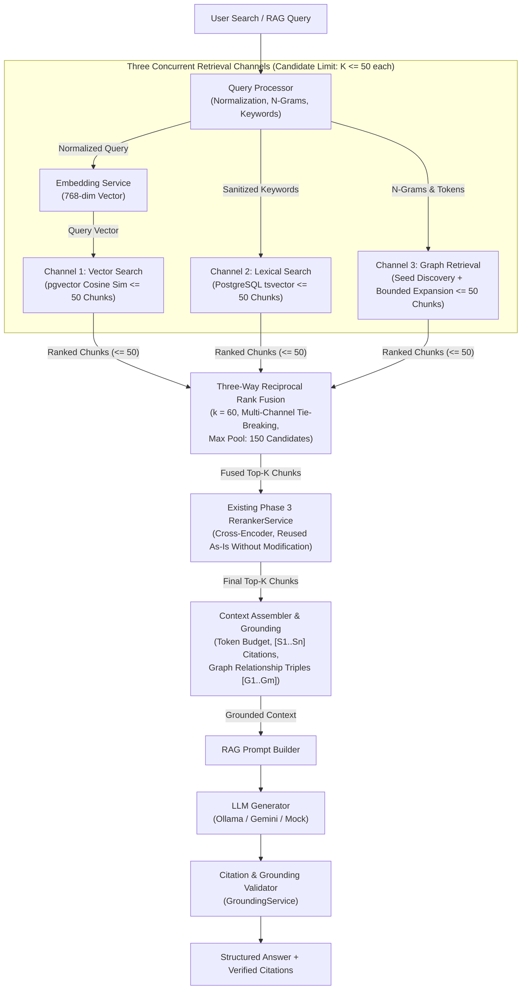
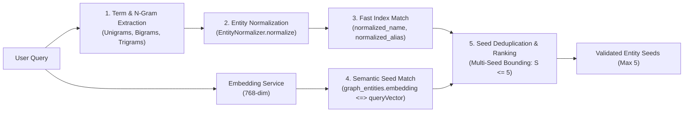
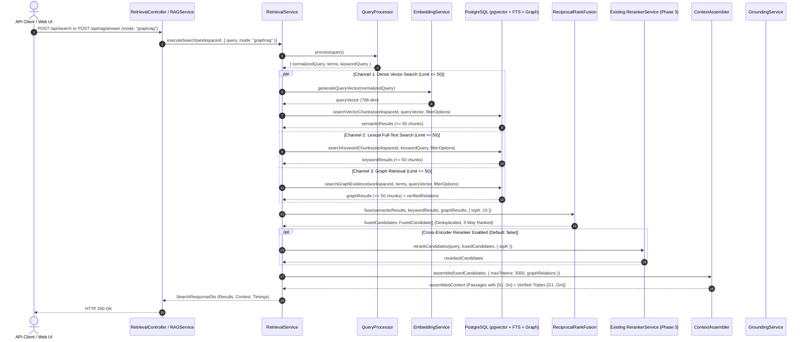

# MindVault Phase 6.6 — GraphRAG Retrieval Architecture Blueprint

**Milestone:** Phase 6.6 — GraphRAG Retrieval  
**Mode:** STRICT ARCHITECTURE & SYSTEM DESIGN SPECIFICATION  
**Status:** BLUEPRINT REFINED (Implementation NOT Authorized)  
**Date:** 2026-11-08

---

## 1. High-Level Architecture & Retrieval Paradigm

MindVault GraphRAG expands the existing two-stage hybrid retrieval system into an integrated **Three-Channel Retrieval and Fusion Architecture**. It combines:

1. **Dense Semantic Retrieval:** Captures implicit conceptual similarity using pgvector 768-dimensional embeddings.
2. **Sparse Lexical Retrieval:** Captures exact keywords, codes, versions, and names using PostgreSQL full-text search (`tsvector` with BM25-like `ts_rank_cd`).
3. **Knowledge Graph Retrieval:** Captures explicit entity relationships, multi-hop dependencies, and verified relational evidence using graph traversal and provenance joins.

These three channels execute concurrently under strict multi-tenant isolation. Each channel retrieves up to 50 ranked candidate chunks ($K_{vec} \le 50, K_{kw} \le 50, K_{graph} \le 50$), pooling up to 150 candidate references. These candidates are fused using an extended **Reciprocal Rank Fusion (RRF)** algorithm ($k=60$) to produce a unified, evidence-grounded context for generative RAG.



---

## 2. Component Design & Specifications

### 2.1 Channel A: Graph Seed Discovery Engine

The Graph Seed Discovery Engine identifies relevant knowledge graph entities referenced directly or implicitly in the user's query.

#### A. Multi-Strategy Seed Extraction Pipeline



#### B. Seed Matching SQL Query Contract

To avoid N+1 round-trips, seed discovery executes as a single parameterized query that combines lexical exact matching against canonical names and alias registry with vector similarity fallback:

```sql
-- Parameters:
-- $1 = workspaceId (text)
-- $2 = normalized_ngram_array (text[])
-- $3 = queryVector (vector)
-- $4 = maxSeeds (int, default: 5)

WITH matched_lexical AS (
    -- Strategy 1: Exact canonical and alias match
    SELECT
        e.id AS entity_id,
        e.canonical_name,
        e.entity_type,
        1.0 AS seed_score,
        'LEXICAL' AS match_strategy
    FROM graph_entities e
    WHERE e.workspace_id = $1
      AND e.normalized_name = ANY($2::text[])

    UNION ALL

    SELECT
        a.entity_id,
        e.canonical_name,
        e.entity_type,
        0.95 AS seed_score,
        'ALIAS' AS match_strategy
    FROM graph_entity_aliases a
    JOIN graph_entities e ON a.entity_id = e.id AND e.workspace_id = $1
    WHERE a.workspace_id = $1
      AND a.normalized_alias = ANY($2::text[])
),
matched_semantic AS (
    -- Strategy 2: Vector similarity on entity embeddings (when populated)
    SELECT
        e.id AS entity_id,
        e.canonical_name,
        e.entity_type,
        (1 - (e.embedding <=> $3::vector)) AS seed_score,
        'SEMANTIC' AS match_strategy
    FROM graph_entities e
    WHERE e.workspace_id = $1
      AND e.embedding IS NOT NULL
      AND (1 - (e.embedding <=> $3::vector)) >= 0.70
    ORDER BY e.embedding <=> $3::vector ASC
    LIMIT $4
),
combined_seeds AS (
    SELECT * FROM matched_lexical
    UNION ALL
    SELECT * FROM matched_semantic
)
SELECT DISTINCT ON (entity_id)
    entity_id,
    canonical_name,
    entity_type,
    seed_score,
    match_strategy
FROM combined_seeds
ORDER BY entity_id, seed_score DESC
LIMIT $4;
```

#### C. Seed Extraction Rules & Invariants

1. **Multi-Tenant Scoping:** Every branch enforces `workspace_id = $1`.
2. **Seed Ceiling:** Strictly capped at $S \le 5$ seeds. Over-expansion degrades precision and inflates latency.
3. **Stop-Word Immunity:** Ignores common English stop-words (`the`, `is`, `at`, `which`) using `QueryProcessor` filtering.

---

### 2.2 Channel B: Bounded Graph Expansion & Evidence Chunk Retrieval

#### A. Global Traversal Work Bound (Issue 1 Resolution)

In multi-seed queries, naive per-node fan-out can lead to combinatorial explosion. For example, $S=5$ seeds each expanding $K_{fanout}=15$ edges at depth 1 yields 75 relations. If those 75 intermediate nodes each expand 15 edges at depth 2, the intermediate candidate pool expands to $75 \times 15 = 1,125$ rows before the final `LIMIT 50` is applied.

To eliminate this vulnerability, the GraphRAG query enforces a **hard global intermediate work ceiling of $M\_{intermediate} \le 150$ relations in SQL**:

1. **Anchor Stage (Depth 1):** Bounded by `LIMIT 50` on the union of seed connections.
2. **Frontier Parent Restriction:** Only the top $P \le 10$ highest-salience distinct neighbor entities from Depth 1 are admitted to the expansion frontier:
   $$\text{Frontier Parents} \le 10$$
3. **Lateral Recursive Limit:** Each frontier parent expands at most 10 candidate edges (`LIMIT 10`), guaranteeing at most $10 \times 10 = 100$ recursive relations.
4. **Intermediate Candidate Deduplication & Pruning:** The `deduplicated_relations` CTE groups by `relation_id` using `DISTINCT ON (relation_id)` and enforces an immutable hard ceiling of **`LIMIT 150`** on the intermediate relation pool before joining evidence tables.
5. **Deterministic Pruning Order:** When candidate relations exceed 150, pruning strictly follows:
   $$\text{ORDER BY } \text{depth ASC}, \; \text{confidence DESC}, \; \text{weight DESC}, \; \text{relation\_id ASC}$$
6. **Final Chunk Bound:** The final result set is capped at **`LIMIT 50`** chunks.

#### B. Production-Grade Parameterized SQL Query (`searchGraphEvidence`)

```sql
-- Parameters:
-- $1 = workspaceId (text)
-- $2 = seed_entity_ids (text[])
-- $3 = topK (int, default: 20, max: 50)
-- $4 = minConfidence (float, default: 0.6)
-- $5 = minWeight (float, default: 0.5)

WITH RECURSIVE graph_expansion AS (
    -- 1. Anchor Member: Depth 1 relations connected to discovered seeds
    SELECT
        r.id AS relation_id,
        r.source_entity_id,
        r.target_entity_id,
        CASE
            WHEN r.source_entity_id = ANY($2::text[]) THEN r.target_entity_id
            ELSE r.source_entity_id
        END AS neighbor_id,
        r.relation_type,
        r.weight,
        r.confidence,
        ARRAY[r.source_entity_id, r.target_entity_id]::text[] AS path,
        1 AS depth
    FROM (
        SELECT r.*
        FROM graph_relations r
        WHERE r.workspace_id = $1
          AND (r.source_entity_id = ANY($2::text[]) OR r.target_entity_id = ANY($2::text[]))
          AND r.confidence >= $4
          AND r.weight >= $5
        ORDER BY r.confidence DESC, r.weight DESC, r.id ASC
        LIMIT 50 -- Global anchor ceiling
    ) r

    UNION ALL

    -- 2. Recursive Member: Depth 2 expansion with restricted frontier and lateral limit
    SELECT
        cand.id AS relation_id,
        cand.source_entity_id,
        cand.target_entity_id,
        CASE
            WHEN cand.source_entity_id = ge.neighbor_id THEN cand.target_entity_id
            ELSE cand.source_entity_id
        END AS neighbor_id,
        cand.relation_type,
        (cand.weight * ge.weight) AS weight,
        LEAST(cand.confidence, ge.confidence) AS confidence,
        (ge.path || CASE
            WHEN cand.source_entity_id = ge.neighbor_id THEN cand.target_entity_id
            ELSE cand.source_entity_id
        END)::text[] AS path,
        ge.depth + 1 AS depth
    FROM (
        -- Restrict expansion frontier to top 10 distinct neighbors by salience
        SELECT DISTINCT ON (neighbor_id)
            neighbor_id,
            weight,
            confidence,
            path,
            depth
        FROM graph_expansion
        WHERE depth = 1
        ORDER BY neighbor_id, confidence DESC, weight DESC
        LIMIT 10
    ) ge
    JOIN LATERAL (
        SELECT r2.*
        FROM graph_relations r2
        WHERE r2.workspace_id = $1
          AND (r2.source_entity_id = ge.neighbor_id OR r2.target_entity_id = ge.neighbor_id)
          AND NOT (
            CASE
                WHEN r2.source_entity_id = ge.neighbor_id THEN r2.target_entity_id
                ELSE r2.source_entity_id
            END = ANY(ge.path)
          )
          AND r2.confidence >= $4
          AND r2.weight >= $5
        ORDER BY r2.confidence DESC, r2.weight DESC, r2.id ASC
        LIMIT 10 -- Per-frontier lateral limit (10 parents x 10 = max 100 relations)
    ) cand ON true
    WHERE ge.depth < 2 -- Clamped strictly to max 2 hops
      AND array_length(ge.path, 1) <= 3
),
deduplicated_relations AS (
    -- Hard global intermediate ceiling: Max 150 relations across all seeds
    SELECT DISTINCT ON (relation_id)
        relation_id,
        source_entity_id,
        target_entity_id,
        relation_type,
        weight,
        confidence,
        depth
    FROM graph_expansion
    ORDER BY relation_id, depth ASC, confidence DESC, weight DESC
    LIMIT 150
),
chunk_evidence_candidates AS (
    -- Strategy 1: Chunks that substantiate traversed relations (Relationship Evidence)
    SELECT
        re.chunk_id,
        re.document_id,
        -- Score: W_rel * C_rel * E_ev * (1 / depth)
        (dr.weight * dr.confidence * COALESCE(re.confidence, 0.85) * (1.0 / dr.depth)) AS raw_score,
        'RELATION_EVIDENCE' AS provenance_type,
        dr.relation_id,
        dr.relation_type,
        dr.source_entity_id,
        dr.target_entity_id,
        dr.depth
    FROM deduplicated_relations dr
    JOIN relation_evidence re ON dr.relation_id = re.relation_id AND re.workspace_id = $1

    UNION ALL

    -- Strategy 2: Chunks that directly mention seed entities (Direct Entity Mention)
    SELECT
        cem.chunk_id,
        c.document_id,
        -- Score: C_mention * 0.75 (dampened)
        (COALESCE(cem.confidence, 0.90) * 0.75) AS raw_score,
        'ENTITY_MENTION' AS provenance_type,
        NULL AS relation_id,
        NULL AS relation_type,
        cem.entity_id AS source_entity_id,
        NULL AS target_entity_id,
        1 AS depth
    FROM chunk_entity_mentions cem
    JOIN document_chunks c ON cem.chunk_id = c.id AND c.workspace_id = $1
    WHERE cem.workspace_id = $1
      AND cem.entity_id = ANY($2::text[])
),
aggregated_chunk_scores AS (
    -- Combine multiple relations supporting the same chunk
    -- Formula: min(1.0, S_max + sum_{j != max} 0.2 * S_j)
    SELECT
        cec.chunk_id,
        cec.document_id,
        LEAST(1.0,
            MAX(cec.raw_score) +
            COALESCE(SUM(CASE WHEN cec.raw_score < max_scores.max_score THEN 0.2 * cec.raw_score ELSE 0.0 END), 0.0)
        ) AS final_graph_score,
        COUNT(DISTINCT cec.relation_id) AS supported_relations_count,
        ARRAY_AGG(DISTINCT cec.relation_id) FILTER (WHERE cec.relation_id IS NOT NULL) AS supported_relation_ids,
        ARRAY_AGG(DISTINCT cec.relation_type) FILTER (WHERE cec.relation_type IS NOT NULL) AS relation_types
    FROM chunk_evidence_candidates cec
    JOIN (
        SELECT chunk_id, MAX(raw_score) AS max_score
        FROM chunk_evidence_candidates
        GROUP BY chunk_id
    ) max_scores ON cec.chunk_id = max_scores.chunk_id
    GROUP BY cec.chunk_id, cec.document_id
)
SELECT
    c.id AS "chunkId",
    c.document_id AS "documentId",
    c.workspace_id AS "workspaceId",
    c.chunk_index AS "chunkIndex",
    c.content,
    c.token_count AS "tokenCount",
    c.page_start AS "pageStart",
    c.page_end AS "pageEnd",
    c.metadata,
    c.created_at AS "createdAt",
    d.original_name AS "docOriginalName",
    d.extension AS "docExtension",
    d.status AS "docStatus",
    d.page_count AS "docPageCount",
    acs.final_graph_score AS "score",
    acs.supported_relations_count AS "supportedRelationsCount",
    acs.supported_relation_ids AS "supportedRelationIds",
    acs.relation_types AS "relationTypes"
FROM aggregated_chunk_scores acs
JOIN document_chunks c ON acs.chunk_id = c.id AND c.workspace_id = $1
JOIN documents d ON acs.document_id = d.id AND d.workspace_id = $1
WHERE d.status = 'COMPLETED'
ORDER BY acs.final_graph_score DESC, c.chunk_index ASC, c.id ASC
LIMIT LEAST(GREATEST($3::int, 1), 50);
```

#### C. Graph Scoring Specification (Issue 2 Resolution)

##### 1. Mathematical Formulation

For each candidate chunk $c$, the final graph retrieval score $\text{Score}_{graph}(c)$ is computed by aggregating the contributions of all relations and entity mentions supported by $c$:

$$\text{Score}_{graph}(c) = \min\left(1.0, \; S_{max}(c) + \sum_{j \neq max} 0.2 \times S_j(c)\right) \in [0.0, 1.0]$$

where:

- $S_{max}(c) = \max_j S_j(c)$ is the highest single evidence contribution.
- $S_j(c)$ is the score contribution of individual evidence item $j$.
- The multiplier $0.2$ provides a compounding multi-relation synergy boost while preventing runaway inflation.
- The outer $\min(1.0, \dots)$ ensures strict bounds within $[0.0, 1.0]$.

##### 2. Individual Evidence Contributions

- **For Relationship Evidence (`relation_evidence`):**
  $$\text{Score}_{relation}(c, r_j) = S_{seed} \times W_{rel} \times C_{rel} \times E_{ev} \times \delta(d)$$
  where:
  - $S_{seed} \in [0.70, 1.0]$ is the seed entity match score ($1.0$ for exact canonical lexical match, $0.95$ for alias match, or cosine similarity for semantic seed match).
  - $W_{rel} \in [0.0, 1.0]$ is the relation weight from `graph_relations.weight`.
  - $C_{rel} \in [0.0, 1.0]$ is the relation confidence from `graph_relations.confidence`.
  - $E_{ev} \in [0.0, 1.0]$ is the evidence confidence from `relation_evidence.confidence` (default: **$0.85$**; fallback if null/unspecified: **$0.50$**).
  - $\delta(d) = \frac{1}{d}$ is the exact depth penalty:
    $$\delta(1) = 1.0, \quad \delta(2) = 0.5$$

- **For Direct Entity Mention Evidence (`chunk_entity_mentions`):**
  $$\text{Score}_{mention}(c) = S_{seed} \times C_{mention} \times 0.75$$
  where:
  - $C_{mention} \in [0.0, 1.0]$ is the mention confidence from `chunk_entity_mentions.confidence` (default: $0.90$).
  - $0.75$ is the dampening coefficient: a chunk merely mentioning an entity is less informative than one substantiating a verified relational proposition.

##### 3. Three Worked Numerical Examples

- **Worked Example 1 (Single 1-hop relation):**
  - Seed match: Lexical canonical match $S_{seed} = 1.0$.
  - Relation: $W_{rel} = 1.0$, $C_{rel} = 0.90$.
  - Evidence: Explicit confidence $E_{ev} = 0.95$.
  - Depth: $d = 1 \implies \delta(1) = 1.0$.
  - Score: $S_1 = 1.0 \times 1.0 \times 0.90 \times 0.95 \times 1.0 = 0.855$.
  - Final Chunk Score: $\text{Score}_{graph}(c) = \min(1.0, 0.855) = \mathbf{0.855}$.

- **Worked Example 2 (Multiple relations at different depths):**
  - Chunk supports two distinct relations:
    - Relation 1 (1-hop): $S_{seed} = 1.0$, $W_{rel} = 1.0$, $C_{rel} = 0.90$, $E_{ev} = 0.95$, $d = 1 \implies S_1 = 0.855$.
    - Relation 2 (2-hop): $S_{seed} = 1.0$, $W_{rel} = 0.80$, $C_{rel} = 0.85$, $E_{ev} = 0.85$ (default), $d = 2 \implies \delta(2) = 0.5$.
      $$S_2 = 1.0 \times 0.80 \times 0.85 \times 0.85 \times 0.5 = 0.289$$
  - Primary component: $S_{max} = S_1 = 0.855$.
  - Secondary component: $0.2 \times S_2 = 0.2 \times 0.289 = 0.0578$.
  - Unclamped sum: $0.855 + 0.0578 = 0.9128$.
  - Final Chunk Score: $\text{Score}_{graph}(c) = \min(1.0, 0.9128) = \mathbf{0.9128} \approx \mathbf{0.913}$.

- **Worked Example 3 (Direct entity mention only):**
  - Seed match: Alias registry match $S_{seed} = 0.95$.
  - Mention: $C_{mention} = 0.90$.
  - Score: $S_{mention} = 0.95 \times 0.90 \times 0.75 = 0.64125$.
  - Final Chunk Score: $\text{Score}_{graph}(c) = \min(1.0, 0.64125) = \mathbf{0.64125} \approx \mathbf{0.641}$.

##### 4. Conversion to 1-Indexed Ranks for RRF

All retrieved graph candidate chunks ($N \le 50$) are ordered deterministically:
$$\text{ORDER BY } \text{final\_graph\_score DESC}, \; \text{chunk\_index ASC}, \; \text{chunk\_id ASC}$$
Each chunk is assigned its ordinal 1-indexed position:
$$r_{graph}(c) \in [1, 50]$$
This rank $r_{graph}(c)$ feeds directly into the Three-Way RRF formula.

---

### 2.3 Channel C: Three-Way Reciprocal Rank Fusion (RRF)

The existing `ReciprocalRankFusion` class is extended to support three independent retrieval channels (`semantic`, `keyword`, `graph`) without duplicating logic.

#### A. Mathematical Formulation

For each candidate chunk $d \in \mathcal{C}$ retrieved across semantic, keyword, and graph channels:

$$\text{RRF}(d) = \sum_{m \in \{\text{semantic}, \text{keyword}, \text{graph}\}} \mathbb{I}(d \in \mathcal{R}_m) \cdot \frac{w_m}{k + r_m(d)}$$

where:

- $k = 60$ (smoothing constant).
- $w_m$ is the channel weight (default: $w_{sem}=1.0, w_{kw}=1.0, w_{graph}=1.0$).
- $r_m(d) \in [1, 50]$ is the 1-indexed rank of chunk $d$ in channel $m$.
- $\mathbb{I}(d \in \mathcal{R}_m)$ indicates whether chunk $d$ was retrieved by channel $m$.

#### B. Candidate Pool Bounds & Synergy

- Each active channel retrieves at most 50 chunks.
- The total deduplicated candidate pool entering fusion is bounded by:
  $$|\mathcal{C}| \le 50 \times 3 = 150 \text{ chunks}$$
- When a chunk is retrieved across multiple channels, its fused score reflects additive synergy:
  - **Single-Channel Top-1:** $\text{RRF} = \frac{1}{61} \approx 0.01639$
  - **Two-Channel Top-1 (Semantic + Keyword):** $\text{RRF} = \frac{1}{61} + \frac{1}{61} \approx 0.03279$
  - **Three-Channel Top-1 (Semantic + Keyword + Graph):** $\text{RRF} = \frac{1}{61} + \frac{1}{61} + \frac{1}{61} \approx 0.04918$

#### C. Deterministic Four-Tier Tie-Breaking

When candidates have identical fused RRF scores, deterministic tie-breaking is enforced:

1. **Tier 1: Fused Score Descending:** Highest $\text{RRF}(d)$ first.
2. **Tier 2: Retrieval Source Breadth Descending:** Chunks appearing in 3 channels rank ahead of 2 channels, which rank ahead of 1 channel.
3. **Tier 3: Document Chunk Index Ascending:** Earlier chunks in a document rank ahead of later chunks (`chunkIndex ASC`).
4. **Tier 4: Lexicographical Chunk UUID Ascending:** `a.chunkId.localeCompare(b.chunkId)` ensures 100% deterministic ranking across concurrent runs and operating systems.

---

### 2.4 Evidence Semantics & Grounding Invariants (Issue 4 & Issue 6 Resolution)

#### A. Formal Evidence Semantics Matrix

MindVault distinguishes between three distinct relational grounding states:

| Evidence Classification     | Schema Source                          | Semantic Meaning                                                                               | Graph Scoring Contribution                                | Permitted in LLM Context? | Prompt Formatting                                                                                          |
| :-------------------------- | :------------------------------------- | :--------------------------------------------------------------------------------------------- | :-------------------------------------------------------- | :-----------------------: | :--------------------------------------------------------------------------------------------------------- |
| **Relationship Evidence**   | `relation_evidence`                    | A specific text passage explicitly substantiating a relational assertion between two entities. | $W_{rel} \times C_{rel} \times E_{ev} \times \frac{1}{d}$ |          **YES**          | Formatted as verified relationship triple `[G_i]` citing the evidence chunk's citation ID `[Source: S_j]`. |
| **Entity Mention Evidence** | `chunk_entity_mentions`                | A text passage mentioning an entity without asserting a specific relationship.                 | $C_{mention} \times 0.75$ (dampened)                      | **YES** (as passage only) | Included in context passages `[S_j]`. **Cannot** be used to synthesize unsupported relationship triples.   |
| **Ungrounded Relation**     | `graph_relations` with 0 evidence rows | A relation exists in the schema but has zero supporting text passages in `relation_evidence`.  | **0.0** (Excluded from chunk retrieval)                   |  **STRICTLY PROHIBITED**  | **Must NEVER enter the prompt context.**                                                                   |

#### B. Multiple Evidence Records & Multiple Relations

1. **Multiple evidence records for a single relation:**
   - When relation $R$ is substantiated by Chunk $C_1$ and Chunk $C_2$, both chunks are retrieved. When $R$ is assembled into prompt context, its citation lists all supporting chunks that survived token budgeting: `[Evidence: S1, S2]`.
2. **Multiple relations supported by a single chunk:**
   - When Chunk $C$ substantiates multiple relations $R_1, R_2, R_3$, Chunk $C$ is emitted only once in `SearchResultItem[]` and `SearchContextDto.sources`. Its graph score receives the compounding multi-relation boost (Blueprint §2.2.C), and its metadata records all supported relation IDs: `supportedRelationIds: [R1, R2, R3]`.

#### C. Formal Citation Grounding Invariant

> **Invariant 6.6.1 (Citation Grounding Invariant):**  
> _A knowledge graph relationship triple $(E\_{source}) \xrightarrow{REL} (E\_{target})$ can enter the LLM prompt context if and only if at least one of its supporting evidence document chunks is present in the final assembled context passages and possesses an active citation identifier $[S_i]$._

#### D. Token Budgeting Eviction Rules

Context assembly strictly observes token budgeting (`maxTokens`):

1. **Passage Budgeting:** Chunks are ordered by RRF rank and admitted into `contextPassages` until the token ceiling is reached.
2. **Relationship Pruning on Eviction:** If token limits force the eviction of all supporting evidence chunks for relationship $R$, relationship $R$ is **automatically dropped** from the prompt context. No relationship can appear in the prompt without a living `[S_i]` citation.
3. **Grounding Validation:** `GroundingService` validates that any citation in the LLM answer resolves to a known `ContextSourceItem.citationId`.

---

## 3. Security, Multi-Tenancy & Performance Invariants

### 3.1 Security & Multi-Tenancy Invariants

1. **Tenant Isolation across All 7 Participating Tables:**
   - Every SQL query takes `workspaceId` as parameter `$1`.
   - Seed discovery, alias resolution, relation traversal, evidence lookup, and chunk retrieval enforce `workspace_id = $1`.
   - Verified schema composite keys prevent cross-tenant foreign key traversal.
2. **Zero IDOR Vulnerability:**
   - Any entity or chunk ID supplied by a client is resolved strictly within `$1`. Foreign workspace entities return 404 `ENTITY_NOT_FOUND` without leaking existence.
3. **No Unsanitized String Interpolation:**
   - All dynamic parameters (ngrams, vectors, thresholds, limits) are passed via parameterized bindings (`$1, $2, \dots`).

### 3.2 Performance & Resource Bounding

1. **Connection-Scoped Statement Timeout:**
   - The graph retrieval query executes inside an interactive transaction with `SET LOCAL statement_timeout = '2500ms'`, consistent with Phase 6.5. SQLSTATE `57014` is caught and mapped to HTTP 504 `GraphTraversalTimeoutError`.
2. **Strict Work Bounds:**
   - Maximum active seeds: $S \le 5$.
   - Depth 1 anchor relations: $\le 50$.
   - Frontier parent neighbors: $\le 10$.
   - Recursive lateral relations: $\le 10$ per parent.
   - Global intermediate relations: $M_{intermediate} \le 150$.
   - Final returned graph chunks: $K_{graph} \le 50$.
3. **Zero External Infrastructure Dependency:**
   - Fully executed within PostgreSQL 16.4 and pgvector. Zero requirement for external graph engines.

---

## 4. End-to-End Execution Flow



---

_End of Architecture Blueprint._
