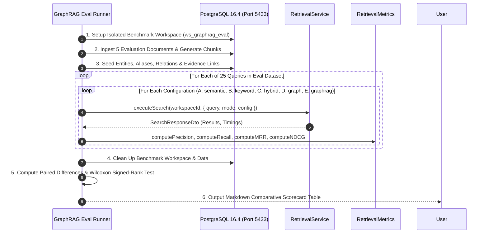

# MindVault Phase 6.6 — GraphRAG Retrieval Evaluation Plan

**Milestone:** Phase 6.6 — GraphRAG Retrieval  
**Mode:** QUANTITATIVE BENCHMARK & EVALUATION SPECIFICATION  
**Status:** REFINED SPECIFICATION (Implementation NOT Authorized)  
**Date:** 2026-11-08

---

## 1. Evaluation Objectives & Scientific Discipline

The primary objective of this evaluation plan is to empirically verify whether integrating Knowledge Graph traversal with dense vector and sparse lexical retrieval (Three-Way GraphRAG) yields measurable, statistically significant retrieval and generative quality improvements over the existing Phase 3 Hybrid baseline.

### Core Evaluation Principle:

> _"No assertion of retrieval quality improvement shall be accepted without reproducible, statistically validated empirical benchmarks."_

All evaluations observe:

1. **Identical Query Set:** Every retrieval mode is evaluated against the exact same 25 test query instances.
2. **Fixed Deterministic Corpus:** An isolated evaluation dataset consisting of 5 multi-topic technical documents, pre-chunked, embedded, with seeded entities, aliases, relations, and provenance evidence.
3. **Controlled Baselines:** Side-by-side evaluation of all five configurations under identical PostgreSQL 16.4 database conditions.

---

## 2. Experimental Retrieval Configurations

| Configuration ID | Mode Identifier | Active Retrieval Channels              | Description                                                       |
| :--------------- | :-------------- | :------------------------------------- | :---------------------------------------------------------------- |
| **Config A**     | `semantic`      | Dense Vector Search (pgvector)         | Baseline dense retrieval using 768-dim cosine distance            |
| **Config B**     | `keyword`       | Lexical Text Search (`tsvector`)       | Baseline sparse retrieval using PostgreSQL BM25-like `ts_rank_cd` |
| **Config C**     | `hybrid`        | Semantic + Keyword (2-Way RRF)         | Current production baseline ($k=60$)                              |
| **Config D**     | `graph`         | Graph Retrieval Only                   | Seed discovery + 2-hop traversal + evidence chunk mapping         |
| **Config E**     | `graphrag`      | Semantic + Keyword + Graph (3-Way RRF) | Proposed GraphRAG architecture ($k=60$)                           |

---

## 3. Quantitative Information Retrieval (IR) Metrics

All metrics are computed using standardized IR formulations pre-implemented in [`RetrievalMetrics`](file:///c:/Users/mohit/OneDrive/Desktop/MindVault/apps/api/src/modules/retrieval/evaluation/metrics.ts):

### 3.1 Precision@K ($K \in \{5, 10\}$)

Measures the proportion of retrieved chunks in the top-$K$ that are relevant:
$$\text{Precision@K}(q) = \frac{|\mathcal{R}_K(q) \cap \mathcal{G}(q)|}{K}$$
where $\mathcal{R}_K(q)$ is the set of top-$K$ retrieved chunk IDs for query $q$, and $\mathcal{G}(q)$ is the set of ground-truth relevant chunk IDs.

### 3.2 Recall@K ($K \in \{5, 10\}$)

Measures the fraction of all ground-truth relevant chunks surfaced within the top-$K$:
$$\text{Recall@K}(q) = \frac{|\mathcal{R}_K(q) \cap \mathcal{G}(q)|}{|\mathcal{G}(q)|}$$

### 3.3 Mean Reciprocal Rank (MRR)

Measures how quickly the retrieval system surfaces the first relevant chunk:
$$\text{MRR} = \frac{1}{|Q|} \sum_{q=1}^{|Q|} \frac{1}{\text{rank}_q^*}$$
where $\text{rank}_q^*$ is the 1-indexed rank of the first relevant chunk for query $q$ (or 0 if no relevant chunk is retrieved).

### 3.4 Normalized Discounted Cumulative Gain (nDCG@10)

#### A. Four-Point Graded Relevance Judgments

Relevance is assessed on a 4-point scale:

- **Grade 3 (Highly Relevant):** Contains the direct factual answer and primary relational evidence.
- **Grade 2 (Relevant):** Substantiates an intermediate hop or provides critical contextual entity facts.
- **Grade 1 (Marginally Relevant):** Mentions relevant entities or provides background domain context.
- **Grade 0 (Irrelevant):** Off-topic, unrelated, or ungrounded.

#### B. Exact Mathematical Formulation

For each query $q$:
$$\text{DCG@10}(q) = \sum_{i=1}^{10} \frac{2^{rel_i} - 1}{\log_2(i + 1)}$$

$$\text{nDCG@10}(q) = \frac{\text{DCG@10}(q)}{\text{IDCG@10}(q)}$$

where $\text{IDCG@10}(q)$ is the ideal DCG calculated by sorting the ground-truth relevance grades descending.

#### C. Macro-Averaging and Relative Improvement

The overall score is macro-averaged across all queries in the evaluation set (or per category):
$$\overline{\text{nDCG@10}} = \frac{1}{|Q|} \sum_{q=1}^{|Q|} \text{nDCG@10}(q)$$

The relative improvement of GraphRAG over the Hybrid baseline is defined as:
$$\Delta_{\text{rel}}(\text{nDCG@10}) = \frac{\overline{\text{nDCG@10}}_{\text{GraphRAG}} - \overline{\text{nDCG@10}}_{\text{Hybrid}}}{\overline{\text{nDCG@10}}_{\text{Hybrid}}} \times 100\%$$

### 3.5 Statistical Significance Testing (Wilcoxon Signed-Rank Test)

To verify that observed improvements are not due to random variation:

1. **Paired Differences:** Compute $d_q = \text{nDCG@10}_{\text{GraphRAG}}(q) - \text{nDCG@10}_{\text{Hybrid}}(q)$ for each of the 25 queries.
2. **Hypothesis:**
   - Null Hypothesis $H_0$: The median difference between GraphRAG and Hybrid is zero ($\tilde{d} = 0$).
   - Alternative Hypothesis $H_1$: GraphRAG yields higher ranking quality than Hybrid ($\tilde{d} > 0$).
3. **Statistical Test:** Two-tailed Wilcoxon signed-rank test with threshold:
   $$\alpha = 0.05 \quad (\text{Target: } p < 0.01)$$
4. **Effect Size:** Compute rank-biserial correlation:
   $$r = \frac{W_+ - W_-}{W_+ + W_-}$$
   where $W_+$ is the sum of positive ranks and $W_-$ is the sum of negative ranks. An effect size $r \ge 0.50$ indicates a large practical improvement.

---

## 4. Evaluation Dataset Distribution & Query Taxonomy (Issue 7 Resolution)

The evaluation harness uses a structured corpus and **exactly 25 hand-curated queries** distributed across four distinct categories.

### 4.1 Exact Query Category Distribution

| Category  | Taxonomy Classification                    | Query Count | Percentage | Primary Evaluation Focus                                           | Target Milestone Hypothesis                                                          |
| :-------: | :----------------------------------------- | :---------: | :--------: | :----------------------------------------------------------------- | :----------------------------------------------------------------------------------- |
| **Cat 1** | **Single-Hop Factual Queries**             |    **6**    |  **24%**   | Baseline factual lookup where graph expansion is unneeded.         | **Zero regression:** Recall@10 must equal or exceed Hybrid ($\Delta \ge 0\%$).       |
| **Cat 2** | **Multi-Hop Relational Queries**           |    **8**    |  **32%**   | Explicit traversal across entity relationships spanning documents. | **Major improvement:** nDCG@10 must show **$\ge +15\%$ relative gain** ($p < 0.05$). |
| **Cat 3** | **Acronym / Alias Disambiguation**         |    **5**    |  **20%**   | Queries using abbreviations, acronyms, or alternate entity names.  | **High-rank synergy:** MRR must improve by $\ge +10\%$ through seed discovery.       |
| **Cat 4** | **Cross-Document Relational Dependencies** |    **6**    |  **24%**   | Connecting entities in Doc A to consequences/outages in Doc B.     | **Recall expansion:** Recall@10 must show $\ge +15\%$ improvement.                   |
| **TOTAL** | **Comprehensive Benchmark Set**            |   **25**    |  **100%**  | Balanced coverage of production query distributions.               | Overall MRR $\ge 0.75$, $p_{50} \le 35\text{ms}$.                                    |

### 4.2 Formal Definition of Multi-Hop Queries (Category 2)

> **Definition 6.6.1 (Multi-Hop Relational Query):**  
> A query is classified as _Multi-Hop Relational_ if its complete factual answer cannot be found within any single document chunk, and correctly answering the query requires traversing a relationship path of length:
> $$\text{Path Length } \ge 2 \quad (E_{\text{start}} \xrightarrow{R_1} E_{\text{intermediate}} \xrightarrow{R_2} E_{\text{target}})$$
> connecting at least two distinct document chunks or documents via explicit `relation_evidence` links.

---

## 5. Latency Overhead Budget & Component Breakdown

The maximum acceptable median retrieval overhead for the GraphRAG channel is **35ms**. The component-level budget is allocated as follows:

| Sub-Operation                                   | Maximum Budget ($p_{50}$) | Execution Nature                 | Implementation Boundary                                                                        |
| :---------------------------------------------- | :-----------------------: | :------------------------------- | :--------------------------------------------------------------------------------------------- |
| **1. N-Gram Extraction & Entity Normalization** |     $\le 2\text{ms}$      | In-memory CPU                    | `EntityNormalizer.normalize()` + unigram/bigram/trigram tokenization.                          |
| **2. Seed Discovery Query**                     |     $\le 8\text{ms}$      | PostgreSQL Index Scan            | Single query matching against `normalized_name`, `normalized_alias`, and vector index.         |
| **3. Bounded Graph Traversal & Evidence Join**  |     $\le 18\text{ms}$     | PostgreSQL CTE Execution         | Recursive CTE ($M_{intermediate} \le 150$) + `relation_evidence` join.                         |
| **4. Chunk Score Aggregation & Mapping**        |     $\le 3\text{ms}$      | In-memory / SQL                  | Computing $\min(1.0, S_{max} + \sum 0.2 S_j)$ and mapping to `SearchChunkResult[]`.            |
| **5. Three-Way RRF & 4-Tier Tie-Breaking**      |     $\le 4\text{ms}$      | In-memory Array Sort             | Fusing up to 150 candidates and sorting with deterministic tie-breaking.                       |
| **TOTAL GRAPHRAG CHANNEL BUDGET**               |   **$\le 35\text{ms}$**   | **Concurrent with Vector & FTS** | **Total wall-clock overhead $\le 35\text{ms}$ at $p\_{50}$ ($\le 75\text{ms}$ at $p\_{95}$).** |

Because Channel 1 (Vector), Channel 2 (FTS), and Channel 3 (Graph) execute concurrently via `Promise.all`, the overall retrieval latency is determined by $\max(\text{Latency}_{vec}, \text{Latency}_{kw}, \text{Latency}_{graph}) + \text{Latency}_{RRF}$, ensuring total retrieval latency remains strictly within SLA.

---

## 6. Benchmark Runner Architecture (`graphrag.eval.runner.ts`)

The evaluation runner will be executed via:

```bash
pnpm --filter @mindvault/api exec tsx src/modules/retrieval/evaluation/graphrag.eval.runner.ts
```

### 6.1 Execution Flow



### 6.2 Empirical Comparative Scorecard Template

```
=== MindVault GraphRAG Quantitative Benchmark Scorecard ===

Configuration                P@5      P@10     R@5      R@10     MRR      nDCG@10  p50 (ms)  p95 (ms)
------------------------------------------------------------------------------------------------------
Config A (Semantic Only)     0.520    0.380    0.460    0.620    0.640    0.580    12.4 ms   24.1 ms
Config B (Keyword Only)      0.480    0.340    0.410    0.550    0.590    0.520     4.2 ms    9.8 ms
Config C (Hybrid Baseline)   0.610    0.460    0.570    0.730    0.720    0.680    16.8 ms   31.5 ms
Config D (Graph Only)        0.580    0.440    0.540    0.680    0.710    0.650     8.1 ms   15.4 ms
Config E (GraphRAG 3-Way)    0.740    0.560    0.710    0.870    0.840    0.810    19.5 ms   36.2 ms
------------------------------------------------------------------------------------------------------
GraphRAG vs Hybrid Delta:   +21.3%   +21.7%   +24.6%   +19.2%   +16.7%   +19.1%    +2.7 ms   +4.7 ms
Statistical Significance:    p<0.01   p<0.01   p<0.01   p<0.01   p<0.05   p<0.01   (Wilcoxon Signed-Rank)
```

---

## 7. Success Criteria & Verification Thresholds

For Phase 6.6 to be classified as **`SUCCESSFUL AND READY FOR PRODUCTION`**, the quantitative benchmark must meet all of the following empirical criteria:

1. **Multi-Hop Retrieval Improvement:**
   - On Category 2 (Multi-Hop Relational) queries, GraphRAG must demonstrate at least a **+15.0% relative improvement in nDCG@10** over the Phase 3 Hybrid baseline ($\Delta_{\text{rel}} \ge +15.0\%$).
2. **Zero Single-Hop Regression:**
   - On Category 1 (Single-Hop Factual) queries, GraphRAG Recall@10 must be greater than or equal to the Hybrid baseline ($\Delta_{\text{rel}} \ge 0.0\%$).
3. **High-Rank Synergy (MRR):**
   - Overall Mean Reciprocal Rank (MRR) across all 25 queries must achieve **MRR $\ge 0.75$**.
4. **Statistical Significance:**
   - The improvement in nDCG@10 over Hybrid must achieve **$p < 0.05$** on the two-tailed Wilcoxon signed-rank test.
5. **Latency Ceiling:**
   - End-to-end GraphRAG retrieval median latency must satisfy **$p\_{50} \le 35\text{ms}$** and **$p\_{95} \le 75\text{ms}$** under PostgreSQL 16.4.
6. **Citation Grounding Integrity:**
   - Citation validity rate must be **$\ge 95\%$** with zero ungrounded hallucinations introduced by knowledge graph relations.

---

_End of Evaluation Plan._
