# MindVault Phase 6.6 — GraphRAG Retrieval Task Breakdown

**Milestone:** Phase 6.6 — GraphRAG Retrieval  
**Mode:** TASK-BY-TASK IMPLEMENTATION SPECIFICATION  
**Status:** REFINED SPECIFICATION (Implementation NOT Authorized)  
**Date:** 2026-11-08

---

## 1. Overview & Phased Roadmap

Phase 6.6 is partitioned into **six atomic, sequentially auditable tasks**. Each task defines strict inputs, outputs, error handling, test requirements, and an explicit **Human Authorization Gate** before the subsequent task may commence.

```mermaid
flowchart TD
    Audit["Phase 6.6 Architecture Approval\n(Human Gate 0)"] --> T1["Task 6.6.1: Seed Discovery & Graph Evidence Repository\n(SQL Query Builders, GraphRepository, Timeout Mapping)"]
    T1 --> G1{"Human Gate 1"}
    G1 -->|Approved| T2["Task 6.6.2: Graph Retrieval Channel Service\n(GraphRetrievalService, Scoring & Deduplication)"]
    T2 --> G2{"Human Gate 2"}
    G2 -->|Approved| T3["Task 6.6.3: Three-Way Reciprocal Rank Fusion\n(ReciprocalRankFusion Extension, 4-Tier Tie-Breaking)"]
    T3 --> G3{"Human Gate 3"}
    G3 -->|Approved| T4["Task 6.6.4: Retrieval Service Orchestration & API\n(RetrievalService, SearchController, Routes, DTOs)"]
    T4 --> G4{"Human Gate 4"}
    G4 -->|Approved| T5["Task 6.6.5: Graph Context Assembly & Grounded RAG\n(ContextAssembler, Token Budgeting, RAGPromptBuilder)"]
    T5 --> G5{"Human Gate 5"}
    G5 -->|Approved| T6["Task 6.6.6: Quantitative Evaluation & Verification\n(Benchmark Dataset & Runner, IR Metrics, Full Monorepo Check)"]
    T6 --> FinalGate["Phase 6.6 Final Approval & Milestone Closure"]
```



---

## 2. Task-by-Task Implementation Specifications

---

### Task 6.6.1: Seed Discovery & Graph Evidence Repository Query

#### 1. Objective

Implement the production parameterized PostgreSQL query builders and repository methods to execute seed discovery and graph evidence chunk retrieval within an interactive transaction with a connection-scoped statement timeout, mapping timeout errors cleanly.

#### 2. Architectural Role of Database Layers (Issue 8 Resolution)

- **Role of `GraphRepository`:** Primary host for graph retrieval query execution. `GraphRepository.searchGraphEvidence()` encapsulates the complex recursive CTE, parameter binding, interactive transaction, and statement timeout.
- **Role of `apps/api/src/lib/db.ts`:** `db.ts` hosts core document, chunk, vector, and keyword queries. Complex graph traversal logic **must not bloat `db.ts`**. `GraphRetrievalService` will directly invoke `graphRepository.searchGraphEvidence()`. If desired for consistency with existing retrieval patterns, an optional lightweight delegation wrapper `dbService.searchGraphChunks()` may be provided, simply forwarding calls to `graphRepository`.

#### 3. Scope & Target Files

- **Create:** `apps/api/src/modules/graph/queries/graph-retrieval.sql.ts`
  - Parameterized `buildSeedDiscoveryQuery()`: matches n-grams against canonical and alias names, with vector fallback ($S \le 5$).
  - Parameterized `buildGraphEvidenceQuery()`: implements the authorized SQL template from Blueprint §2.2.B with:
    - Depth 1 anchor limit: 50.
    - Frontier parent restriction: $\le 10$ neighbors.
    - Lateral recursive limit: $\le 10$ per parent.
    - Hard intermediate ceiling: $M_{intermediate} \le 150$ relations via `LIMIT 150` on `deduplicated_relations`.
    - Deterministic candidate pruning: `depth ASC, confidence DESC, weight DESC, relation_id ASC`.
    - Final chunk limit: $K_{graph} \le 50$.
- **Modify:** `apps/api/src/modules/graph/repositories/graph.repository.interface.ts`
  - Define contracts:
    ```typescript
    export interface GraphEvidenceQueryParams {
      workspaceId: string;
      seedEntityIds: string[];
      topK?: number; // default 20, max 50
      minConfidence?: number; // default 0.6
      minWeight?: number; // default 0.5
    }

    export interface RawGraphChunkRow {
      chunkId: string;
      documentId: string;
      workspaceId: string;
      chunkIndex: number;
      content: string;
      tokenCount: number;
      pageStart: number | null;
      pageEnd: number | null;
      metadata: Record<string, unknown>;
      createdAt: Date;
      docOriginalName: string;
      docExtension: string;
      docStatus: string;
      docPageCount: number | null;
      score: number;
      supportedRelationsCount: number;
      supportedRelationIds: string[];
      relationTypes: string[];
    }

    export interface RawGraphRelationRow {
      relationId: string;
      sourceEntityId: string;
      sourceCanonicalName: string;
      targetEntityId: string;
      targetCanonicalName: string;
      relationType: string;
      weight: number;
      confidence: number;
      depth: number;
      evidenceChunkIds: string[];
    }

    export interface GraphEvidenceQueryResult {
      chunks: RawGraphChunkRow[];
      relations: RawGraphRelationRow[];
    }

    export interface IGraphRepository {
      // ... existing Phase 6.5 methods ...
      searchGraphEvidence(params: GraphEvidenceQueryParams): Promise<GraphEvidenceQueryResult>;
      discoverEntitySeeds(
        workspaceId: string,
        ngrams: string[],
        queryVector?: number[],
        maxSeeds?: number,
      ): Promise<DiscoveredSeedEntity[]>;
    }
    ```
- **Modify:** `apps/api/src/modules/graph/repositories/graph.repository.ts`
  - Implement `searchGraphEvidence` inside an interactive Prisma transaction:
    ```typescript
    return await this.prisma.$transaction(async (tx) => {
      await tx.$executeRawUnsafe(`SET LOCAL statement_timeout = '2500ms'`);
      // execute parameterized query...
    });
    ```
  - Map PostgreSQL error code `57014` (`query_canceled`) to `GraphTraversalTimeoutError` (HTTP 504), preventing unhandled database crashes.

#### 4. Prerequisites

- Phase 6.5 completion verified and milestone closed.
- PostgreSQL 16.4 and Prisma schema operational.

#### 5. Verification & Testing

- Unit and integration tests in `apps/api/src/modules/graph/__tests__/graph-retrieval.repository.test.ts`:
  - Lexical seed discovery against canonical names and aliases.
  - Multi-seed resolution respecting $S \le 5$.
  - Enforcement of intermediate ceiling $M_{intermediate} \le 150$.
  - Correct execution of 2-hop bounded traversal and evidence joins.
  - Strict workspace isolation: zero cross-workspace entities or chunks returned.
  - Timeout enforcement: queries exceeding statement timeout cleanly throw `GraphTraversalTimeoutError`.

#### 6. Human Authorization Gate

- **GATE 1:** Submit Task 6.6.1 implementation report and test results. Do not begin Task 6.6.2 without explicit human authorization.

---

### Task 6.6.2: Graph Retrieval Channel Service (`GraphRetrievalService`)

#### 1. Objective

Build the dedicated `GraphRetrievalService` that coordinates query n-gram extraction, seed entity resolution, bounded graph expansion via `GraphRepository`, chunk score normalization, and mapping to canonical `SearchChunkResult[]`.

#### 2. Scope & Target Files

- **Create:** `apps/api/src/modules/retrieval/services/graph-retrieval.service.ts`
  - Implements `GraphRetrievalService.retrieveChunks(workspaceId, query, options)`.
  - Coordinates n-gram extraction using `EntityNormalizer.normalize()`.
  - Resolves seeds using `graphRepository.discoverEntitySeeds()`.
  - Calls `graphRepository.searchGraphEvidence()`.
  - Computes final graph chunk scores using the authorized mathematical formula:
    $$\text{Score}_{graph}(c) = \min\left(1.0, \; S_{max}(c) + \sum_{j \neq max} 0.2 \times S_j(c)\right)$$
  - Ranks chunks deterministically and assigns 1-indexed ranks $r_{graph}(c) \in [1, 50]$.
  - Formats supporting relationship triples for downstream context assembly.
- **Modify:** `packages/shared/src/types.ts`
  - Define `GraphRetrievalOptions`, `GraphEvidenceMetadata`, and `GraphRelationTripleDto`.

#### 3. Prerequisites

- Task 6.6.1 completed, verified, and authorized by human gate.

#### 4. Verification & Testing

- Unit tests in `apps/api/src/modules/retrieval/__tests__/graph-retrieval.service.test.ts`:
  - Graceful handling of queries with 0 matching entities (returns empty array without throwing).
  - Exact score calculation matching the 3 worked examples in Blueprint §2.2.C.
  - Multi-relation compounding score boost verification.
  - Deterministic sorting and rank assignment $r_{graph}(c) \in [1, 50]$.
  - Output contract perfectly satisfies `SearchChunkResult[]`.

#### 5. Human Authorization Gate

- **GATE 2:** Submit Task 6.6.2 implementation report and test results. Do not begin Task 6.6.3 without explicit human authorization.

---

### Task 6.6.3: Three-Way Reciprocal Rank Fusion (RRF) Extension

#### 1. Objective

Extend the existing `ReciprocalRankFusion` class to support three independent retrieval channels (`semantic`, `keyword`, `graph`) with additive score synergy and four-tier deterministic tie-breaking.

#### 2. Scope & Target Files

- **Modify:** `apps/api/src/modules/retrieval/fusion/rrf.fusion.ts`
  - Extend `FusedCandidate` with `graphRank?: number`, `graphScore?: number`, and `retrievalSources: Array<'semantic' | 'keyword' | 'graph'>`.
  - Update `ReciprocalRankFusion.fuse()` signature to accept optional `graphResults?: SearchChunkResult[]`:
    $$\text{RRF}(d) = \sum_{m \in \{\text{semantic}, \text{keyword}, \text{graph}\}} \mathbb{I}(d \in \mathcal{R}_m) \cdot \frac{w_m}{k + r_m(d)}$$
  - Implement 4-tier deterministic tie-breaking:
    1. `rrfScore` descending.
    2. `retrievalSources.length` descending.
    3. `chunkIndex` ascending.
    4. `chunkId.localeCompare(b.chunkId)` ascending.
- **Modify:** `packages/shared/src/types.ts`
  - Update `SearchResultItem.retrievalSources` to include `'graph'`.

#### 3. Prerequisites

- Task 6.6.2 completed, verified, and authorized by human gate.

#### 4. Verification & Testing

- Unit tests in `apps/api/src/modules/retrieval/fusion/rrf.fusion.test.ts`:
  - 100% backward compatibility: 2-way fusion (`semantic` + `keyword`) yields identical scores and rankings to existing Phase 3 tests.
  - 3-way fusion synergy: items present in all 3 channels rank higher than items in 2 channels or 1 channel.
  - Deterministic tie-breaking across identical RRF scores.
  - Truncation to `topK`.

#### 5. Human Authorization Gate

- **GATE 3:** Submit Task 6.6.3 implementation report and test results. Do not begin Task 6.6.4 without explicit human authorization.

---

### Task 6.6.4: Retrieval Service Orchestration & API Integration

#### 1. Objective

Integrate the Graph Retrieval channel and Three-Way RRF into `RetrievalService.executeSearch`, expand shared schemas to support `mode: 'graph'` and `mode: 'graphrag'`, and expose updated API routes.

#### 2. Scope & Target Files

- **Modify:** `packages/shared/src/types.ts`
  - Update `RetrievalModeEnum`: `z.enum(['hybrid', 'semantic', 'keyword', 'graph', 'graphrag'])`.
  - Update `SearchTimingMetadata` to include `graphSearchMs?: number` and `graphSeedDiscoveryMs?: number`.
- **Modify:** `apps/api/src/modules/retrieval/services/retrieval.service.ts`
  - Concurrently trigger Channel 1 (Vector), Channel 2 (Keyword), and Channel 3 (Graph) via `Promise.all` when `mode === 'graphrag'`.
  - Handle single-channel `mode === 'graph'`.
  - Delegate to `ReciprocalRankFusion.fuse()` with all active channel results.
  - Record fine-grained channel timings in telemetry.
- **Modify:** `apps/api/src/modules/retrieval/retrieval.controller.ts` & `retrieval.routes.ts`
  - Validate incoming requests with updated `SearchRequestSchema`.
  - Return canonical `SearchResponseDto`.

#### 3. Prerequisites

- Task 6.6.3 completed, verified, and authorized by human gate.

#### 4. Verification & Testing

- Integration tests in `apps/api/src/modules/retrieval/__tests__/graphrag.integration.test.ts`:
  - `POST /api/search` with `mode: 'graph'` returns graph-retrieved chunks.
  - `POST /api/search` with `mode: 'graphrag'` executes 3 channels concurrently and returns 3-way fused chunks.
  - Telemetry validation: `graphSearchMs` accurately recorded.
  - Workspace isolation: cross-tenant search requests return zero results.

#### 5. Human Authorization Gate

- **GATE 4:** Submit Task 6.6.4 implementation report and test results. Do not begin Task 6.6.5 without explicit human authorization.

---

### Task 6.6.5: Graph Context Assembly & Grounded RAG Generation

#### 1. Objective

Extend `ContextAssembler` to assemble verified relational triples alongside text passages, enforce the Citation Grounding Invariant and token budgeting eviction rules, update `RAGPromptBuilder`, and verify end-to-end grounded generation.

#### 2. Scope & Target Files

- **Modify:** `apps/api/src/modules/retrieval/context/context.assembler.ts`
  - Accept supporting `graphRelations?: GraphRelationTripleDto[]`.
  - Map relations to active citation identifiers (`[S1]`, `[S2]`).
  - Enforce Invariant 6.6.1: if all evidence chunks for a relation are evicted during token budgeting, automatically drop the relation triple from context.
- **Modify:** `apps/api/src/modules/generation/prompts/rag.prompt.ts`
  - Format `KNOWLEDGE GRAPH RELATIONSHIPS (VERIFIED TRIPLETS)` section in prompt when verified relations are present.
- **Modify:** `apps/api/src/modules/generation/services/rag.service.ts`
  - Pass `mode: 'graphrag'` and supporting graph relations to context assembler.
- **Modify:** `apps/api/src/modules/generation/services/grounding.service.ts`
  - Validate that citations in generated answers resolve to valid `ContextSourceItem.citationId` entries.

#### 3. Prerequisites

- Task 6.6.4 completed, verified, and authorized by human gate.

#### 4. Verification & Testing

- Integration tests in `apps/api/src/modules/generation/generation.test.ts`:
  - Assembled context includes passages and verified relation triples.
  - Token budgeting eviction test: verify evicted chunks drop associated relation triples.
  - LLM prompt format conforms to specification.
  - Grounding validator confirms citations and flags hallucinations.

#### 5. Human Authorization Gate

- **GATE 5:** Submit Task 6.6.5 implementation report and test results. Do not begin Task 6.6.6 without explicit human authorization.

---

### Task 6.6.6: Quantitative Evaluation, Benchmarking & Verification

#### 1. Objective

Implement the quantitative evaluation harness comparing `semantic`, `keyword`, `hybrid`, `graph`, and `graphrag` retrieval modes across 25 curated queries, compute empirical IR metrics (Precision, Recall, MRR, nDCG@10), execute statistical significance tests, and perform full monorepo regression checks.

#### 2. Scope & Target Files

- **Create:** `apps/api/src/modules/retrieval/evaluation/graphrag.eval.dataset.ts`
  - 25 hand-curated queries distributed across 4 categories (Single-Hop: 6, Multi-Hop: 8, Acronym/Alias: 5, Cross-Document: 6).
  - Graded relevance judgments ($rel \in \{0, 1, 2, 3\}$).
- **Create:** `apps/api/src/modules/retrieval/evaluation/graphrag.eval.runner.ts`
  - Automated benchmark runner testing all 5 configurations.
  - Computes Precision@5/10, Recall@5/10, MRR, nDCG@5/10, and latency percentiles ($p_{50}, p_{95}$).
  - Runs Wilcoxon signed-rank test comparing `graphrag` vs `hybrid`.
- **Deliverable:** `PHASE_6_6_VERIFICATION_REPORT.md`
  - Comprehensive empirical scorecard, statistical analysis, and milestone closure report.

#### 3. Prerequisites

- Tasks 6.6.1–6.6.5 completed, verified, and authorized by human gates.

#### 4. Verification & Testing

- Monorepo full verification:
  - `pnpm test` (all 55+ test suites passing).
  - `pnpm typecheck` (zero TypeScript errors).
  - `pnpm lint` (zero ESLint warnings/errors).
  - `pnpm build` (production build succeeds).

#### 5. Final Milestone Gate

- **FINAL GATE:** Present `PHASE_6_6_VERIFICATION_REPORT.md` and await human sign-off to officially close Phase 6.6.

---

_End of Task Breakdown._
