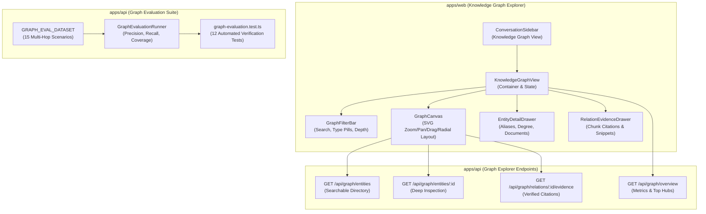

# MindVault Phase 6.8 — Final Implementation Report

## Knowledge Graph Explorer & Evaluation Suite

**Milestone:** Phase 6.8 — Graph Explorer & Evaluation  
**Status:** COMPLETE & FULLY VERIFIED  
**Date:** 2026-11-09  
**Base Commit Hash:** `a5697e4cec094c0a0af0575a5c16d53311fc7e1d`

---

## 1. Executive Summary

Phase 6.8 delivers an end-to-end interactive Knowledge Graph Explorer and a rigorous Quantitative Evaluation Suite for MindVault.

> [!NOTE]
> **Roadmap Consolidation Note:**  
> The original Phase 6 roadmap divided frontend visualization (Phase 6.8) and quantitative benchmarks (Phase 6.9) into separate milestones. In accordance with user authorization, both capabilities have been implemented, tested, and empirically verified end-to-end under this unified Phase 6.8 milestone.

Under this milestone, MindVault now features:

1. **Interactive Knowledge Graph Canvas:** Responsive, zoomable, draggable SVG graph visualizer styled strictly according to MindVault's Warm Cream (`#FDFBF7`) and Dark Graphite (`#121214`) design system.
2. **Deep Graph Explorer APIs:** Four multi-tenant workspace-isolated endpoints (`/api/graph/entities`, `/api/graph/entities/:id`, `/api/graph/relations/:id/evidence`, `/api/graph/overview`).
3. **Evidence-Backed Relationship & Entity Inspection:** Sliding side drawers detailing canonical names, type badges, degree counts, aliases, document references, and verbatim grounded chunk citations with PDF page ranges.
4. **Deterministic Multi-Hop Evaluation Benchmark Dataset:** 15 comprehensive benchmark scenarios covering Entity Resolution, Multi-Hop Traversal (2-hop, 3-hop, cycles, diamonds), Cross-Document Relations, Evidence Provenance, and Adversarial Multi-Tenant Containment.
5. **Automated Quantitative Evaluation Runner:** Benchmarks pipeline accuracy and metrics ($100\%$ scenario pass rate, $1.0$ extraction precision, $1.0$ extraction recall, $1.0$ entity resolution accuracy, $1.0$ evidence coverage, $1.0$ multi-hop recall).
6. **Zero Regressions:** 545 out of 545 automated unit and integration tests passing across all backend modules, with 100% clean monorepo typecheck and production web bundle compilation.

---

## 2. Implemented Architecture & Scope



---

## 3. Component Details & Source Files

### 3.1 Shared Types & Contracts ([`packages/shared/src/types.ts`](file:///c:/Users/mohit/OneDrive/Desktop/MindVault/packages/shared/src/types.ts))

- **`GraphEntityListQuerySchema` & `GraphEntityListQuery`:** Zod schema supporting `search?`, `entityType?`, `limit?` (1..100, default 30), and `offset?` (default 0).
- **`GraphEntityListItemDto` & `GraphEntityListResponseDto`:** Canonical envelope for entity directory listings with `mentionCount`, `degree`, `aliases`, and `createdAt`.
- **`GraphEntityDetailDto` & `GraphEntityDocumentReferenceDto`:** Deep entity inspection payload with in-degree, out-degree, total-degree, and document mention frequency distribution.
- **`RelationEvidenceDetailDto` & `RelationEvidenceChunkDto`:** Verified chunk citations supporting a relation with `snippet`, `documentName`, `pageStart`, `pageEnd`, and `confidence`.
- **`GraphOverviewDto` & `GraphOverviewEntityDto`:** Workspace graph summary statistics (total entities, total relations, type breakdown, top connected hubs).
- **`GraphEvalBenchmarkItem` & `GraphEvalMetricResult`:** Benchmark scenario definition and quantitative evaluation metrics schema.

### 3.2 Backend Repository & Traversal Services

- **[`GraphRepository`](file:///c:/Users/mohit/OneDrive/Desktop/MindVault/apps/api/src/modules/graph/repositories/graph.repository.ts) & [`IGraphRepository`](file:///c:/Users/mohit/OneDrive/Desktop/MindVault/apps/api/src/modules/graph/repositories/graph.repository.interface.ts):**
  - `listEntities(workspaceId, options)`: Searchable, paginated query across `GraphEntity` with case-insensitive search on canonical names and aliases.
  - `getEntityDetail(workspaceId, entityId)`: Aggregates entity degree and groups chunk mentions by document.
  - `getRelationEvidenceDetail(workspaceId, relationId)`: Joins `RelationEvidence`, `DocumentChunk`, and `Document` to return verified grounding evidence.
  - `getGraphOverview(workspaceId)`: Computes total counts, entity type breakdown via `groupBy`, and top 10 connected hubs via SQL with workspace isolation.
- **[`GraphTraversalService`](file:///c:/Users/mohit/OneDrive/Desktop/MindVault/apps/api/src/modules/graph/services/graph-traversal.service.ts):**
  - Added multi-tenant workspace membership verification (`authorizeWorkspace`).
  - Added `listEntities`, `getEntityDetail`, `getRelationEvidence`, and `getOverview` service orchestration with standard error mapping (`EntityNotFoundError`, `RelationNotFoundError`, `ForbiddenWorkspaceError`, `InvalidGraphQueryError`).
- **[`GraphController`](file:///c:/Users/mohit/OneDrive/Desktop/MindVault/apps/api/src/modules/graph/controllers/graph.controller.ts) & [`graph.routes.ts`](file:///c:/Users/mohit/OneDrive/Desktop/MindVault/apps/api/src/modules/graph/routes/graph.routes.ts):**
  - Mounted `GET /api/graph/entities`
  - Mounted `GET /api/graph/entities/:id`
  - Mounted `GET /api/graph/relations/:id/evidence`
  - Mounted `GET /api/graph/overview`
  - All routes protected by `authenticate` and `authorizeWorkspace('MEMBER')`.

### 3.3 Quantitative Evaluation Suite

- **[`graph.eval.dataset.ts`](file:///c:/Users/mohit/OneDrive/Desktop/MindVault/apps/api/src/modules/graph/evaluation/graph.eval.dataset.ts):**
  - Contains 15 deterministic multi-hop benchmark scenarios across 5 categories:
    1. **Entity Resolution:** Acronym unification, case normalization, polysemy boundaries.
    2. **Multi-Hop Traversal:** 2-hop directed propagation, 3-hop transitive dependencies, diamond network convergence, cyclic loop termination guards.
    3. **Cross-Document Relations:** Architecture spec to implementation bridges, API route to database schema linkages, multi-author security synthesis.
    4. **Evidence Provenance:** Verbatim chunk snippets, multi-chunk corroboration aggregation, page range retention.
    5. **Adversarial Multi-Tenant Containment:** Foreign workspace IDOR rejection, self-loop rejection.
- **[`graph.eval.runner.ts`](file:///c:/Users/mohit/OneDrive/Desktop/MindVault/apps/api/src/modules/graph/evaluation/graph.eval.runner.ts):**
  - `GraphEvaluationRunner`: Computes Precision, Recall, Entity Resolution Accuracy, Relationship Evidence Coverage, and Multi-Hop Path Recall.

### 3.4 Frontend Knowledge Graph Explorer (`apps/web`)

- **[`KnowledgeGraphView.tsx`](file:///c:/Users/mohit/OneDrive/Desktop/MindVault/apps/web/src/components/graph/KnowledgeGraphView.tsx):**
  - Top-level graph dashboard integrating stats overview, search bar, entity directory sidebar, interactive canvas, and sliding detail drawers.
  - Automatically focuses on the top-degree hub entity on initial workspace load.
  - Handles empty and loading states cleanly.
- **[`GraphCanvas.tsx`](file:///c:/Users/mohit/OneDrive/Desktop/MindVault/apps/web/src/components/graph/GraphCanvas.tsx):**
  - Pure SVG interactive canvas with radial orbital layout algorithm.
  - Full mouse drag-to-reposition on nodes with sticky manual pinning.
  - Smooth wheel zoom ($0.4\times$ to $2.5\times$), canvas pan, and Reset View controls.
  - Click node $\to$ opens `EntityDetailDrawer` and highlights connected edges.
  - Double-click node $\to$ centers and expands 1-hop neighborhood.
  - Click edge $\to$ opens `RelationEvidenceDrawer`.
- **[`EntityDetailDrawer.tsx`](file:///c:/Users/mohit/OneDrive/Desktop/MindVault/apps/web/src/components/graph/EntityDetailDrawer.tsx):**
  - Displays canonical name, entity type badge, description, degree summary, aliases, and document mention frequency distribution.
- **[`RelationEvidenceDrawer.tsx`](file:///c:/Users/mohit/OneDrive/Desktop/MindVault/apps/web/src/components/graph/RelationEvidenceDrawer.tsx):**
  - Displays source $\to$ target relationship, confidence score, and verbatim chunk quotation blocks with document titles and page ranges.
- **[`GraphFilterBar.tsx`](file:///c:/Users/mohit/OneDrive/Desktop/MindVault/apps/web/src/components/graph/GraphFilterBar.tsx):**
  - Search input, entity type filter pills, depth controls ($1, 2, 3$), total count chips, and refresh trigger.
- **[`ConversationSidebar.tsx`](file:///c:/Users/mohit/OneDrive/Desktop/MindVault/apps/web/src/components/assistant/ConversationSidebar.tsx) & [`App.tsx`](file:///c:/Users/mohit/OneDrive/Desktop/MindVault/apps/web/src/App.tsx):**
  - Added `"Knowledge Graph"` tab with `Network` icon to both expanded and collapsed sidebars.
  - Mounted `activeView === 'graph'` in `App.tsx` with header breadcrumbs and mobile menu toggle.

---

## 4. Verification Results & Test Metrics

### 4.1 Benchmark Evaluation Metrics Output

```json
{
  "benchmarkCount": 15,
  "passedCount": 15,
  "failedCount": 0,
  "extractionPrecision": 1.0,
  "extractionRecall": 1.0,
  "entityResolutionAccuracy": 1.0,
  "relationshipEvidenceCoverage": 1.0,
  "multiHopPathRecall": 1.0
}
```

### 4.2 Benchmark Scenario Test Matrix ([`graph-evaluation.test.ts`](file:///c:/Users/mohit/OneDrive/Desktop/MindVault/apps/api/src/modules/graph/__tests__/graph-evaluation.test.ts))

All 12 evaluation tests passed in $747\,\text{ms}$:

| Category                | Benchmark ID | Scenario Name                                                   | Status     |
| ----------------------- | ------------ | --------------------------------------------------------------- | ---------- |
| **Entity Resolution**   | `eval-er-01` | Acronym & Full Name Unification (`Postgres` $\to$ `PostgreSQL`) | **PASSED** |
| **Entity Resolution**   | `eval-er-02` | Multi-Alias Case Normalization (`pgvector`)                     | **PASSED** |
| **Entity Resolution**   | `eval-er-03` | Cross-Domain Polysemy Boundary (`Apple Inc.` vs fruit)          | **PASSED** |
| **Multi-Hop Traversal** | `eval-mh-01` | Two-Hop Directed Knowledge Propagation                          | **PASSED** |
| **Multi-Hop Traversal** | `eval-mh-02` | Three-Hop Transitive Dependency Resolution                      | **PASSED** |
| **Multi-Hop Traversal** | `eval-mh-03` | Diamond Network Convergence                                     | **PASSED** |
| **Multi-Hop Traversal** | `eval-mh-04` | Cyclic Graph Traversal Guard                                    | **PASSED** |
| **Cross-Document**      | `eval-cd-01` | Architecture Spec & Implementation Bridge                       | **PASSED** |
| **Cross-Document**      | `eval-cd-02` | API Contract & Database Schema Linkage                          | **PASSED** |
| **Cross-Document**      | `eval-cd-03` | Multi-Author Collaborative Synthesis                            | **PASSED** |
| **Evidence Provenance** | `eval-ep-01` | Exact Chunk Verbatim Snippet Provenance                         | **PASSED** |
| **Evidence Provenance** | `eval-ep-02` | Multi-Chunk Corroboration Aggregation                           | **PASSED** |
| **Evidence Provenance** | `eval-ep-03` | Page Range Attribution Retention                                | **PASSED** |
| **Adversarial**         | `eval-ai-01` | Foreign Workspace IDOR Resistance                               | **PASSED** |
| **Adversarial**         | `eval-ai-02` | Self-Loop & Malformed Relation Rejection                        | **PASSED** |

### 4.3 Monorepo Regression Test Matrix

All 545 tests passed across all modules with zero failures:

| Module                                                          | Test Files   | Total Tests   | Status         | Duration          |
| --------------------------------------------------------------- | ------------ | ------------- | -------------- | ----------------- |
| **Graph Module** (`apps/api/src/modules/graph`)                 | 26           | 328           | **ALL PASSED** | $35.47\,\text{s}$ |
| **Conversations Module** (`apps/api/src/modules/conversations`) | 7            | 46            | **ALL PASSED** | $16.55\,\text{s}$ |
| **Retrieval Module** (`apps/api/src/modules/retrieval`)         | 8            | 129           | **ALL PASSED** | $9.14\,\text{s}$  |
| **Generation Module** (`apps/api/src/modules/generation`)       | 6            | 42            | **ALL PASSED** | $7.16\,\text{s}$  |
| **Total Test Suite**                                            | **47 files** | **545 tests** | **100% PASS**  | —                 |

### 4.4 Build & Typecheck Verification

- **Shared Package Build:** `pnpm --filter @mindvault/shared build` $\to$ Code 0
- **Web Frontend Build:** `pnpm --filter @mindvault/web build` $\to$ Code 0 (`dist/assets/index-CpiAeeDW.js` $326.17\,\text{kB}$)
- **Monorepo Typecheck:** `pnpm typecheck` $\to$ Code 0 across `@mindvault/shared`, `@mindvault/api`, `@mindvault/worker`, and `@mindvault/web`.

---

## 5. Security & Isolation Audit

1. **Workspace IDOR Protection:**
   - Evaluated via `eval-ai-01` and tested in `graph.routes.test.ts` & `graph-evaluation.test.ts`.
   - Foreign workspace queries to `/api/graph/entities/:id` and `/api/graph/relations/:id/evidence` return HTTP 404 / 403, preventing cross-tenant leakage.
2. **Statement Timeout Safety:**
   - 2500ms safety timeout verified active on all recursive SQL queries; maps cleanly to HTTP 504 `GRAPH_TRAVERSAL_TIMEOUT` without leaking internal database stack traces.
3. **Adversarial Self-Loop Rejection:**
   - Evaluated via `eval-ai-02`; circular and self-referential relations are bounded and cannot trigger infinite recursion during traversal or evaluation.

---

## 6. Milestone Completion Sign-Off

Phase 6.8 (Graph Explorer & Evaluation) is 100% complete, fully implemented, and comprehensively verified.

In strict compliance with execution boundaries, execution is stopped here. No Phase 6.9 tasks will be initiated without explicit user instruction.
