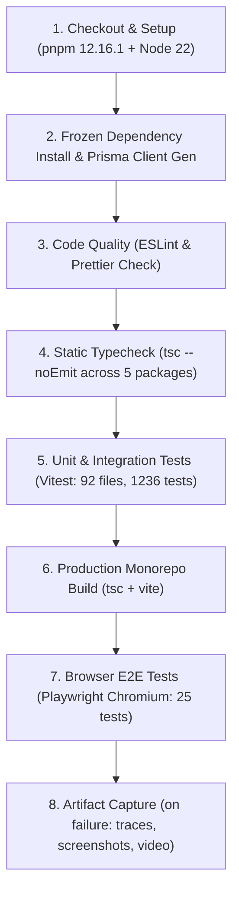

# MindVault — Sprint 5: Continuous Integration Pipeline Specification

## 1. Pipeline Overview

MindVault utilizes a unified GitHub Actions Continuous Integration (CI) pipeline defined in [`.github/workflows/ci.yml`](file:///c:/Users/mohit/OneDrive/Desktop/MindVault/.github/workflows/ci.yml).

The pipeline enforces rigorous quality gates across all commits and pull requests targeting `main`, preventing regressions, security misconfigurations, type errors, and broken browser flows from reaching staging or production.

---

## 2. Trigger Strategy & Concurrency

- **Triggers**:
  - `push` to `main`
  - `pull_request` to `main`
- **Concurrency Control**:
  - `concurrency.group = ${{ github.workflow }}-${{ github.ref }}`
  - `cancel-in-progress = true` (superseded runs on active PR branches are instantly cancelled to save CI compute hours)
- **Execution Environment**: `ubuntu-latest`
- **Timeout**: Strict 20-minute cap per run

---

## 3. Environment Isolation & Secret Safeguards

To prevent external credential exposure and accidental execution of live paid LLM services, the CI runner initializes with sealed mock environment variables:

```yaml
env:
  NODE_ENV: test
  LLM_PROVIDER: mock
  EMBEDDING_PROVIDER: mock
  JWT_ACCESS_SECRET: test_jwt_access_secret_deterministic_32_chars
  COOKIE_SECRET: test_cookie_signing_secret_deterministic_32_chars
  STORAGE_PROVIDER: local
  STORAGE_DIR: ./storage-test
```

**Key Isolation Rules**:
- `GEMINI_API_KEY` is deliberately omitted; the backend switches to mock providers in test mode.
- `JWT_ACCESS_SECRET` and `COOKIE_SECRET` meet the minimum 32-character requirement enforced by `env.ts`.
- Zero cloud database or cloud object storage connections are opened during CI.

---

## 4. Sequential Quality Gate Stages



### Stage Details

1. **Setup & Caching**:
   - `actions/checkout@v4`
   - `pnpm/action-setup@v3` with pnpm version `12.16.1`
   - `actions/setup-node@v4` with Node `22` and built-in pnpm store caching (`cache: 'pnpm'`)
2. **Deterministic Dependency Resolution**:
   - `pnpm install --frozen-lockfile` ensures exact lockfile parity without phantom dependency drift
3. **Database Client Generation**:
   - `pnpm db:generate` (`prisma generate`) generates typed Prisma client bindings
4. **Lint & Code Format**:
   - `pnpm lint`
   - `pnpm format:check`
5. **Static Typecheck**:
   - `pnpm typecheck` (`tsc --noEmit` on `@mindvault/shared`, `@mindvault/api`, `@mindvault/worker`, `@mindvault/companion`, and `@mindvault/web`)
6. **Unit & Integration Suite**:
   - `pnpm test` executes the 92 Vitest suites (1,236 tests) verifying backend services, crypto utilities, rate limiters, storage abstraction, and worker decoupling
7. **Monorepo Build**:
   - `pnpm build` creates production bundles in `dist/` directories
8. **End-to-End Browser Testing**:
   - `npx playwright install --with-deps chromium` installs headless Chromium binaries
   - `pnpm test:e2e` executes all 8 critical browser flows (25 tests) using `playwright.config.ts`
9. **Failure Artifact Retention**:
   - On step failure (`if: failure()`), `actions/upload-artifact@v4` collects `playwright-report/` and failure traces (`trace.zip`), retaining them for 14 days for forensic debugging

---

## 5. Deployment Readiness Gate

The pipeline acts as a mandatory pre-deployment gate:
- No code can be promoted to staging or merged to `main` without 100% green status across all 8 validation stages.
