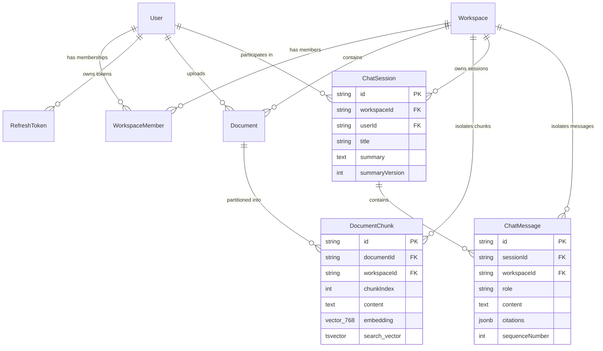

# MindVault — Database Architecture & Schema Audit

**Audit Date:** November 7, 2026  
**Auditor:** Principal Software Architect & Database Architect  
**Database Engine:** PostgreSQL 16.4 with `pgvector` extension  
**ORM / Data Access:** Prisma 5.22.0 + Raw SQL (`$queryRaw` for vector & full-text search)  
**State of Migrations:** 5 applied migrations, 0 pending migrations

---

## 1. Schema Entity Model & Relational Topology



---

## 2. Table-by-Table Schema Specification

### 2.1 Identity, Authentication & Workspace Domain

| Table Name          | Primary Key | Foreign Keys                                                  | Key Columns                                           | Indexes & Constraints                                                                      |
| ------------------- | ----------- | ------------------------------------------------------------- | ----------------------------------------------------- | ------------------------------------------------------------------------------------------ |
| `users`             | `id` (cuid) | None                                                          | `email`, `password_hash`, `role`, `status`            | UNIQUE(`email`), INDEX(`status`)                                                           |
| `workspaces`        | `id` (cuid) | None                                                          | `name`, `slug`, `deleted_at`                          | UNIQUE(`slug`), INDEX(`deleted_at`)                                                        |
| `workspace_members` | `id` (cuid) | `user_id` -> `users.id`<br/>`workspace_id` -> `workspaces.id` | `role` (OWNER, ADMIN, MEMBER)                         | UNIQUE(`workspace_id`, `user_id`), INDEX(`user_id`), CASCADE on delete                     |
| `refresh_tokens`    | `id` (cuid) | `user_id` -> `users.id`                                       | `token_hash`, `family_id`, `is_revoked`, `expires_at` | INDEX(`token_hash`), INDEX(`family_id`), INDEX(`user_id`, `expires_at`), CASCADE on delete |

### 2.2 Ingestion & Vector Retrieval Domain

| Table Name        | Primary Key | Foreign Keys                                                          | Key Columns                                                                                    | Indexes & Constraints                                                                                                                                                  |
| ----------------- | ----------- | --------------------------------------------------------------------- | ---------------------------------------------------------------------------------------------- | ---------------------------------------------------------------------------------------------------------------------------------------------------------------------- |
| `documents`       | `id` (cuid) | `workspace_id` -> `workspaces.id`<br/>`uploaded_by_id` -> `users.id`  | `original_name`, `mime_type`, `size_bytes`, `checksum`, `storage_key`, `status`, `chunk_count` | UNIQUE(`workspace_id`, `checksum`), INDEX(`workspace_id`, `status`), INDEX(`created_at`), CASCADE on workspace delete                                                  |
| `document_chunks` | `id` (cuid) | `document_id` -> `documents.id`<br/>`workspace_id` -> `workspaces.id` | `chunk_index`, `content`, `token_count`, `embedding`, `search_vector`, `metadata`              | UNIQUE(`document_id`, `chunk_index`), INDEX(`workspace_id`), INDEX(`document_id`), HNSW INDEX on `embedding`, GIN INDEX on `search_vector`, CASCADE on document delete |

### 2.3 Conversational Domain

| Table Name      | Primary Key | Foreign Keys                                                             | Key Columns                                                                                                                   | Indexes & Constraints                                                                                                    |
| --------------- | ----------- | ------------------------------------------------------------------------ | ----------------------------------------------------------------------------------------------------------------------------- | ------------------------------------------------------------------------------------------------------------------------ |
| `chat_sessions` | `id` (cuid) | `workspace_id` -> `workspaces.id`<br/>`user_id` -> `users.id`            | `title`, `model_provider`, `model_name`, `summary`, `summary_version`, `summary_token_count`, `last_message_at`, `deleted_at` | INDEX(`workspace_id`, `deleted_at`), INDEX(`user_id`), INDEX(`last_message_at`), CASCADE on workspace delete             |
| `chat_messages` | `id` (cuid) | `session_id` -> `chat_sessions.id`<br/>`workspace_id` -> `workspaces.id` | `role`, `content`, `status`, `sequence_number`, `citations` (JSONB), `metadata` (JSONB)                                       | UNIQUE(`session_id`, `sequence_number`), INDEX(`session_id`, `status`), INDEX(`workspace_id`), CASCADE on session delete |

---

## 3. Migration History & Database Evolutions

The repository maintains an explicit migration sequence in `prisma/migrations/`:

1. **`20261105120000_init_auth_and_workspaces`**
   - Creates `users`, `workspaces`, `workspace_members`, and `refresh_tokens`.
   - Enables `pgcrypto` and UUID generation functions.
2. **`20261105180000_documents_and_chunks`**
   - Enables `vector` extension (`CREATE EXTENSION IF NOT EXISTS vector`).
   - Creates `documents` and `document_chunks`.
   - Defines column `embedding vector(768)`.
   - Adds HNSW index: `CREATE INDEX document_chunks_embedding_hnsw_idx ON document_chunks USING hnsw (embedding vector_cosine_ops) WITH (m = 16, ef_construction = 64);`.
3. **`20261105210000_add_full_text_search`**
   - Adds generated `search_vector tsvector` to `document_chunks`.
   - Adds GIN index on `search_vector`: `CREATE INDEX document_chunks_search_vector_gin_idx ON document_chunks USING gin (search_vector);`.
4. **`20261106090000_add_search_vector_and_fts_optimization`**
   - Optimizes FTS triggers and ensures English language stemmer configuration (`to_tsvector('english', ...)`).
5. **`20261106110000_chat_sessions_and_messages`**
   - Creates `chat_sessions` and `chat_messages`.
   - Adds optimistic concurrency control (`summary_version INT DEFAULT 0`).
   - Establishes JSONB validation for citations and token metrics.

---

## 4. Indexing, Performance & Concurrency Controls

### 4.1 Vector Indexing (HNSW)

- **Algorithm:** Hierarchical Navigable Small World (`hnsw`).
- **Distance Function:** Cosine similarity (`vector_cosine_ops`).
- **Configuration Parameters:**
  - `m = 16` (bi-directional links per node; balanced recall vs index size).
  - `ef_construction = 64` (search depth during index build).
- **Execution Strategy:** Cosine similarity query is executed via `$queryRaw`:
  ```sql
  SELECT id, document_id, content, 1 - (embedding <=> $1::vector) as similarity
  FROM document_chunks
  WHERE workspace_id = $2
  ORDER BY embedding <=> $1::vector ASC
  LIMIT $3;
  ```

### 4.2 Full-Text Search Indexing (GIN)

- **Algorithm:** Generalized Inverted Index (`gin`).
- **Field:** `search_vector tsvector`.
- **Ranking Function:** `ts_rank_cd(search_vector, plainto_tsquery('english', $1))` with cover density ranking.
- **Combined Hybrid:** Reciprocal Rank Fusion (RRF with $k=60$) executed in memory by `RRFService` over vector and FTS result sets.

### 4.3 Concurrency Control

- `chat_sessions.summary_version` implements optimistic locking. When `ConversationSummaryService` updates the rolling memory summary, it verifies that `summary_version` matches the read version, preventing race conditions during concurrent message processing.

---

## 5. Knowledge Graph (Phase 6) Schema Readiness Assessment

A comprehensive audit of the database schema reveals the following regarding Phase 6 (Knowledge Graph):

| Inspection Question                                | Audit Finding | Evidence & Details                                                                                                                                                                                                                                                                                                                                                                             |
| -------------------------------------------------- | ------------- | ---------------------------------------------------------------------------------------------------------------------------------------------------------------------------------------------------------------------------------------------------------------------------------------------------------------------------------------------------------------------------------------------- |
| **Are there existing graph tables?**               | **NO (0%)**   | Zero tables exist for entities, relations, edges, or knowledge graphs.                                                                                                                                                                                                                                                                                                                         |
| **Are there reserved columns for graph metadata?** | **PARTIAL**   | `document_chunks.metadata` (JSONB) and `chat_messages.metadata` (JSONB) can store arbitrary tags, but no relational foreign keys or graph adjacency lists exist.                                                                                                                                                                                                                               |
| **Is a dedicated Graph DB required?**              | **NO**        | PostgreSQL 16 can natively support Knowledge Graph representations via two relational tables (`graph_entities` and `graph_relations`) or Apache AGE extension, or recursive CTE queries. Given the existing pgvector deployment, keeping the graph inside PostgreSQL provides ACID compliance, unified workspace isolation, and cross-modal querying without maintaining Neo4j infrastructure. |
| **Does multi-tenant isolation support graphs?**    | **READY**     | Any newly introduced `graph_entities` and `graph_relations` tables must include `workspace_id` foreign keys indexed with `ON DELETE CASCADE`, matching the proven multi-tenant pattern used in `document_chunks`.                                                                                                                                                                              |
