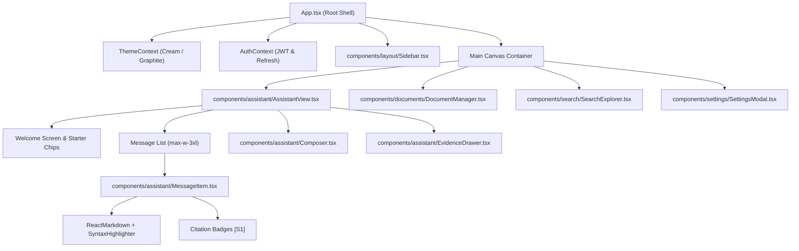

# MindVault — Frontend Architecture & UI/UX Audit

**Audit Date:** November 7, 2026  
**Auditor:** Senior Frontend Architect & Principal Product Designer  
**Technology Stack:** React 18.3.1, TypeScript 5.7.2, Vite 6.0.7, Tailwind CSS 3.4.17, Lucide Icons, Axios, React-Markdown

---

## 1. Executive Summary & Design System Conformance

The frontend of MindVault was completely redesigned from a generic dashboard into a focused, conversation-first AI workspace inspired by modern conversational AI platforms (ChatGPT, Claude, Gemini, Grok).

The visual language adheres strictly to two custom-crafted color palettes:

1. **Warm Cream (Default):** Soft ivory background (`#F7F5F0`), warm cream surfaces (`#FBFAF7`), charcoal typography (`#252521`), and warm earth accents (`#8B7860`).
2. **Dark Graphite:** Deep obsidian-graphite background (`#171816`), warm charcoal surfaces (`#20211E`), light bone typography (`#ECECE6`), and muted brass accents (`#B8A68B`).

Pure white (`#FFFFFF`) and pure black (`#000000`) have been eliminated from the primary canvas in favor of calm, low-glare surfaces.

---

## 2. Component Hierarchy & Architectural Breakdown



---

## 3. Detailed Component Inspections

### 3.1 Layout & Navigation (`Sidebar.tsx`)

- **Brand & Header:** Clean MindVault monogram icon, workspace indicator, and prominent "New Chat" button with keyboard shortcut tooltip.
- **Conversation List:**
  - Dynamic grouping of sessions.
  - Active session indicator with subtle background tint and border.
  - Inline rename and delete actions with confirmation state.
  - Smooth collapse/expand transition (collapses to an icon-only rail).
- **Bottom Shelf:** User profile avatar, current workspace slug, theme toggle button, and settings dialog trigger.

### 3.2 Conversation Interface (`AssistantView.tsx` & `MessageItem.tsx`)

- **Empty State:** Minimalist header with tagline (_"Your knowledge, connected"_), explanatory subtitle, and 4 curated suggestion chips:
  - _"Summarize my documents"_
  - _"Find connections across my knowledge"_
  - _"Explain a complex topic"_
  - _"What should I know about my uploaded files?"_
- **Reading Typography:** Constrained to `max-w-3xl` reading column with generous line height and proportional font scales (`Inter` / system-ui).
- **Markdown & Code Rendering:**
  - Rendered using `react-markdown` and `remark-gfm`.
  - Code blocks feature syntax highlighting, language badges, and one-click copy buttons with copied confirmation state.
  - Tables, bulleted lists, and blockquotes styled cleanly for both cream and graphite themes.
- **Citations & Grounding:**
  - Inline references render as interactive pill buttons (e.g. `[S1]`, `[S2]`).
  - Clicking a citation opens the slide-over `EvidenceDrawer`.
- **Evidence Drawer (`EvidenceDrawer.tsx`):**
  - Displays source chunk content, source document title, page numbers, and similarity relevance scores.
  - Enables verification of AI claims against underlying documents without cluttering the chat flow.

### 3.3 Message Composer (`Composer.tsx`)

- **Input Field:** Auto-resizing textarea that grows with content (capped at 200px max height).
- **Keyboard Handling:** `Enter` sends the message; `Shift + Enter` inserts a newline.
- **Model Switcher:** An interactive dropdown allowing the user to select between:
  - **Gemini 2.5 Flash** (Google Cloud GenAI — fast, high reasoning capability)
  - **Qwen 2.5 7B** (Local Ollama — privacy-focused, offline)
- **Streaming Controls:** Dynamically toggles between Send button and Stop/Abort button during active SSE stream generation.

---

## 4. Theme Engine & Styling Implementation

The theme system is implemented via CSS variables in `apps/web/src/index.css` paired with React context in `apps/web/src/context/ThemeContext.tsx`:

```css
:root,
[data-theme='cream'],
.theme-cream {
  --bg-primary: #f7f5f0;
  --bg-sidebar: #f0eee8;
  --bg-surface: #fbfaf7;
  --bg-surface-secondary: #efeee9;
  --text-primary: #252521;
  --text-secondary: #77766f;
  --border-subtle: #e5e2da;
  --accent-primary: #8b7860;
  --user-msg-bg: #eeebe3;
}

[data-theme='graphite'],
.theme-graphite {
  --bg-primary: #171816;
  --bg-sidebar: #1d1e1b;
  --bg-surface: #20211e;
  --bg-surface-secondary: #292a26;
  --text-primary: #ecece6;
  --text-secondary: #a3a39a;
  --border-subtle: #353630;
  --accent-primary: #b8a68b;
  --user-msg-bg: #30312b;
}
```

- **Persistence:** Saved in `localStorage` under key `mindvault_theme`.
- **System Preference:** Falls back to `window.matchMedia('(prefers-color-scheme: dark)')` if no saved preference exists.
- **Zero Flash:** Applies theme classes directly to `document.documentElement` during mount.

---

## 5. Frontend Deficiencies & Technical Debt

| Severity   | Issue Description                           | Location                               | Impact                                                                                                                   |
| ---------- | ------------------------------------------- | -------------------------------------- | ------------------------------------------------------------------------------------------------------------------------ |
| **HIGH**   | **Zero Automated Unit/Component Tests**     | `apps/web/`                            | No Jest, Vitest, or React Testing Library tests exist. Any UI regression must be manually verified.                      |
| **MEDIUM** | **Missing Knowledge Graph Visualizer**      | `apps/web/src/components/`             | No network graph canvas exists (Cytoscape, React Flow, or D3) for Phase 6 Knowledge Graph rendering.                     |
| **MEDIUM** | **Direct Token Storage in LocalStorage**    | `apps/web/src/context/AuthContext.tsx` | Access tokens stored in `localStorage` are vulnerable to XSS; should migrate to HttpOnly cookies or memory-only storage. |
| **LOW**    | **CSS Variable Completeness in Sub-Modals** | `apps/web/src/components/settings/`    | Certain modal borders use raw Tailwind gray classes (`border-gray-200`) instead of semantic `border-subtle` tokens.      |
