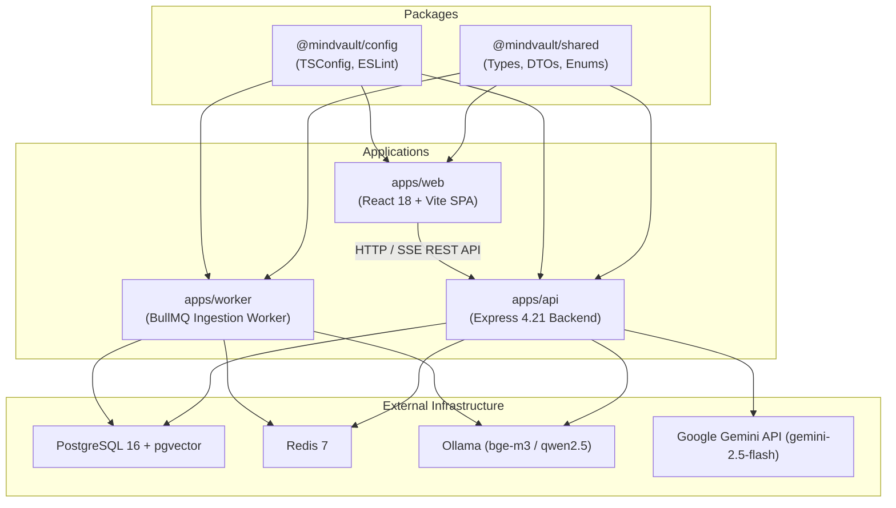

# MindVault — Repository Architecture Audit

**Audit Date:** November 7, 2026  
**Auditor:** Principal Software Architect & Independent Engineering Auditor  
**Repository Branch:** `main`  
**Git Commit Status:** Clean working tree in sync with `origin/main`  
**Monorepo Tooling:** pnpm 12.16.1 workspace, TypeScript 5.7.2, Node.js 20+

---

## 1. Executive Structural Overview

MindVault is organized as a pnpm monorepo using workspace protocol (`workspace:*`). The repository contains 3 deployable applications and 2 shared library packages.

```
MindVault/
├── apps/
│   ├── api/                    # Express 4.21 REST & SSE backend
│   │   ├── src/
│   │   │   ├── config/         # Environment schema (Zod) and app configuration
│   │   │   ├── lib/            # Shared DB interfaces, Prisma client, Redis client
│   │   │   ├── middleware/     # Auth, RBAC, tenant isolation, error handling, rate limiting
│   │   │   ├── modules/
│   │   │   │   ├── auth/           # Argon2id auth, JWT, rotating refresh token families
│   │   │   │   ├── document/       # Multipart upload, storage abstraction, BullMQ producer
│   │   │   │   ├── retrieval/      # Hybrid search (pgvector + FTS), RRF fusion, reranker
│   │   │   │   ├── generation/     # LLM provider abstraction (Ollama, Gemini, Mock)
│   │   │   │   ├── conversations/  # Chat sessions, sliding window, summaries, SSE streaming
│   │   │   │   └── workspaces/     # Workspace CRUD, membership, RBAC roles
│   │   │   └── server.ts       # Application bootstrap, graceful shutdown
│   │   └── tsconfig.json
│   ├── web/                    # React 18 SPA (Vite 6, Tailwind CSS 3.4)
│   │   ├── src/
│   │   │   ├── components/     # AppShell, Assistant, Documents, Search, Settings, Auth
│   │   │   ├── context/        # AuthContext, ThemeContext (Cream & Graphite)
│   │   │   ├── hooks/          # useChat, useSSE, useDocuments, useTheme
│   │   │   ├── lib/            # Axios API client, token refresh interceptors
│   │   │   └── types/          # Frontend domain interfaces
│   │   └── vite.config.ts
│   └── worker/                 # BullMQ 5 background processing engine
│       ├── src/
│       │   ├── config/         # Worker environment configuration
│       │   ├── lib/            # Prisma and Redis singletons
│       │   ├── modules/
│       │   │   └── ingestion/  # Extractors (PDF, DOCX, MD, TXT), normalizer, chunker, embeddings
│       │   └── worker.ts       # BullMQ Worker process with graceful shutdown
│       └── tsconfig.json
├── packages/
│   ├── shared/                 # Shared TypeScript types, DTOs, enums, constants
│   │   └── src/index.ts
│   └── config/                 # Base ESLint and TypeScript configs
├── prisma/
│   ├── schema.prisma           # Relational schema (PostgreSQL 16 + pgvector)
│   └── migrations/             # 5 applied SQL migrations
├── docker-compose.yml          # Local infra: PostgreSQL 16 pgvector (5432), Redis 7 (6379)
└── package.json                # Root pnpm workspace scripts
```

---

## 2. Package Dependency Graph & Module Boundaries



### Dependency Analysis Table

| Package / App     | Internal Dependencies                    | External Runtime Dependencies                                                                                | Role & Purpose                                                                     |
| ----------------- | ---------------------------------------- | ------------------------------------------------------------------------------------------------------------ | ---------------------------------------------------------------------------------- |
| `packages/shared` | None                                     | None (Zero runtime deps)                                                                                     | Shared domain contracts, DTO schemas, and status enums                             |
| `packages/config` | None                                     | ESLint, TypeScript presets                                                                                   | Shared build and lint presets                                                      |
| `apps/api`        | `@mindvault/shared`, `@mindvault/config` | `express`, `@prisma/client`, `ioredis`, `bullmq`, `argon2`, `jsonwebtoken`, `zod`, `multer`, `@google/genai` | Primary API gateway, auth, conversation orchestrator, SSE streaming                |
| `apps/worker`     | `@mindvault/shared`, `@mindvault/config` | `@prisma/client`, `ioredis`, `bullmq`, `pdf-parse`, `mammoth`, `marked`, `zod`                               | Background document text extraction, normalization, chunking, and vector embedding |
| `apps/web`        | `@mindvault/shared`                      | `react`, `react-dom`, `lucide-react`, `axios`, `react-markdown`, `remark-gfm`                                | Single-page application, ChatGPT/Claude style UI, SSE consumer                     |

---

## 3. Monorepo Configuration & Scripts Audit

### Root `package.json` Scripts Inspection

The root workspace declares the following orchestration scripts:

| Script Name                  | Command                                              | Operational Verification                                                                                        |
| ---------------------------- | ---------------------------------------------------- | --------------------------------------------------------------------------------------------------------------- |
| `pnpm build`                 | `pnpm --recursive run build`                         | **OPERATIONAL** (Builds shared -> api -> worker -> web in ~14s)                                                 |
| `pnpm typecheck`             | `pnpm --recursive run typecheck`                     | **OPERATIONAL** (Zero TypeScript compilation errors across all packages)                                        |
| `pnpm test`                  | `pnpm --recursive run test`                          | **OPERATIONAL** (25 test files, 189 passing tests)                                                              |
| `pnpm lint`                  | `pnpm --recursive run lint`                          | **FAILED** (2 syntax escape errors in `query-context.service.ts`, 112 formatting warnings)                      |
| `pnpm format:check`          | `prettier --check "**/*.{ts,tsx,js,json,md}"`        | **FAILED** (15 files have formatting differences)                                                               |
| `pnpm db:migrate`            | `pnpm --filter @mindvault/api prisma:migrate`        | **OPERATIONAL** (5 migrations applied to database)                                                              |
| `pnpm db:generate`           | `pnpm --filter @mindvault/api prisma:generate`       | **OPERATIONAL** (Prisma client generates without error)                                                         |
| `pnpm retrieval:evaluate`    | `pnpm --filter @mindvault/api evaluate:retrieval`    | **OPERATIONAL** (MRR: Semantic 0.517, Keyword 1.000, Hybrid 0.767)                                              |
| `pnpm rag:evaluate`          | `pnpm --filter @mindvault/api evaluate:rag`          | **OPERATIONAL** (100% citation validity, 100% injection containment)                                            |
| `pnpm conversation:evaluate` | `pnpm --filter @mindvault/api evaluate:conversation` | **PARTIAL** (14/15 passing, 93.3% pass rate; scen_03 demonstrative resolution fails on dual acronym constraint) |

---

## 4. Architectural Variance from Initial Design Plan

A comparison of the original Phase 0–5 specifications against the actual codebase reveals several architectural variances:

1. **Storage Engine:**
   - _Original Plan:_ S3/MinIO compatible object store for raw document files.
   - _Actual Implementation:_ Abstract `IStorageProvider` interface implemented by `LocalStorageProvider` (`apps/api/src/modules/document/storage/local-storage.provider.ts`) saving to local directory `uploads/`. An S3 provider skeleton exists but is not wired as the default.
2. **LLM Provider Evolution:**
   - _Original Plan:_ Local Ollama only (`qwen2.5:7b-instruct-q4_K_M`).
   - _Actual Implementation:_ Added `@google/genai` provider (`GeminiLLMProvider`) supporting `gemini-2.5-flash` with model switching supported dynamically per conversation request.
3. **Database Client Layer:**
   - _Design Choice:_ Prisma ORM is used for all standard CRUD operations, but raw SQL queries (`$queryRaw`) are utilized for vector similarity (`<=>` cosine distance operator) and full-text search (`ts_rank_cd` and `plainto_tsquery`) to circumvent Prisma's native vector limitations.
4. **Test Architecture:**
   - Unit and integration tests are heavily concentrated in `apps/api` (20 suites) and `apps/worker` (5 suites). `apps/web` has **0 test suites** (no Jest, Vitest, or Playwright setup).
