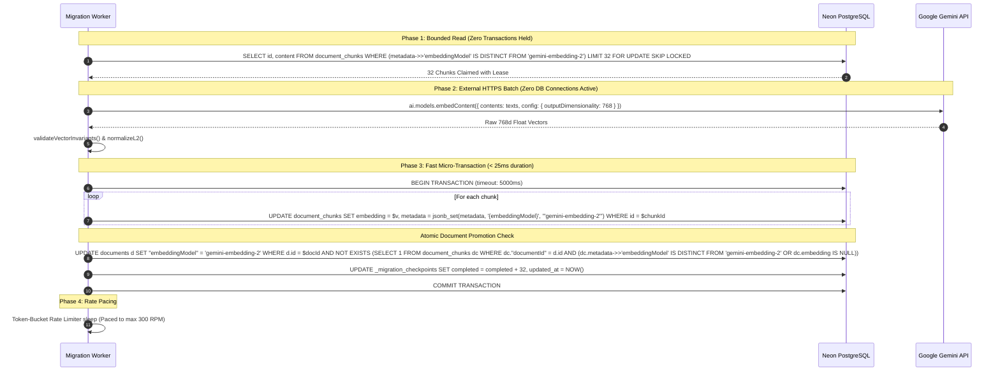

# MindVault — Data & Embedding Migration Plan (Revision 3)
## Migration from Nomic-Embed-Text to Google Gemini Embeddings

**Document Version:** 3.0.0  
**Audit Date:** November 16, 2026  
**Status:** ALIGNED & AUDITED (Strictly Read-Only)  
**Target Embedding Model:** `gemini-embedding-2` (with `outputDimensionality: 768`)  
**Cross-References:**  
* [`PHASE_1B_FINAL_AUDIT_V3.md`](file:///c:/Users/mohit/OneDrive/Desktop/MindVault/PHASE_1B_FINAL_AUDIT_V3.md)
* [`PHASE_1B_FINAL_ACCEPTANCE_MATRIX.md`](file:///c:/Users/mohit/OneDrive/Desktop/MindVault/PHASE_1B_FINAL_ACCEPTANCE_MATRIX.md)
* [`PHASE_1B_ROLLBACK_AND_RECOVERY.md`](file:///c:/Users/mohit/OneDrive/Desktop/MindVault/PHASE_1B_ROLLBACK_AND_RECOVERY.md)

---

## 1. Target Embedding Architecture

### 1.1 Model Selection: `gemini-embedding-2`
* **Canonical Model:** `gemini-embedding-2` (Google Flagship Multimodal Embedding Model).
* **Dimensionality:** Configured via `outputDimensionality: 768` (Matryoshka Representation Learning).
* **Context Window:** 8,192 tokens (eliminates chunk truncation errors).
* **Auto-Renormalization:** Natively renormalizes truncated dimensions at the API boundary.
* **Universal Normalization Defense:** All returned vectors are processed through client-side $L_2$ normalization (`validateVectorInvariants()`) to guarantee $\|\vec{v}\|_2 = 1.0 \pm 10^{-4}$.
* **Database Schema Impact:** **ZERO DDL CHANGES.** The existing PostgreSQL column `embedding vector(768)` in `document_chunks` accommodates the vectors without schema migration.

### 1.2 Fundamental Incompatibility & Gating Invariant
Vectors generated by `nomic-embed-text` and `gemini-embedding-2` inhabit mathematically distinct semantic vector spaces:
$$\text{CosineSimilarity}(\vec{v}_{\text{nomic}}, \vec{v}_{\text{gemini}}) \approx \text{Random Noise}$$

* **Fencing Rule:** Vector search queries MUST NOT evaluate Gemini query vectors against Nomic chunks.
* **Per-Chunk Provenance:** Every chunk updated records `metadata.embeddingModel = 'gemini-embedding-2'`.
* **Query Gating:** Vector search queries filter strictly on `(c.metadata->>'embeddingModel' = 'gemini-embedding-2')`.
* **Zero Downtime Fallback:** Unmigrated documents are seamlessly served via PostgreSQL Full-Text Search (`tsvector`) until fully migrated.

---

## 2. Non-Blocking Bounded Migration Pipeline



---

## 3. Concurrency, Fault Tolerance & Idempotency Safeguards

1. **Atomic Batch Claims:** Uses `FOR UPDATE SKIP LOCKED` so concurrent workers claim non-overlapping chunk batches.
2. **Distributed Locking:** Upstash Redis lock (`mindvault:migration:lock:<workspaceId>`) prevents duplicate workers from processing the same workspace.
3. **Session Advisory Lock:** PostgreSQL `pg_try_advisory_lock` prevents multi-process collisions.
4. **Deleted Document Safety:** If a document is deleted while the worker is generating embeddings, `UPDATE document_chunks` affects 0 rows without foreign key errors.
5. **Crash Resumption:** Workers resume in $< 5\text{ seconds}$ from the last committed checkpoint in `_migration_checkpoints`.
6. **Dead-Letter Isolation:** Chunks failing 5 times are routed to `_migration_failures`, preventing a single poison chunk from halting the migration.

---

## 4. Planned Execution Commands (Post-Approval)

```powershell
# 1. Probe Gemini quota limits
pnpm exec tsx scripts/probe-gemini-quota.ts

# 2. Dry-run inspection
pnpm exec tsx scripts/migrate-embeddings-to-gemini.ts --dry-run

# 3. Execute workspace migration with rate limiting
pnpm exec tsx scripts/migrate-embeddings-to-gemini.ts --workspace-id <workspaceId> --concurrency 1

# 4. Verify post-migration retrieval quality
pnpm exec tsx evaluation/harness/run-real-evaluation.ts
```
