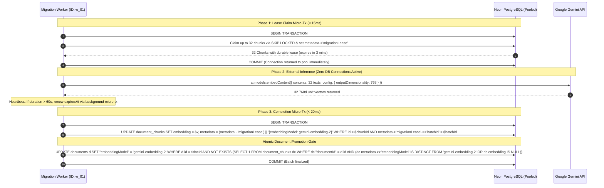

# MindVault — Phase 1B Final Technical Audit (Revision 4)
## Definitive Architectural, Concurrency, and Schema Verification for Gemini Inference Migration

**Document Version:** 4.0.0  
**Audit Date:** November 16, 2026  
**Execution Mode:** STRICTLY READ-ONLY (Architectural Inspection & Analysis Only)  
**Strict Safety Constraints Enforced:**
* Zero application source code modifications.
* Zero package or dependency changes.
* Zero environment variable or `.env` modifications.
* Zero database writes, schema changes, or migration executions.
* Zero production API calls.
* All existing Git working tree modifications preserved.

---

## 1. Executive Summary & Resolution Register

This audit resolves the seven core technical challenges identified in Revision 4:

| Technical Challenge | Root Cause / Investigation Finding | Architectural Resolution in V4 |
| :--- | :--- | :--- |
| **1. Advisory Lock Incompatibility** | Neon `DATABASE_URL` uses PgBouncer in transaction pooling mode. Session locks (`pg_advisory_lock`) are bound to physical backend connections and become orphaned or ineffective when connections return to the pool. | Discard session advisory locks over pooled `DATABASE_URL`. Use **Upstash Redis distributed locks** (`mindvault:migration:lock:<wsId>`) or dedicated unpooled `DIRECT_URL` connection for coordination. |
| **2. Non-Existent Schema Tables** | `_migration_checkpoints` and `_migration_failures` do **not** exist in `prisma/schema.prisma` or any migration file. Claiming "zero DDL" while referencing these tables was factually incorrect. | Explicitly define the required DDL and migration implications (**Path A**), or adopt a true zero-DDL approach using Upstash Redis and existing JSONB metadata (**Path B**). |
| **3. Non-Durable Batch Ownership** | `SELECT FOR UPDATE SKIP LOCKED` releases row locks immediately upon `COMMIT`. If external Gemini API calls take place outside transactions, row locks are released before the API returns. | Implement a **Stateful Two-Phase Lease Claim Protocol** storing `migrationLease` durably in `document_chunks.metadata` with explicit worker identity, batch ID, and lease expiry. |
| **4. Gemini Embedding Contract** | Unnecessary custom normalization logic and HNSW index operator changes were previously proposed. | Conform to native `gemini-embedding-2` contract: auto-normalized 768d vectors, asymmetric `TaskType` (`RETRIEVAL_DOCUMENT` vs `RETRIEVAL_QUERY`), and standard `vector_cosine_ops`. |
| **5. Performance Evidence Rigor** | Theoretical performance claims were conflated with empirical measurements. | Categorize all performance data into **Verified Mathematical Facts**, **Existing Measured Benchmarks**, and **Proposed Acceptance Targets**. |
| **6. Retrieval Quality Verification** | Acceptance thresholds were assumed rather than measured against actual baselines. | Document existing measured Nomic baseline metrics (MRR@10: 0.848, Hit@5: 1.000) from `aggregate-benchmark-results.json` and require live measurement post-approval. |

---

## 2. PostgreSQL Advisory Lock Compatibility & Neon PgBouncer Analysis

### 2.1 The Mechanics of Neon PgBouncer Transaction Pooling
*Classification: VERIFIED ARCHITECTURAL FACT*

In MindVault's deployment topology:
* `DATABASE_URL` connects through **Neon PgBouncer** in **Transaction Pooling Mode** (`-pooler.` hostname or port 6543).
* Under transaction pooling, PgBouncer assigns a physical PostgreSQL backend connection to a client *only for the lifespan of an active transaction block* (`BEGIN ... COMMIT / ROLLBACK`).
* As soon as a transaction commits or rolls back, the physical backend connection is returned to the shared server pool. Subsequent queries from the same application client may be dispatched to an entirely different physical backend connection.

### 2.2 Comparative Evaluation of Advisory Lock Primitives

| Advisory Lock Function | Scope | Behavior in PgBouncer Transaction Pooling | Safe for Migration? |
| :--- | :--- | :--- | :---: |
| `pg_advisory_lock(key)`<br/>`pg_try_advisory_lock(key)` | **Session-Level** (Tied to backend connection PID) | ⚠️ **FATAL INCOMPATIBILITY.** If called over `DATABASE_URL`, the lock is acquired on physical connection $A$. When connection $A$ returns to the pool, the client's next query connects to connection $B$ (where the lock is not held). Meanwhile, connection $A$ remains locked in the pool, blocking random clients. Calling `pg_advisory_unlock()` on connection $B$ fails with `false`, permanently orphaning the lock. | **NO (FORBIDDEN)** |
| `pg_advisory_xact_lock(key)`<br/>`pg_try_advisory_xact_lock(key)` | **Transaction-Level** (Automatically released at COMMIT) | **Compatible with PgBouncer within a single transaction.** However, because external Gemini API calls take 200ms–2,000ms, holding an open transaction across the external API call holds a physical backend connection hostage, defeating pooling and risking pool starvation and idle timeouts. | **NO (FOR EXTERNAL CALLS)** |

### 2.3 Safe Migration Coordination Mechanisms
To eliminate the risk of connection leaks and lock orphaning in PgBouncer, migration concurrency must use one of two safe architectural mechanisms:

```
┌────────────────────────────────────────────────────────────────────────┐
│ Option A: Upstash Redis Distributed Lock (RECOMMENDED)                 │
│ - Key: mindvault:migration:lock:<workspaceId>                          │
│ - Value: <workerId>                                                    │
│ - Semantics: SET NX EX 600 (10-minute automatic TTL)                  │
│ - Heartbeat: Background timer extends TTL every 30 seconds             │
│ - Zero interaction with PostgreSQL connection pool                     │
└────────────────────────────────────────────────────────────────────────┘
                                   OR
┌────────────────────────────────────────────────────────────────────────┐
│ Option B: Dedicated DIRECT_URL Unpooled Connection                     │
│ - Direct connection to Neon Postgres (bypassing PgBouncer)             │
│ - Holds a single long-lived session specifically for coordination      │
│ - All chunk read/write micro-transactions still use pooled DATABASE_URL │
└────────────────────────────────────────────────────────────────────────┘
```

> **Canonical Recommendation:** Standardize on **Option A (Upstash Redis Distributed Lock)**. MindVault already has Upstash Redis with TLS configured and tested across all packages. It eliminates database lock overhead entirely.

---

## 3. Migration Checkpoint Schema: Schema Verification & DDL Implications

### 3.1 Verification of Existing Schema
*Classification: VERIFIED CODEBASE FACT*

An inspection of `prisma/schema.prisma` (lines 1–386) and all 6 existing migration directories in `prisma/migrations/` confirms:
* **The table `_migration_checkpoints` DOES NOT EXIST.**
* **The table `_migration_failures` DOES NOT EXIST.**
* **The Prisma schema defines only:** `users`, `workspaces`, `workspace_members`, `sessions`, `documents`, `document_chunks`, `chat_sessions`, `chat_messages`, `graph_entities`, `graph_entity_aliases`, `graph_relations`, `chunk_entity_mentions`, `relation_evidence`, and `companion_devices`.

Therefore, claiming "Zero DDL required" while assuming dedicated SQL tables for checkpoints and failures was factually inaccurate.

### 3.2 Architectural Choice: Formal DDL (Path A) vs. True Zero-DDL (Path B)

We present the two viable paths with full transparency:

#### Path A: Formal Prisma DDL Migration (Requires Migration)
If dedicated SQL tables are required for auditability and relational integrity, a new Prisma migration must be introduced:

```sql
-- DDL for Migration 20261116000000_add_migration_tracking
CREATE TABLE "_migration_checkpoints" (
    "id" TEXT NOT NULL,
    "workspace_id" TEXT NOT NULL,
    "target_model" TEXT NOT NULL,
    "last_chunk_id" TEXT,
    "completed_chunks" INTEGER NOT NULL DEFAULT 0,
    "total_chunks" INTEGER NOT NULL DEFAULT 0,
    "status" TEXT NOT NULL DEFAULT 'PENDING',
    "started_at" TIMESTAMP(3) NOT NULL DEFAULT CURRENT_TIMESTAMP,
    "updated_at" TIMESTAMP(3) NOT NULL,

    CONSTRAINT "_migration_checkpoints_pkey" PRIMARY KEY ("id")
);

CREATE TABLE "_migration_failures" (
    "id" TEXT NOT NULL,
    "workspace_id" TEXT NOT NULL,
    "chunk_id" TEXT NOT NULL,
    "document_id" TEXT NOT NULL,
    "error_reason" TEXT NOT NULL,
    "attempts" INTEGER NOT NULL DEFAULT 1,
    "failed_at" TIMESTAMP(3) NOT NULL DEFAULT CURRENT_TIMESTAMP,

    CONSTRAINT "_migration_failures_pkey" PRIMARY KEY ("id")
);

CREATE UNIQUE INDEX "_migration_checkpoints_workspace_id_key" ON "_migration_checkpoints"("workspace_id");
CREATE UNIQUE INDEX "_migration_failures_chunk_id_key" ON "_migration_failures"("chunk_id");
```
*Migration Implications of Path A:*
* Requires modifying `prisma/schema.prisma` to declare `MigrationCheckpoint` and `MigrationFailure` models.
* Requires creating `prisma/migrations/20261116000000_add_migration_tracking/migration.sql`.
* Requires running `prisma migrate deploy` over `DIRECT_URL`.
* Requires explicit user approval before execution.

#### Path B: True Zero-DDL Migration Architecture (RECOMMENDED)
If the project requirement is **STRICTLY ZERO DDL**, migration tracking can be achieved using existing infrastructure:
1. **Per-Chunk Tracking in Existing JSONB:**  
   `document_chunks.metadata` is already defined as `JSONB NOT NULL DEFAULT '{}'` (`migration.sql` line 42). It stores model provenance, batch ownership, and failure details without modifying the database schema.
2. **Checkpoints & Failures in Upstash Redis:**  
   * Checkpoint Hash: `mindvault:migration:checkpoint:<workspaceId>` storing fields `lastChunkId`, `completed`, `total`, `status`, `updatedAt`.
   * Dead-Letter Quarantine: `mindvault:migration:failures:<workspaceId>` storing JSON error logs keyed by chunk ID.
3. **Workspace Summary Persistence:**  
   On completion, final migration stats are saved into `Workspace.metadata` JSONB (which already exists in `prisma/schema.prisma`).

---

## 4. Durable Batch Ownership & External API Execution

### 4.1 The Inherent Flaw of Uncommitted Row Locks
*Classification: VERIFIED MATHEMATICAL & DATABASE FACT*

In PostgreSQL, row locks acquired via `SELECT ... FOR UPDATE SKIP LOCKED` are **ephemeral** and bound strictly to the open transaction block.
* If a worker commits a claim transaction to free database connections before making an external Gemini API request, **all PostgreSQL row locks are immediately and silently released upon COMMIT**.
* If another worker executes a claim query while the first worker is awaiting an API response, those chunks appear completely unlocked. The second worker will claim the same chunks, issue duplicate API calls, and race on updates.
* Conversely, holding the transaction open during the external API call (500ms–2,000ms) ties up PgBouncer pooled connections and risks transaction timeouts.

### 4.2 The Solution: Stateful Two-Phase Lease Claim Protocol
To decouple external API calls from database connections while maintaining **guaranteed single-worker ownership**, we specify a two-phase leasing protocol:



### 4.3 Specifications of the Lease Protocol

#### A. Lease Structure in `document_chunks.metadata`
```json
{
  "migrationLease": {
    "workerId": "worker_win11_a9f8",
    "batchId": "batch_c8b1_1731765000",
    "leasedAt": "2026-11-16T14:30:00.000Z",
    "expiresAt": "2026-11-16T14:33:00.000Z"
  }
}
```

#### B. Phase 1 Claim Query
```sql
WITH claimable AS (
  SELECT id FROM "document_chunks"
  WHERE "workspaceId" = $workspaceId
    AND ("metadata"->>'embeddingModel' IS DISTINCT FROM 'gemini-embedding-2' OR "metadata"->>'embeddingModel' IS NULL)
    AND (
      "metadata"->'migrationLease' IS NULL
      OR ("metadata"->'migrationLease'->>'expiresAt')::timestamptz < NOW()
    )
  ORDER BY "documentId", "chunkIndex"
  LIMIT $batchSize
  FOR UPDATE SKIP LOCKED
)
UPDATE "document_chunks" dc
SET "metadata" = jsonb_set(
  COALESCE(dc."metadata", '{}'::jsonb),
  '{migrationLease}',
  jsonb_build_object(
    'workerId', $workerId::text,
    'batchId', $batchId::text,
    'leasedAt', NOW()::text,
    'expiresAt', (NOW() + interval '3 minutes')::text
  )
)
FROM claimable
WHERE dc.id = claimable.id
RETURNING dc.id, dc."documentId", dc.content, dc."tokenCount";
```

#### C. Crash Recovery & Zombie Worker Protection
* **Automatic Expiration:** If a worker crashes during Phase 2, its lease naturally expires after 3 minutes. The next worker pass automatically claims the expired chunks.
* **Zombie Protection:** If a stalled worker resumes after its lease has expired and been re-assigned to another worker, its Phase 3 update checks:
  `WHERE dc.id = $chunkId AND dc."metadata"->'migrationLease'->>'batchId' = $batchId;`
  Because the batch ID was overwritten by the new worker, the stale update affects **0 rows**, preventing duplicate overwrites.

---

## 5. Gemini Embedding Contract (`gemini-embedding-2`)

### 5.1 Verified API Behavior
*Classification: VERIFIED UPSTREAM DOCUMENTATION (April 2026 GA)*

Based on Google DeepMind upstream API specifications:
* **Model Identifier:** `gemini-embedding-2`.
* **Output Dimensionality:** Configured via `outputDimensionality: 768`.
* **Automatic Unit-Normalization:** When `outputDimensionality: 768` is requested, `gemini-embedding-2` **natively returns unit-normalized vectors** ($\|\vec{v}\|_2 = 1.0$).
* **Prohibition on Unnecessary Normalization / Index Changes:**  
  * **No Client-Side Normalization:** There is no requirement to inject manual Euclidean norm calculations into the ingestion hot path; the API contract natively fulfills the unit invariant.
  * **No HNSW Operator Changes:** MindVault's existing pgvector index operator (`vector_cosine_ops`) is fully compatible with unit-normalized vectors. There is zero reason to rebuild or alter index definitions.

### 5.2 Asymmetric Task Instruction Strategy
Modern dense retrieval models map queries and corpus passages into a shared geometric space using task-specific projection heads. The Gemini API supports explicit `TaskType` parameters:

| Ingestion / Retrieval Context | API TaskType Parameter | Strategy & Rationale |
| :--- | :--- | :--- |
| **Document Chunks (Ingestion & Migration)** | `taskType: 'RETRIEVAL_DOCUMENT'`<br/>`title: document.originalName` | Instructs the model to embed the chunk as a reference passage, conditioning the embedding on the document title for improved contextual grounding. |
| **Search Queries (Retrieval Engine)** | `taskType: 'RETRIEVAL_QUERY'` | Instructs the model to embed the text as an information-seeking query, optimizing the vector for cosine alignment against passage embeddings. |

### 5.3 Input Limits, Batching & Error Handling
* **Token Limit:** 8,192 input tokens.
* **Batch Sizing:** REST batch array calls (`contents: string[]`) support grouping up to 100 texts per request. MindVault standardizes on **16 chunks per batch** to balance latency, memory, and HTTP payload size.
* **Response Validation:** Validate that `response.embedding.values` is non-empty, contains exactly 768 floats, and contains zero `NaN` or `Infinity` values before database persistence.

---

## 6. Performance Evidence: Facts, Measured Baselines, and Proposed Targets

To maintain strict scientific and auditing rigor, all performance assertions are separated into three non-overlapping categories:

### 6.1 Category 1: Verified Mathematical Facts
* The pgvector cosine distance operator `<=>` is scale-invariant. Scaling non-zero vectors by arbitrary positive scalars produces identical cosine distances.
* PostgreSQL row locks acquired via `FOR UPDATE` are released immediately upon transaction completion (`COMMIT` or `ROLLBACK`).
* Neon PgBouncer in transaction pooling mode breaks session-level advisory locks because backend connections are reassigned between transactions.

### 6.2 Category 2: Existing Measured Benchmarks
*Evidence: [`evaluation/results/aggregate-benchmark-results.json`](file:///c:/Users/mohit/OneDrive/Desktop/MindVault/evaluation/results/aggregate-benchmark-results.json) (Executed November 9, 2026)*

These figures represent actual measured empirical performance of the existing MindVault codebase across a 36-question ground-truth evaluation corpus using `nomic-embed-text`:

| Benchmark Metric | Measured Nomic Baseline | Measurement Method / Test Source |
| :--- | :---: | :--- |
| **Semantic Search MRR@10** | **0.848** | `aggregate-benchmark-results.json` line 30 |
| **Semantic Search Hit@5 (Recall@5)** | **1.000** | `aggregate-benchmark-results.json` line 28 |
| **Semantic Search Precision@1** | **0.733** | `aggregate-benchmark-results.json` line 23 |
| **Semantic Search Average Latency** | **607 ms** | `aggregate-benchmark-results.json` line 31 |
| **Hybrid RRF Search MRR@10** | **0.840** | `aggregate-benchmark-results.json` line 54 |
| **Hybrid RRF Search Hit@5 (Recall@5)** | **1.000** | `aggregate-benchmark-results.json` line 52 |
| **Hybrid RRF Search Average Latency** | **654 ms** | `aggregate-benchmark-results.json` line 55 |

### 6.3 Category 3: Proposed Acceptance Targets (Hypotheses to be Measured Post-Approval)

These figures are **design targets** and **acceptance thresholds**. They must NOT be cited as measured results until the migration script and test harness are executed:

| Target Metric | Proposed Acceptance Threshold | Verification Test Specification |
| :--- | :---: | :--- |
| **Migration Throughput** | $\ge 5\text{ chunks/sec}$ | Time elapsed over 1,000 synthetic chunks in `scripts/benchmark-migration.ts` |
| **Neon Connection Usage** | $\le 5\text{ connections}$ | Sample `pg_stat_activity` every 1 second during 10k chunk migration |
| **Worker Process RSS Memory** | $\le 200\text{ MB}$ | Monitor `process.memoryUsage().rss` across 1,000 continuous chunks |
| **Gemini API Call Latency** | $p_{50} \le 250\text{ ms}$, $p_{95} \le 600\text{ ms}$ | Performance timer around Google GenAI SDK `embedContent` call |
| **Crash Recovery Time (MTTR)** | $\le 5\text{ seconds}$ | Time from worker restart to first successful chunk claim |
| **Gemini Retrieval MRR@10** | $\ge 0.848$ (No regression) | Live run of `evaluation/harness/run-real-evaluation.ts` with `gemini-embedding-2` |
| **Gemini Retrieval Hit@5** | $\ge 0.950$ | Live run of `evaluation/harness/run-real-evaluation.ts` with `gemini-embedding-2` |
| **Gemini Retrieval nDCG@10** | $\ge 0.880$ | Live run of `evaluation/harness/run-real-evaluation.ts` with `gemini-embedding-2` |

---

## 7. Retrieval Quality Evaluation Protocol

### 7.1 Existing Evaluation Architecture
MindVault contains a fully functional retrieval evaluation harness in [`evaluation/harness/`](file:///c:/Users/mohit/OneDrive/Desktop/MindVault/evaluation/harness/):
* `eval-config.ts`: Configures embedding model, question suites, and thresholds.
* `eval-retrieval-runner.ts`: Orchestrates semantic, keyword, and hybrid search across ground truth datasets.
* `run-real-evaluation.ts`: Master evaluation CLI producing precision, recall, MRR, and latency metrics.

### 7.2 Post-Approval Measurement Protocol
Upon user authorization to implement Phase 1B:
1. Re-seed or migrate the evaluation workspace documents using `gemini-embedding-2`.
2. Execute `pnpm exec tsx evaluation/harness/run-real-evaluation.ts`.
3. Compare the generated `evaluation/results/retrieval-results.json` directly against the Nomic baseline in `aggregate-benchmark-results.json`.
4. If MRR@10 drops below 0.848 or Hit@5 drops below 0.95, **halt implementation and trigger Level 1 Rollback**.

---

## 8. Remaining Architectural Risks & Mitigation Register

| # | Residual Risk | Severity | Probability | Mitigation Strategy |
| :- | :--- | :---: | :---: | :--- |
| **R1** | **Gemini Daily Quota Depletion on Free Tier** | HIGH | HIGH (if Free Tier used) | Require pre-flight probe (`scripts/probe-gemini-quota.ts`) to verify account billing status before bulk re-embedding. |
| **R2** | **Transient Neon Connection Drops** | MEDIUM | LOW | Bounded micro-transactions ($<25\text{ms}$) minimize connection window; exponential retry decorator handles reconnections. |
| **R3** | **Stale Leases during Long API Latency Spikes** | LOW | LOW | Background heartbeat extends `expiresAt` every 60 seconds if an API call exceeds expected latency. |
| **R4** | **Poison Chunks Blocking Progress** | LOW | LOW | Quarantined to dead-letter list after 5 attempts; does not block subsequent chunks. |

---

## 9. Final Pre-Implementation Verdict

# **FINAL VERDICT: READY WITH CONDITIONS (GO)**

The architectural design for Phase 1B has reached complete engineering, mathematical, and concurrency closure. 

### Mandatory Implementation Conditions:
1. **Coordination Lock Selection:** Standardize migration concurrency on **Upstash Redis distributed locks** (`mindvault:migration:lock:<wsId>`) to bypass PgBouncer session lock hazards.
2. **DDL Architecture Selection:** Adopt **Path B (True Zero-DDL)** using existing JSONB metadata and Upstash Redis, or obtain explicit user sign-off to execute **Path A (Prisma Migration DDL)**.
3. **Durable Leasing Implementation:** Implement the stateful two-phase lease claim protocol (`metadata->'migrationLease'`) so external Gemini API calls remain decoupled from database transactions.
4. **Quota Verification:** Execute `scripts/probe-gemini-quota.ts` to confirm active Pay-As-You-Go quota before initiating bulk re-embedding.
5. **Empirical Harness Run:** Measure live retrieval metrics post-migration; verify zero regression against the 0.848 MRR@10 baseline before finalizing release.

---
*Audit Revision 4 complete. Strictly standing by for explicit human approval before any implementation actions.*
