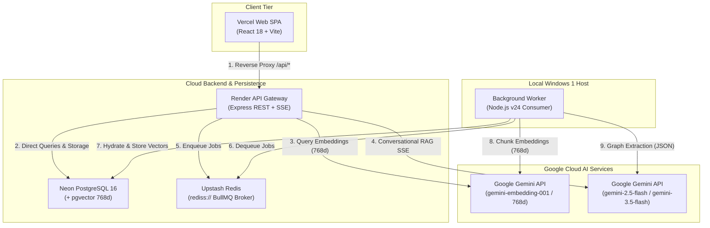

# MindVault — Revised Production Architecture Audit
## Phase 1B: Gemini-Only Inference Architecture Specification

**Document Version:** 1.0.0  
**Status:** PROPOSED & AUDITED (Read-Only Baseline)  
**Date:** November 16, 2026  
**Architectural Scope:** Deprecation of Local Ollama & Standardization on Google Gemini API

---

## 1. Executive Summary & Architectural Rationale

MindVault has executed an architectural pivot: **complete deprecation of local Ollama inference infrastructure (Qwen3 and nomic-embed-text) in favor of Google Gemini cloud AI APIs**.

### Motivation for the Transition
1. **Elimination of Ingress/Tunneling Security Vulnerabilities:**
   Under the hybrid Ollama architecture, the cloud-hosted Render API required an inbound HTTPS tunnel (e.g. `ngrok` or Cloudflare Tunnel) to connect to the Windows machine's local port `11434` for query embeddings. Ollama has zero native authentication. Deprecating Ollama eliminates this inbound exposure vector entirely; all AI traffic flows outbound via TLS to Google's hardened API gateways.
2. **Resource Right-Sizing on Host Machine:**
   The primary development and demonstration host is an Intel Core i3-1115G4 with 8 GB RAM. Running Ollama locally with `qwen3:0.6b` and `nomic-embed-text` consumed significant memory and CPU/GPU cycles, necessitating worker throttling to `WORKER_CONCURRENCY=1`. Cloud-based inference relieves the local CPU, eliminating thermal throttling, out-of-memory risks, and background sluggishness.
3. **Enterprise-Grade Model Quality & Performance:**
   * **Generation:** Migrating from quantized 0.6B local parameters (`qwen3:0.6b`) to Gemini Flash (`gemini-2.5-flash` / `gemini-3.5-flash`) provides a massive leap in reasoning, structured JSON schema compliance, multi-turn conversational nuance, and multilingual capabilities.
   * **Embeddings:** Migrating to `gemini-embedding-001` provides state-of-the-art semantic retrieval quality while supporting Matryoshka Representation Learning (MRL) output dimensionality truncation to **768 dimensions**, preserving the existing PostgreSQL `vector(768)` database schema without DDL migration.
4. **Unified Multi-Modal Pipeline:**
   Gemini natively supports multi-modal inputs (text, PDF, audio, images), paving the way for advanced future ingestion capabilities without external OCR or local whisper engines.

---

## 2. Target Production Architecture Topology

---

## 3. Workload Mapping & Model Selection

| Workload | System Component | Previous Engine | Proposed Gemini Engine | Output Format / Config |
| :--- | :--- | :--- | :--- | :--- |
| **Document Chunk Embeddings** | `apps/worker` Ingestion Pipeline | Ollama `nomic-embed-text` | `gemini-embedding-2` (Recommended) | `outputDimensionality: 768` `taskType: RETRIEVAL_DOCUMENT` Auto-normalized to unit vector |
| **Query Vector Generation** | `apps/api` Retrieval Engine | Ollama `nomic-embed-text` | `gemini-embedding-2` (Recommended) | `outputDimensionality: 768` `taskType: RETRIEVAL_QUERY` Auto-normalized to unit vector |
| **Conversational RAG Generation** | `apps/api` Generation Engine | Ollama `qwen3:0.6b` | `gemini-3.8-flash` (or `gemini-3.6-flash`) | SSE streaming (`text/event-stream`) token chunks |
| **Knowledge Graph Entity Extraction** | `apps/worker` Graph Pipeline | Ollama `qwen3:0.6b` | `gemini-3.5-flash-lite` / `gemini-3.8-flash` | `responseMimeType: 'application/json'` + Zod schema validation |
| **Knowledge Graph Relation Extraction** | `apps/worker` Graph Pipeline | Ollama `qwen3:0.6b` | `gemini-3.5-flash-lite` / `gemini-3.8-flash` | Structured JSON array with source/target/evidence |
| **Query Routing & Intent Classification** | `apps/api` Retrieval Preprocessor | Rule-based / Ollama | `gemini-3.5-flash-lite` | Low token budget (max 256 tokens, temp 0.0) |

---

## 4. Provider Architecture Design

### 4.1 Common Gemini Client Abstraction
Currently, both `apps/api` and `apps/worker` independently import `@google/genai` with separate options and partial implementations:
* `apps/api/src/modules/generation/providers/gemini.provider.ts` (implements `LLMProvider`)
* `apps/api/src/modules/graph/providers/gemini-extraction.provider.ts` (implements `IKnowledgeExtractionProvider`)
* `apps/worker/src/modules/graph/providers/gemini-extraction.provider.ts` (implements `IKnowledgeExtractionProvider`)
* **Missing:** Neither package currently has a `GeminiEmbeddingProvider`.

**Architectural Recommendation:**
Centralize all Gemini interfaces and provider implementations in `@mindvault/shared`:
1. `GeminiClientFactory`: Manages singleton instances of `GoogleGenAI` per API key.
2. `GeminiEmbeddingProvider`: Implements `EmbeddingProvider` from `@mindvault/shared/types.ts`:
   * `modelName: 'gemini-embedding-001'`
   * `dimension: 768`
   * `generateEmbedding(text: string): Promise<number[]>`
   * `generateEmbeddings(texts: string[]): Promise<number[][]>`
3. `GeminiLLMProvider`: Unified text generation & streaming provider.
4. `GeminiExtractionProvider`: Unified structured graph entity and relation extraction provider.

### 4.2 Error Handling, Backoff & Rate Limits
* **Rate Limits:**
  * Free Tier: 15 Requests Per Minute (RPM), 1,500 Requests Per Day (RPD).
  * Paid Tier: 1,500 - 3,000 RPM for embeddings; 1,000+ RPM for Flash models.
* **Transient Error Classifier:**
  * Status 429 (`RESOURCE_EXHAUSTED`): Exponential backoff with full jitter ($T = \min(60s, \text{base} \times 2^{\text{attempt}} \pm \text{jitter})$).
  * Status 503 (`UNAVAILABLE` / High Demand Spike): Automatic retries with 2-second initial delay.
  * Status 400 (`INVALID_ARGUMENT`): Non-retryable; log validation error immediately.
* **Timeout & Abort Propagation:**
  * AbortController signals connected to HTTP client requests, strictly bounded by `LLM_REQUEST_TIMEOUT` (default: 60,000ms).

---

## 5. Worker Architecture Compatibility

The Windows background worker will continue executing locally while decoupling completely from Ollama:
1. **BullMQ Worker Process:**
   * Dequeues `process-document` jobs from Upstash Redis.
   * Operates asynchronously on the Windows host.
2. **Hydration via Database Metadata:**
   * Preserves the verified **Hybrid Cloud-to-Local Bridge** in `pipeline.ts`: files uploaded through Render are read from `doc.metadata.rawContentBase64`, cached locally, and stripped upon completion.
3. **Embedding Generation:**
   * Replaces `OllamaEmbeddingProvider` with `GeminiEmbeddingProvider`.
   * Sends batches of chunk texts to Google Gemini via HTTPS outbound.
   * Employs batching ($N=16$ or $N=32$) to respect quota limits.
4. **Graph Extraction:**
   * Directly uses `GeminiExtractionProvider` with JSON structured schema output.
   * Completely bypasses local Ollama JSON format parsing quirks.
5. **Worker Concurrency Scaling:**
   * Freed from CPU/VRAM saturation caused by local LLM processes, worker concurrency on the i3 machine can safely scale from `1` to `2` or `3` concurrent jobs if desired (bounded only by Gemini API quota).

---

## 6. Security & Credential Isolation

* **Single Secret Standard:** `GEMINI_API_KEY` becomes the sole required AI credential across API and Worker environments.
* **Zero Inbound Ports:** No ports need to be opened or forwarded on the Windows host.
* **Zero Plaintext Storage:** Keys are read exclusively from environment variables or secure token stores; never committed to git or exposed in client bundles.
