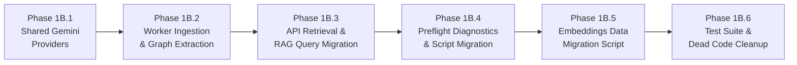

# MindVault — Gemini Migration Implementation Roadmap
## Phased Implementation Sequence, Risk Matrix & Testing Strategy

**Document Version:** 1.0.0  
**Status:** PROPOSED ROADMAP (Awaiting Human Approval)  
**Date:** November 16, 2026  

---

## 1. Phased Implementation Breakdown

### Phase 1B.1: Core Gemini Provider Abstraction
* **Objective:** Implement shared, production-grade Gemini embedding and generation providers using `@google/genai`.
* **Tasks:**
  1. Create `GeminiEmbeddingProvider` implementing `EmbeddingProvider` (`outputDimensionality: 768`, `model: 'gemini-embedding-001'`).
  2. Implement exponential backoff, jitter, and retry logic for HTTP 429 (`RESOURCE_EXHAUSTED`) and 503 errors.
  3. Support batch embedding (`generateEmbeddings(texts: string[])`).
  4. Ensure deterministic `MockEmbeddingProvider` is maintained for offline test isolation.

### Phase 1B.2: Worker Ingestion & Graph Extraction Migration
* **Objective:** Transition the Windows background worker entirely to Gemini.
* **Tasks:**
  1. Wire `GeminiEmbeddingProvider` into `DocumentIngestionPipeline`.
  2. Wire `GeminiExtractionProvider` as the default in `apps/worker/src/modules/graph/providers/provider.factory.ts`.
  3. Replace `validateOllamaEnvironment` in `apps/worker/src/worker.ts` with `validateGeminiEnvironment`.
  4. Remove Ollama preflight blockers during worker startup.

### Phase 1B.3: API Retrieval & RAG Query Migration
* **Objective:** Transition API query embedding and chat generation to Gemini.
* **Tasks:**
  1. Wire `GeminiEmbeddingProvider` into `apps/api/src/modules/retrieval/embeddings/embedding.service.ts`.
  2. Set `LLMProviderFactory` in `apps/api/src/modules/generation/providers/provider.factory.ts` to default to `GeminiProvider`.
  3. Update `envSchema` in `apps/api/src/config/env.ts` with `LLM_PROVIDER.default('gemini')`.

### Phase 1B.4: Preflight Scripts & Diagnostics Migration
* **Objective:** Update diagnostic scripts to verify Google Gemini API connectivity.
* **Tasks:**
  1. Update `scripts/verify-worker-preflight.ts`: Replace step `[4/5]` (Ollama check) with Gemini API key and model availability checks.
  2. Update `scripts/start-local-worker.ps1`: Remove Ollama daemon check and `OLLAMA_BASE_URL`.
  3. Update `scripts/verify-demo-environment.ts`: Update LLM service check.

### Phase 1B.5: Data Migration Script Execution
* **Objective:** Re-embed existing document chunks in the database using Gemini embeddings.
* **Tasks:**
  1. Implement `scripts/migrate-embeddings-to-gemini.ts`.
  2. Execute re-embedding across existing documents with progress tracking and transaction safety.
  3. Verify cosine similarity retrieval consistency on migrated chunks.

### Phase 1B.6: Test Suite Updates & Deprecation Cleanup
* **Objective:** Update unit/integration tests and remove dead Ollama code.
* **Tasks:**
  1. Update `tests/local-worker-runtime.test.ts` and `tests/verify-demo-environment.test.ts`.
  2. Remove dead Ollama provider files from `apps/api` and `apps/worker`.
  3. Verify all 8 repository quality gates: `lint`, `format:check`, `typecheck`, `test`, `build`, `worker:preflight`, `demo:check`, `test:e2e:worker`.

---

## 2. Risk Assessment & Mitigation Matrix

| Identified Risk | Severity | Probability | Mitigation Strategy |
| :--- | :---: | :---: | :--- |
| **Google Gemini API Rate Limits (429)** | High | Medium | Implement automatic exponential backoff with jitter in `GeminiEmbeddingProvider`. Group chunk embedding in batches of 16. Recommend Pay-as-you-go key for production. |
| **Vector Space Incompatibility during Re-embedding** | High | Low | Atomic per-document transactions in `migrate-embeddings-to-gemini.ts`. Search queries enforce model homogeneity via `EmbeddingService.validateCompatibility`. |
| **Network Latency during Chunk Embedding** | Medium | Low | Parallelize chunk batching via `Promise.allSettled` with bounded concurrency. Embeddings latency typically $< 250\text{ms}$ per batch on Google GenAI SDK. |
| **Offline Test Suite Breakage** | Medium | Low | Ensure unit tests continue using `MockEmbeddingProvider` and `MockLLMProvider`. Zero external API calls during `vitest run`. |

---

## 3. Rollback Plan

If unforeseen issues arise during Phase 1B implementation:
1. **Git Isolation:** All changes will be developed in a distinct feature branch or cleanly staged logical commits.
2. **Database State:** Because `outputDimensionality: 768` is maintained, the PostgreSQL column definition `vector(768)` remains completely unchanged.
3. **Provider Fallback:** The provider factories maintain modular provider interfaces, allowing rapid fallback if necessary.
