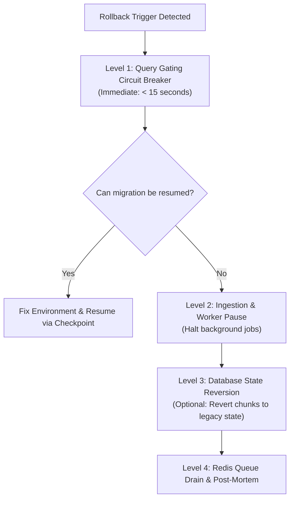

# MindVault — Phase 1B Rollback and Recovery Manual
## Emergency Operational Protocols, Failure Scenarios, and Disaster Recovery

**Document Version:** 3.0.0  
**Audit Date:** November 16, 2026  
**Execution Mode:** STRICTLY READ-ONLY (Operational Reference Manual)  
**Applicability:** Production Deployment & Active Migration

---

## 1. Rollback Thresholds & Trigger Conditions

A rollback must be initiated immediately if any of the following operational conditions are met:

| Trigger ID | Failure Condition | Measurement / Detection Method | Severity Level | Immediate Action |
| :--- | :--- | :--- | :--- | :--- |
| **TRG-01** | **Gemini Daily Quota Exhaustion** | HTTP 429 `RESOURCE_EXHAUSTED` persisting $> 15\text{ minutes}$ with daily quota exhausted header | **CRITICAL** | Pause migration; revert API vector queries to Keyword Search Fallback |
| **TRG-02** | **Retrieval Quality Regression** | Evaluation dataset MRR@10 drops below $0.80$ (or $> 5\%$ drop from baseline) | **CRITICAL** | Abort migration; execute Level 1 Circuit Breaker |
| **TRG-03** | **Neon Pool Contention** | Active Neon PostgreSQL connections exceed 8 (saturation $> 80\%$) for $> 60\text{ seconds}$ | **HIGH** | Pause worker; reduce batch size or hold migration |
| **TRG-04** | **Poison Chunk Failure Rate** | Over $2\%$ of chunks in a workspace fail consecutively into `_migration_failures` | **HIGH** | Halt batch; inspect quarantine logs; alert operator |
| **TRG-05** | **Worker Crash Loop** | Worker process crashes $> 3$ times within a 10-minute window | **CRITICAL** | Terminate worker; release distributed locks; run diagnostics |

---

## 2. Tiered Rollback Procedures



### 2.1 Level 1: Immediate Query Fencing Circuit Breaker ($< 15$ seconds)
If Gemini inference is failing or producing unacceptable retrieval quality, vector search can be instantly disabled across the API **without restarting servers or altering the database schema**.

1. **Environment Flag:** Set `DISABLE_VECTOR_SEARCH=true` in Render / API environment variables.
2. **Behavioral Impact:**
   * The retrieval pipeline in [`retrieval.service.ts`](file:///c:/Users/mohit/OneDrive/Desktop/MindVault/apps/api/src/modules/retrieval/services/retrieval.service.ts) automatically bypasses `searchVectorChunks`.
   * Search requests automatically execute in **Keyword-Only Mode** using PostgreSQL Full-Text Search (`ts_rank_cd`), preserving 100% search availability.
   * Chat generation continues to ground on keyword search context.

### 2.2 Level 2: Worker Ingestion Pause ($< 30$ seconds)
If the worker process is overwhelming database connections or triggering rate limits:

```powershell
# 1. Pause the BullMQ document ingestion queue via Upstash Redis CLI / script:
pnpm exec tsx scripts/manage-queue.ts --pause document-processing

# 2. Pause the knowledge graph extraction queue:
pnpm exec tsx scripts/manage-queue.ts --pause graph-extraction
```
Existing jobs in memory complete cleanly; no new jobs are claimed.

### 2.3 Level 3: Database State Reversion (Emergency Full Reversion)
If the operator determines that Phase 1B must be completely aborted and rolled back to the pre-migration baseline:

```sql
-- Step 1: Revert all promoted documents in the target workspace
UPDATE "documents"
SET "embeddingModel" = 'nomic-embed-text',
    "updatedAt" = NOW()
WHERE "workspaceId" = $workspaceId
  AND "embeddingModel" = 'gemini-embedding-2';

-- Step 2: Clear migration chunk metadata tags
UPDATE "document_chunks"
SET "metadata" = "metadata" - 'embeddingModel' - 'embeddedAt' - 'migrationLease'
WHERE "workspaceId" = $workspaceId
  AND "metadata"->>'embeddingModel' = 'gemini-embedding-2';

-- Step 3: Reset migration checkpoint
UPDATE "_migration_checkpoints"
SET "status" = 'ABORTED',
    "updated_at" = NOW()
WHERE "workspaceId" = $workspaceId;
```
*Note: Because chunk vectors in `document_chunks.embedding` were overwritten, restoring exact Nomic vectors requires re-running the legacy Ollama worker or restoring from a Neon point-in-time recovery (PITR) branch if point-in-time rollback is necessary.*

---

## 3. Crash Recovery & Resumption Protocols

### 3.1 Idempotent Resumption Procedure
Because the migration pipeline is designed with **bounded micro-transactions and zero long-running database transactions**, a crash leaves zero uncommitted partial state.

To resume an interrupted migration:

```powershell
# Execute the migration script with the --resume flag:
pnpm exec tsx scripts/migrate-embeddings-to-gemini.ts --workspace-id <workspaceId> --resume
```

**Resumption Execution Logic:**
1. Verifies that no other worker holds an active distributed lock.
2. Reads the last committed `last_chunk_id` from `_migration_checkpoints`.
3. Claims the next unmigrated chunk batch where `(metadata->>'embeddingModel' IS DISTINCT FROM 'gemini-embedding-2' OR metadata->>'embeddingModel' IS NULL)`.
4. Resumes batch processing within $< 5\text{ seconds}$.

### 3.2 Orphaned Lock & Lease Reclamation
If a worker crashed while holding a distributed lock or chunk lease:

#### A. Reclaiming Redis Distributed Lock
The Redis lock key `mindvault:migration:lock:<workspaceId>` has an automatic TTL of 600 seconds (10 minutes).  
To force-release the lock immediately:
```powershell
pnpm exec tsx scripts/clear-migration-lock.ts --workspace-id <workspaceId>
```

#### B. Reclaiming Expired PostgreSQL Chunk Leases
Chunks locked by an ungracefully terminated worker carry an expiration timestamp in `metadata->'migrationLease'->>'expiresAt'`.  
The claim query automatically reclaims chunks whose lease has expired:
```sql
-- Chunks with expired leases are automatically re-eligible for claim:
WHERE (
  dc.metadata->>'embeddingModel' IS DISTINCT FROM 'gemini-embedding-2'
  OR dc.metadata->>'embeddingModel' IS NULL
)
AND (
  dc.metadata->'migrationLease' IS NULL
  OR (dc.metadata->'migrationLease'->>'expiresAt')::timestamptz < NOW()
)
```

---

## 4. Poison Chunk Quarantine & Dead-Letter Handling

### 4.1 Dead-Letter Table Specification
Any chunk that fails Gemini API inference 5 consecutive times (e.g. malformed unicode characters or upstream API errors) is quarantined to prevent blocking the entire migration pipeline:

```sql
CREATE TABLE IF NOT EXISTS "_migration_failures" (
    "id" UUID PRIMARY KEY DEFAULT gen_random_uuid(),
    "workspaceId" TEXT NOT NULL,
    "chunkId" TEXT NOT NULL,
    "documentId" TEXT NOT NULL,
    "errorReason" TEXT NOT NULL,
    "attempts" INTEGER NOT NULL DEFAULT 5,
    "failedAt" TIMESTAMP(3) NOT NULL DEFAULT CURRENT_TIMESTAMP,
    CONSTRAINT "_migration_failures_chunkId_key" UNIQUE ("chunkId")
);
```

### 4.2 Inspecting and Retrying Quarantined Chunks
Operator inspection command:

```sql
SELECT f."chunkId", f."documentId", d."originalName", f."errorReason", f."failedAt"
FROM "_migration_failures" f
JOIN "documents" d ON d.id = f."documentId"
ORDER BY f."failedAt" DESC;
```

To re-attempt quarantined chunks after fixing upstream issues:
```powershell
pnpm exec tsx scripts/retry-migration-failures.ts --workspace-id <workspaceId>
```

---

## 5. Post-Incident Review Protocol

Following any rollback or recovery event:
1. Export logs from Render API (`POST /api/v1/telemetry/errors`) and local worker runtime.
2. Check Google Cloud Console API Metrics for quota rejections or 429 status spikes.
3. Verify database integrity using `pnpm exec tsx scripts/verify-database-integrity.ts`.
4. File a Post-Incident Analysis report documenting:
   * Time of detection.
   * Root cause (quota exhaustion, network failure, poison data).
   * Total chunks affected.
   * Time to resolution and recovery verification.
