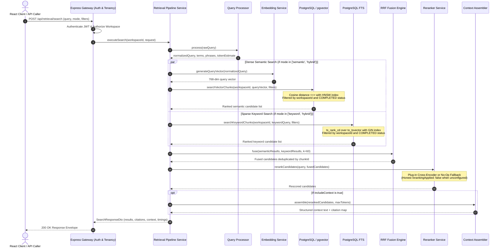

# MindVault — Retrieval Engine Architecture

**Phase:** Phase 3 (Retrieval Engine & Hybrid Search)  
**Status:** Completed & Verified

---

## 1. Architectural Overview

MindVault's Retrieval Engine transforms stored document chunks and vector representations into an evidence-grounded, multi-tenant knowledge retrieval system.

The subsystem operates independently of LLM generation: it accepts natural language queries, validates and normalizes query intent, performs dual retrieval (dense semantic search via pgvector and sparse keyword search via PostgreSQL Full-Text Search), merges ranked lists using Reciprocal Rank Fusion (RRF), optionally rescores candidates via a pluggable reranker abstraction, budgets tokens into structured context, and tags every item with stable source citations (`[S1]`, `[S2]`).



---

## 2. Subsystem Components

### 2.1 Query Processing & Normalization (`modules/retrieval/query/`)

- **Validation:** Enforces non-empty strings and a strict 1,000-character upper bound.
- **Normalization:** Employs Unicode NFKC normalization, eliminates invisible ASCII control characters, standardizes smart quotes (`“”‘’` to `""''`), and collapses irregular whitespace.
- **Token Extraction:** Dissects phrases (e.g., `"supervised learning"`) and alphanumeric tokens for full-text search.
- **Heuristic Token Counting:** Computes pre-retrieval token estimates using character-to-word heuristics.

### 2.2 Dense Vector Semantic Retrieval (`modules/retrieval/embeddings/` & `lib/db.ts`)

- **Model Invariant:** Strictly 768 dimensions (`nomic-embed-text` v1.5 or test mock).
- **Metric:** Cosine distance (`<=>`). Cosine similarity calculated as $1 - \text{distance}$.
- **Tenancy Boundary:** Parameterized SQL executes directly in PostgreSQL:
  ```sql
  WHERE c."workspaceId" = $1 AND d."workspaceId" = $1 AND d."status" = 'COMPLETED'
  ```
- **Index:** PostgreSQL HNSW index on `document_chunks.embedding` using `vector_cosine_ops`.

### 2.3 Sparse Full-Text Keyword Retrieval (`lib/db.ts` & migration)

- **Engine:** PostgreSQL English Full-Text Search.
- **Query Parser:** `websearch_to_tsquery('english', $query)` supporting quotes, boolean operators, and natural phrases, with graceful fallback to `plainto_tsquery`.
- **Ranking Function:** `ts_rank_cd(to_tsvector('english', c.content), query)` using cover density ranking.
- **Index:** PostgreSQL GIN index on stored `search_vector` column and functional expression `to_tsvector('english', content)`.

### 2.4 Reciprocal Rank Fusion (`modules/retrieval/fusion/`)

- Combines semantic and keyword ranked lists without score-scale distortion:
  $$RRF\_score(d) = \sum_{m \in M} \frac{1}{k + rank_m(d)}$$
- Constant: $k = 60$.
- Deduplicates chunks across both sources and preserves origin tracking (`['semantic', 'keyword']`).

### 2.5 Extensible Reranking Engine (`modules/retrieval/reranking/`)

- Provider abstraction decoupling reranking from core execution.
- Default: `NoOpRerankerProvider` which preserves native RRF ordering and honestly returns `rerankingApplied: false`.
- Pluggable support for cross-encoders, Cohere, Jina, or local reranking services without forcing heavy local dependencies.

### 2.6 Context Assembly & Citation Tracking (`modules/retrieval/context/`)

- **Token Budgeting:** Strictly caps context block size (default 3,000 tokens, configurable from 500 to 16,000).
- **Stable Citations:** Generates sequential references (`[S1]`, `[S2]`, etc.) associated with document name, chunk index, page number, and section title.
- **Deduplication:** Prevents identical chunks from consuming duplicate budget tokens.
- **Structured Formatting:** Emits clean markdown source blocks ready for future LLM generation in Phase 4.

---

## 3. Performance & Observability Telemetry

Every retrieval response includes timing metrics down to two decimal places:

- `queryProcessingMs`
- `embeddingGenerationMs`
- `semanticSearchMs`
- `keywordSearchMs`
- `fusionMs`
- `rerankingMs`
- `contextAssemblyMs`
- `totalMs`
