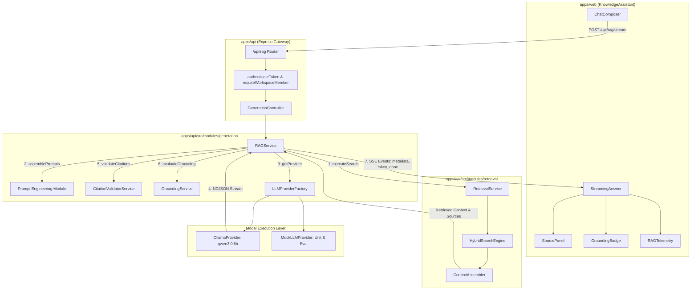
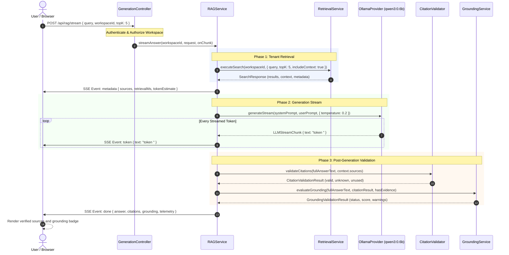

# MindVault — Phase 4 Generation Architecture

**Date:** 2026-11-06  
**Status:** Implemented & Verified  
**Scope:** Architecture, Component Decomposition, Data Flow, and Telemetry

---

## 1. Architectural Philosophy

MindVault Phase 4 transforms the retrieval platform into an evidence-grounded generative assistant. Rather than allowing a Large Language Model (LLM) to fabricate answers from its parameter weights or produce unverified claims, MindVault enforces an **evidence-first generation protocol**:

1. **Retrieval Precedes Generation:** An LLM is never invoked without prior execution of tenant-isolated hybrid retrieval.
2. **Zero-Evidence Short-Circuit:** When retrieval produces zero matching chunks, the pipeline refuses generation early, saving compute and preventing hallucinations.
3. **Structured Citation Anchoring:** The LLM is constrained to reference evidence chunks using explicit bracketed keys (`[S1]`, `[S2]`).
4. **Post-Generation Validation:** Output text is deterministically parsed by [`CitationValidatorService`](file:///c:/Users/mohit/OneDrive/Desktop/MindVault/apps/api/src/modules/generation/services/citation-validator.service.ts) and evaluated by [`GroundingService`](file:///c:/Users/mohit/OneDrive/Desktop/MindVault/apps/api/src/modules/generation/services/grounding.service.ts) before completion is signaled.
5. **Bidirectional Streaming Protocol:** Full Server-Sent Events (SSE) support delivers immediate token responsiveness to the user interface alongside structured source and telemetry metadata.

---

## 2. High-Level Component Decomposition

---

## 3. End-to-End Sequence Diagram

---

## 4. Telemetry Structure & Latency Attribution

Every non-streaming response and streaming `done` payload provides structured timing telemetry conforming to [`RAGTelemetryDto`](file:///c:/Users/mohit/OneDrive/Desktop/MindVault/packages/shared/src/types.ts):

| Field             | Type     | Description                                                                                                        |
| :---------------- | :------- | :----------------------------------------------------------------------------------------------------------------- |
| `retrievalMs`     | `number` | Time taken for query normalization, embedding generation, vector distance calculation, FTS ranking, and RRF fusion |
| `generationMs`    | `number` | Time taken for LLM prompt processing, inference, and response streaming                                            |
| `totalMs`         | `number` | Total wall-clock time from request ingress to response finalization                                                |
| `tokensGenerated` | `number` | Count of output tokens emitted by the LLM provider                                                                 |
| `provider`        | `string` | Identifier of active backend (e.g. `ollama`, `mock`)                                                               |
| `model`           | `string` | Concrete model version utilized (e.g. `qwen3:0.6b`, `mock-deterministic`)                                          |

---

## 5. Module File Structure

All Phase 4 backend generation components are encapsulated inside [`apps/api/src/modules/generation/`](file:///c:/Users/mohit/OneDrive/Desktop/MindVault/apps/api/src/modules/generation):

- [`generation.routes.ts`](file:///c:/Users/mohit/OneDrive/Desktop/MindVault/apps/api/src/modules/generation/generation.routes.ts): REST routing with JWT authentication and workspace membership middleware.
- [`generation.controller.ts`](file:///c:/Users/mohit/OneDrive/Desktop/MindVault/apps/api/src/modules/generation/generation.controller.ts): Input schema validation, SSE stream management, and HTTP error normalization.
- [`services/rag.service.ts`](file:///c:/Users/mohit/OneDrive/Desktop/MindVault/apps/api/src/modules/generation/services/rag.service.ts): High-level RAG orchestration, prompt binding, and validation coordination.
- [`services/citation-validator.service.ts`](file:///c:/Users/mohit/OneDrive/Desktop/MindVault/apps/api/src/modules/generation/services/citation-validator.service.ts): Deterministic regex citation parser and source cross-referencer.
- [`services/grounding.service.ts`](file:///c:/Users/mohit/OneDrive/Desktop/MindVault/apps/api/src/modules/generation/services/grounding.service.ts): Grounding status classifier and hallucination detector.
- [`prompts/system.prompt.ts`](file:///c:/Users/mohit/OneDrive/Desktop/MindVault/apps/api/src/modules/generation/prompts/system.prompt.ts): Strict evidence adherence instructions and anti-injection guards.
- [`prompts/rag.prompt.ts`](file:///c:/Users/mohit/OneDrive/Desktop/MindVault/apps/api/src/modules/generation/prompts/rag.prompt.ts): Contextual user prompt template with untrusted evidence boundaries.
- [`providers/llm.provider.ts`](file:///c:/Users/mohit/OneDrive/Desktop/MindVault/apps/api/src/modules/generation/providers/llm.provider.ts): Base interface contract.
- [`providers/ollama.provider.ts`](file:///c:/Users/mohit/OneDrive/Desktop/MindVault/apps/api/src/modules/generation/providers/ollama.provider.ts): Production Ollama HTTP & SSE client.
- [`providers/mock.provider.ts`](file:///c:/Users/mohit/OneDrive/Desktop/MindVault/apps/api/src/modules/generation/providers/mock.provider.ts): Deterministic mock provider for tests and benchmarking.
- [`providers/provider.factory.ts`](file:///c:/Users/mohit/OneDrive/Desktop/MindVault/apps/api/src/modules/generation/providers/provider.factory.ts): Singleton factory managing provider instances.
