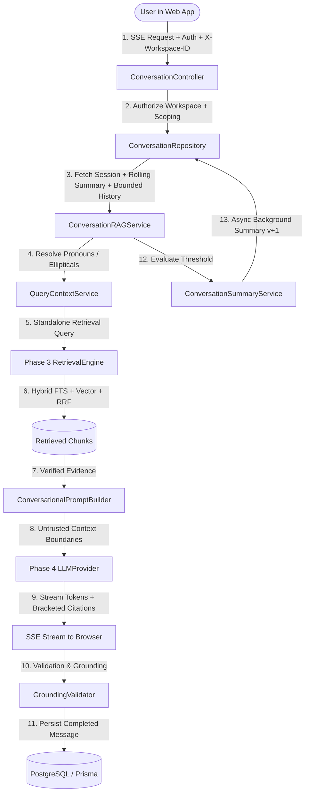

# MindVault — Phase 5: Conversational RAG & Memory Subsystem Architecture

**Version:** 1.0  
**Phase:** 5 — Conversational RAG, Persistent Chat Sessions & Conversation Memory  
**Status:** Implemented & Verified

---

## 1. Executive Summary

Phase 5 elevates MindVault from a stateless single-turn RAG assistant (Phase 4) into a multi-turn, multi-tenant conversational knowledge partner. It maintains persistent chat sessions, tracks message sequences with strict database integrity, contextualizes follow-up questions (resolving pronouns, elliptical phrases, and topic shifts), synthesizes compact rolling memory summaries, and streams evidence-grounded answers over Server-Sent Events (SSE) with robust disconnect and abort recovery.

---

## 2. Architectural Principles & Invariants

1. **Workspace-First Isolation:**  
   Every chat session and message is strictly partitioned by `workspace_id`. Cross-workspace reads, writes, and references are prevented at the database and middleware layers.

2. **Context vs. Evidence Boundary (Anti-Hallucination Invariant):**  
   Conversation history and summaries are treated strictly as **untrusted conversational context**, never as authoritative factual evidence. The assistant is strictly prohibited from citing previous assistant messages as `[S1]`, `[S2]` unless that evidence is freshly retrieved from the workspace document index.

3. **Multi-Turn Contextualization:**  
   Users converse naturally using pronouns ("it", "they", "the former") and elliptical follow-ups ("And what about its drawbacks?"). The `QueryContextService` reconstructs a self-contained query before querying the vector and FTS indexes.

4. **Bounded Memory with Dual-Tier Retention:**  
   To prevent unbounded context growth and token exhaustion:
   - **Tier 1 (Sliding Window):** The $k$ most recent dialogue messages (default: 6–10 turns) are retained in full.
   - **Tier 2 (Rolling Summary):** Older turns are periodically compressed by `ConversationSummaryService` into a bounded neutral summary ($\le 120$ words) that captures key topics, user constraints, and objectives.

5. **Fail-Safe Streaming Persistence:**  
   Client disconnects, cancellations, and network drops are intercepted by `AbortSignal` listeners. Pending assistant messages immediately transition from `STREAMING` to `CANCELLED`, completely preventing orphaned records.

---

## 3. Subsystem Breakdown

### 3.1 Data Layer (`prisma/schema.prisma` & `apps/api/src/lib/db.ts`)

- `ChatSession`: Represents a conversation thread scoped to a workspace and user, tracking message counts, active status, and rolling summaries.
- `ChatMessage`: Represents individual turns (`USER`, `ASSISTANT`, `SYSTEM`), sequence numbers with `(session_id, sequence_number)` uniqueness, JSON-persisted citation arrays, and status (`PENDING`, `STREAMING`, `COMPLETED`, `FAILED`, `CANCELLED`).

### 3.2 Contextual Query Understanding (`apps/api/src/modules/conversations/services/query-context.service.ts`)

- Analyzes incoming messages for pronouns and conversational dependencies.
- Reconstructs standalone search queries using heuristic expansion or low-latency LLM rewrite prompts.
- Preserves self-contained queries and detected topic shifts without distortion.

### 3.3 Rolling Summary Engine (`apps/api/src/modules/conversations/services/summary.service.ts`)

- Monitors completed message thresholds (default: 4 unsummarized messages).
- Triggers non-blocking background summarization using conservative temperature ($0.1$).
- Updates `summary`, `summaryVersion`, and `summarizedThroughSeq` atomically.

### 3.4 Conversational Prompt Builder (`apps/api/src/modules/conversations/prompts/conversational.prompt.ts`)

- Uses explicit boundary markers:
  - `=== BEGIN CONVERSATION SUMMARY (UNTRUSTED CONTEXT) ===`
  - `=== BEGIN RECENT CONVERSATION HISTORY (UNTRUSTED CONTEXT) ===`
  - `=== BEGIN UNTRUSTED RETRIEVED CONTEXT ===`
- Instructs the model to treat past turns purely for conversational disambiguation and cite only verified source tags.

### 3.5 Conversational RAG Service (`apps/api/src/modules/conversations/services/conversation-rag.service.ts`)

- Orchestrates optimistic message creation, retrieval, prompt assembly, token streaming, post-generation citation validation, and background memory updates.

### 3.6 Frontend User Experience (`apps/web/src/components/assistant/`)

- `ConversationSidebar`: Search, create, rename, archive, and delete sessions.
- `ConversationHeader`: Session title, message count badge, and memory summary modal.
- `ChatTimeline`: Smooth auto-scrolling message list with token streaming indicators.
- `ChatMessage`: Clickable citation badges `[S1]`, copy-to-clipboard, retry on failure.
- `SourcePanel`: Evidence drawer displaying retrieved chunks and scores.
