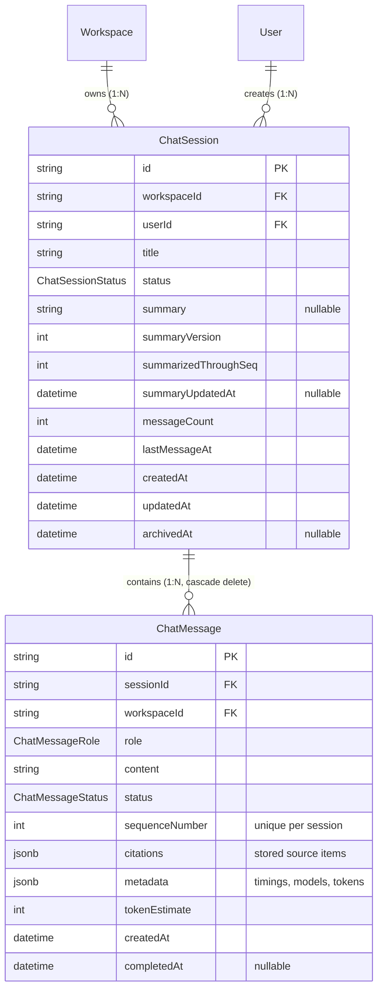

# MindVault — Phase 5: Database Schema & Migration Reference

**Migration:** `20261106000002_add_chat_sessions_and_messages`  
**Status:** Applied & Generated

---

## 1. Schema Design Overview

Phase 5 introduces two primary models to PostgreSQL: `ChatSession` and `ChatMessage`, accompanied by three strongly-typed enums:

- `ChatSessionStatus`: `ACTIVE`, `ARCHIVED`, `DELETED`
- `ChatMessageRole`: `USER`, `ASSISTANT`, `SYSTEM`
- `ChatMessageStatus`: `PENDING`, `STREAMING`, `COMPLETED`, `FAILED`, `CANCELLED`

---

## 2. Table Definitions & DDL

### 2.1 `chat_sessions` Table

| Column Name              | SQL Type              | Nullable | Default              | Description                                                 |
| ------------------------ | --------------------- | -------- | -------------------- | ----------------------------------------------------------- |
| `id`                     | `TEXT`                | No       | `gen_random_uuid()`  | Primary Key                                                 |
| `workspace_id`           | `TEXT`                | No       | -                    | Foreign Key -> `workspaces(id)` ON DELETE CASCADE           |
| `user_id`                | `TEXT`                | No       | -                    | Foreign Key -> `users(id)` ON DELETE CASCADE                |
| `title`                  | `TEXT`                | No       | `'New Conversation'` | Human-readable session title                                |
| `status`                 | `chat_session_status` | No       | `'ACTIVE'`           | Current session lifecycle status                            |
| `summary`                | `TEXT`                | Yes      | `NULL`               | Compact rolling conversational summary ($\le 120$ words)    |
| `summary_version`        | `INTEGER`             | No       | `0`                  | Incremented with each summary update                        |
| `summarized_through_seq` | `INTEGER`             | No       | `0`                  | Sequence number through which messages have been summarized |
| `summary_updated_at`     | `TIMESTAMPTZ`         | Yes      | `NULL`               | Timestamp of last summary synthesis                         |
| `message_count`          | `INTEGER`             | No       | `0`                  | Total number of messages in session                         |
| `last_message_at`        | `TIMESTAMPTZ`         | No       | `CURRENT_TIMESTAMP`  | Timestamp of last appended message                          |
| `created_at`             | `TIMESTAMPTZ`         | No       | `CURRENT_TIMESTAMP`  | Creation timestamp                                          |
| `updated_at`             | `TIMESTAMPTZ`         | No       | `CURRENT_TIMESTAMP`  | Last modification timestamp                                 |
| `archived_at`            | `TIMESTAMPTZ`         | Yes      | `NULL`               | Timestamp of archiving                                      |

**Indexes on `chat_sessions`:**

- `chat_sessions_pkey`: `PRIMARY KEY (id)`
- `chat_sessions_workspace_id_idx`: `CREATE INDEX ON chat_sessions(workspace_id)`
- `chat_sessions_user_id_idx`: `CREATE INDEX ON chat_sessions(user_id)`
- `chat_sessions_workspace_id_status_last_message_at_idx`: `CREATE INDEX ON chat_sessions(workspace_id, status, last_message_at DESC)`

---

### 2.2 `chat_messages` Table

| Column Name       | SQL Type              | Nullable | Default             | Description                                                      |
| ----------------- | --------------------- | -------- | ------------------- | ---------------------------------------------------------------- |
| `id`              | `TEXT`                | No       | `gen_random_uuid()` | Primary Key                                                      |
| `session_id`      | `TEXT`                | No       | -                   | Foreign Key -> `chat_sessions(id)` ON DELETE CASCADE             |
| `workspace_id`    | `TEXT`                | No       | -                   | Denormalized Foreign Key -> `workspaces(id)` for tenant indexing |
| `role`            | `chat_message_role`   | No       | -                   | Role of sender (`USER`, `ASSISTANT`, `SYSTEM`)                   |
| `content`         | `TEXT`                | No       | `''`                | Full text content of message                                     |
| `status`          | `chat_message_status` | No       | `'COMPLETED'`       | Streaming or completion state                                    |
| `sequence_number` | `INTEGER`             | No       | -                   | Strictly increasing turn index within session                    |
| `citations`       | `JSONB`               | No       | `'[]'`              | Verified evidence sources `[S1]`, `[S2]` and chunk references    |
| `metadata`        | `JSONB`               | No       | `'{}'`              | Grounding validation warnings, latency metrics, models used      |
| `token_estimate`  | `INTEGER`             | No       | `0`                 | Estimated token count using deterministic formula                |
| `created_at`      | `TIMESTAMPTZ`         | No       | `CURRENT_TIMESTAMP` | Creation timestamp                                               |
| `completed_at`    | `TIMESTAMPTZ`         | Yes      | `NULL`              | Timestamp when streaming completed                               |

**Indexes & Constraints on `chat_messages`:**

- `chat_messages_pkey`: `PRIMARY KEY (id)`
- `chat_messages_session_id_sequence_number_key`: `UNIQUE (session_id, sequence_number)`
- `chat_messages_session_id_idx`: `CREATE INDEX ON chat_messages(session_id)`
- `chat_messages_workspace_id_idx`: `CREATE INDEX ON chat_messages(workspace_id)`
- `chat_messages_session_id_sequence_number_idx`: `CREATE INDEX ON chat_messages(session_id, sequence_number ASC)`

---

## 3. Data Integrity & Cascade Rules

1. **Workspace Cascade:**  
   When a `Workspace` is deleted, all associated `ChatSession` records are deleted automatically (`ON DELETE CASCADE`).
2. **Session Cascade:**  
   When a `ChatSession` is deleted, all constituent `ChatMessage` records are deleted automatically (`ON DELETE CASCADE`).
3. **Turn Sequence Invariant:**  
   `UNIQUE (session_id, sequence_number)` guarantees that no two messages within the same conversation can share the same ordinal position, preventing race conditions or interleaved turns.
