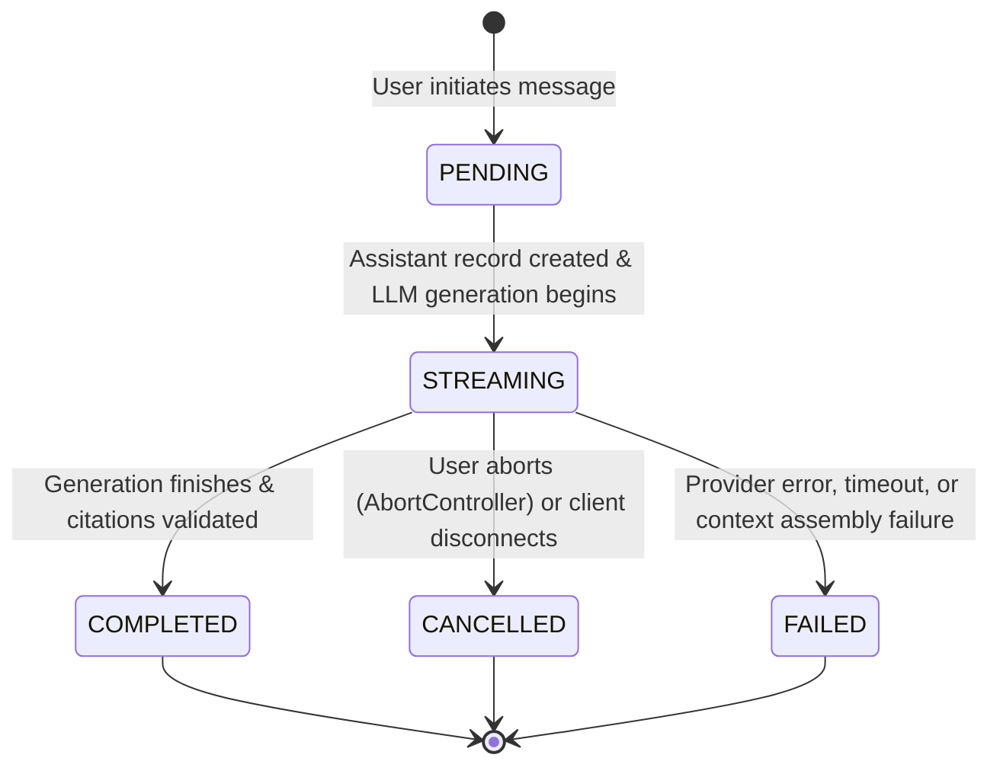

# MindVault — Phase 5: Streaming Lifecycle & Persistence Resilience

---

## 1. Streaming Lifecycle State Machine

Messages undergo a strictly deterministic lifecycle state machine:



---

## 2. Disconnect and Abort Handling (No Orphaned Records)

In production RAG systems, network drops and deliberate user cancellations are frequent. Without defensive lifecycle handling, records remain permanently stuck in `STREAMING`, corrupting conversation history.

### Implementation Pattern in `ConversationRAGService`:

```ts
// Attach client disconnect listener
req.on('close', async () => {
  if (!isStreamDone) {
    isStreamDone = true;
    abortController.abort();
    await ConversationRepository.updateMessage(assistantMessage.id, sessionId, {
      status: 'CANCELLED',
      content: accumulatedAnswerText,
      completedAt: new Date(),
    });
  }
});
```

---

## 3. SSE Protocol Event Sequence

| Event Name           | Payload Format                                    | Timing                 | Purpose                                              |
| -------------------- | ------------------------------------------------- | ---------------------- | ---------------------------------------------------- |
| `start`              | `{ sessionId, messageId, userMessageId }`         | Before generation      | Reconciles frontend optimistic IDs with database IDs |
| `query_rewrite`      | `{ originalQuery, rewrittenQuery, wasRewritten }` | Post-contextualization | Displays how pronouns/ellipticals were resolved      |
| `retrieval_complete` | `{ chunkCount, timings }`                         | Post-retrieval         | Signals evidence retrieval latency                   |
| `sources`            | `{ sources: ContextSourceItem[] }`                | Pre-generation         | Populates frontend source drawer with verified cards |
| `token`              | `{ text: string }`                                | During generation      | Emits delta tokens for real-time typewriter effect   |
| `validation`         | `{ grounding: GroundingValidationResult }`        | Post-generation        | Reports citation adherence and warnings              |
| `summary_updated`    | `{ summary, summaryVersion }`                     | Background             | Broadcasts new summary version if threshold reached  |
| `done`               | `{ messageId, totalTokens, metadata }`            | Stream completion      | Closes stream and updates telemetry                  |
| `error`              | `{ message: string }`                             | On failure             | Notifies frontend of error and closes stream         |
