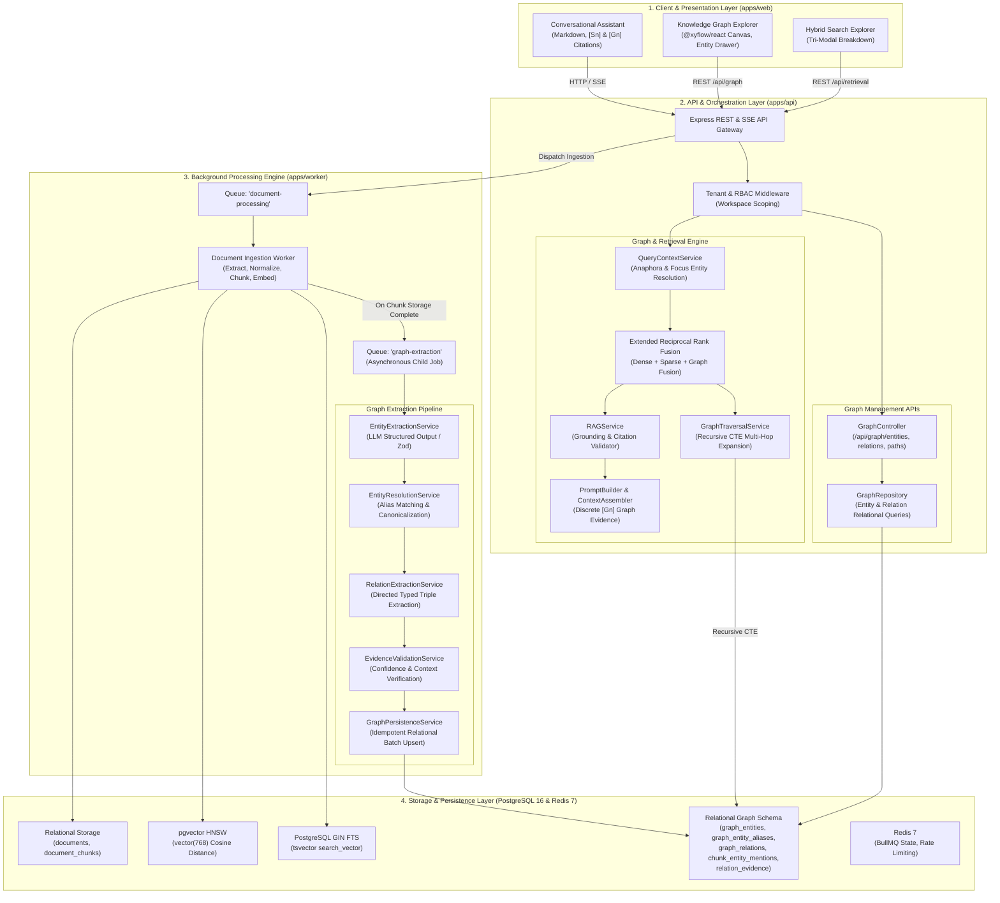

# MindVault — Phase 6: Knowledge Graph & GraphRAG Integration

## System Architecture & Technical Specification

**Document Version:** 1.0.0  
**Status:** Architecture Blueprint (Planning Only)  
**Target Subsystem:** Multi-Tenant Knowledge Graph, GraphRAG Retrieval Engine, Ingestion Worker, and Visualizer  
**Authors:** Principal Software Architect, Senior Backend Engineer, GraphRAG Systems Engineer  
**Date:** November 2026

---

## 1. Executive Vision & Problem Statement

### 1.1 From Chunk-Centric RAG to Relationship-Aware Intelligence

In Phases 0 through 5, MindVault established a high-performance, multi-tenant RAG platform. Documents are ingested, normalized, recursively chunked, embedded via 768-dimensional vectors (`bge-m3`), indexed via PostgreSQL `pgvector` HNSW, and combined with PostgreSQL Full-Text Search (FTS) using Reciprocal Rank Fusion (RRF).

While this hybrid retrieval architecture excels at **local factual retrieval** (answering direct questions whose evidence resides within a single contiguous 500-token chunk), it exhibits fundamental limitations when faced with **complex, multi-document, relational queries**:

1. **Disconnected Knowledge Silos:** Information spanning multiple documents (e.g., Document A mentions that _"Alpha uses Beta"_, Document B mentions that _"Beta is an implementation of Gamma"_, and Document C mentions that _"Gamma is vulnerable to Exploit Delta"_) remains isolated. Vector similarity alone cannot bridge multi-hop hops unless the intermediate concepts happen to share surface semantic embeddings with the query.
2. **Missing Entity Awareness:** The system cannot answer aggregate questions such as: _"What technologies are discussed across our engineering documentation?"_, _"Which components depend on Redis?"_, or _"What connects machine learning to image recognition?"_.
3. **Implicit vs. Explicit Relationships:** Vector distance measures topical similarity, not semantic relationships. A query about _"competitors of Framework X"_ will frequently retrieve documents describing _"partners of Framework X"_ because their semantic embeddings are nearly identical.

### 1.2 Phase 6 Transformation: GraphRAG

Phase 6 transforms MindVault into an **evidence-grounded knowledge intelligence platform** by augmenting the vector and keyword search pipelines with a native **PostgreSQL-backed Knowledge Graph (GraphRAG)**:

- **Entity Identification:** Automated extraction of canonical entities (People, Technologies, Concepts, Organizations, Products) from ingested chunks.
- **Entity Resolution & Deduplication:** Rule-based and context-aware merging of aliases, acronyms, and variants (e.g., _"PostgreSQL"_, _"Postgres"_, and _"pg16"_ resolve to the same canonical entity).
- **Directed Relation Extraction:** Extraction of typed relationships between entities with confidence scores and explicit source attribution.
- **Traceable Evidence Provenance:** Every relationship links directly to the exact chunk and document version that asserted it. Unsupported facts cannot exist.
- **Tri-Modal Retrieval Fusion:** Dense vector search, sparse keyword search, and multi-hop graph traversal are fused via a 3-way Reciprocal Rank Fusion engine.
- **Dual-Theme Visual Exploration:** An interactive, canvas-based Graph Explorer seamlessly supporting Warm Cream and Dark Graphite themes.

---

## 2. End-to-End System Architecture Blueprint



---

## 3. Subsystem Breakdown & Boundary Definitions

### 3.1 Extraction Subsystem (`apps/worker`)

- **Queue Separation & Reconciliation Sweeper:** Graph extraction runs on a dedicated BullMQ queue (`graph-extraction`), distinct from `document-processing`. Fast-path vector indexing completes in seconds, atomically setting `documents.metadata.graphStatus = 'QUEUED'`. A 5-minute repeatable BullMQ reconciliation sweeper guards against process crashes, guaranteeing no stalled jobs are abandoned.
- **Worker Concurrency:** Configured with isolated concurrency limits (`GRAPH_WORKER_CONCURRENCY = 2`) to prevent GPU or API rate limit saturation during high-volume document ingestion.
- **Structured LLM Extraction:** Leverages deterministic JSON schema enforcement via Zod validation, preventing hallucinated formatting or unparseable text.
- **Two-Pass Entity Resolution via Normalized Aliases:** Entities extracted from individual chunks are resolved against workspace-level canonical entities and the normalized `graph_entity_aliases` table in PostgreSQL using exact matching and indexed B-tree lookups.

### 3.2 Relational Graph Storage Subsystem (`prisma` & PostgreSQL 16)

- **Zero New Infrastructure:** Avoids Neo4j or external graph services. Implements graph topology using standard PostgreSQL relational tables with composite foreign key constraints and B-Tree/HNSW indexes.
- **Tenant Boundary Enforcement via Composite Foreign Keys:** Every graph table (`graph_entities`, `graph_entity_aliases`, `graph_relations`, `chunk_entity_mentions`, `relation_evidence`) enforces compound unique keys `(workspace_id, id)` and composite foreign keys `FOREIGN KEY (workspace_id, ...)` referencing parent tables, making cross-workspace leakage physically impossible at the storage layer.
- **First-Class Provenance & Compound FK:** The `relation_evidence` junction table maps relationships to supporting chunks using a compound foreign key `FOREIGN KEY (workspace_id, document_id, chunk_id) REFERENCES document_chunks(workspace_id, document_id, id)`, completely eliminating split-brain chunk/document ownership while ensuring evidence-backed relationship cascades.

### 3.3 Graph Retrieval & Fusion Subsystem (`apps/api`)

- **Parallel Retrieval Dispatch:** The query engine dispatches three parallel retrieval promises:
  1. Dense Vector Search (`VectorSearchService`) -> Top 20 chunks
  2. Sparse Keyword Search (`KeywordSearchService`) -> Top 20 chunks
  3. Graph Traversal (`GraphTraversalService`) -> Connected subgraphs & supporting chunks
- **Tri-Modal Reciprocal Rank Fusion:** An expanded `RRFService` normalizes and merges all candidate lists using parameter $k = 60$, with rank credit assigned to chunks supporting discovered relationships.
- **Discrete Citation Attribution:** Distinguishes ordinary document citations (`[S1]`, `[S2]`) from graph-derived relational citations (`[G1]`, `[G2]`), enabling users to inspect the exact relationship triple `(Subject) -[RELATION]-> (Object)` and its underlying chunk evidence in the UI.

### 3.4 Interactive Frontend Subsystem (`apps/web`)

- **React Flow Canvas (`@xyflow/react`):** A custom, performance-tuned graph visualizer that adheres to the MindVault Warm Cream and Dark Graphite design tokens.
- **Inspectable Relationship Drawer:** Clicking any node or edge highlights the connected subgraph, lists incoming/outgoing relations, and displays verbatim source chunk evidence in the slide-over `EvidenceDrawer`.
- **Graph-Aware Conversational Interface:** When the assistant generates a response using relational multi-hop reasoning, an interactive **"Knowledge Path"** pill is rendered in the message header, allowing users to visualize the discovery path.

---

## 4. Architectural Trace: Multi-Hop Question Answering

To illustrate how Phase 6 functions in practice, consider the following execution trace:

### Step 1: User Query

User submits: _"What connects machine learning and image recognition?"_

### Step 2: Query Contextualization & Focus Entity Identification

[`QueryContextService`](file:///c:/Users/mohit/OneDrive/Desktop/MindVault/apps/api/src/modules/conversations/services/query-context.service.ts) analyzes the query:

1. Detects focus entity seeds: `["Machine Learning", "Image Recognition"]`.
2. Queries `graph_entities` within the user's workspace to locate canonical entity IDs:
   - $E_1$: `Machine Learning` (ID: `ent_ml_01`)
   - $E_2$: `Image Recognition` (ID: `ent_ir_02`)

### Step 3: Tri-Modal Retrieval Execution

Three parallel searches execute concurrently:

1. **Dense Vector Search:** Embeds query via `bge-m3`, searches `document_chunks` HNSW index. Finds chunks discussing Machine Learning algorithms and vision models.
2. **Sparse Keyword Search:** Executes `plainto_tsquery('english', 'machine learning image recognition')` against `document_chunks.search_vector`.
3. **Graph Traversal (Path Discovery):**
   Executes a bounded recursive CTE in PostgreSQL from $E_1$ to $E_2$ with maximum depth = 3:
   - Hop 1: `(Machine Learning) -[USES]-> (Neural Networks)` (Evidence: Chunk 101, Doc A)
   - Hop 2: `(Neural Networks) -[FUNDAMENTAL_TO]-> (Deep Learning)` (Evidence: Chunk 204, Doc B)
   - Hop 3: `(Deep Learning) -[INCLUDES]-> (CNN) -[USED_FOR]-> (Image Recognition)` (Evidence: Chunk 308, Doc C)

### Step 4: Tri-Modal Reciprocal Rank Fusion

`RRFService` pools candidate chunks:

- Chunks 101, 204, and 308 receive substantial rank bonuses because they appear in both the graph traversal evidence set and the semantic/keyword candidate sets.
- Deduplication ensures unique chunk references with composite RRF scoring.

### Step 5: Prompt Construction & Grounded Generation

The context assembler formats both raw chunk passages and explicit relation triples:

```xml
<retrieved_evidence>
[S1] Document: Introduction_to_AI.pdf (Chunk 101)
Machine learning algorithms frequently utilize neural network architectures for complex function approximation...

[G1] Relationship: (Machine Learning) --[USES]--> (Neural Networks)
Evidence: Asserted in Introduction_to_AI.pdf (Page 4).

[G2] Relationship: (Neural Networks) --[FUNDAMENTAL_TO]--> (Deep Learning) --[USED_FOR]--> (Image Recognition)
Evidence: Supported across Deep_Learning_Foundations.pdf and Vision_Systems.pdf.
</retrieved_evidence>
```

### Step 6: Grounded Answer & Verification

The LLM generates:

> _"Machine learning connects to image recognition through deep learning architectures [G2]. Specifically, machine learning uses neural networks [G1], which form the foundation of deep learning [G2]. Deep learning models such as Convolutional Neural Networks (CNNs) are then directly utilized for image recognition tasks [S1]."_

Citation validation verifies that `[G1]`, `[G2]`, and `[S1]` correspond to valid retrieved evidence items, and the response is streamed via SSE to the client.
