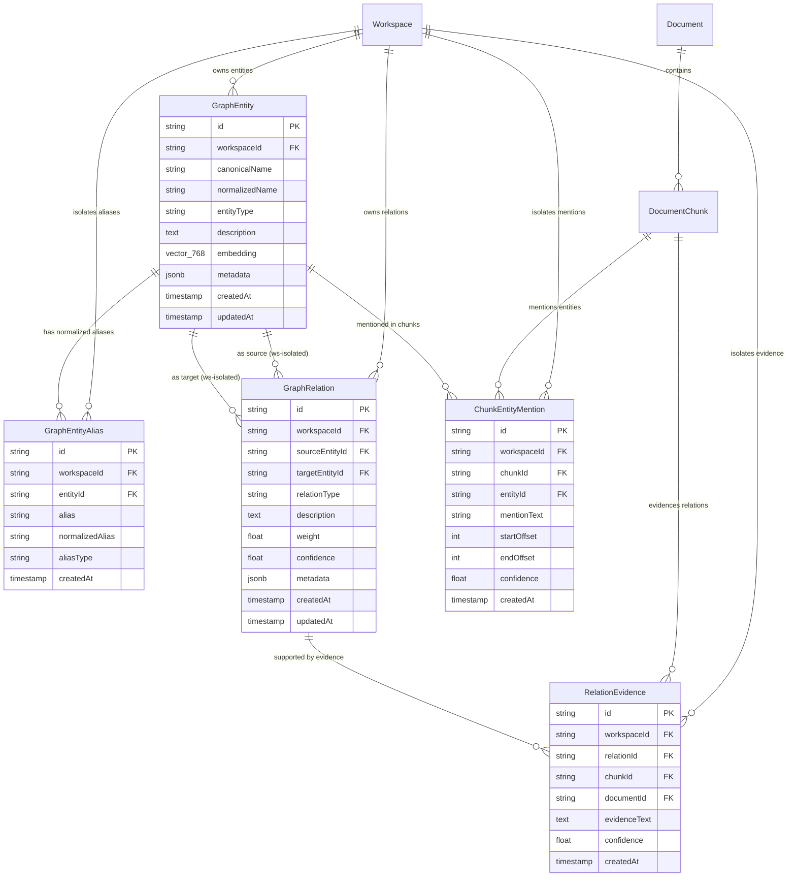
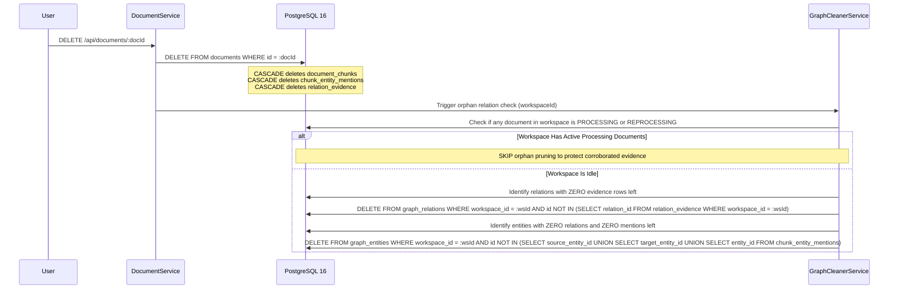

# MindVault — Phase 6: Knowledge Graph Database Design & Schema Specification

**Document Version:** 1.1.0 (Refined Architecture)  
**Status:** Database Architecture Specification (Planning Only)  
**Database Engine:** PostgreSQL 16.4 with `pgvector`  
**ORM / Data Access:** Prisma 6.2.1 + Raw SQL Queries via `$queryRaw` (for recursive CTEs and vector search)  
**Authors:** Database Architect, Senior GraphRAG Systems Engineer  
**Date:** November 2026

---

## 1. Relational Graph Entity Topology



---

## 2. Table-by-Table Schema Specification

### 2.1 Table: `graph_entities`

Represents canonical concepts, technologies, people, organizations, and products recognized within a workspace.

| Column Name       | SQL Type                   | Modifiers                                               | Description                                                                                      |
| ----------------- | -------------------------- | ------------------------------------------------------- | ------------------------------------------------------------------------------------------------ |
| `id`              | `VARCHAR(36)`              | PRIMARY KEY, NOT NULL                                   | Unique entity identifier (UUID v4)                                                               |
| `workspace_id`    | `VARCHAR(36)`              | NOT NULL, REFERENCES `workspaces(id)` ON DELETE CASCADE | Multi-tenant workspace isolation                                                                 |
| `canonical_name`  | `VARCHAR(255)`             | NOT NULL                                                | Display name (e.g., `"PostgreSQL"`)                                                              |
| `normalized_name` | `VARCHAR(255)`             | NOT NULL                                                | Lowercased, alphanumeric stripped name for deduplication (e.g., `"postgresql"`)                  |
| `entity_type`     | `VARCHAR(64)`              | NOT NULL                                                | Category enum: `TECHNOLOGY`, `CONCEPT`, `PERSON`, `ORGANIZATION`, `PRODUCT`, `LOCATION`, `OTHER` |
| `description`     | `TEXT`                     | NULL                                                    | Concise synthesized description of the entity                                                    |
| `embedding`       | `vector(768)`              | NULL                                                    | Semantic vector embedding for entity similarity search                                           |
| `metadata`        | `JSONB`                    | NOT NULL, DEFAULT `'{}'`                                | Extensible properties (domain tags, extraction metrics)                                          |
| `created_at`      | `TIMESTAMP WITH TIME ZONE` | NOT NULL, DEFAULT `NOW()`                               | Creation timestamp                                                                               |
| `updated_at`      | `TIMESTAMP WITH TIME ZONE` | NOT NULL, DEFAULT `NOW()`                               | Last modification timestamp                                                                      |

#### Constraints & Indexes for `graph_entities`

- **Tenant Composite Unique:** `CONSTRAINT uq_entities_ws_id UNIQUE (workspace_id, id)` enables composite foreign keys from child tables to guarantee multi-tenant referential integrity.
- **Type Unique Constraint:** `CONSTRAINT uq_entities_ws_norm_type UNIQUE (workspace_id, normalized_name, entity_type)` ensures no duplicate entities within a workspace for the same type.
- **Tenant Index:** `CREATE INDEX idx_graph_entities_ws ON graph_entities(workspace_id);`
- **Lookup Index:** `CREATE INDEX idx_graph_entities_lookup ON graph_entities(workspace_id, normalized_name);`
- **Type Filter Index:** `CREATE INDEX idx_graph_entities_type ON graph_entities(workspace_id, entity_type);`
- **Vector HNSW Index:** `CREATE INDEX idx_graph_entities_vector ON graph_entities USING hnsw (embedding vector_cosine_ops) WITH (m = 16, ef_construction = 64);`

---

### 2.2 Table: `graph_entity_aliases`

Stores normalized alternative surface forms, synonyms, and acronyms for canonical entities. Adopting a normalized table guarantees workspace-scoped alias uniqueness and enables fast B-tree prefix lookups.

| Column Name        | SQL Type                   | Modifiers                                               | Description                                                   |
| ------------------ | -------------------------- | ------------------------------------------------------- | ------------------------------------------------------------- |
| `id`               | `VARCHAR(36)`              | PRIMARY KEY, NOT NULL                                   | Unique alias identifier (UUID v4)                             |
| `workspace_id`     | `VARCHAR(36)`              | NOT NULL, REFERENCES `workspaces(id)` ON DELETE CASCADE | Multi-tenant workspace isolation                              |
| `entity_id`        | `VARCHAR(36)`              | NOT NULL                                                | Target canonical entity                                       |
| `alias`            | `VARCHAR(255)`             | NOT NULL                                                | Verbatim alias text (e.g., `"Postgres"`, `"PG16"`)            |
| `normalized_alias` | `VARCHAR(255)`             | NOT NULL                                                | Normalized alias text for collision prevention (`"postgres"`) |
| `alias_type`       | `VARCHAR(32)`              | NOT NULL, DEFAULT `'SYNONYM'`                           | Category: `SYNONYM`, `ACRONYM`, `VARIANT`, `ABBREVIATION`     |
| `created_at`       | `TIMESTAMP WITH TIME ZONE` | NOT NULL, DEFAULT `NOW()`                               | Creation timestamp                                            |

#### Constraints & Indexes for `graph_entity_aliases`

- **Workspace-Scoped Unique Alias:** `CONSTRAINT uq_aliases_ws_norm UNIQUE (workspace_id, normalized_alias)` physically prevents two different entities in the same workspace from claiming the same alias.
- **Composite Foreign Key:** `CONSTRAINT fk_aliases_entity_ws FOREIGN KEY (workspace_id, entity_id) REFERENCES graph_entities(workspace_id, id) ON DELETE CASCADE` ensures child alias records strictly match the parent entity's workspace.
- **Lookup Index:** `CREATE INDEX idx_graph_aliases_ws_lookup ON graph_entity_aliases(workspace_id, normalized_alias);`
- **Entity Index:** `CREATE INDEX idx_graph_aliases_entity ON graph_entity_aliases(entity_id);`

---

### 2.3 Table: `graph_relations`

Represents directed semantic relationships between two canonical entities within the same workspace.

| Column Name        | SQL Type                   | Modifiers                                               | Description                                                                                  |
| ------------------ | -------------------------- | ------------------------------------------------------- | -------------------------------------------------------------------------------------------- |
| `id`               | `VARCHAR(36)`              | PRIMARY KEY, NOT NULL                                   | Unique relationship identifier (UUID v4)                                                     |
| `workspace_id`     | `VARCHAR(36)`              | NOT NULL, REFERENCES `workspaces(id)` ON DELETE CASCADE | Multi-tenant workspace isolation                                                             |
| `source_entity_id` | `VARCHAR(36)`              | NOT NULL                                                | Source node ID                                                                               |
| `target_entity_id` | `VARCHAR(36)`              | NOT NULL                                                | Target node ID                                                                               |
| `relation_type`    | `VARCHAR(64)`              | NOT NULL                                                | Semantic verb (e.g., `USES`, `DEPENDS_ON`, `PART_OF`, `IMPLEMENTS`, `CAUSES`, `COMPARED_TO`) |
| `description`      | `TEXT`                     | NULL                                                    | Text explanation of the relationship                                                         |
| `weight`           | `DOUBLE PRECISION`         | NOT NULL, DEFAULT `1.0`                                 | Graph traversal traversal weight ($> 0.0$)                                                   |
| `confidence`       | `DOUBLE PRECISION`         | NOT NULL, DEFAULT `0.8`                                 | Aggregated extraction confidence score ($[0.0, 1.0]$)                                        |
| `metadata`         | `JSONB`                    | NOT NULL, DEFAULT `'{}'`                                | Extensible properties                                                                        |
| `created_at`       | `TIMESTAMP WITH TIME ZONE` | NOT NULL, DEFAULT `NOW()`                               | Creation timestamp                                                                           |
| `updated_at`       | `TIMESTAMP WITH TIME ZONE` | NOT NULL, DEFAULT `NOW()`                               | Last modification timestamp                                                                  |

#### Constraints & Indexes for `graph_relations`

- **Tenant Composite Unique:** `CONSTRAINT uq_relations_ws_id UNIQUE (workspace_id, id)` enables downstream composite foreign keys from `relation_evidence`.
- **Semantic Unique Constraint:** `CONSTRAINT uq_relations_semantic UNIQUE (workspace_id, source_entity_id, target_entity_id, relation_type)` prevents duplicate parallel edges with the same verb.
- **Self-Loop Check:** `CONSTRAINT chk_relation_no_self_loop CHECK (source_entity_id <> target_entity_id)` prevents invalid self-referencing relationships.
- **Confidence Range Check:** `CONSTRAINT chk_relation_confidence CHECK (confidence >= 0.0 AND confidence <= 1.0)`
- **Weight Check:** `CONSTRAINT chk_relation_weight CHECK (weight > 0.0)`
- **Composite Source Foreign Key:** `CONSTRAINT fk_relation_source_ws FOREIGN KEY (workspace_id, source_entity_id) REFERENCES graph_entities(workspace_id, id) ON DELETE CASCADE` guarantees source node belongs to the exact same workspace.
- **Composite Target Foreign Key:** `CONSTRAINT fk_relation_target_ws FOREIGN KEY (workspace_id, target_entity_id) REFERENCES graph_entities(workspace_id, id) ON DELETE CASCADE` guarantees target node belongs to the exact same workspace.
- **Source Traversal Index:** `CREATE INDEX idx_graph_relations_source ON graph_relations(workspace_id, source_entity_id);`
- **Target Traversal Index:** `CREATE INDEX idx_graph_relations_target ON graph_relations(workspace_id, target_entity_id);`
- **Type Filter Index:** `CREATE INDEX idx_graph_relations_type ON graph_relations(workspace_id, relation_type);`

---

### 2.4 Table: `chunk_entity_mentions`

Maps entity occurrences inside specific document chunks for provenance and term highlighting.

| Column Name    | SQL Type                   | Modifiers                                               | Description                           |
| -------------- | -------------------------- | ------------------------------------------------------- | ------------------------------------- |
| `id`           | `VARCHAR(36)`              | PRIMARY KEY, NOT NULL                                   | Unique mention identifier (UUID v4)   |
| `workspace_id` | `VARCHAR(36)`              | NOT NULL, REFERENCES `workspaces(id)` ON DELETE CASCADE | Multi-tenant workspace isolation      |
| `chunk_id`     | `VARCHAR(36)`              | NOT NULL                                                | Source text chunk ID                  |
| `entity_id`    | `VARCHAR(36)`              | NOT NULL                                                | Mentioned canonical entity ID         |
| `mention_text` | `VARCHAR(255)`             | NOT NULL                                                | Exact surface text appearing in chunk |
| `start_offset` | `INTEGER`                  | NULL                                                    | Character start offset inside chunk   |
| `end_offset`   | `INTEGER`                  | NULL                                                    | Character end offset inside chunk     |
| `confidence`   | `DOUBLE PRECISION`         | NOT NULL, DEFAULT `1.0`                                 | NER confidence score ($[0.0, 1.0]$)   |
| `created_at`   | `TIMESTAMP WITH TIME ZONE` | NOT NULL, DEFAULT `NOW()`                               | Creation timestamp                    |

#### Constraints & Indexes for `chunk_entity_mentions`

- **Confidence Range Check:** `CONSTRAINT chk_mention_confidence CHECK (confidence >= 0.0 AND confidence <= 1.0)`
- **Composite Chunk Foreign Key:** `CONSTRAINT fk_mention_chunk_ws FOREIGN KEY (workspace_id, chunk_id) REFERENCES document_chunks(workspace_id, id) ON DELETE CASCADE` prevents referencing a chunk outside the workspace.
- **Composite Entity Foreign Key:** `CONSTRAINT fk_mention_entity_ws FOREIGN KEY (workspace_id, entity_id) REFERENCES graph_entities(workspace_id, id) ON DELETE CASCADE` prevents referencing an entity outside the workspace.
- **Chunk Lookup Index:** `CREATE INDEX idx_chunk_mentions_chunk ON chunk_entity_mentions(chunk_id);`
- **Entity Lookup Index:** `CREATE INDEX idx_chunk_mentions_entity ON chunk_entity_mentions(entity_id);`

---

### 2.5 Table: `relation_evidence`

Independent evidence junction linking relationships to supporting source chunks and documents.

| Column Name     | SQL Type                   | Modifiers                                               | Description                                  |
| --------------- | -------------------------- | ------------------------------------------------------- | -------------------------------------------- |
| `id`            | `VARCHAR(36)`              | PRIMARY KEY, NOT NULL                                   | Unique evidence identifier (UUID v4)         |
| `workspace_id`  | `VARCHAR(36)`              | NOT NULL, REFERENCES `workspaces(id)` ON DELETE CASCADE | Multi-tenant workspace isolation             |
| `relation_id`   | `VARCHAR(36)`              | NOT NULL                                                | Associated relationship ID                   |
| `chunk_id`      | `VARCHAR(36)`              | NOT NULL                                                | Verbatim supporting chunk ID                 |
| `document_id`   | `VARCHAR(36)`              | NOT NULL                                                | Parent source document ID                    |
| `evidence_text` | `TEXT`                     | NOT NULL                                                | Verbatim sentence/passage asserting relation |
| `confidence`    | `DOUBLE PRECISION`         | NOT NULL, DEFAULT `0.85`                                | Extraction confidence for this passage       |
| `created_at`    | `TIMESTAMP WITH TIME ZONE` | NOT NULL, DEFAULT `NOW()`                               | Creation timestamp                           |

#### Constraints & Indexes for `relation_evidence`

- **Unique Evidence Constraint:** `CONSTRAINT uq_evidence_relation_chunk UNIQUE (workspace_id, relation_id, chunk_id)` prevents duplicate evidence rows for the same chunk.
- **Confidence Range Check:** `CONSTRAINT chk_evidence_confidence CHECK (confidence >= 0.0 AND confidence <= 1.0)`
- **Composite Relation Foreign Key:** `CONSTRAINT fk_evidence_relation_ws FOREIGN KEY (workspace_id, relation_id) REFERENCES graph_relations(workspace_id, id) ON DELETE CASCADE` ensures relation belongs to the workspace.
- **Compound Chunk & Document Foreign Key:** `CONSTRAINT fk_evidence_chunk_doc_ws FOREIGN KEY (workspace_id, document_id, chunk_id) REFERENCES document_chunks(workspace_id, document_id, id) ON DELETE CASCADE` guarantees that `document_id` and `chunk_id` physically match the same document chunk in the same workspace, permanently preventing split-brain ownership.
- **Relation Lookup Index:** `CREATE INDEX idx_relation_evidence_rel ON relation_evidence(relation_id);`
- **Chunk Lookup Index:** `CREATE INDEX idx_relation_evidence_chunk ON relation_evidence(chunk_id);`
- **Document Lookup Index:** `CREATE INDEX idx_relation_evidence_doc ON relation_evidence(document_id);`

---

## 3. Evidence Preservation & Document Deletion Lifecycle

A critical requirement of Phase 6 is that **relationships must be evidence-grounded at all times**. Unsupported facts must never remain in the knowledge graph.

### 3.1 Document Deletion Cascade Mechanics



### 3.2 SQL Evidence Pruning Procedure

When a document is deleted:

1. Composite foreign keys automatically delete rows in `relation_evidence` and `chunk_entity_mentions` associated with the deleted chunks and document.
2. A background task cleans up orphan relations that have no remaining evidence in any document, subject to the **active processing invariant**:

```sql
-- Step 1: Invariant Check: Verify workspace has NO active graph ingestion/reprocessing
-- If COUNT > 0, postpone cleanup until jobs finish
SELECT COUNT(*) FROM documents
WHERE workspace_id = $1
  AND (metadata->>'graphStatus' = 'PROCESSING' OR metadata->>'graphStatus' = 'REPROCESSING');

-- Step 2: Remove relations that have zero supporting evidence remaining
DELETE FROM graph_relations
WHERE workspace_id = $1
  AND id NOT IN (
    SELECT DISTINCT relation_id FROM relation_evidence WHERE workspace_id = $1
  );

-- Step 3: Remove orphan entities that have zero relationships and zero chunk mentions remaining
DELETE FROM graph_entities
WHERE workspace_id = $1
  AND id NOT IN (
    SELECT source_entity_id FROM graph_relations WHERE workspace_id = $1
    UNION
    SELECT target_entity_id FROM graph_relations WHERE workspace_id = $1
    UNION
    SELECT entity_id FROM chunk_entity_mentions WHERE workspace_id = $1
  );
```

This guarantees that **if Document A and Document B both assert that `(PostgreSQL) -[SUPPORTS]-> (HNSW)`, deleting Document A preserves the relationship because Document B's evidence row remains**. If Document B is subsequently deleted, the relationship is pruned automatically once all active ingestion jobs complete.

---

## 4. Recursive Graph Traversal Query Specifications

Graph traversal is implemented using PostgreSQL Recursive Common Table Expressions (CTEs), eliminating external graph database requirements while supporting bounded multi-hop queries.

### 4.1 Bounded Multi-Hop Traversal (Cycle-Safe & SQL-Hardened)

The following parameter-driven recursive CTE traverses the graph from a seed entity up to depth 3 with 6 deterministic safety constraints enforced directly inside the database query:

```sql
-- Execution Timeout Guard
SET LOCAL statement_timeout = '2500ms';

WITH RECURSIVE graph_walk AS (
    -- Anchor member: immediate 1-hop relations from seed entity
    SELECT
        r.id AS relation_id,
        r.source_entity_id,
        r.target_entity_id,
        r.relation_type,
        r.weight,
        r.confidence,
        ARRAY[r.source_entity_id, r.target_entity_id]::VARCHAR(36)[] AS path,
        1 AS depth
    FROM graph_relations r
    WHERE r.workspace_id = $1                              -- Limit 1: Anchor Tenant Isolation
      AND r.source_entity_id = $2

    UNION ALL

    -- Recursive member: traverse outgoing relations from target entity
    SELECT
        r.id AS relation_id,
        r.source_entity_id,
        r.target_entity_id,
        r.relation_type,
        r.weight * gw.weight AS weight,
        LEAST(r.confidence, gw.confidence) AS confidence,
        gw.path || r.target_entity_id,
        gw.depth + 1
    FROM graph_relations r
    JOIN graph_walk gw ON r.source_entity_id = gw.target_entity_id
    WHERE r.workspace_id = $1                              -- Limit 2: Recursive Tenant Isolation
      AND gw.depth < 3                                     -- Limit 3: Max Hop Depth (Depth <= 3)
      AND array_length(gw.path, 1) <= 4                    -- Limit 4: Visited Node Path Cap
      AND NOT (r.target_entity_id = ANY(gw.path))          -- Limit 5: Cycle Detection
)
SELECT
    gw.relation_id,
    gw.depth,
    s.canonical_name AS source_name,
    s.entity_type AS source_type,
    gw.relation_type,
    t.canonical_name AS target_name,
    t.entity_type AS target_type,
    gw.confidence,
    re.evidence_text,
    re.chunk_id,
    re.document_id
FROM graph_walk gw
JOIN graph_entities s ON s.id = gw.source_entity_id
JOIN graph_entities t ON t.id = gw.target_entity_id
LEFT JOIN relation_evidence re ON re.relation_id = gw.relation_id
ORDER BY gw.depth ASC, gw.confidence DESC
LIMIT 50;                                                  -- Limit 6: Max Edges Limit
```

### 4.2 Path Discovery Between Two Target Entities ($E_1 \rightarrow E_2$)

```sql
SET LOCAL statement_timeout = '2500ms';

WITH RECURSIVE path_finder AS (
    -- Anchor: Outgoing from Entity 1
    SELECT
        r.id AS relation_id,
        r.source_entity_id,
        r.target_entity_id,
        r.relation_type,
        ARRAY[r.source_entity_id, r.target_entity_id]::VARCHAR(36)[] AS path,
        ARRAY[r.relation_type]::VARCHAR(64)[] AS relation_path,
        1 AS depth
    FROM graph_relations r
    WHERE r.workspace_id = $1
      AND r.source_entity_id = $2

    UNION ALL

    -- Recursive step: Follow edges until Entity 2 is reached
    SELECT
        r.id AS relation_id,
        r.source_entity_id,
        r.target_entity_id,
        r.relation_type,
        pf.path || r.target_entity_id,
        pf.relation_path || r.relation_type,
        pf.depth + 1
    FROM graph_relations r
    JOIN path_finder pf ON r.source_entity_id = pf.target_entity_id
    WHERE r.workspace_id = $1
      AND pf.depth < 4
      AND NOT (r.target_entity_id = ANY(pf.path))
)
SELECT * FROM path_finder
WHERE target_entity_id = $3
ORDER BY depth ASC
LIMIT 5;
```

---

## 5. Complete Prisma Schema Extension (Migration 6)

The following schema extensions will be added to `prisma/schema.prisma` in Phase 6.0:

### 5.1 Updated Existing Models (`DocumentChunk`)

```prisma
// Existing DocumentChunk model updated to support composite foreign keys:
model DocumentChunk {
  id           String                      @id @default(uuid())
  documentId   String
  workspaceId  String
  chunkIndex   Int
  content      String                      @db.Text
  tokenCount   Int
  pageStart    Int?
  pageEnd      Int?
  metadata     Json                        @default("{}")
  embedding    Unsupported("vector(768)")?
  searchVector Unsupported("tsvector")?
  createdAt    DateTime                    @default(now())

  document     Document                    @relation(fields: [documentId], references: [id], onDelete: Cascade)
  workspace    Workspace                   @relation(fields: [workspaceId], references: [id], onDelete: Cascade)

  // Phase 6 Relations
  mentions     ChunkEntityMention[]
  evidence     RelationEvidence[]

  @@unique([documentId, chunkIndex])
  @@unique([workspaceId, id])                          // Required for composite FK from chunk_entity_mentions
  @@unique([workspaceId, documentId, id])              // Required for compound FK from relation_evidence
  @@index([workspaceId])
  @@index([documentId])
  @@map("document_chunks")
}
```

### 5.2 Phase 6 Models

```prisma
// Phase 6: Knowledge Graph & GraphRAG Models

enum EntityType {
  TECHNOLOGY
  CONCEPT
  PERSON
  ORGANIZATION
  PRODUCT
  LOCATION
  OTHER
}

model GraphEntity {
  id             String               @id @default(uuid())
  workspaceId    String               @map("workspace_id")
  canonicalName  String               @map("canonical_name")
  normalizedName String               @map("normalized_name")
  entityType     EntityType           @default(CONCEPT) @map("entity_type")
  description    String?              @db.Text
  embedding      Unsupported("vector(768)")?
  metadata       Json                 @default("{}")
  createdAt      DateTime             @default(now()) @map("created_at")
  updatedAt      DateTime             @updatedAt @map("updated_at")

  workspace       Workspace            @relation(fields: [workspaceId], references: [id], onDelete: Cascade)
  aliases         GraphEntityAlias[]
  sourceRelations GraphRelation[]      @relation("SourceRelations")
  targetRelations GraphRelation[]      @relation("TargetRelations")
  mentions        ChunkEntityMention[]

  @@unique([workspaceId, id])
  @@unique([workspaceId, normalizedName, entityType])
  @@index([workspaceId])
  @@index([workspaceId, normalizedName])
  @@index([workspaceId, entityType])
  @@map("graph_entities")
}

model GraphEntityAlias {
  id              String      @id @default(uuid())
  workspaceId     String      @map("workspace_id")
  entityId        String      @map("entity_id")
  alias           String      @db.VarChar(255)
  normalizedAlias String      @map("normalized_alias") @db.VarChar(255)
  aliasType       String      @default("SYNONYM") @map("alias_type") @db.VarChar(32)
  createdAt       DateTime    @default(now()) @map("created_at")

  workspace       Workspace   @relation(fields: [workspaceId], references: [id], onDelete: Cascade)
  entity          GraphEntity @relation(fields: [workspaceId, entityId], references: [workspaceId, id], onDelete: Cascade)

  @@unique([workspaceId, normalizedAlias])
  @@index([workspaceId, normalizedAlias])
  @@index([workspaceId, entityId])
  @@map("graph_entity_aliases")
}

model GraphRelation {
  id             String               @id @default(uuid())
  workspaceId    String               @map("workspace_id")
  sourceEntityId String               @map("source_entity_id")
  targetEntityId String               @map("target_entity_id")
  relationType   String               @map("relation_type") @db.VarChar(64)
  description    String?              @db.Text
  weight         Float                @default(1.0)
  confidence     Float                @default(0.8)
  metadata       Json                 @default("{}")
  createdAt      DateTime             @default(now()) @map("created_at")
  updatedAt      DateTime             @updatedAt @map("updated_at")

  workspace      Workspace            @relation(fields: [workspaceId], references: [id], onDelete: Cascade)
  sourceEntity   GraphEntity          @relation("SourceRelations", fields: [workspaceId, sourceEntityId], references: [workspaceId, id], onDelete: Cascade)
  targetEntity   GraphEntity          @relation("TargetRelations", fields: [workspaceId, targetEntityId], references: [workspaceId, id], onDelete: Cascade)
  evidence       RelationEvidence[]

  @@unique([workspaceId, id])
  @@unique([workspaceId, sourceEntityId, targetEntityId, relationType])
  @@index([workspaceId])
  @@index([workspaceId, sourceEntityId])
  @@index([workspaceId, targetEntityId])
  @@index([workspaceId, relationType])
  @@map("graph_relations")
}

model ChunkEntityMention {
  id             String               @id @default(uuid())
  workspaceId    String               @map("workspace_id")
  chunkId        String               @map("chunk_id")
  entityId       String               @map("entity_id")
  mentionText    String               @map("mention_text") @db.VarChar(255)
  startOffset    Int?                 @map("start_offset")
  endOffset      Int?                 @map("end_offset")
  confidence     Float                @default(1.0)
  createdAt      DateTime             @default(now()) @map("created_at")

  workspace      Workspace            @relation(fields: [workspaceId], references: [id], onDelete: Cascade)
  chunk          DocumentChunk        @relation(fields: [workspaceId, chunkId], references: [workspaceId, id], onDelete: Cascade)
  entity         GraphEntity          @relation(fields: [workspaceId, entityId], references: [workspaceId, id], onDelete: Cascade)

  @@index([workspaceId])
  @@index([chunkId])
  @@index([entityId])
  @@index([workspaceId, entityId, chunkId])
  @@map("chunk_entity_mentions")
}

model RelationEvidence {
  id             String               @id @default(uuid())
  workspaceId    String               @map("workspace_id")
  relationId     String               @map("relation_id")
  chunkId        String               @map("chunk_id")
  documentId     String               @map("document_id")
  evidenceText   String               @map("evidence_text") @db.Text
  confidence     Float                @default(0.85)
  createdAt      DateTime             @default(now()) @map("created_at")

  workspace      Workspace            @relation(fields: [workspaceId], references: [id], onDelete: Cascade)
  relation       GraphRelation        @relation(fields: [workspaceId, relationId], references: [workspaceId, id], onDelete: Cascade)
  chunk          DocumentChunk        @relation(fields: [workspaceId, documentId, chunkId], references: [workspaceId, documentId, id], onDelete: Cascade)

  @@unique([workspaceId, relationId, chunkId])
  @@index([workspaceId])
  @@index([relationId])
  @@index([chunkId])
  @@index([documentId])
  @@map("relation_evidence")
}
```
