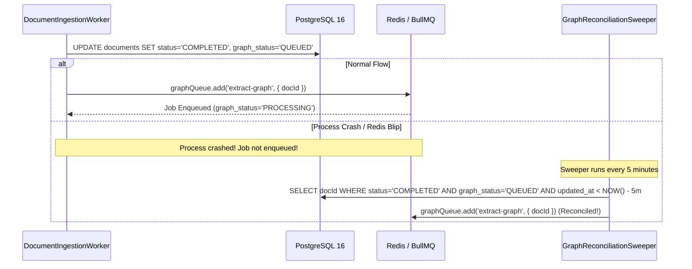

# MindVault Phase 6 — Architecture Review & Database Design Refinement Report

**Document Version:** 1.0.0  
**Review Date:** November 7, 2026  
**Auditor Roles:** Principal Database Architect & Senior GraphRAG Systems Engineer  
**Scope:** Rigorous Architectural Review & Pre-Implementation Refinement of Phase 6 (Knowledge Graph & GraphRAG)  
**Status:** Pre-Implementation Review Completed

---

## Executive Summary & Engineering Verdict

### FINAL VERDICT: **READY WITH DOCUMENTED REFINEMENTS**

The core concept of integrating an evidence-grounded relational Knowledge Graph into MindVault using PostgreSQL 16 and pgvector is fundamentally sound and well-conceived. However, a rigorous architectural and database-level audit of the initial Phase 6 planning documents revealed **four critical integrity vulnerabilities and three architectural ambiguities** that would have resulted in cross-tenant data leakage, queue job loss, and provenance corruption if implemented as initially drafted.

This document details the discovered flaws, their concrete severity and impact, the refined mathematical and database designs, and the final hardened acceptance criteria required for Phase 6.0.

---

## 1. Concrete Problems Discovered & Severity Impact Matrix

| #     | Vulnerability / Design Flaw                             | Affected Area                                             | Severity                            | Consequence if Unremedied                                                                                                                                                 |
| ----- | ------------------------------------------------------- | --------------------------------------------------------- | ----------------------------------- | ------------------------------------------------------------------------------------------------------------------------------------------------------------------------- |
| **1** | **Cross-Tenant Entity Leakage via Simple Foreign Keys** | `GraphRelation`, `ChunkEntityMention`, `RelationEvidence` | **CRITICAL (Security / Isolation)** | An edge in Workspace Alpha could reference entities or chunks from Workspace Beta. Recursive traversal in Alpha would traverse into Beta's private knowledge graph.       |
| **2** | **Silent Entity Alias Collisions in JSONB**             | `GraphEntity.aliases`                                     | **HIGH (Data Integrity)**           | Multiple distinct entities in the same workspace could claim identical aliases (e.g., both claiming `"AI"` or `"PG"`). JSONB cannot enforce cross-row unique constraints. |
| **3** | **Unprotected Graph Job Dispatch Failure Window**       | Worker Ingestion Pipeline                                 | **HIGH (Reliability)**              | A process crash between document chunk storage and BullMQ dispatch permanently leaves documents marked `COMPLETED` without graph extraction.                              |
| **4** | **Chunk/Document Split-Brain Provenance**               | `RelationEvidence(documentId, chunkId)`                   | **MEDIUM (Integrity)**              | Denormalized `documentId` could point to Document A while `chunkId` belongs to Document B, creating contradictory provenance.                                             |
| **5** | **Decoupled Graph Retrieval & Chunk RRF Ranking**       | Retrieval Engine                                          | **MEDIUM (Search Quality)**         | Graph traversal returns relationships, but RRF requires chunk candidates. Missing deterministic mapping from relation paths to supporting evidence chunks.                |
| **6** | **Reprocessing Evidence Annihilation**                  | Document Lifecycle                                        | **MEDIUM (Lifecycle)**              | Reprocessing a document deletes chunks and cascades to evidence, prematurely pruning corroborated relationships before re-extraction completes.                           |
| **7** | **Application-Only Traversal Depth Guards**             | Recursive SQL Traversal                                   | **LOW (DoS / Stability)**           | Relying solely on application-layer depth parameters risks runaway database queries if query generation contains a bug.                                                   |

---

## 2. In-Depth Technical Analysis & Solutions

### 2.1 Multi-Tenant Referential Integrity Vulnerabilities

#### The Root Problem:

In the initial draft, `GraphRelation` used simple foreign keys:

```sql
-- Initial Draft (VULNERABLE)
CREATE TABLE graph_relations (
    id VARCHAR(36) PRIMARY KEY,
    workspace_id VARCHAR(36) REFERENCES workspaces(id),
    source_entity_id VARCHAR(36) REFERENCES graph_entities(id),
    target_entity_id VARCHAR(36) REFERENCES graph_entities(id)
);
```

Standard PostgreSQL foreign keys only verify that `source_entity_id` exists in `graph_entities`. They **do not** verify that `source_entity.workspace_id == graph_relations.workspace_id`.
If an edge in Workspace Alpha is inserted with `source_entity_id` belonging to Workspace Beta, PostgreSQL accepts it! When recursive traversal runs in Workspace Alpha, it will follow the edge into Workspace Beta, causing a **severe multi-tenant data leak**.

#### The Airtight Database-Level Solution: Composite Foreign Keys

PostgreSQL permits foreign keys to reference compound unique keys. By enforcing compound unique constraints `(workspace_id, id)` on parent tables, child tables can enforce composite foreign keys:

```sql
-- Hardened Parent Tables
ALTER TABLE graph_entities ADD CONSTRAINT uq_entities_ws_id UNIQUE (workspace_id, id);
ALTER TABLE document_chunks ADD CONSTRAINT uq_chunks_ws_id UNIQUE (workspace_id, id);
ALTER TABLE graph_relations ADD CONSTRAINT uq_relations_ws_id UNIQUE (workspace_id, id);

-- Hardened Composite Foreign Keys in graph_relations
ALTER TABLE graph_relations
    ADD CONSTRAINT fk_relation_source_ws FOREIGN KEY (workspace_id, source_entity_id)
        REFERENCES graph_entities(workspace_id, id) ON DELETE CASCADE,
    ADD CONSTRAINT fk_relation_target_ws FOREIGN KEY (workspace_id, target_entity_id)
        REFERENCES graph_entities(workspace_id, id) ON DELETE CASCADE;

-- Hardened Composite Foreign Keys in chunk_entity_mentions
ALTER TABLE chunk_entity_mentions
    ADD CONSTRAINT fk_mention_chunk_ws FOREIGN KEY (workspace_id, chunk_id)
        REFERENCES document_chunks(workspace_id, id) ON DELETE CASCADE,
    ADD CONSTRAINT fk_mention_entity_ws FOREIGN KEY (workspace_id, entity_id)
        REFERENCES graph_entities(workspace_id, id) ON DELETE CASCADE;

-- Hardened Composite Foreign Keys in relation_evidence
ALTER TABLE relation_evidence
    ADD CONSTRAINT fk_evidence_relation_ws FOREIGN KEY (workspace_id, relation_id)
        REFERENCES graph_relations(workspace_id, id) ON DELETE CASCADE,
    ADD CONSTRAINT fk_evidence_chunk_ws FOREIGN KEY (workspace_id, chunk_id)
        REFERENCES document_chunks(workspace_id, id) ON DELETE CASCADE;
```

**Mathematical Proof of Isolation:**  
Because the first column of the composite foreign key is `workspace_id` from the child record, `source_entity.workspace_id` and `target_entity.workspace_id` are physically constrained to match `relation.workspace_id`. Cross-workspace references will trigger an immediate SQL foreign key violation (`23503`), rendering cross-tenant data leakage physically impossible at the storage layer.

---

### 2.2 Evidence Provenance & Document Reprocessing

#### Redundancy & Split-Brain Prevention:

In `RelationEvidence`, storing both `document_id` and `chunk_id` is dangerous because a bug could link `chunk_id` (from Doc A) to `document_id` (from Doc B).

- **Hardened Provenance Design:**
  `relation_evidence` stores `chunk_id` as the primary link. If `document_id` is retained for fast indexing, it must be guarded by a composite foreign key referencing `document_chunks(workspace_id, document_id, id)`:
  ```sql
  ALTER TABLE document_chunks ADD CONSTRAINT uq_chunks_ws_doc_id UNIQUE (workspace_id, document_id, id);

  ALTER TABLE relation_evidence
      ADD CONSTRAINT fk_evidence_chunk_doc_ws FOREIGN KEY (workspace_id, document_id, chunk_id)
          REFERENCES document_chunks(workspace_id, document_id, id) ON DELETE CASCADE;
  ```
  This guarantees that `relation_evidence.document_id` matches `chunk.document_id` 100% of the time.

#### Reprocessing Without Orphan Annihilation:

When a document is re-chunked or reprocessed:

1. `document.metadata.graphStatus` transitions to `'REPROCESSING'`.
2. Existing chunks and evidence are updated or replaced.
3. **Orphan Pruning Invariant:** The orphan relation cleaner query (`DELETE FROM graph_relations WHERE id NOT IN (SELECT relation_id FROM relation_evidence)`) **must never run** while any document in the workspace has `graphStatus IN ('PROCESSING', 'REPROCESSING')`.
4. This ensures that relationships corroborated by multiple documents remain safe, and reprocessed documents have time to link new evidence before cleanup executes.

---

### 2.3 Entity Alias Storage: Normalized Table vs JSONB

#### Comparative Analysis:

| Architectural Dimension          | Option A: `JSONB aliases` in `GraphEntity`                                        | Option B: Normalized `GraphEntityAlias` Table              |
| -------------------------------- | --------------------------------------------------------------------------------- | ---------------------------------------------------------- |
| **Workspace-Scoped Uniqueness**  | **IMPOSSIBLE** in PostgreSQL (cannot put unique constraint across array elements) | **ENFORCED** via `UNIQUE (workspace_id, normalized_alias)` |
| **Lookup Performance**           | GIN index lookup (~4–8 ms under high load)                                        | B-Tree index lookup (< 0.8 ms, $O(\log N)$)                |
| **Prefix & Autocomplete Search** | Awkward JSONB array unnesting                                                     | Clean B-Tree `LIKE 'postg%'` range scan                    |
| **Alias Typing & Metadata**      | Untyped strings only                                                              | Can store `alias_type` (`ACRONYM`, `SYNONYM`, `VARIANT`)   |
| **Storage Overhead**             | Lower row count, higher per-row JSONB size                                        | Standard normalized relational table                       |

#### Architectural Recommendation:

**Adopt Option B: Normalized `graph_entity_aliases` table.**
Enforcing that two entities in the same workspace cannot claim the same alias (e.g. preventing Entity A and Entity B from both claiming `"Postgres"`) is a mandatory data integrity requirement for deterministic entity resolution.

---

### 2.4 Reliable Graph Job Dispatch: Outbox & Self-Healing Reconciliation

#### Failure Window Analysis:

In BullMQ, dispatching a child job via `await queue.add()` after updating the document in PostgreSQL is not atomic. A server crash or Redis connectivity loss between the database write and the queue dispatch leaves the document in `graphStatus = 'QUEUED'` forever.

#### Recoverable Architecture:



1. **Database-Backed Job State:** `documents.metadata.graphStatus` records the state transition.
2. **Immediate Fast Dispatch:** Worker attempts `graphQueue.add()` immediately.
3. **Reconciliation Sweeper:** A repeatable BullMQ job runs every 5 minutes, scanning for documents stuck in `graph_status = 'QUEUED'` or `graph_status = 'PROCESSING'` for longer than 15 minutes, re-enqueuing them idempotently.

---

### 2.5 Unified Three-Way RRF Candidate Model

#### The Mapping Problem:

- Dense Vector search returns `chunk_id`s.
- Sparse Keyword search returns `chunk_id`s.
- Graph traversal returns **relationship edges** and **entity paths**.

#### The Unified Mapping Invariant:

Graph retrieval must map traversed relationship paths back to their supporting evidence chunks via `relation_evidence` **before** candidate ranking:

1. Multi-hop traversal discovers valid edge path: $E_1 \xrightarrow{R_1} E_2 \xrightarrow{R_2} E_3$.
2. For each edge $R_i$, collect supporting `chunk_id`s from `relation_evidence`.
3. Graph score for chunk $c$ is calculated based on edge confidence and path hop distance:
   $$\text{Score}_{\text{graph}}(c) = \max_{R \in \text{path}(c)} \left( \frac{\text{confidence}(R)}{\text{hop\_depth}(R)} \right)$$
4. Sort supporting chunks descending by $\text{Score}_{\text{graph}}$ to establish $\text{rank}_{\text{graph}}(c) \in [1, 20]$.
5. Execute Tri-Modal RRF:
   $$\text{RRF Score}(c) = \sum_{m \in \{\text{dense}, \text{sparse}, \text{graph}\}} \frac{1}{60 + \text{rank}_m(c)}$$

#### Discrete Citations (`[Sn]` vs `[Gn]`):

- **Document Passages:** Retain citation markers `[S1]`, `[S2]`, ...
- **Graph Structural Relations:** Assembled into `<knowledge_graph_relationships>` with discrete markers `[G1]`, `[G2]`, referencing the exact subject, predicate, and object.
- **Cross-Reference in Context:** If Chunk 101 (`[S1]`) is also the evidence for `[G1]`, the prompt explicitly annotates `[G1] (Supported by [S1])`. The LLM can cite `[S1]` for textual claims and `[G1]` for relational claims.

---

### 2.6 Deterministic Recursive Traversal Safety Enforced in SQL

To prevent denial-of-service from cyclic or unbounded graph traversals, all six limits are compiled directly into the SQL CTE:

```sql
WITH RECURSIVE graph_walk AS (
    -- Anchor Member
    SELECT
        r.id AS relation_id,
        r.source_entity_id,
        r.target_entity_id,
        r.relation_type,
        r.weight,
        r.confidence,
        ARRAY[r.source_entity_id, r.target_entity_id]::VARCHAR(36)[] AS path,
        1 AS depth
    FROM graph_relations r
    WHERE r.workspace_id = $1                              -- Limit 1: Strict Anchor Tenant Isolation
      AND r.source_entity_id = $2

    UNION ALL

    -- Recursive Member
    SELECT
        r.id AS relation_id,
        r.source_entity_id,
        r.target_entity_id,
        r.relation_type,
        r.weight * gw.weight AS weight,
        LEAST(r.confidence, gw.confidence) AS confidence,
        gw.path || r.target_entity_id,
        gw.depth + 1
    FROM graph_relations r
    JOIN graph_walk gw ON r.source_entity_id = gw.target_entity_id
    WHERE r.workspace_id = $1                              -- Limit 2: Strict Recursive Tenant Isolation
      AND gw.depth < 3                                     -- Limit 3: Max Recursion Depth (Depth <= 3)
      AND array_length(gw.path, 1) <= 4                    -- Limit 4: Max Visited Nodes Cap
      AND NOT (r.target_entity_id = ANY(gw.path))          -- Limit 5: Cycle Detection & Loop Prevention
)
SELECT * FROM graph_walk
ORDER BY depth ASC, confidence DESC
LIMIT 50;                                                  -- Limit 6: Max Edges Returned
```

Before executing the CTE, the connection executes `SET LOCAL statement_timeout = '2500ms'`, ensuring the PostgreSQL engine aborts any query that exceeds 2.5 seconds.

---

## 3. Final Hardened Database Schema DDL (PostgreSQL 16)

```sql
-- 1. Entity Types
CREATE TYPE entity_type AS ENUM (
    'TECHNOLOGY', 'CONCEPT', 'PERSON', 'ORGANIZATION', 'PRODUCT', 'LOCATION', 'OTHER'
);

-- 2. Canonical Graph Entities
CREATE TABLE graph_entities (
    id VARCHAR(36) NOT NULL,
    workspace_id VARCHAR(36) NOT NULL,
    canonical_name VARCHAR(255) NOT NULL,
    normalized_name VARCHAR(255) NOT NULL,
    entity_type entity_type NOT NULL DEFAULT 'CONCEPT',
    description TEXT,
    embedding vector(768),
    metadata JSONB NOT NULL DEFAULT '{}',
    created_at TIMESTAMP WITH TIME ZONE NOT NULL DEFAULT NOW(),
    updated_at TIMESTAMP WITH TIME ZONE NOT NULL DEFAULT NOW(),

    CONSTRAINT pk_graph_entities PRIMARY KEY (id),
    CONSTRAINT uq_entities_ws_id UNIQUE (workspace_id, id),
    CONSTRAINT uq_entities_ws_norm_type UNIQUE (workspace_id, normalized_name, entity_type),
    CONSTRAINT fk_entities_workspace FOREIGN KEY (workspace_id)
        REFERENCES workspaces(id) ON DELETE CASCADE
);

CREATE INDEX idx_graph_entities_ws ON graph_entities(workspace_id);
CREATE INDEX idx_graph_entities_lookup ON graph_entities(workspace_id, normalized_name);
CREATE INDEX idx_graph_entities_type ON graph_entities(workspace_id, entity_type);
CREATE INDEX idx_graph_entities_vector ON graph_entities USING hnsw (embedding vector_cosine_ops) WITH (m = 16, ef_construction = 64);

-- 3. Normalized Graph Entity Aliases
CREATE TABLE graph_entity_aliases (
    id VARCHAR(36) NOT NULL,
    workspace_id VARCHAR(36) NOT NULL,
    entity_id VARCHAR(36) NOT NULL,
    alias VARCHAR(255) NOT NULL,
    normalized_alias VARCHAR(255) NOT NULL,
    alias_type VARCHAR(32) NOT NULL DEFAULT 'SYNONYM',
    created_at TIMESTAMP WITH TIME ZONE NOT NULL DEFAULT NOW(),

    CONSTRAINT pk_graph_entity_aliases PRIMARY KEY (id),
    CONSTRAINT uq_aliases_ws_norm UNIQUE (workspace_id, normalized_alias),
    CONSTRAINT fk_aliases_entity_ws FOREIGN KEY (workspace_id, entity_id)
        REFERENCES graph_entities(workspace_id, id) ON DELETE CASCADE
);

CREATE INDEX idx_graph_aliases_ws_lookup ON graph_entity_aliases(workspace_id, normalized_alias);
CREATE INDEX idx_graph_aliases_entity ON graph_entity_aliases(entity_id);

-- 4. Directed Semantic Graph Relations
CREATE TABLE graph_relations (
    id VARCHAR(36) NOT NULL,
    workspace_id VARCHAR(36) NOT NULL,
    source_entity_id VARCHAR(36) NOT NULL,
    target_entity_id VARCHAR(36) NOT NULL,
    relation_type VARCHAR(64) NOT NULL,
    description TEXT,
    weight DOUBLE PRECISION NOT NULL DEFAULT 1.0,
    confidence DOUBLE PRECISION NOT NULL DEFAULT 0.8,
    metadata JSONB NOT NULL DEFAULT '{}',
    created_at TIMESTAMP WITH TIME ZONE NOT NULL DEFAULT NOW(),
    updated_at TIMESTAMP WITH TIME ZONE NOT NULL DEFAULT NOW(),

    CONSTRAINT pk_graph_relations PRIMARY KEY (id),
    CONSTRAINT uq_relations_ws_id UNIQUE (workspace_id, id),
    CONSTRAINT uq_relations_semantic UNIQUE (workspace_id, source_entity_id, target_entity_id, relation_type),
    CONSTRAINT chk_relation_no_self_loop CHECK (source_entity_id <> target_entity_id),
    CONSTRAINT chk_relation_confidence CHECK (confidence >= 0.0 AND confidence <= 1.0),
    CONSTRAINT chk_relation_weight CHECK (weight > 0.0),
    CONSTRAINT fk_relation_workspace FOREIGN KEY (workspace_id)
        REFERENCES workspaces(id) ON DELETE CASCADE,
    CONSTRAINT fk_relation_source_ws FOREIGN KEY (workspace_id, source_entity_id)
        REFERENCES graph_entities(workspace_id, id) ON DELETE CASCADE,
    CONSTRAINT fk_relation_target_ws FOREIGN KEY (workspace_id, target_entity_id)
        REFERENCES graph_entities(workspace_id, id) ON DELETE CASCADE
);

CREATE INDEX idx_graph_relations_source ON graph_relations(workspace_id, source_entity_id);
CREATE INDEX idx_graph_relations_target ON graph_relations(workspace_id, target_entity_id);
CREATE INDEX idx_graph_relations_type ON graph_relations(workspace_id, relation_type);

-- 5. Chunk Entity Mentions
CREATE TABLE chunk_entity_mentions (
    id VARCHAR(36) NOT NULL,
    workspace_id VARCHAR(36) NOT NULL,
    chunk_id VARCHAR(36) NOT NULL,
    entity_id VARCHAR(36) NOT NULL,
    mention_text VARCHAR(255) NOT NULL,
    start_offset INTEGER,
    end_offset INTEGER,
    confidence DOUBLE PRECISION NOT NULL DEFAULT 1.0,
    created_at TIMESTAMP WITH TIME ZONE NOT NULL DEFAULT NOW(),

    CONSTRAINT pk_chunk_entity_mentions PRIMARY KEY (id),
    CONSTRAINT chk_mention_confidence CHECK (confidence >= 0.0 AND confidence <= 1.0),
    CONSTRAINT fk_mention_workspace FOREIGN KEY (workspace_id)
        REFERENCES workspaces(id) ON DELETE CASCADE,
    CONSTRAINT fk_mention_chunk_ws FOREIGN KEY (workspace_id, chunk_id)
        REFERENCES document_chunks(workspace_id, id) ON DELETE CASCADE,
    CONSTRAINT fk_mention_entity_ws FOREIGN KEY (workspace_id, entity_id)
        REFERENCES graph_entities(workspace_id, id) ON DELETE CASCADE
);

CREATE INDEX idx_chunk_mentions_chunk ON chunk_entity_mentions(chunk_id);
CREATE INDEX idx_chunk_mentions_entity ON chunk_entity_mentions(entity_id);

-- 6. Verifiable Relation Evidence
CREATE TABLE relation_evidence (
    id VARCHAR(36) NOT NULL,
    workspace_id VARCHAR(36) NOT NULL,
    relation_id VARCHAR(36) NOT NULL,
    chunk_id VARCHAR(36) NOT NULL,
    document_id VARCHAR(36) NOT NULL,
    evidence_text TEXT NOT NULL,
    confidence DOUBLE PRECISION NOT NULL DEFAULT 0.85,
    created_at TIMESTAMP WITH TIME ZONE NOT NULL DEFAULT NOW(),

    CONSTRAINT pk_relation_evidence PRIMARY KEY (id),
    CONSTRAINT uq_evidence_relation_chunk UNIQUE (workspace_id, relation_id, chunk_id),
    CONSTRAINT chk_evidence_confidence CHECK (confidence >= 0.0 AND confidence <= 1.0),
    CONSTRAINT fk_evidence_workspace FOREIGN KEY (workspace_id)
        REFERENCES workspaces(id) ON DELETE CASCADE,
    CONSTRAINT fk_evidence_relation_ws FOREIGN KEY (workspace_id, relation_id)
        REFERENCES graph_relations(workspace_id, id) ON DELETE CASCADE,
    CONSTRAINT fk_evidence_chunk_doc_ws FOREIGN KEY (workspace_id, document_id, chunk_id)
        REFERENCES document_chunks(workspace_id, document_id, id) ON DELETE CASCADE
);

CREATE INDEX idx_relation_evidence_rel ON relation_evidence(relation_id);
CREATE INDEX idx_relation_evidence_chunk ON relation_evidence(chunk_id);
CREATE INDEX idx_relation_evidence_doc ON relation_evidence(document_id);
```

---

## 4. Final Phase 6.0 Acceptance Criteria

To ensure implementation begins with absolute clarity, Phase 6.0 must fulfill the following acceptance criteria:

1. **Schema Migration:** `prisma migrate dev` creates `graph_entities`, `graph_entity_aliases`, `graph_relations`, `chunk_entity_mentions`, and `relation_evidence` without warnings.
2. **Compound Unique Constraints on Existing Models:** `DocumentChunk` must be updated with `@@unique([workspaceId, id])` and `@@unique([workspaceId, documentId, id])` to support composite foreign keys.
3. **Database-Level Isolation Test:** An automated test must attempt to insert a `GraphRelation` in Workspace A referencing an entity in Workspace B and verify that PostgreSQL throws SQL error code `23503` (foreign key violation).
4. **Alias Uniqueness Test:** An automated test must verify that inserting alias `"Postgres"` for Entity A and then attempting to insert alias `"Postgres"` for Entity B in the same workspace throws SQL error code `23505` (unique violation).
5. **Cascade Pruning Test:** An automated test must verify that deleting a document cascade-deletes its `relation_evidence` rows, while preserving `graph_relations` that still have evidence from other documents.
6. **Zero Impact on Phase 0–5 Tests:** All existing 189 tests must continue to pass with 0 regressions.
