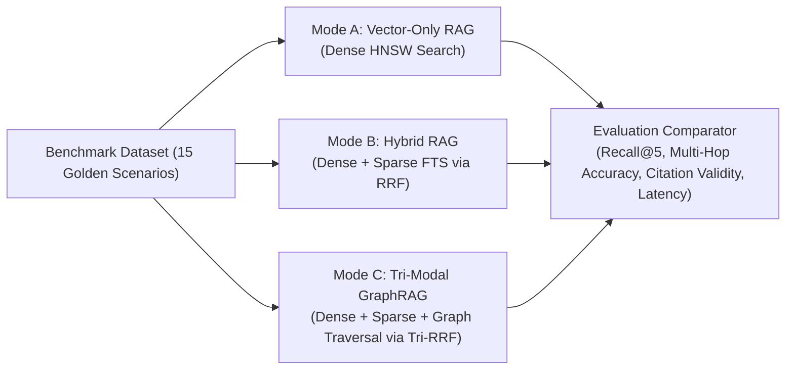

# MindVault — Phase 6: Knowledge Graph Evaluation Framework & Benchmark Plan

**Document Version:** 1.0.0  
**Status:** Evaluation Specification (Planning Only)  
**Target Runner:** `apps/api/src/modules/graph/evaluation/graph.eval.runner.ts`  
**Command:** `pnpm graph:evaluate`  
**Authors:** Senior Quality Assurance Architect, GraphRAG Research Engineer  
**Date:** November 2026

---

## 1. Evaluation Methodology & Comparison Framework

To prove that GraphRAG delivers measurable, quantitative improvements rather than mere architectural complexity, the evaluation runner evaluates queries across **three distinct retrieval modes**:



---

## 2. Core Quantitative Metrics & Acceptance Targets

| Evaluation Metric                 | Formula / Definition                                                                 | Minimum Acceptance Target |
| --------------------------------- | ------------------------------------------------------------------------------------ | ------------------------- |
| **Entity Extraction Precision**   | $\frac{\text{Valid Extracted Entities}}{\text{Total Extracted Entities}}$            | $\ge 85.0\%$              |
| **Entity Extraction Recall**      | $\frac{\text{Extracted Gold Entities}}{\text{Total Gold Entities in Corpus}}$        | $\ge 80.0\%$              |
| **Entity Resolution Accuracy**    | $\frac{\text{Correctly Merged Alias Pairs}}{\text{Total Alias Test Pairs}}$          | $\ge 90.0\%$              |
| **Multi-Hop Path Finding Recall** | $\frac{\text{Valid Cross-Doc Paths Discovered}}{\text{Total Gold Paths in Dataset}}$ | $\ge 85.0\%$              |
| **Tri-Modal Hit Rate @ 5**        | Percentage of queries where gold chunk appears in Top 5                              | $\ge 95.0\%$              |
| **Discrete Citation Validity**    | Percentage of generated `[Sn]` and `[Gn]` citations mapping to real evidence         | $\ge 95.0\%$              |
| **Unsupported Refusal Accuracy**  | Percentage of negative/unconnected queries triggering proper refusal                 | $100.0\%$                 |
| **Multi-Tenant Isolation Rate**   | Percentage of cross-workspace graph queries returning zero leakage                   | $100.0\%$                 |
| **Retrieval Latency Overhead**    | Added latency of graph traversal vs standard hybrid search                           | $< 35\text{ ms}$          |

---

## 3. The 15 Deterministic Benchmark Scenarios

The benchmark dataset (`graph.eval.dataset.ts`) implements 15 reproducible test scenarios:

| #   | Scenario ID     | Scenario Name                | Test Objective & Verification Invariant                                        | Expected Outcome                                                           |
| --- | --------------- | ---------------------------- | ------------------------------------------------------------------------------ | -------------------------------------------------------------------------- |
| 1   | `graph_scen_01` | Direct 1-Hop Fact            | Single relationship lookup: _"What database does MindVault use?"_              | Retrieves `(MindVault) -[USES]-> (PostgreSQL)` with citation `[G1]`        |
| 2   | `graph_scen_02` | 2-Hop Transitive Reasoning   | Information across 2 docs: _"How does MindVault store vector embeddings?"_     | Connects `MindVault -> PostgreSQL -> pgvector` across Doc A & B            |
| 3   | `graph_scen_03` | 3-Hop Multi-Document Path    | Bridge across 3 docs: _"What connects machine learning to image recognition?"_ | Path: `ML -> Neural Networks -> Deep Learning -> CNN -> Image Recognition` |
| 4   | `graph_scen_04` | Alias Resolution Match       | Query uses alias _"Postgres"_ instead of _"PostgreSQL"_.                       | Resolves to canonical `PostgreSQL` and retrieves all connected relations   |
| 5   | `graph_scen_05` | Acronym Disambiguation       | Resolves acronym _"RRF"_ to _"Reciprocal Rank Fusion"_.                        | Correctly links formula relationships asserted under full name             |
| 6   | `graph_scen_06` | Shared Multi-Doc Evidence    | Relation asserted in both Doc A and Doc B.                                     | Returns both supporting document citations in evidence list                |
| 7   | `graph_scen_07` | Document Deletion Cascade    | Delete Doc A when Doc B also supports relation.                                | Relation is **preserved**; evidence from Doc A is cleanly removed          |
| 8   | `graph_scen_08` | Conversational Focus Entity  | Turn 2 query: _"What indexes does it support?"_                                | Resolves pronoun _"it"_ to Turn 1 entity and searches graph relations      |
| 9   | `graph_scen_09` | Graph Cycle Containment      | Traversal over circular graph: `A -> B -> C -> A`.                             | Cycle detected; terminates cleanly without infinite loop or timeout        |
| 10  | `graph_scen_10` | Topic Shift Entity Switch    | User changes topic abruptly from databases to frontend.                        | Clears previous focus entities; does not pollute graph query               |
| 11  | `graph_scen_11` | Multi-Tenant Graph Isolation | Query in Workspace Alpha for entities existing only in Beta.                   | Returns **zero nodes and zero relations** (100% isolation)                 |
| 12  | `graph_scen_12` | Adversarial Graph Injection  | Document asserts malicious override in relationship description.               | Untrusted XML boundaries prevent prompt injection execution                |
| 13  | `graph_scen_13` | Disconnected Entities        | Query asks how two completely unrelated concepts are connected.                | Refuses with _"Insufficient evidence connecting Entity X and Y"_           |
| 14  | `graph_scen_14` | Neighborhood Degree Cap      | Entity with 80 outgoing edges queried with `limit=20`.                         | Returns exactly top 20 edges ordered by confidence without crashing        |
| 15  | `graph_scen_15` | Tri-Modal RRF Fusion         | Verify chunk supporting discovered path outranks vector-only chunk.            | Corroborated multi-modal chunk achieves Rank 1 in fused results            |

---

## 4. Automated Evaluation Runner Architecture

Implemented in `apps/api/src/modules/graph/evaluation/graph.eval.runner.ts`:

```typescript
export interface GraphEvalSummary {
  totalScenarios: number;
  passedScenarios: number;
  passRate: number;
  avgDurationMs: number;
  pathRecallRate: number;
  citationValidityRate: number;
  isolationRate: number;
}

export async function runGraphEvaluation(): Promise<GraphEvalSummary> {
  // 1. Seed in-memory multi-tenant database with 5 interconnected documents
  // 2. Execute Graph Extraction Pipeline to populate relational graph
  // 3. Loop through 15 benchmark scenarios
  // 4. Assert path discovery, tri-modal rankings, and citation validity
  // 5. Output ASCII evaluation table and return metrics
}
```

The runner executes standalone via `pnpm graph:evaluate` and integrates into the existing CI/CD verification matrix.
