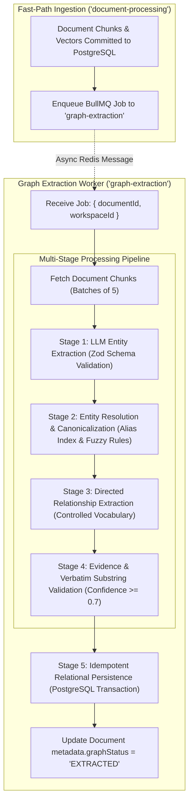
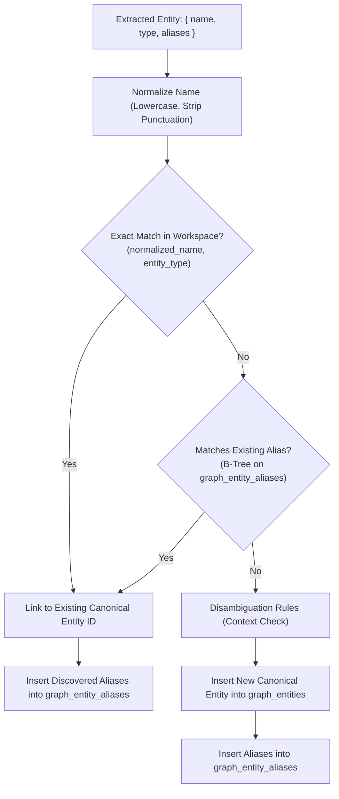
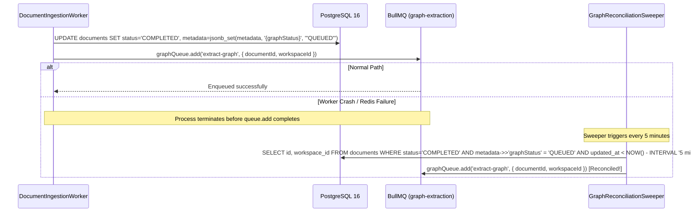

# MindVault — Phase 6: Knowledge Graph Extraction Pipeline Architecture

**Document Version:** 1.0.0  
**Status:** Pipeline Specification (Planning Only)  
**Target Subsystem:** Asynchronous BullMQ Worker, LLM Extraction Engine, Entity Canonicalizer  
**Authors:** Senior Backend Engineer, GraphRAG Systems Engineer  
**Date:** November 2026

---

## 1. Asynchronous Extraction Pipeline Flow

Graph extraction executes strictly in the background via BullMQ without blocking the fast-path document ingestion pipeline. When chunks and vectors are committed to PostgreSQL, a child job is enqueued to the `'graph-extraction'` queue.



---

## 2. Multi-Stage Pipeline Specification

### Stage 1: Structured Entity Extraction

- **Input:** Text chunk content, document metadata, section headings.
- **Engine:** LLM via `LLMProvider` (Google Gemini 2.5 Flash in production or Ollama Qwen 2.5 local).
- **Enforcement:** Structured JSON output schema enforced and validated by Zod:

```typescript
import { z } from 'zod';

export const EntityTypeEnum = z.enum([
  'TECHNOLOGY',
  'CONCEPT',
  'PERSON',
  'ORGANIZATION',
  'PRODUCT',
  'LOCATION',
  'OTHER',
]);

export const ExtractedEntitySchema = z.object({
  name: z.string().trim().min(2).max(100),
  entityType: EntityTypeEnum,
  description: z.string().trim().max(300).optional(),
  aliases: z.array(z.string().trim()).default([]),
  confidence: z.number().min(0.0).max(1.0).default(0.85),
});

export const EntityExtractionResponseSchema = z.object({
  entities: z.array(ExtractedEntitySchema),
});
```

- **Extraction Prompt Engineering:**
  The system prompt strictly commands the model:
  1. Extract only high-value, domain-specific concepts, technologies, people, organizations, and products.
  2. Reject meaningless generic words (_"data"_, _"information"_, _"system"_, _"process"_, _"details"_).
  3. Detect acronyms and attach them to the `aliases` array (e.g. `name: "Reciprocal Rank Fusion", aliases: ["RRF"]`).

### Stage 2: Entity Resolution & Canonicalization

Extracted entities must be mapped to workspace-level canonical entities in `graph_entities` to avoid knowledge fragmentation.



#### Canonicalization Algorithm:

1. **String Normalization:**
   ```typescript
   export function normalizeEntityName(name: string): string {
     return name
       .toLowerCase()
       .replace(/^(the|a|an)\s+/i, '')
       .replace(/[^a-z0-9\s-]/g, '')
       .replace(/\s+/g, ' ')
       .trim();
   }
   ```
2. **Lookup Strategy:**
   - Step A: `SELECT id FROM graph_entities WHERE workspace_id = $1 AND normalized_name = $2 AND entity_type = $3`
   - Step B: If not found, lookup normalized alias:
     ```sql
     SELECT entity_id AS id FROM graph_entity_aliases
     WHERE workspace_id = $1 AND normalized_alias = $2;
     ```
   - Step C: If found, insert any newly discovered aliases into `graph_entity_aliases`:
     ```sql
     INSERT INTO graph_entity_aliases (
         id, workspace_id, entity_id, alias, normalized_alias, alias_type, created_at
     ) VALUES ($1, $2, $3, $4, $5, 'SYNONYM', NOW())
     ON CONFLICT (workspace_id, normalized_alias) DO NOTHING;
     ```
   - Step D: If not found, insert a new canonical entity record into `graph_entities`, and then record its aliases in `graph_entity_aliases`.

### Stage 3: Directed Relationship Extraction

Once entities in a chunk have been resolved to canonical IDs, relationships are extracted between co-occurring entities.

- **Controlled Relationship Vocabulary:**
  Relationships are categorized using a standard semantic taxonomy:
  - `USES` / `DEPENDS_ON`: Functional dependency (e.g. _"BullMQ uses Redis"_)
  - `IMPLEMENTS` / `EXTENDS`: Technical implementation (e.g. _"pgvector implements HNSW"_)
  - `PART_OF` / `CONTAINS`: Composition (e.g. _"Attention is part of Transformer"_)
  - `CAUSES` / `PREVENTS`: Causal interaction (e.g. _"High learning rate causes instability"_)
  - `COMPARED_TO`: Evaluative comparison (e.g. _"PostgreSQL compared to MySQL"_)
  - `CREATED_BY` / `MAINTAINED_BY`: Provenance (e.g. _"PyTorch created by Meta"_)
  - `CUSTOM`: Domain-specific relation requiring text description

- **Structured Relation Schema:**

```typescript
export const ExtractedRelationSchema = z.object({
  sourceEntityName: z.string().trim(),
  targetEntityName: z.string().trim(),
  relationType: z.string().trim().toUpperCase(),
  description: z.string().trim().max(300),
  evidenceText: z.string().trim().min(10).max(500),
  confidence: z.number().min(0.0).max(1.0).default(0.8),
});
```

### Stage 4: Verbatim Evidence & Substring Validation

To prevent LLM hallucination and ensure strict RAG grounding:

1. **Substring Verification:** The pipeline verifies that `evidenceText` exists as an exact or fuzzy substring within the source chunk's `content`:
   ```typescript
   export function validateEvidenceInChunk(chunkContent: string, evidenceText: string): boolean {
     const normalizedChunk = chunkContent.toLowerCase().replace(/\s+/g, ' ');
     const normalizedEvidence = evidenceText.toLowerCase().replace(/\s+/g, ' ');
     return normalizedChunk.includes(normalizedEvidence);
   }
   ```
2. **Confidence Threshold:** Any relationship with `confidence < 0.70` is dropped.
3. **Endpoint Validation:** Both `sourceEntityName` and `targetEntityName` must resolve to valid canonical entities present in the workspace. Self-loops (`source == target`) are discarded.

### Stage 5: Idempotent Relational Persistence

Persistence is executed inside an atomic PostgreSQL transaction:

1. Insert entity mentions into `chunk_entity_mentions`.
2. Upsert relationships into `graph_relations`:
   ```sql
   INSERT INTO graph_relations (
       id, workspace_id, source_entity_id, target_entity_id, relation_type,
       description, weight, confidence, metadata, created_at, updatedAt
   ) VALUES ($1, $2, $3, $4, $5, $6, $7, $8, $9, NOW(), NOW())
   ON CONFLICT (workspace_id, source_entity_id, target_entity_id, relation_type)
   DO UPDATE SET
       confidence = GREATEST(graph_relations.confidence, EXCLUDED.confidence),
       description = COALESCE(EXCLUDED.description, graph_relations.description),
       updated_at = NOW()
   RETURNING id;
   ```
3. Insert supporting evidence into `relation_evidence`:
   ```sql
   INSERT INTO relation_evidence (
       id, workspace_id, relation_id, chunk_id, document_id, evidence_text, confidence, created_at
   ) VALUES ($1, $2, $3, $4, $5, $6, $7, NOW())
   ON CONFLICT (workspace_id, relation_id, chunk_id) DO NOTHING;
   ```

---

## 3. Worker Concurrency, Retries & Error Handling

| Configuration Parameter    | Value                          | Rationale                                                                        |
| -------------------------- | ------------------------------ | -------------------------------------------------------------------------------- |
| **Queue Name**             | `'graph-extraction'`           | Isolated from `'document-processing'` to prevent queue contention                |
| **Worker Concurrency**     | `2`                            | Bounded to prevent overloading local Ollama or triggering Gemini API rate limits |
| **Chunk Batch Size**       | `5 chunks`                     | Limits memory footprint and per-turn LLM token consumption                       |
| **Job Attempts / Retries** | `3`                            | Handles transient LLM network timeouts                                           |
| **Backoff Strategy**       | Exponential (`delay = 5000ms`) | Avoids hammering failing services                                                |
| **Lock Duration**          | `60,000ms (1 min)`             | Provides sufficient headroom for multi-chunk extraction                          |

### Failed-Job Recovery

If a graph extraction job fails after 3 retries:

1. The error message is recorded in `documents.metadata.graphError`.
2. `documents.metadata.graphStatus` is set to `'FAILED'`.
3. Normal vector and keyword search for the document **remains fully functional**.
4. An admin can trigger a re-extraction via `POST /api/graph/reindex/:documentId`.

---

## 4. Transactional Outbox State & Self-Healing Reconciliation Sweeper

To close the failure window between document ingestion completion and BullMQ dispatch:



The sweeper is registered as a repeatable BullMQ job (`every: 300_000` ms) in `apps/worker/src/worker.ts`, guaranteeing that no document ever remains unprocessed due to transient process failures.
