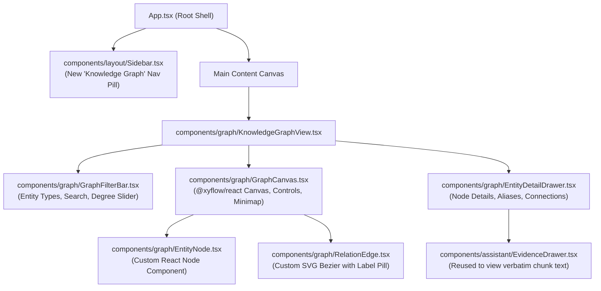

# MindVault — Phase 6: Frontend Knowledge Graph Experience & UI/UX Design

**Document Version:** 1.0.0  
**Status:** Frontend Design Specification (Planning Only)  
**Target Module:** `apps/web/src/components/graph/`  
**Design Direction:** Seamless Warm Cream (`#F7F5F0`) & Dark Graphite (`#171816`)  
**Visualization Engine:** `@xyflow/react` (React Flow v12)  
**Authors:** Senior Frontend Architect, Principal Product Designer  
**Date:** November 2026

---

## 1. Graph Visualization Engine Evaluation & Selection

Three candidate visualization engines were evaluated against MindVault's architectural requirements:

| Evaluation Criteria                | `@xyflow/react` (React Flow v12)                       | Cytoscape.js                                 | D3-force (Custom SVG Canvas)            |
| ---------------------------------- | ------------------------------------------------------ | -------------------------------------------- | --------------------------------------- |
| **React 18 & Fiber Compatibility** | **Native** (First-class React components)              | Requires manual imperative DOM bridge        | Requires custom React canvas wrappers   |
| **Theme System Integration**       | **Seamless** (Uses CSS variables & Tailwind classes)   | Canvas style strings; awkward theme toggling | Manual SVG re-rendering on theme change |
| **Custom Node Rendering**          | **HTML/JSX Components** (Rich badges, icons, tooltips) | Limited SVG/Canvas primitives                | Complex manual SVG path layout          |
| **TypeScript Ergonomics**          | **Complete** (Strict generic types for Nodes/Edges)    | Decent `@types/cytoscape`                    | Low-level untyped D3 force simulations  |
| **Pan, Zoom & Viewport**           | Built-in GPU-accelerated transforms & Minimap          | Built-in                                     | Requires custom `d3-zoom` wiring        |
| **Bundle Size Overhead**           | ~45 kB gzipped                                         | ~80 kB gzipped                               | ~35 kB gzipped                          |

### Architecture Verdict: `@xyflow/react` (React Flow)

`@xyflow/react` is selected as the primary graph engine. Its ability to render **native React JSX components as graph nodes** allows MindVault to reuse existing Tailwind design tokens, typography, and theme contexts without maintaining an imperative canvas rendering pipeline.

---

## 2. Dual-Theme Visual Specifications

The graph canvas strictly respects the **Warm Cream** and **Dark Graphite** design language:

```css
/* Warm Cream Theme Graph Tokens */
.theme-cream .graph-canvas {
  --graph-bg: #f7f5f0;
  --graph-node-bg: #fbfaf7;
  --graph-node-border: #e5e2da;
  --graph-node-hover: #f0eee8;
  --graph-text-primary: #252521;
  --graph-text-secondary: #77766f;
  --graph-edge-stroke: #c9c4b8;
  --graph-edge-highlight: #8b7860;
}

/* Dark Graphite Theme Graph Tokens */
.theme-graphite .graph-canvas {
  --graph-bg: #171816;
  --graph-node-bg: #20211e;
  --graph-node-border: #353630;
  --graph-node-hover: #292a26;
  --graph-text-primary: #ecece6;
  --graph-text-secondary: #a3a39a;
  --graph-edge-stroke: #454640;
  --graph-edge-highlight: #b8a68b;
}
```

### Entity Category Color Accents (Low Saturation)

To preserve the calm aesthetic, entity types use subtle background tints and borders rather than neon colors:

- **`TECHNOLOGY`:** Amber Sand (`#D4A373`)
- **`CONCEPT`:** Slate Sage (`#839788`)
- **`ORGANIZATION`:** Muted Ochre (`#BFB59E`)
- **`PERSON`:** Warm Clay (`#C47E5A`)
- **`PRODUCT`:** Soft Ash (`#9A8C98`)

---

## 3. Component Hierarchy & User Flow



---

## 4. Key Component Design

### 4.1 Knowledge Graph Explorer (`KnowledgeGraphView.tsx`)

- **Empty State:** Minimalist prompt inviting user to upload documents or select a seed entity.
- **Header Controls:** Search bar with auto-complete for canonical entities; entity type filter tags (`Technology`, `Concept`, etc.); layout reset button.
- **Viewport Layout:** Full-bleed interactive canvas with bottom-right floating zoom/pan controls and minimap.

### 4.2 Custom Entity Node (`EntityNode.tsx`)

Rendered as an elegant pill container:

- Top: Category icon and entity type badge (e.g., `TECHNOLOGY`).
- Center: Canonical entity name in bold charcoal typography.
- Bottom: Degree counter indicator (e.g., `14 connections`).
- Interactive States: Hover elevates subtle shadow; selected state displays a brass focus outline (`#8B7860` / `#B8A68B`).

### 4.3 Custom Relationship Edge (`RelationEdge.tsx`)

- Curved Bezier edge with directional arrow marker.
- Midpoint Label Badge: Small rounded pill displaying `relationType` (e.g., `USES`, `IMPLEMENTS`).
- Clicking the edge label opens the `EvidenceDrawer` displaying verbatim supporting passages.

### 4.4 Entity Detail Drawer (`EntityDetailDrawer.tsx`)

Slide-over drawer from the right side displaying:

1. **Canonical Header:** Name, category badge, and synthesized description.
2. **Known Aliases:** Tag list (e.g., `["Postgres", "pg16"]`).
3. **Connection Explorer:** List of incoming and outgoing relationships with 1-click **"Expand Neighborhood"** actions.
4. **Supporting Documents:** List of documents asserting relations involving this entity.

---

## 5. Graph-Aware Conversational Assistant Integration

The conversational chat interface ([`AssistantView.tsx`](file:///c:/Users/mohit/OneDrive/Desktop/MindVault/apps/web/src/components/assistant/AssistantView.tsx)) is deeply connected to the knowledge graph:

### 5.1 Discrete Graph Citations (`[G1]`, `[G2]`)

- When the assistant outputs relation citations (e.g., `[G1]`), [`MessageItem.tsx`](file:///c:/Users/mohit/OneDrive/Desktop/MindVault/apps/web/src/components/assistant/MessageItem.tsx) renders a distinct brass pill badge (contrasting with standard chunk citation badges `[S1]`).
- Clicking `[G1]` opens the `EvidenceDrawer` with the header **"Knowledge Graph Relationship"**, showing the exact source and target entities, relation type, and verbatim chunk quotation.

### 5.2 Multi-Hop Path Visualizer in Chat

- For responses synthesizing multi-document paths, an inline collapsible pill is rendered above the message:  
  `🔗 Multi-Hop Path: (Machine Learning) -> (Neural Networks) -> (Deep Learning) -> (Image Recognition)`
- Clicking the pill navigates the user directly to the **Knowledge Graph Explorer** with the discovered path highlighted and centered in the viewport.
