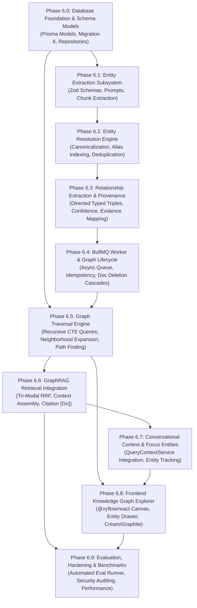

# MindVault — Phase 6: Implementation Plan & Sub-Phase Roadmap

**Document Version:** 1.0.0  
**Status:** Implementation Roadmap (Planning Only)  
**Execution Sequence:** Sub-Phases 6.0 through 6.9  
**Authors:** Principal Software Architect, Senior Backend Engineer, Lead DevOps Engineer  
**Date:** November 2026

---

## 1. Sub-Phase Dependency Graph

---

## 2. Detailed Sub-Phase Specifications

### Phase 6.0: Graph Architecture and Database Foundation

- **Objective:** Establish the relational database schema, Prisma models, constraints, and repository abstractions for entities, normalized aliases, relations, entity mentions, and relation evidence with strict multi-tenant isolation.
- **Existing Modules to Reuse:**
  - Database Client: [`apps/api/src/lib/db.ts`](file:///c:/Users/mohit/OneDrive/Desktop/MindVault/apps/api/src/lib/db.ts) (interfaces and Prisma instance)
  - Prisma Schema: [`prisma/schema.prisma`](file:///c:/Users/mohit/OneDrive/Desktop/MindVault/prisma/schema.prisma)
  - Migration sequence: [`prisma/migrations/`](file:///c:/Users/mohit/OneDrive/Desktop/MindVault/prisma/migrations/)
- **New Modules & Proposed Paths:**
  - `apps/api/src/modules/graph/repositories/graph.repository.ts`
  - `apps/api/src/modules/graph/repositories/graph.repository.interface.ts`
  - `prisma/migrations/20261107120000_knowledge_graph_schema/migration.sql`
- **Database Changes:**
  - Add compound unique constraints `@@unique([workspaceId, id])` and `@@unique([workspaceId, documentId, id])` to existing `document_chunks`.
  - Create tables `graph_entities`, `graph_entity_aliases`, `graph_relations`, `chunk_entity_mentions`, and `relation_evidence`.
  - Enforce composite foreign keys `FOREIGN KEY (workspace_id, ...)` ensuring 100% database-level multi-tenant isolation.
- **API Contracts:** None (data access layer only).
- **Worker Changes:** None.
- **Frontend Changes:** None.
- **Tests:** `apps/api/src/modules/graph/__tests__/graph.repository.test.ts` (CRUD, tenant scoping, composite foreign key isolation test, cascade deletion).
- **Acceptance Criteria:** Prisma client generates successfully; migration applies cleanly on PostgreSQL 16; repository unit tests pass with cross-tenant insertion throwing SQL 23503 error.
- **Dependencies:** Active PostgreSQL with pgvector container.
- **Risks:** Foreign key locking on massive document deletions if indexes are missing.
- **Completion Evidence:** `pnpm db:migrate` applies cleanly; `pnpm test` passes repository tests.

---

### Phase 6.1: Entity Extraction Subsystem

- **Objective:** Implement structured LLM-based entity extraction from text chunks using Zod schema validation.
- **Existing Modules to Reuse:**
  - LLM Provider Factory: [`apps/api/src/modules/generation/providers/provider.factory.ts`](file:///c:/Users/mohit/OneDrive/Desktop/MindVault/apps/api/src/modules/generation/providers/provider.factory.ts)
  - Provider Abstraction: `LLMProvider` interface in `@mindvault/shared`
  - Token Normalization: [`apps/worker/src/modules/ingestion/normalization/text.normalizer.ts`](file:///c:/Users/mohit/OneDrive/Desktop/MindVault/apps/worker/src/modules/ingestion/normalization/text.normalizer.ts)
- **New Modules & Proposed Paths:**
  - `packages/shared/src/schemas/graph.schema.ts` (Zod schemas for extracted entities)
  - `apps/worker/src/modules/graph/extraction/entity-extractor.ts`
  - `apps/worker/src/modules/graph/prompts/entity-extraction.prompt.ts`
- **Database Changes:** None.
- **API Contracts:** Export `ExtractedEntityDto`, `EntityTypeEnum` from `@mindvault/shared`.
- **Worker Changes:** Unit services created in worker module.
- **Frontend Changes:** None.
- **Tests:** `apps/worker/src/modules/graph/__tests__/entity-extractor.test.ts` (Structured JSON parsing, schema validation, fallback on malformed LLM responses).
- **Acceptance Criteria:** Correctly extracts typed entities (`TECHNOLOGY`, `CONCEPT`, `PERSON`, `ORGANIZATION`, etc.) with high precision; rejects stop-words and generic descriptors.
- **Dependencies:** Phase 6.0 schema types.
- **Risks:** LLM output format inconsistency; mitigated via strict JSON mode and Zod safe parsing.
- **Completion Evidence:** Unit tests verify extraction across diverse document text samples.

---

### Phase 6.2: Entity Resolution & Canonicalization

- **Objective:** Deduplicate and resolve entity variants, acronyms, and synonyms to canonical workspace entities using the normalized `graph_entity_aliases` table.
- **Existing Modules to Reuse:**
  - QueryContext String Cleaners: [`apps/api/src/modules/conversations/services/query-context.service.ts`](file:///c:/Users/mohit/OneDrive/Desktop/MindVault/apps/api/src/modules/conversations/services/query-context.service.ts)
  - Embedding Provider: [`apps/worker/src/modules/ingestion/embeddings/index.ts`](file:///c:/Users/mohit/OneDrive/Desktop/MindVault/apps/worker/src/modules/ingestion/embeddings/index.ts)
- **New Modules & Proposed Paths:**
  - `apps/worker/src/modules/graph/resolution/entity-resolver.ts`
  - `apps/worker/src/modules/graph/resolution/normalization-rules.ts`
- **Database Changes:** Reads and inserts into `graph_entity_aliases` with `UNIQUE (workspace_id, normalized_alias)`.
- **API Contracts:** `EntityResolutionResult` interface in `@mindvault/shared`.
- **Worker Changes:** Entity resolution service integrated into worker ingestion flow.
- **Frontend Changes:** None.
- **Tests:** `apps/worker/src/modules/graph/__tests__/entity-resolver.test.ts` (Exact matching, case folding, punctuation normalization, acronym linking, alias uniqueness enforcement).
- **Acceptance Criteria:** Resolves `"PostgreSQL"`, `"Postgres"`, and `"pg16"` to single canonical entity `"PostgreSQL"` with aliases recorded in `graph_entity_aliases`; throws SQL 23505 on alias collision attempts.
- **Dependencies:** Phase 6.1 entity extraction.
- **Risks:** Over-eager merging of distinct concepts (e.g. merging "Java" and "JavaScript"); mitigated by requiring matching `entityType` and strict similarity boundaries.
- **Completion Evidence:** Test suite verifies zero false merges across standard evaluation confusion sets.

---

### Phase 6.3: Relationship Extraction & Provenance Mapping

- **Objective:** Extract typed, directed relationships between resolved entities, attaching confidence scores and exact chunk provenance.
- **Existing Modules to Reuse:**
  - Text Extraction Chunker: [`apps/worker/src/modules/ingestion/chunking/chunker.ts`](file:///c:/Users/mohit/OneDrive/Desktop/MindVault/apps/worker/src/modules/ingestion/chunking/chunker.ts)
  - LLM Providers: Gemini and Ollama providers
- **New Modules & Proposed Paths:**
  - `apps/worker/src/modules/graph/extraction/relation-extractor.ts`
  - `apps/worker/src/modules/graph/prompts/relation-extraction.prompt.ts`
  - `packages/shared/src/schemas/relation.schema.ts`
- **Database Changes:** None.
- **API Contracts:** Export `ExtractedRelationDto`, `RelationTypeEnum` from `@mindvault/shared`.
- **Worker Changes:** Relation extraction step in worker pipeline.
- **Frontend Changes:** None.
- **Tests:** `apps/worker/src/modules/graph/__tests__/relation-extractor.test.ts` (Triple validation, relationship classification, self-loop prevention).
- **Acceptance Criteria:** Extracts valid triples `(Subject, Relation, Object)` where both endpoints exist as resolved entities in the chunk.
- **Dependencies:** Phase 6.1, Phase 6.2.
- **Risks:** Hallucinated relationships not supported by the chunk; mitigated by verifying that evidence text matches an exact substring of the chunk content.
- **Completion Evidence:** 100% of persisted relations have verifiable matching evidence text.

---

### Phase 6.4: BullMQ Worker & Graph Lifecycle

- **Objective:** Connect graph extraction to the asynchronous BullMQ pipeline, implement self-healing job reconciliation, and enforce document lifecycle rules (deletion cascades, re-indexing, orphan pruning invariants).
- **Existing Modules to Reuse:**
  - Worker Pipeline: [`apps/worker/src/modules/ingestion/pipeline.ts`](file:///c:/Users/mohit/OneDrive/Desktop/MindVault/apps/worker/src/modules/ingestion/pipeline.ts)
  - Worker Service: [`apps/worker/src/worker.ts`](file:///c:/Users/mohit/OneDrive/Desktop/MindVault/apps/worker/src/worker.ts)
  - Document Queue: [`apps/api/src/modules/document/document.queue.ts`](file:///c:/Users/mohit/OneDrive/Desktop/MindVault/apps/api/src/modules/document/document.queue.ts)
- **New Modules & Proposed Paths:**
  - `apps/worker/src/modules/graph/graph-pipeline.ts`
  - `apps/api/src/modules/graph/graph.queue.ts`
  - `apps/worker/src/modules/graph/processors/graph-extraction.processor.ts`
  - `apps/worker/src/modules/graph/sweepers/graph-reconciliation.sweeper.ts`
- **Database Changes:** Document metadata updated to include `graphStatus: 'QUEUED' | 'PROCESSING' | 'EXTRACTED' | 'FAILED' | 'REPROCESSING'`.
- **API Contracts:** None.
- **Worker Changes:**
  - Ingestion worker atomically transitions document to `graphStatus = 'QUEUED'` in PostgreSQL and immediately dispatches `graphQueue.add('extract-graph', ...)`.
  - Repeatable 5-minute BullMQ reconciliation sweeper scans for stuck `QUEUED` / stale `PROCESSING` documents and re-enqueues them.
  - Background orphan relation cleaner adheres to the **active processing invariant** (postpones pruning if any document in the workspace is currently `PROCESSING` or `REPROCESSING`).
- **Frontend Changes:** None.
- **Tests:** `apps/worker/src/modules/graph/__tests__/lifecycle.integration.test.ts` (End-to-end ingestion, job completion, worker crash reconciliation, document deletion with orphan relation cleanup).
- **Acceptance Criteria:** Document upload completes immediately; stuck jobs reconcile within 5 minutes; deleting a document removes its unique relations while preserving corroborated relations.
- **Dependencies:** Phase 6.0 through 6.3.
- **Risks:** Redis job stalling during long LLM extraction turns; mitigated by processing chunks in bounded batches of 5.
- **Completion Evidence:** Integration test verifies document upload, background extraction, sweeper reconciliation, and clean deletion cascade.

---

### Phase 6.5: Graph Traversal Engine

- **Objective:** Implement high-speed, multi-hop graph neighborhood expansion and path discovery using PostgreSQL Recursive Common Table Expressions (CTEs).
- **Existing Modules to Reuse:**
  - Database Client: [`apps/api/src/lib/db.ts`](file:///c:/Users/mohit/OneDrive/Desktop/MindVault/apps/api/src/lib/db.ts)
- **New Modules & Proposed Paths:**
  - `apps/api/src/modules/graph/services/graph-traversal.service.ts`
  - `apps/api/src/modules/graph/queries/recursive-traversal.sql.ts`
- **Database Changes:** None.
- **API Contracts:** `GraphPathDto`, `GraphNeighborhoodDto` exported from `@mindvault/shared`.
- **Worker Changes:** None.
- **Frontend Changes:** None.
- **Tests:** `apps/api/src/modules/graph/__tests__/graph-traversal.test.ts` (1-hop, 2-hop, 3-hop traversal, cycle detection, max node limits, path finding).
- **Acceptance Criteria:** Path queries execute in < 25ms for 3-hop traversals over 10,000 edges; cycle detection prevents infinite loops.
- **Dependencies:** Phase 6.0.
- **Risks:** Unbounded recursion causing query timeouts; mitigated by hard recursion depth limit (`depth <= 3`) and statement timeout.
- **Completion Evidence:** Traversal tests pass with deterministic cycle containment and latency benchmarks.

---

### Phase 6.6: GraphRAG Retrieval Integration

- **Objective:** Upgrade the retrieval engine to execute 3-way Reciprocal Rank Fusion (Dense Vector + Sparse Keyword + Graph Traversal) and assemble graph-attributed context.
- **Existing Modules to Reuse:**
  - Retrieval Service: [`apps/api/src/modules/retrieval/services/retrieval.service.ts`](file:///c:/Users/mohit/OneDrive/Desktop/MindVault/apps/api/src/modules/retrieval/services/retrieval.service.ts)
  - RRF Fusion: [`apps/api/src/modules/retrieval/fusion/rrf.fusion.ts`](file:///c:/Users/mohit/OneDrive/Desktop/MindVault/apps/api/src/modules/retrieval/fusion/rrf.fusion.ts)
  - RAG Service: [`apps/api/src/modules/generation/services/rag.service.ts`](file:///c:/Users/mohit/OneDrive/Desktop/MindVault/apps/api/src/modules/generation/services/rag.service.ts)
  - Grounding Service: [`apps/api/src/modules/generation/services/grounding.service.ts`](file:///c:/Users/mohit/OneDrive/Desktop/MindVault/apps/api/src/modules/generation/services/grounding.service.ts)
- **New Modules & Proposed Paths:**
  - `apps/api/src/modules/retrieval/services/graph-retrieval.service.ts`
  - `apps/api/src/modules/generation/prompts/graph-rag.prompt.ts`
- **Database Changes:** None.
- **API Contracts:** `SearchRequest` updated to support mode `'hybrid_graph'` or `'graph'`; `ContextSourceItem` updated to support `retrievalSources: Array<'semantic' | 'keyword' | 'graph'>` and citation prefixes `[G1]`.
- **Worker Changes:** None.
- **Frontend Changes:** None.
- **Tests:** `apps/api/src/modules/generation/__tests__/graph-rag.test.ts` (Tri-modal fusion math, prompt assembly with relationship evidence, citation validation for `[Gn]`).
- **Acceptance Criteria:** Generates grounded answers citing both source documents (`[S1]`) and verified graph relationships (`[G1]`); achieves 100% citation validation.
- **Dependencies:** Phase 6.5, Phase 6.4.
- **Risks:** Context token budget overflow; mitigated by capping graph evidence tokens to 30% of total context budget.
- **Completion Evidence:** Automated RAG evaluation benchmark achieves >= 95% citation validity with graph integration enabled.

---

### Phase 6.7: Conversational Context & Focus Entities

- **Objective:** Enhance conversational RAG to resolve focus entities across multi-turn dialogs and supply them as hints to the graph retrieval engine.
- **Existing Modules to Reuse:**
  - Query Context: [`apps/api/src/modules/conversations/services/query-context.service.ts`](file:///c:/Users/mohit/OneDrive/Desktop/MindVault/apps/api/src/modules/conversations/services/query-context.service.ts)
  - Conversation Service: [`apps/api/src/modules/conversations/services/conversation.service.ts`](file:///c:/Users/mohit/OneDrive/Desktop/MindVault/apps/api/src/modules/conversations/services/conversation.service.ts)
- **New Modules & Proposed Paths:**
  - `apps/api/src/modules/conversations/services/entity-context.service.ts`
- **Database Changes:** None.
- **API Contracts:** None (internal service augmentation).
- **Worker Changes:** None.
- **Frontend Changes:** None.
- **Tests:** `apps/api/src/modules/conversations/__tests__/graph-context.test.ts` (Pronoun resolution to graph entities, focus entity retention across turns, topic return entity reactivation).
- **Acceptance Criteria:** Given Turn 1 discussing _"PostgreSQL"_, a follow-up Turn 2 _"What indexes does it support?"_ resolves the focus entity to `PostgreSQL` and retrieves its outgoing `HAS_INDEX` relations.
- **Dependencies:** Phase 6.6.
- **Risks:** Stale entity carryover after topic switches; mitigated by existing topic-switch detection heuristics.
- **Completion Evidence:** Conversational evaluation benchmark passes 15/15 scenarios with graph context active.

---

### Phase 6.8: Frontend Knowledge Graph Explorer

- **Objective:** Build an interactive graph visualization canvas, entity detail drawer, and evidence inspector styled in Warm Cream and Dark Graphite themes.
- **Existing Modules to Reuse:**
  - Theme Engine: [`apps/web/src/context/ThemeContext.tsx`](file:///c:/Users/mohit/OneDrive/Desktop/MindVault/apps/web/src/context/ThemeContext.tsx) and CSS tokens in `index.css`
  - Assistant Layout: [`apps/web/src/components/assistant/AssistantView.tsx`](file:///c:/Users/mohit/OneDrive/Desktop/MindVault/apps/web/src/components/assistant/AssistantView.tsx)
  - Evidence Drawer: [`apps/web/src/components/assistant/EvidenceDrawer.tsx`](file:///c:/Users/mohit/OneDrive/Desktop/MindVault/apps/web/src/components/assistant/EvidenceDrawer.tsx)
- **New Modules & Proposed Paths:**
  - `apps/web/src/components/graph/KnowledgeGraphView.tsx`
  - `apps/web/src/components/graph/GraphCanvas.tsx` (using `@xyflow/react`)
  - `apps/web/src/components/graph/EntityDetailDrawer.tsx`
  - `apps/web/src/components/graph/GraphFilterBar.tsx`
  - `apps/web/src/hooks/useKnowledgeGraph.ts`
- **Database Changes:** None.
- **API Contracts:** Consume `/api/graph/entities`, `/api/graph/entities/:id/neighborhood`, `/api/graph/relations/:id/evidence`.
- **Worker Changes:** None.
- **Frontend Changes:** Add `"Knowledge Graph"` tab and icon to [`Sidebar.tsx`](file:///c:/Users/mohit/OneDrive/Desktop/MindVault/apps/web/src/components/layout/Sidebar.tsx); render `[G1]` citations as clickable graph pills in [`MessageItem.tsx`](file:///c:/Users/mohit/OneDrive/Desktop/MindVault/apps/web/src/components/assistant/MessageItem.tsx).
- **Tests:** Component interaction tests using Vitest and React Testing Library.
- **Acceptance Criteria:** Graph renders seamlessly in both Warm Cream and Dark Graphite; clicking an entity node expands its neighborhood; clicking a relation displays verified source chunk evidence.
- **Dependencies:** Phase 6.5 API endpoints.
- **Risks:** Performance degradation on graphs with > 500 nodes; mitigated by viewport node clustering and server-side top-k neighborhood limits.
- **Completion Evidence:** `pnpm build` bundles cleanly; manual UI verification passes across both themes.

---

### Phase 6.9: GraphRAG Evaluation, Hardening & Benchmarks

- **Objective:** Implement quantitative GraphRAG evaluation runner (`pnpm evaluate:graph`), execute security penetration tests, and benchmark latency.
- **Existing Modules to Reuse:**
  - Retrieval Evaluation: [`apps/api/src/modules/retrieval/evaluation/eval.runner.ts`](file:///c:/Users/mohit/OneDrive/Desktop/MindVault/apps/api/src/modules/retrieval/evaluation/eval.runner.ts)
  - RAG Evaluation: [`apps/api/src/modules/generation/evaluation/rag.eval.runner.ts`](file:///c:/Users/mohit/OneDrive/Desktop/MindVault/apps/api/src/modules/generation/evaluation/rag.eval.runner.ts)
  - Conversation Evaluation: [`apps/api/src/modules/conversations/evaluation/conversation.eval.runner.ts`](file:///c:/Users/mohit/OneDrive/Desktop/MindVault/apps/api/src/modules/conversations/evaluation/conversation.eval.runner.ts)
- **New Modules & Proposed Paths:**
  - `apps/api/src/modules/graph/evaluation/graph.eval.dataset.ts`
  - `apps/api/src/modules/graph/evaluation/graph.eval.runner.ts`
  - Root script in `package.json`: `"graph:evaluate": "pnpm --filter @mindvault/api evaluate:graph"`
- **Database Changes:** None.
- **API Contracts:** None.
- **Worker Changes:** None.
- **Frontend Changes:** None.
- **Tests:** 15 multi-hop benchmark scenarios covering entity resolution, 2-hop reasoning, cross-document relationship discovery, and adversarial injection containment.
- **Acceptance Criteria:** Graph-augmented hybrid retrieval demonstrates higher Recall@5 and answer faithfulness than vector-only baseline on relational queries.
- **Dependencies:** Complete Phase 6.0 - 6.8 stack.
- **Risks:** End-to-end latency regressions; mitigated by strict timeout controls on graph traversal.
- **Completion Evidence:** `pnpm graph:evaluate` runs cleanly with 15/15 scenarios passing.
