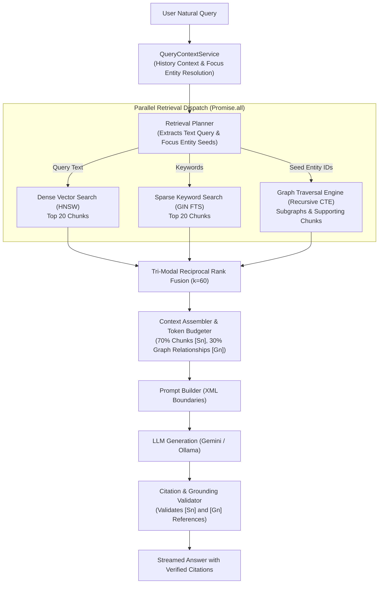

# MindVault — Phase 6: Knowledge Graph Retrieval Engine & Tri-Modal RRF

**Document Version:** 1.0.0  
**Status:** Retrieval Architecture Specification (Planning Only)  
**Target Subsystem:** Retrieval Engine, Tri-Modal RRF, Context Assembler, Grounding Validator  
**Authors:** Principal RAG Architect, Senior Systems Engineer  
**Date:** November 2026

---

## 1. Tri-Modal Retrieval Flow

The MindVault retrieval pipeline is upgraded from 2-way hybrid search (Dense Vector + Sparse Keyword) to **Tri-Modal Fusion**, integrating relational graph traversal as an equal first-class retrieval modality.



---

## 2. Tri-Modal Reciprocal Rank Fusion (RRF)

### 2.1 Mathematical Formulation

The standard Reciprocal Rank Fusion formula is extended to three independent retrieval candidate lists:

$$\text{RRF Score}(d) = \sum_{m \in \{\text{dense}, \text{sparse}, \text{graph}\}} \frac{1}{k + \text{rank}_m(d)}$$

Where:

- $k = 60$ (smoothing constant, preventing top-ranked outliers from dominating the distribution).
- $\text{rank}_m(d)$ is the 1-indexed rank of candidate chunk $d$ in retrieval modality $m$.
- If candidate $d$ does not appear in modality $m$, its rank contribution for that modality is $0$.

### 2.2 Numerical Demonstration of Tri-Modal Fusion

Consider three chunks evaluated across the three retrieval streams:

- **Chunk 101:** Highly relevant to exact keywords, moderate vector similarity, not present in graph paths.
- **Chunk 204:** Moderate vector similarity, moderate keyword rank, but is the **primary supporting evidence** for an extracted relationship connecting the query entities.
- **Chunk 308:** Appears only in the graph traversal path as an intermediate bridge.

| Chunk ID      | Dense Rank ($\text{rank}_{\text{dense}}$) | Sparse Rank ($\text{rank}_{\text{sparse}}$) | Graph Rank ($\text{rank}_{\text{graph}}$) | Mathematical RRF Calculation                                                     | Final RRF Score | Final Rank        |
| ------------- | ----------------------------------------- | ------------------------------------------- | ----------------------------------------- | -------------------------------------------------------------------------------- | --------------- | ----------------- |
| **Chunk 204** | Rank 3                                    | Rank 4                                      | Rank 1                                    | $\frac{1}{60+3} + \frac{1}{60+4} + \frac{1}{60+1} = 0.01587 + 0.01562 + 0.01639$ | **0.04788**     | **#1 (Top Pick)** |
| **Chunk 101** | Rank 1                                    | Rank 2                                      | Not Present                               | $\frac{1}{60+1} + \frac{1}{60+2} + 0 = 0.01639 + 0.01613$                        | **0.03252**     | **#2**            |
| **Chunk 308** | Not Present                               | Not Present                                 | Rank 2                                    | $0 + 0 + \frac{1}{60+2} = 0.01613$                                               | **0.01613**     | **#3**            |

_Analysis:_ Chunk 204 achieves the highest score because it is independently corroborated across all three modalities. Chunk 101 retains a high position due to dense/sparse relevance, while Chunk 308 enters the candidate pool to provide the structural reasoning link.

### 2.3 Graph Path to Supporting Chunk Mapping Algorithm

Because RRF fuses discrete candidates at the document chunk level, graph relationships and multi-hop traversal paths must be deterministically mapped to chunk candidates before ranking:

1. **Path Traversal:** The recursive CTE returns edge paths: $E_1 \xrightarrow{R_1} E_2 \xrightarrow{R_2} \dots \xrightarrow{R_n} E_{n+1}$.
2. **Evidence Chunk Extraction:** For each relationship $R_i$ along the path at depth $h \in [1, 3]$, fetch all supporting chunks from `relation_evidence`:
   ```sql
   SELECT chunk_id, document_id, evidence_text, confidence
   FROM relation_evidence
   WHERE workspace_id = $1 AND relation_id = $2;
   ```
3. **Hop-Discounted Scoring:** Assign a raw graph relevance score to each chunk $c$:
   $$\text{Score}_{\text{graph}}(c) = \max_{R \in \text{path}(c)} \left( \frac{\text{confidence}(R)}{\text{hop\_depth}(R)} \right)$$
   Direct 1-hop evidence carries full weight ($\frac{\text{conf}}{1}$); 2-hop bridge evidence is scaled by $\frac{1}{2}$; 3-hop is scaled by $\frac{1}{3}$.
4. **Graph Ranking:** Deduplicate chunks and sort descending by $\text{Score}_{\text{graph}}(c)$, assigning sequential ranks: $\text{rank}_{\text{graph}}(c) \in [1, 20]$.
5. **Tri-Modal Fusion:** Pass the ranked chunk candidates into `ReciprocalRankFusion.fuse`.

---

## 3. Backward-Compatible RRF Service Architecture

To prevent breaking existing callers in [`apps/api/src/modules/retrieval/`](file:///c:/Users/mohit/OneDrive/Desktop/MindVault/apps/api/src/modules/retrieval/), `ReciprocalRankFusion.fuse` is overloaded:

```typescript
export interface GraphRetrievalResult {
  chunk: {
    id: string;
    documentId: string;
    content: string;
    chunkIndex: number;
    tokenCount: number;
    pageStart: number | null;
    pageEnd: number | null;
    metadata: Record<string, unknown>;
  };
  document: {
    originalName: string;
    extension: string;
  };
  score: number;
  relationId?: string;
  relationType?: string;
}

export class ReciprocalRankFusion {
  public static readonly DEFAULT_K = 60;

  /**
   * Overloaded signature: Backward-compatible 2-way fusion
   */
  public static fuse(
    semanticResults: SearchChunkResult[],
    keywordResults: SearchChunkResult[],
    options?: FusionOptions,
  ): FusedCandidate[];

  /**
   * Full signature: Tri-modal fusion (dense + sparse + graph)
   */
  public static fuse(
    semanticResults: SearchChunkResult[],
    keywordResults: SearchChunkResult[],
    graphResults?: GraphRetrievalResult[],
    options?: FusionOptions,
  ): FusedCandidate[] {
    const k = options?.k ?? this.DEFAULT_K;
    const topK = options?.topK ?? 10;
    const candidateMap = new Map<string, FusedCandidate>();

    // Process Semantic Results (rank_dense)
    semanticResults.forEach((item, idx) => {
      this.accumulateCandidate(
        candidateMap,
        item.chunk,
        item.document,
        'semantic',
        idx + 1,
        item.score,
        k,
      );
    });

    // Process Keyword Results (rank_sparse)
    keywordResults.forEach((item, idx) => {
      this.accumulateCandidate(
        candidateMap,
        item.chunk,
        item.document,
        'keyword',
        idx + 1,
        item.score,
        k,
      );
    });

    // Process Graph Evidence Results (rank_graph)
    if (graphResults) {
      graphResults.forEach((item, idx) => {
        this.accumulateCandidate(
          candidateMap,
          item.chunk,
          item.document,
          'graph',
          idx + 1,
          item.score,
          k,
        );
      });
    }

    // Sort descending by rrfScore and assign 1-based ranks
    return Array.from(candidateMap.values())
      .sort((a, b) => b.rrfScore - a.rrfScore)
      .slice(0, topK)
      .map((item, idx) => ({ ...item, rank: idx + 1 }));
  }
}
```

---

## 4. Graph-Augmented Context Assembly & Prompt Boundaries

### 4.1 Token Budget Allocation

The context assembler enforces strict token budgeting to prevent exceeding context window limits:

- Total Context Budget: Default **3,000 tokens**.
- **Chunk Evidence Budget:** 70% (~2,100 tokens) for top fused chunks (`[S1]`, `[S2]`).
- **Graph Relationship Budget:** 30% (~900 tokens) for explicit relational paths and entity summaries (`[G1]`, `[G2]`).

### 4.2 Context Boundary Representation

The assembled prompt explicitly formats both modalities within untrusted XML boundaries:

```xml
<context>
<retrieved_documents>
[S1] Document: Deep_Learning_Handbook.pdf (Chunk 12)
Convolutional Neural Networks (CNNs) specialize in grid-like topological data such as image recognition...

[S2] Document: AI_Architecture_Guide.pdf (Chunk 45)
Machine learning workflows rely on neural networks for non-linear feature transformation...
</retrieved_documents>

<knowledge_graph_relationships>
[G1] Relationship: (Machine Learning) --[USES]--> (Neural Networks)
Supporting Document: AI_Architecture_Guide.pdf (Confidence: 0.94)

[G2] Relationship: (Neural Networks) --[FUNDAMENTAL_TO]--> (Deep Learning) --[INCLUDES]--> (CNN)
Supporting Documents: Deep_Learning_Handbook.pdf, Neural_Nets_Overview.pdf (Confidence: 0.89)
</knowledge_graph_relationships>
</context>
```

---

## 5. Discrete Citation Validation (`[Sn]` vs `[Gn]`)

The generation engine distinguishes between document citations (`[Sn]`) and graph relationship citations (`[Gn]`):

- **`[Sn]` Citation:** Asserts factual claims backed by a verbatim document chunk.
- **`[Gn]` Citation:** Asserts structural relationships connecting multiple entities.

### Validation Engine Enhancements:

`CitationValidatorService` parses both citation formats and verifies grounding:

1. `validateDocumentCitations(answerText, sources)` ensures every `[Sn]` points to an existing `citationId` in the retrieved chunk context.
2. `validateGraphCitations(answerText, graphRelations)` ensures every `[Gn]` points to an existing relationship verified in the `<knowledge_graph_relationships>` block.
3. If an answer includes hallucinated markers (e.g., model generates `[G5]` when only `[G1]` and `[G2]` were supplied), the grounding status is demoted to `UNGROUNDED_CITATIONS`.
